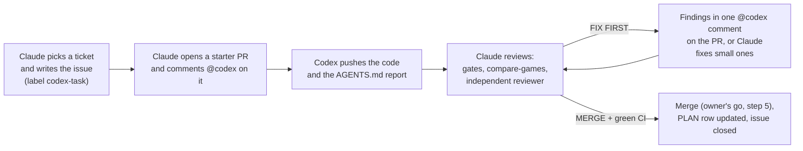

# Handing tickets to Codex

Codex Cloud implements some bounded tickets so Claude spends its time on specs, design and review. Started 2026-10-23. Codex runs on the owner's ChatGPT plan. Manual steps: connect the repository in Codex once (chatgpt.com/codex, setup script `npm ci`), and, while the `@codex` comment is not answered (see step 2), start each task with one line in the Codex chat.

## The loop

1. **Issue.** Claude writes it from the `Codex task` template (`.github/ISSUE_TEMPLATE/codex-task.yml`): the spec ticket it implements, expected behaviour, acceptance criteria, required tests, the files in and out of scope, constraints and what the PR must report. Title `[codex] <ticket id>: <short name>`. An issue with the `codex-task` label that is open is **taken**: Claude's own builders skip that ticket.
2. **Hand-off (automatic).** Claude makes a branch `codex/<ticket>` from `main` with one starter commit (the ticket's PLAN row marked "In progress (Codex, #N)"), opens a draft PR whose body starts with `Closes #N`, and comments on it: `@codex Implement issue #N (its full text is in this PR's description) on this branch, following AGENTS.md. Use <tier>.` Codex reads `AGENTS.md` at the repo root for the rules, gates and report format. OpenAI's GitHub integration page (https://learn.chatgpt.com/docs/third-party/github, read 2026-10-23) documents `@codex` only in pull request comments, hence the starter PR. Starter PR title: `<ticket id>: <short name> (Codex)`.
   **While `@codex` is refused** (since 2026-10-23 the bot answers "create an environment for this repo" although the environment is published; the owner has asked OpenAI support), the owner starts the task from the Codex chat with one line instead of the comment: `Implement PR #<starter PR> in Fr3nchyz/3reich: the task is in its description. Follow AGENTS.md, push to its branch, post the report as a PR comment.` Claude gives the owner that line with the PR number. This route delivered #134 and #135. Claude stops posting `@codex` comments until support answers.
3. **Codex works** on that branch and pushes its commits there, then writes its report (the `AGENTS.md` sections) as a PR comment or in the PR body.
4. **Review by Claude**, the same bar as any builder's PR (CLAUDE.md):
   - read the PR's "Remaining concerns" first; a design question goes to the owner, not guessed;
   - check out the branch, re-run `npm run lint && npm run typecheck && npm run coverage && npm run build` and `npm run compare-games`, and compare with the PR's numbers;
   - run the independent read-only `reviewer` agent (sonnet for engine-wide changes); it re-tries 3 to 5 of the PR's mutation checks;
   - run the browser specs that cover any `src/ui` change (Codex usually cannot);
   - findings go back in one `@codex` comment on the PR listing every FIX FIRST item. Small fixes (a doc row, a test name) Claude may push itself as new commits.
5. **Merge.** The owner told the project manager to "merge it once CI is green" (recorded 2026-10-23; this is the owner's explicit exception to CLAUDE.md's "ask first before merging", and it covers Codex PRs): reviewer says MERGE, gates pass and CI is green on the exact head sha; Claude marks the PR ready and squash merges with the expected head sha. Then the PLAN row moves to Done and the issue closes.

CI posts the whole-game comparison summary as an updated PR comment for engine, computer-opponent or data changes; fork PRs receive the job summary only.

## Landing checks

From a clean worktree on the PR branch, run `scripts/land.sh <PR> [EXPECTED_BRANCH]`.
It prints the current branch, refuses local changes or a mismatched optional branch,
and checks that the PR is open when `gh auth status` succeeds. Without a token it
states that the closed-PR check was skipped and continues. It runs lint, typecheck,
coverage and build, plus the existing compare-games command only for an engine,
computer-opponent or data diff against `origin/main` (which must exist locally).
The summary includes test counts, comparison output, shared engine and stability-test
changes, and newly added `TODO(verify)` ids missing from either required registry.
It prints paths to a saved summary and full gate logs, and exits nonzero if a gate
fails. The manager still reviews concerns, obtains the independent reviewer verdict,
checks CI on the exact head and handles publishing; the helper never publishes.

## Which tickets go to Codex

Good fits: a ticket whose spec settles every rule; pure functions and constants with tests (resolvers, rule queries, fact tables); a contained rule in a few named files; tests or tooling that copy an existing pattern; docs tables.

Kept with Claude: specs and anything waiting on the owner's answers; tickets that add actions or steps or edit the shared engine files (`actions.ts`, `action-types.ts`, `sequence.ts`, `turn.ts`, `types.ts`) in a wave with other work; computer-opponent policy tuning (it moves fixed-seed hashes); screen layouts for the iPad; gates that need judgement (self-play gates); anything rules-ambiguous.

Give Codex at most two or three issues at a time, on different files, so its PRs do not conflict with each other or with Claude's builders.

## Getting the most out of a ChatGPT Plus plan

Codex on Plus has two allowances: a rolling **5-hour window** and a **weekly** cap; work stops when either runs out. Cloud tasks use more of it than local ones, and Fast mode uses it about 2.5 times faster. (Figures from a third-party summary, https://standardcompute.com/codex-usage-limits, read 2026-10-23, not from OpenAI; the Codex usage page shows the real meter.)

- **Every issue names a model and effort**, so the allowance goes where it matters:
  - **Light** (the smallest model, low effort): docs rows, constants with tests, tests that copy a pattern.
  - **Standard** (the default model, medium effort): most tickets, one rule in a few files.
  - **Heavy** (the top model, high effort): a pure resolver or rule query with many branches, or a second attempt after a FIX FIRST review. Use sparingly; it costs several times as much.
  The issue names the current model for its tier (model names are kept out of the repo; they change often).
- **Keep Fast mode off.**
- **Keep a queue.** At least four ready issues, in the order of the issue table below, so each new 5-hour window can start a task at once. Claude starts two tasks per window; after the first week the owner can raise or lower that from the weekly meter.
- **Review findings are cheap to send back** on the same PR (the Light or Standard tier is enough for a fix list).

## Issues so far

In hand-off order. Tier as in the section above.

| Issue | Ticket | Tier | Status |
|---|---|---|---|
| #130 | 16-0 spec 16 facts and constants | Light | Done (#134) |
| #131 | 16-26 Anglo-French stop ban | Standard | Done (#135) |
| #132 | 12-9 naval combat resolver (Release 1) | Standard, high effort | In progress |
| #174 | T-0 rehash helper | Light | In progress |
| #175 | 16-25 fortress news, outlines, supply detail | Standard | Ready |
| #176 | 12-10 fleet base-change rules (Release 1) | Heavy | Ready |
| #177 | 09-5 air displaced on capture | Heavy | Ready, waits for a gap in the whole-game queue |

Next candidates, written once the ones above are in review: 16-24 (Sevastopol's two conditions, after 16-0), 16-3 (Attrition rules, pure, after 16-0), and the pure rule queries of spec 15.
