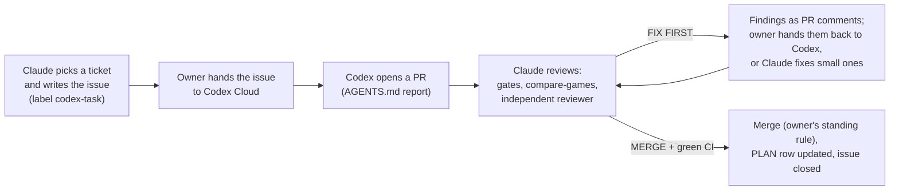

# Handing tickets to Codex

Codex Cloud implements some bounded tickets so Claude spends its time on specs, design and review. There is no automatic dispatch: the owner hands an issue to Codex by hand. Started 2026-10-23.

## The loop

1. **Issue.** Claude writes it from the `Codex task` template (`.github/ISSUE_TEMPLATE/codex-task.yml`): the spec ticket it implements, expected behaviour, acceptance criteria, required tests, the files in and out of scope, constraints and what the PR must report. Title `[codex] <ticket id>: <short name>`. An issue with the `codex-task` label that is open is **taken**: Claude's own builders skip that ticket.
2. **Hand-off.** The owner opens the issue in Codex Cloud (or pastes its link) and asks Codex to implement it. Codex reads `AGENTS.md` at the repo root for the project rules, gates and PR format.
3. **PR.** Codex opens one PR per issue, body starting with `Closes #N`, with the sections `AGENTS.md` lists: changes, gate results, mutation checks, `npm run compare-games` output, hashes, remaining concerns.
4. **Review by Claude**, the same bar as any builder's PR (CLAUDE.md):
   - read the PR's "Remaining concerns" first; a design question goes to the owner, not guessed;
   - check out the branch, re-run `npm run lint && npm run typecheck && npm test && npm run build` and `npm run compare-games`, and compare with the PR's numbers;
   - run the independent read-only `reviewer` agent (sonnet for engine-wide changes); it re-tries 3 to 5 of the PR's mutation checks;
   - run the browser specs that cover any `src/ui` change (Codex usually cannot);
   - findings go on the PR as review comments. Small fixes (a doc row, a test name) Claude may push itself as new commits; anything larger goes back to Codex through the owner, so Codex learns the codebase.
5. **Merge.** Under the owner's standing rule: reviewer says MERGE, gates pass and CI is green on the exact head sha; squash merge with the expected head sha. Then the PLAN row moves to Done and the issue closes.

## Which tickets go to Codex

Good fits: a ticket whose spec settles every rule; pure functions and constants with tests (resolvers, rule queries, fact tables); a contained rule in a few named files; tests or tooling that copy an existing pattern; docs tables.

Kept with Claude: specs and anything waiting on the owner's answers; tickets that add actions or steps or edit the shared engine files (`actions.ts`, `action-types.ts`, `sequence.ts`, `turn.ts`, `types.ts`) in a wave with other work; computer-opponent policy tuning (it moves fixed-seed hashes); screen layouts for the iPad; gates that need judgement (self-play gates); anything rules-ambiguous.

Give Codex at most two or three issues at a time, on different files, so its PRs do not conflict with each other or with Claude's builders.

## Getting the most out of a ChatGPT Plus plan

Codex on Plus has two allowances: a rolling **5-hour window** and a **weekly** cap; work stops when either runs out. Cloud tasks use more of it than local ones, and Fast mode uses it about 2.5 times faster. (Figures from a third-party summary of the plan, October 2026, not from OpenAI; the Codex usage page shows the real meter.)

- **Every issue names a model and effort**, so the allowance goes where it matters:
  - **Light** (the smallest model, low effort): docs rows, constants with tests, tests that copy a pattern.
  - **Standard** (the default model, medium effort): most tickets, one rule in a few files.
  - **Heavy** (the top model, high effort): a pure resolver or rule query with many branches, or a second attempt after a FIX FIRST review. Use sparingly; it costs several times as much.
  The issue names the current model for its tier (model names are kept out of the repo; they change often).
- **Keep Fast mode off.**
- **Keep a queue.** At least four ready issues, in the order of the issue table below, so each new 5-hour window can start a task at once. Start with two tasks per window; after the first week, raise or lower that by the weekly meter.
- **Review findings are cheap to send back** on the same PR (the Light or Standard tier is enough for a fix list).

## Issues so far

In hand-off order. Tier as in the section above.

| Issue | Ticket | Tier | Status |
|---|---|---|---|
| #130 | 16-0 spec 16 facts and constants | Light | Ready |
| #131 | 16-26 Anglo-French stop ban | Standard | Ready (16-0 and 16-26 touch different files) |
| #132 | 12-9 naval combat resolver (Release 1) | Standard, high effort | Ready, lower priority |

Next candidates, written once the ones above are in review: 16-24 (Sevastopol's two conditions, after 16-0), 16-3 (Attrition rules, pure, after 16-0), and the pure rule queries of spec 15.
