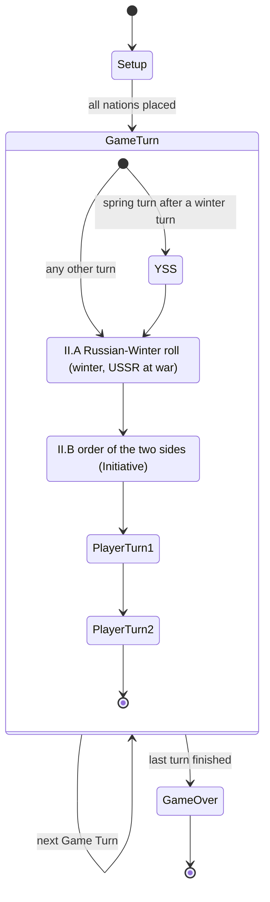

# 01. Turn steps: the engine knows where in the Sequence of Play it is

Status: **built** (T07, after "proceed with development"). Decisions made while building are in "As built" at the end.

## Goal

Today the engine knows only three phases (`setup`, `player-turn`, `game-over`) and one action during play (`END_PLAYER_TURN`). The Sequence of Play (Ops 5.0, the map card) is only data in `src/engine/sequence.ts`. This feature makes the engine itself track the current step of the current Player Turn, so that:

- every later rule (declarations of war, movement, combat, supply, construction...) is attached to the step where the manual puts it;
- an action taken out of order is refused with a clear message, for the human, the tests and the computer opponent alike;
- the UI can show where the game is and what the player may do now;
- a saved game resumes at the exact step.

It adds no game rule by itself. A step whose rules are not built yet passes with nothing to do, and the list of such steps is visible and shrinks as rules land.

## Behaviour

### The position in the game

The engine always knows, and a saved game stores:

1. the Game Turn (year and season), as today;
2. which part of the Game Turn it is in: the Year Start Sequence (between Winter and Spring only), the Russian-Winter roll (II.A), the order of the two sides (II.B), the first Player Turn, or the second Player Turn;
3. inside a Player Turn, the current step id: `1`, `2`, `3`, `4`, `5`, `6a` to `6h`, `7a` to `7p`, `8a` to `8c`, `9a` to `9k`, `10a`, `10b` (the ids already in `sequence.ts`).

### What a player may do at a step

- Only the actions that belong to the current step are legal. `legalActions` lists exactly those, plus the one that moves on.
- Moving on is always an explicit action (for example "done with this step"), never a side effect of another action. Steps with nothing to do for the active side are passed without asking, and the log says so.
- Any other action is refused, and the message names the current step ("Declarations of war are made in step 1; it is step 6f").
- A step cannot be revisited. There is no going back to an earlier step in a Player Turn (the PC game has none).
- The step after `10b` is the other side's step `1`, or the next Game Turn's start, exactly as `END_PLAYER_TURN` does today.

### Steps whose rules are not built yet

Each step is marked implemented or not in one list. For a step not yet implemented, the engine passes it automatically and records that it did. The list is checked by a test, so a step cannot be left unimplemented without being on it, and a rule cannot be added without taking its step off it.

### Setup

The opening setup stays as it is (its own phase). When the last nation presses Done, play starts at the first step of the first Player Turn, as now.

### Game-level steps



### One Player Turn

```mermaid
stateDiagram-v2
    [*] --> S1
    S1: 1 Declarations of war
    S2: 2 Minor countries set up and activated
    S3: 3 Front options
    S4: 4 Minor countries under attack move and fight
    S5: 5 Voluntary destruction
    S6: 6 Movement phase (6a to 6h)
    S7: 7 Combat phase (7a to 7p)
    S8: 8 Unit construction (8a to 8c)
    S9: 9 Strategic redeployment (9a to 9k)
    S10: 10 End of turn (10a, 10b)
    S1 --> S2 --> S3 --> S4 --> S5 --> S6 --> S7 --> S8 --> S9 --> S10
    S10 --> [*]
```

Within 6, 7, 8, 9 and 10 the sub-steps run in the order printed on the card; within a sub-step the active side may take any number of its actions.

## Rules references

- Ops 5.0 (Sequence of Play), 5.2 (Russian Winter), 5.3 (Player-Turn order), 5.41 to 5.49 (the ten steps and their lettered sub-steps), 6.0 (Year Start Sequence).
- Ref 11.1 (Initiative, already implemented in `game.ts`).
- The card numbering is already encoded and tested in `src/engine/sequence.ts`.
- PC README rule "Rule 3.35": once initial setup requirements are met, units move freely; nothing in this spec changes that.

## Open questions (also add to docs/RULES.md)

- Does the original let a player skip the whole Combat phase with one click, or does it walk through each sub-step? The spec assumes steps with nothing to do for a side pass silently; check against the original (roadmap phase 9).
- Is Voluntary Destruction (step 5) a real action in the PC game, or only a prompt? (Ops 5.44 and the PC README errata on 5.44.)
- Which side acts at 8a (Free Siberian Transfer) and 8c (Vichy attempt) when it has nothing to do: confirm these never block the turn.
- The original program's own internal list of phases (found in the game files, not the manual) differs from the printed card in places. For example it checks supply after ground and air movement rather than before it, and its combat phase is a run of air missions, defensive air support, counter-air rounds, ground combat, exploitation, attrition and airborne drops in a different order from 7a to 7p. Which order do we follow: the printed card (the manual is the source of truth) or the program's? Proposal: the card, and record every difference in docs/RULES.md for the fidelity phase.
- Should the engine expose "what the active side must still decide at this step" (for the UI's prompts), or only the legal actions? Proposal: only legal actions; the UI derives prompts.

## Done when

1. `GameState` records the part of the Game Turn and, in a Player Turn, the step id; an old saved state without them is rejected with a clear message rather than guessed.
2. At every step, `legalActions` contains the step's actions and the move-on action and nothing else; a test walks all ten steps and sub-steps in order for both sides and reaches the next Game Turn.
3. For every action type and every step where it is not legal, `applyAction` returns an error naming the current step (a table-driven test over the whole action set).
4. A step list marks which steps are implemented; a test fails if a step is skipped while marked implemented, or passed automatically while not marked.
5. `replay` of a recorded list of actions across several Game Turns reproduces the state exactly, including the step.
6. The Year Start Sequence runs between Winter and Spring only, the Russian-Winter roll only in winter (II.A), and the Initiative is determined in II.B, each at its own step.
7. The UI shows the current step and passes the existing smoke test and the manual setup flow; nothing in the setup phase changes.
8. A mutation check: skipping a step, repeating a step, and allowing an action one step early each make a test fail.

## As built

- `GameState.position` is null during setup and otherwise one of `year-start`, `russian-winter`, `turn-order` or `player-turn` (turn 1 or 2, and the step id). Engine code is `src/engine/turn.ts`; the list of steps with rules built is `IMPLEMENTED_STEPS` in `src/engine/sequence.ts`, and a test context can widen it (`GameContext.implementedSteps`).
- Today the engine waits only at **10b**, where `END_PLAYER_TURN` ends the turn as before; II.B (the Initiative) runs but never waits. Every other step, including the Year Start Sequence (YSS) and the Russian-Winter roll (II.A), is passed automatically and recorded in a `STEPS_PASSED` event.
- `END_STEP { side, step }` is the move-on action at every other waiting step. It names the step being left so a repeated or late action is refused.
- The browser's log does not print `STEPS_PASSED` (about 90 lines a turn would bury everything else); the status line shows the current step instead.
- A state with no position (an old saved game) is refused with a message; there is no saved-game loader yet.
- Proposal taken for the open questions: the printed card's order is followed, and `legalActions` lists only actions.
