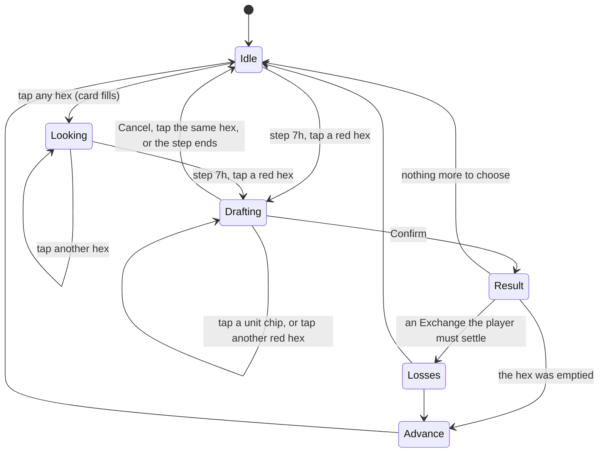
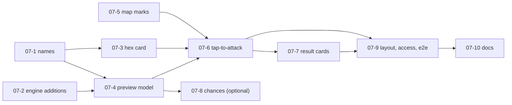

# 07. Tap to attack, with an odds preview, and a unit inspector

Status: proposed 2026-10-15, from the play-test (docs/FEEDBACK.md, entry 2). Builds on spec 04 (ground combat, already built) and spec 06 (watch mode). Approved by the product owner on 2026-10-15 with the decisions below. This page is words and sketches only; the build plan (part H) is the next step.

## Decisions (product owner, 2026-10-15)

| # | Question | Decision |
|---|---|---|
| 1 | One press or two? | One press. No "Are you sure?" pop-up. When the odds are worse than 1-1 the button turns amber and says so ("Attack at 1-3 (risky)"). |
| 2 | Chances in percent? | Not now. The six-roll table is enough. Ticket 07-8 stays on the shelf and is not built unless asked for later. |
| 3 | Keep the old attack buttons? | Yes, in a fold-out, with readable labels. |
| 4 | Default units | Yes: every unit that can attack is chosen by default, and the player can remove units to split the attack. For a hex with only air units, the weakest single unit. |
| 5 | Hex card in setup | As proposed: not shown during setup, only from the first Player Turn. |
| 6 | Phone placement | The main device is an iPad, so design and test the iPad first (both ways round). The phone only has to stay usable: the card goes under the pinned map as proposed. |
| 7 | Coordinates | Place name first, coordinate in brackets: "Warsaw (M35)". Frank can change this later. |
| 8 | Wording | Faithful to the board game: Exchange, Counterattack, Eliminated (not "wiped out"). Open for Frank's opinion. |

## Goal

Frank should be able to play the fighting step on an iPad without knowing a single coordinate or unit number:

1. **Look at any hex** and see every counter in it: what it is, whose it is, how strong it is.
2. **Attack by tapping**: tap the enemy hex, see which of your units will attack, see the odds and what could happen, and press one clear button.
3. **Say names, not codes**: "Warsaw (M35)", "3-4 German armor from Lodz (N33)", never "u94".

## What went wrong for Frank today

| He said | What he saw | What this spec changes |
|---|---|---|
| "I must know the coordinates of the unit I attack." | Buttons such as `Attack M35 with u94, u95`. | Attack by tapping the hex. Every button uses place names and plain unit names. |
| "I cannot see the detail of the 4 Polish units in Warsaw." | Only a one-line hex info with grouped counts. | A **hex card** that lists each counter (part A). |
| (not said, but real) "I can no longer attack Warsaw." | No button, and no explanation. | When a hex cannot be attacked, the card says why in one sentence. |

## Words used here

- **Factors**: the numbers on a counter. A "3-4" infantry has 3 combat factors and 4 movement. Only the first number counts in a battle.
- **Defence multiplier**: the defender's factors are doubled in plain country, tripled in mountains, swamp or behind a river, quadrupled in a fortress. Only the best one applies (`defenseMultiplier`, Ref 4.5, 12.1).
- **Odds column**: attack factors against the defender's multiplied factors, as a ratio, for example 3-1 or 1-2. A weaker attack is rounded in the defender's favour. Weaker than 1-4 means the attackers are eliminated with no roll (`oddsColumn`).
- **Results** (one die, 1 to 6, read on the column): A = attackers eliminated, D = defenders eliminated, Ex = Exchange, CA / CA1 / CA2 / CA3 = the defender counterattacks and the battle goes on (`OFFENSIVE_CRT`, Ref 12.1 to 12.2).
- **Column shift**: the engine has none today. Terrain changes the defender's factors, not the column. See "What the preview shows", last bullet.

## Part A. The hex card (the unit inspector)

A card at the top of the status column, under the pinned map on a phone and in the right-hand column on a wide iPad or a computer. **Tapping or clicking any hex fills it.** It works on empty hexes, enemy hexes, hexes of neutral countries, and during the computer's turn and in watch mode.

```
+------------------------------------------------------+
| WARSAW (M35)                                    [ X ] |
| Plain, Poland, Eastern Front. Held by Poland.        |
| ---------------------------------------------------- |
|  [2]  Polish infantry      1-3          defends      |
|  [2]  Polish infantry      1-3          defends      |
|  [A]  Polish air           1            does not     |
|  [A]  Polish air           1            defend       |
| ---------------------------------------------------- |
| Tap a red hex to attack it. (shown at step 7h)       |
+------------------------------------------------------+
```

**What each counter line says**

| Part | Source in the game | Example |
|---|---|---|
| Kind | `unit.type`, in words: infantry, armor, airborne, replacement, air, fleet, airbase, bridgehead | "armor" |
| Nation | `unit.nationality ?? unit.owner`, `OWNER_NAMES` | "German", "Polish" |
| Owner, when different from the nation | `unit.owner` (the Italian fleet Germany holds in 1944) | "Italian, held by Germany" |
| Factors | `unit.strength`, and `unit.movement` for ground and air units, the way the counter prints them | "3-4" |
| Notes (only those the engine knows) | `movesOf` (moved this turn), `combatOf(...).attacked` (has attacked this turn), can-advance (`combatOf(...).advances`), "does not defend" for air, fleet, airbase, bridgehead (not in `GROUND_COMBAT_TYPES`) | "moved", "has attacked" |

**The hex line** gives: place name or "plain hex in Poland" when the hex has no printed name, terrain, country, Front, fortress if any (`describeHex` plus `state.fortresses`), and who holds it (`controllerOf`).

**Not shown, on purpose:** supply status (supply tracing is not tied to the steps yet, so a label would claim more than the game does), the raw unit id, and any guess about what a counter "can do next turn". Supply gets a slot in the notes later (part G).

**Rules of the card**

- It is **passive**. Filling it never changes the chosen stack of the move flow (`moveFrom`), the chosen build (`build`), the chosen setup counter (`selected`, `mode`) or an attack draft. A test checks this.
- A tap still does what it does today in the current step (select a stack to move, build, place a counter). The card simply shows the hex as well. Tapping your own stack at step 6f therefore selects it and lists it; tapping it again lets it go and the card stays.
- During **setup** the card is not shown, so the setup screen keeps its room; the one-line hex info over the map stays as it is today.
- The one-line hex info over the map stays (it is also the mouse hover). The card is what you tap for detail.
- It has a close button (44 px). Closing hides the card until the next tap.
- It never reads the dice generator and never alters the game.

**Why an enemy hex cannot be attacked** (one sentence under the list, from facts the engine already computes; no new rule):

| Situation | Sentence |
|---|---|
| Not step 7h | "Attacks are made at step 7h." |
| Hex already attacked this Player Turn | "This hex has already been attacked this turn." (`combatOf(state).targets`, `ONE_ATTACK_PER_HEX`, TODO(verify)) |
| None of your free units is next to it across a hexside you may attack over | "None of your units that have not attacked is next to this hex." (`attackerPool`, `crossable`) |
| Not at war with that owner | "You are not at war with Poland." (`isEnemy`) |
| Only air units, fleets or airbases there | not a refusal: it can be attacked, see part B "Hexes with no ground defender" |

## Part B. Tap to attack

### The screens

Four states. The mermaid diagram is the whole flow; the sketches follow.



**State 1. Step 7h begins.** The attackable hexes are outlined on the map (dashed red; not colour alone). Under "Attacks you can make" there is one 44 px row per hex, which is the way in when a finger cannot hit a small hex:

```
+------------------------------------------------------+
| Step 7h: ground combat                               |
| ATTACKS YOU CAN MAKE (3)                             |
| [ Warsaw (M35)       4 Polish units, 4 factors   > ] |
| [ Lodz (N33)         2 Polish units, 3 factors   > ] |
| [ Poznan (M33)       1 Polish unit,  1 factor    > ] |
| Each hex can be attacked once a turn.  (TODO(verify))|
|                          [ Done with step 7h ]       |
+------------------------------------------------------+
```

**State 2. A hex is tapped (on the map or in the list).** The hex gets a thick outline; your units that can attack it get a solid gold outline on their own hexes. The map moves to show both if one is off-screen (`view.focus`). The attack card opens with **all units that can attack already chosen**:

```
+------------------------------------------------------+
| ATTACK ON WARSAW (M35)                     [ Cancel ] |
| Defending: 2 x 1-3 Polish infantry = 2 factors       |
|   plain country: doubled              ->  4 to beat  |
|   (2 Polish air units here do not defend)            |
|                                                      |
| ATTACKING WITH   (tap a unit to add or remove it)    |
| [x] 3-4 German armor      from Lodz (N33)            |
| [x] 2-3 German infantry   from Lodz (N33)            |
| [x] 2-3 German infantry   from Radom (N34)           |
| [-] 2-3 German infantry   from Plock (M34)           |
|        has already attacked this turn                |
|                                                      |
| ODDS   7 against 4    ->   column 1-1                |
| IF YOU ROLL       WHAT HAPPENS                       |
|   1 or 4   Exchange: they lose all, you lose 4+      |
|   2 or 3   Counterattack: they strike back           |
|   5        Your attackers are eliminated              |
|   6        The defenders are eliminated               |
|                                                      |
| One try: this hex cannot be attacked again this turn.|
| [  Attack Warsaw with 3 units (7 factors)  ]         |
+------------------------------------------------------+
```

`[x]` chosen, `[ ]` free to add, `[-]` cannot attack (greyed, with the reason). Each chip is a button with `aria-pressed`.

**State 3. After the button.** The die is rolled by the engine exactly as today (seeded, so a saved game replays). The card turns into a **result card** for the last battle:

```
+------------------------------------------------------+
| RESULT: WARSAW (M35)                                 |
| Column 1-1, roll 4: Exchange.                        |
| You lost: 2 x 2-3 German infantry (your choice).     |
| They lost: both Polish infantry and 2 air units.     |
| Warsaw is empty. Your surviving units can advance.   |
| [ Advance 3-4 German armor into Warsaw (M35) ] [Stay]|
+------------------------------------------------------+
```

**State 4. Choices the engine asks for** appear as cards with names, not as the old coded buttons: "Choose your losses" (an Exchange with more than one legal set, chips with unit names; in the example above, armor plus one infantry, or both infantry) and "Advance into Warsaw?" (survivors that fit, chips). They are the existing `ALLOCATE_LOSSES` and `ADVANCE` actions with new wording. When the Exchange is the computer's to settle, nothing is shown beyond the log.

### The touch flow, step by step

| # | iPad (finger, no hover) | Mouse (computer) | What the game does |
|---|---|---|---|
| 1 | Reach step 7h. Red dashed hexes appear and the list "Attacks you can make" fills. | Same. Hovering a hex shows the one-line info over the map. | `legalActions` has `ATTACK` actions; the UI groups them by target. |
| 2 | Tap a red hex on the map **or** its row in the list. | Click it. | The hex is outlined thickly, the map shows it, the attack card opens with every possible attacker chosen. The hex card is hidden (the attack card already lists the defenders). |
| 3 | Read the defenders and the odds line. | Same. | The preview is computed, nothing is rolled. |
| 4 | Tap a unit chip to remove or add it. | Click it (Space or Enter with the keyboard). | The odds, the six results and the button text change at once. At least one unit must stay chosen, or the button is greyed and says why. |
| 5 | Optional: tap another red hex. | Same. | The draft moves to that hex with its own default units. Nothing was rolled. |
| 6 | Tap the big button "Attack Warsaw with 2 units (5 factors)". | Click it. | One `ATTACK` action through `applyAction`. The units listed in it are used up for this turn. |
| 7 | Read the result card. If asked, tap the losses or advance chips. | Same. | `ALLOCATE_LOSSES` and `ADVANCE` actions as today. |
| 8 | Tap the next red hex, or "Done with step 7h". | Same. | |
| Cancel | Tap Cancel, or tap the same hex again. Escape on a keyboard. | Same. | The draft is thrown away. Nothing changed in the game. |

A tap on any **other** hex while an attack card is open only updates the hex card ("looking at"), under the attack card. The draft stays. This is deliberate: the player can check what stands beside the target without losing the work.

**One try.** There is no take-back: the die is rolled when the button is pressed, and that hex cannot be attacked again this turn. The card says so in one line above the button.

### What the preview shows

Everything below comes from the engine; the screen invents no rule.

- **Defenders**: the ground units of the hex that are at war with at least one chosen attacker (`defendersAt`), their factors, and the defender multiplier with its **reason in words** ("mountains: tripled", "behind a river: tripled, all your attackers are across it", "fortress: quadrupled", "plain country: doubled"). Counters that cannot defend on the ground (air, fleets) are listed under the defenders as "do not defend".
- **Attackers**: the chosen units with their factors. The total is shown. Units that cannot attack are listed greyed with a reason: "has already attacked this turn" (`combatOf(state).attacked`).
- **Odds line**: "5 against 4, column 1-1", or "attackers are eliminated with no roll (weaker than 1-4)" when `oddsColumn` is null. The wording mentions that a weaker attack is rounded against the attacker.
- **A river warning**: the river bonus applies only if every attacker is across a river hexside (`attackNumbers`). Adding one unit from a hex with no river can turn x3 into x2. The preview recomputes on every tap, and the card says "adding Plock's infantry removes the river bonus" when the multiplier drops. This is the most surprising thing the odds can do, so it gets its own line.
- **Six results**: one row per die roll 1 to 6 (rows with the same result are merged: "rolls 5 and 6"), read from `OFFENSIVE_CRT[column]`:

| Result | Plain words | What it costs (all numbers computed, not guessed) |
|---|---|---|
| A | "Your attackers are eliminated." | You lose every chosen unit (N units, F factors). They lose nothing. |
| D | "The defenders are eliminated." | They lose every defender. You lose nothing. If the hex is empty you may advance. Air units or fleets alone in the hex go too (`lonersAt`, see below). |
| Ex | "Exchange." | The smaller side loses everything; the larger side loses at least as many factors and chooses which units. With the defender counted at its multiplied factors. Shown as: "you lose all 5 factors, they lose at least 5 factors (they choose)" or "they lose all, you lose at least 4 of your factors (you choose)". Both lose everything when equal. TODO(verify) Ref 12.2: whether a larger defender removes factors at the multiplied value (built that way, `applyOutcome`). |
| CA | "The defender counterattacks; the fight goes on." | Nothing is lost yet. The defender rolls on column X, taken from `FORCED_COUNTERATTACK_COLUMN` (CA1 = 1-1, CA2 = 1-2, CA3 = 1-3) or, for a plain CA, from `oddsColumn(defender basic factors, your factors)`. There, A wipes out the defenders, D wipes out you, Ex is an Exchange counted in basic factors, and another CA repeats your attack. |

- **Hexes with no ground defender.** If the hex holds only air units, fleets, airbases or bridgeheads, the card says "No roll. These N counters are destroyed" and the button reads "Destroy 2 Polish air units in Warsaw". This is `ALONE_NONGROUND_DESTROYED`, confirmed by the product owner and still TODO(verify) against the PC manual (docs/RULES.md). Only the **weakest single unit, infantry first** is chosen by default here (the way the computer sweeps), so the player does not spend a whole army on it; more can be added, with no effect on the result.
- **After a win**: "If the defenders are eliminated, these also go: ..." lists non-ground enemy counters in the hex, computed with `lonersAt` on a copy of the position without the defenders.
- **Column shift**: there is none in the engine and nothing in docs/RULES.md about one, so the screen shows none. The preview model carries a list of "modifiers" (a label, and whether it adds factors or moves the column) that stays empty today; air support, shore bombardment or anything else that later comes from spec 04 plugs into that list and the card shows it with no redesign. TODO(verify) whether the PC game has any column shift for a ground attack; if it does, it is a rules ticket first.
- **Chances in percent** (optional, ticket 07-8): "about 1 chance in 3 that you are eliminated, 1 in 2 that they are, the rest Exchange". It is exact arithmetic on the same tables: the first roll, the counterattack roll, and the "repeat" case folded in. No dice are rolled to compute it. See open question 2.

### The labels on the existing buttons

The fold-out of coded attack buttons stays (part C) but every label becomes readable:

| Today | New |
|---|---|
| `Attack M35 with u94, u95` | `Attack Warsaw (M35): 5 factors against 4, odds 1-1` |
| `Lose u94` | `Lose 3-4 German armor (from Lodz)` |
| `Advance u95, u96 into M35` | `Advance 2-3 German infantry into Warsaw (M35)` |

The log line for a battle also gets the name: "Attack on Warsaw (M35): ..." (one line in `describeEvent`).

## Part C. How it lives with what exists

| Thing | What happens |
|---|---|
| The list of coded attack buttons | Kept, moved into a fold-out "All attacks as a list (N choices)" (the same style as "Declare war"), with the new labels. Reason: keyboard users, the e2e tests and the product owner's habits keep a way in, and nothing is lost if the new card has a flaw. The buttons are still exactly the `legalActions` attacks (the all-units attack for each hex and each source hex alone). |
| Attacks the list does not offer | The card lets the player choose **any** subset of the units that can attack a hex. `legalActions` only lists the whole group and each source hex alone, because listing every subset would be hundreds of buttons. `applyAttack` already accepts any non-empty subset and checks every unit. The UI therefore builds the `ATTACK` action itself and always sends it through `applyAction`; it never changes the game any other way. The set of units that can attack a hex is read from the largest `ATTACK` action `legalActions` lists for it. A test checks that every subset the card can build is accepted. This is the one place the card goes beyond the list, so it is named in open question B1. |
| "Done with step 7h" | Unchanged. The end-of-step button stays the primary button of the panel. |
| The computer's turn | No attack card, no list; `computerToMove` is true so there are no human actions. The hex card works, so Frank can look at the units the computer attacks him with. When the computer attacks, the existing "Computer is playing..." line and log lines stay, with names. If the computer's attack forces the **human** to choose Exchange losses, the "Choose your losses" card appears with names (that case already exists in `computerToMove`). |
| Watch mode (spec 06) | The hex card works on every tap (the spec already says taps "select and inspect"). The attack card and list are never shown (`s.watch`). |
| Saves and replays | The draft is screen state, not game state, and is never saved. What is saved is the `ATTACK` action, as now, so a replay is identical. |
| Moving (step 6f) and building (8b) | Unchanged. The hex card fills as well. Leaving step 7h (or the Player Turn ending) drops any draft. |
| Redraws | The status column is redrawn from scratch after every change. The chips and rows get stable keys (`data-unit`, `data-target`) so keyboard focus is given back to the same chip (`focusKeep.ts`), and the page does not jump while Frank toggles units. |

## Part D. Touch, access and screen sizes

- **44 px.** Every button this spec adds is at least 44 px high and wide (list rows, unit chips, Cancel, the card's close, Confirm, Advance, Stay). Spacing between chips is at least 8 px so a thumb cannot hit two. Text lines that are not buttons are exempt. The e2e test measures every button in the new cards.
- **The map is not the only way in.** At full-map zoom a hex is far smaller than 44 px; the "Attacks you can make" rows are a full-size alternative that selects the same hex. Zoom buttons (separate item) will make map taps easier; nothing here depends on them.
- **No hover.** Nothing is only on hover. The mouse hover still shows the one-line hex info, as today.
- **Not colour alone.** Targets are dashed, the chosen target is thick, attacker hexes have a gold solid outline and a small mark. Chip state is a check mark and text ("chosen" / "not chosen"), not only a fill. Contrast follows the existing palette (4.5 to 1 for text).
- **Screen readers and keyboard.** Chips are real buttons with `aria-pressed`; the card is a labelled region; opening it moves focus to its heading (`tabindex="-1"`, as `#status` does); Escape cancels; a polite live line says one sentence after each change ("Odds 1-1: 5 against 4"), and says nothing while the player is only scrolling. Reduced motion: no animation anyway.
- **Layouts**

| Screen | Where the cards sit |
|---|---|
| Phone, portrait (390 x 844) | Directly under the pinned map (the map keeps its 46% of the height). When a card opens, the page scrolls just far enough to show its top; it never scrolls the other way. |
| Phone, landscape (844 x 390) | Same, with the existing short-screen map (40%). Chips wrap to two columns. |
| iPad, portrait (820 x 1180) | Single column like the phone; the card is wide, chips go two across. |
| iPad, landscape (1024 x 768 up to 1366 x 1024) | The existing two columns: map left, status right. The cards are at the top of the right column; the column scrolls on its own, so the map never moves while Frank works the card. |
| Computer (1400 x 1000) | Same as iPad landscape, with hover. |

- **Words.** English. All new text sits in one module (`attackText.ts`), so a French pass later is a translation, not a hunt. Not a priority.

## Part E. What the screen needs from the engine

Reused as they are (no change):

| Need | Existing function (file) |
|---|---|
| Which hexes can be attacked, and by whom | `legalActions` -> `ATTACK` actions (`attack.ts`) |
| Defenders, loners, who is at war | `defendersAt`, `lonersAt`, `isEnemy` (`attack-rules.ts`) |
| Ground units that could attack, adjacency | `attackerPool`, `crossable`, `neighborIds` (`attack-rules.ts`) |
| The numbers of one attack | `attackNumbers` -> `attackFactors`, `defenseFactors`, `multiplier`, `column` (`attack-rules.ts`) |
| Column and results | `oddsColumn`, `OFFENSIVE_CRT`, `FORCED_COUNTERATTACK_COLUMN`, `ODDS_COLUMNS` (`combat.ts`) |
| What was used this turn, pending losses, advances | `combatOf`, `movesOf` |
| Who holds a hex, fortress | `controllerOf` (`control.ts`), `state.fortresses` |
| Names | `ctx.map.hexes[id].name`, `OWNER_NAMES`, `combatantName` |

Two **small additions to the engine**, both with no change of behaviour (existing tests must stay green, the computer must play the same games):

1. **Why the multiplier is what it is.** `defenseMultiplier` returns only a number. Add a sibling that returns the basis ("fortress", "mountains", "swamp", "river or crossing arrow", "plain") from the same `if` chain, have `defenseMultiplier` call it, and let `attackNumbers` return it as an extra field. Reason: the screen must say why, and must not copy the rule's order of priority into the UI.
2. **The cost of an Exchange.** `applyOutcome` holds the arithmetic ("smaller side loses all, larger loses at least that many"). Pull it into one exported function used by `applyOutcome` and by the preview, so the card can never disagree with the battle. A test runs real battles over many seeds and compares the shown cost with `PendingLosses.required`.

Nothing else. In particular the preview does **not** call `resolveOffensiveCombat` and never touches `rngState`.

**The preview model** (a pure function in `src/ui/attackPreview.ts`, no DOM, returns plain data; same for the hex card in `src/ui/hexCard.ts`):

- In: the context, the state, the target hex, the ids of the chosen attackers.
- Out: target name, defenders (with factors), non-defenders, all candidate attackers (chosen, free, or greyed with a reason), the numbers (attack factors, defence factors, multiplier and its reason, defence total, column or "eliminated with no roll"), the six result rows with their plain text and costs, the sweep case, the modifiers list (empty), a list of problems (for example "no unit chosen"), and the text of the button.
- Out of scope for the model: the dice, the screen, and any rule not already in the engine.

## Part F. Tests

**Unit tests** (Vitest, `tests/attack-preview.test.ts`, `tests/hex-card.test.ts`, `tests/attack-tap.test.ts`). Each cites its rule (Ref 12.1, 12.2, 4.5, 4.51, PC README 14.23) and gets the usual mutation check (break the rule, see a test fail, restore).

| Test | What it proves |
|---|---|
| Numbers equal the battle | For several positions and every eligible subset, `applyAction(ATTACK)` yields a `COMBAT_RESOLVED` whose attack factors, defence factors, multiplier and first-round column equal the preview's. |
| Six results | For each of the 8 columns the six rows equal `OFFENSIVE_CRT`; a column of null gives "eliminated, no roll". |
| Odds rounding | 5 against 12 gives 1-3; 6 against 5 gives 1-1; more than 5-1 caps at 5-1 (as the table tests do). |
| Multiplier reasons | Plain x2, mountains x3, swamp x3, river x3 only when every chosen attacker is across it, fortress x4, and best-not-sum. Removing the one attacker not across a river changes x2 to x3 and the model says so. |
| Exchange cost | Attack smaller, larger and equal to the multiplied defence; the cost equals `PendingLosses.required` in real battles found by scanning seeds. |
| Counterattack text | CA, CA1, CA2, CA3 name the right column. |
| Hexes with no ground defender | Warsaw after the infantry are gone: sweep text, weakest single unit by default, no roll shown. |
| After a win | The "also destroyed" list equals `lonersAt` on the position without the defenders. |
| Why not | Each sentence of the part A table is reached once; a hex attacked once already is refused with the right words. |
| Purity | The state is not changed; the output is identical whatever `rngState` is. |
| Names | A hex with no printed name falls back to "plain hex in Poland (M35)"; identical counters in one hex are told apart ("1 of 2"); no output text contains a raw id (regex `\bu\d+\b`). |
| Hex card | Empty hex, enemy hex, mixed nations, an Anglo-French stack, a neutral hex, a hex in the middle of a battle; a card for 30 random hexes never throws. |
| Tap routing | Filling the card leaves `moveFrom`, `build`, `selected`, `mode` and an open draft exactly as they were; a tap on the draft's own hex closes it; a tap on another red hex moves it; the draft is dropped when the step or the turn changes; no draft and no list during the computer's turn or in watch mode. |
| Subsets | Every subset of eligible units the card can build is accepted by `applyAction`; one unit that is not eligible is refused. |
| Confirm | One press makes exactly one `ATTACK` action; the record of a watched or taken-over game is unchanged. |
| Labels | `Attack`, `Lose` and `Advance` labels carry names and no ids. |
| Chances (07-8) | The three percentages add to 100; they match a 20,000-seed run of `resolveOffensiveCombat` within 1.5 points, and exact hand-worked cases. |

**Playwright** (`tests/e2e/attack.spec.ts`, run in the existing `mouse` and `touch` projects; the touch one uses `page.touchscreen.tap`). Playwright is not run as part of writing this spec.

1. 1939 as Axis, play to step 7h (the way `move.spec.ts` reaches 6f). Red hexes appear; tap one; the attack card opens with all attackers chosen and an odds line. Toggle a unit: the odds change. Press the big button: the log has a line starting "Attack on", the used units are greyed, and the hex is no longer red.
2. Inspector: tap an empty hex, one of yours and an enemy hex: the card lists the counters each time. At step 6f, with a stack chosen, tap an enemy hex: the yellow outlines stay.
3. The Warsaw case: after the infantry are gone, the card shows the air units and offers the "Destroy ..." button; after it, the hex is empty and "Advance" is offered.
4. The list path: open the "Attacks you can make" row instead of tapping the map; the same card opens.
5. Keyboard: Tab to a row, Enter, Space on a chip, Escape.
6. Sizes: 390 x 844, 844 x 390, 820 x 1180, 1024 x 768, 1366 x 1024, 1400 x 1000. At each: every button in the cards is at least 44 px high, no sideways scroll, and the map is still on screen with the card open.
7. Watch mode: taps fill the card; no attack card or list appears.

## Part G. Out of scope, and the room left

| Not in this spec | Why not now | Room left |
|---|---|---|
| Air units (air support, intercepts, flying attacks) | Air is not built (roadmap 6.4); spec first. | The card already lists air counters and says "does not defend". The preview model has the empty "modifiers" list for factors that air support will add, and the attackers list is typed by unit, not by "ground". |
| Fleets and shore bombardment | Not built. | Same modifiers list; fleets already show in the card. |
| Supply | Supply tracing exists as queries but is not tied to the steps; the engine keeps `isSupplied` true on purpose (Ref 19.4, TODO(verify)). | A notes slot per counter; when `isSupplied` starts to say no, the chip becomes greyed with "out of supply" through the same "cannot attack" reason mechanism. |
| Moving a chosen part of a stack (FEEDBACK item 3) | Separate item. | The unit chip (kind, nation, factors, place) is one shared component with a chosen / not chosen state; "choose which units move" reuses it at step 6f. |
| Zoom buttons, bigger hexes, double-tap (FEEDBACK item 4) | Separate item. | The list of attackable hexes means attacking never needs a small map tap; `view.focus` already centres on a hex; the card does not depend on map size. |
| Retreats, exploitation, attrition combat | Not built (spec 04). | Result rows are data; a new result kind is a new row type. |
| Undo of an attack | The engine has none. | The one-try line warns the player. |
| A French interface | Not a priority. | All new text in one module. |
| Cleaning up the Warsaw side effect (one infantry wipes an ungarrisoned port's air units) | A rules question, already in docs/RULES.md. | The card shows exactly what will be destroyed before the button is pressed, which is what lets the product owner judge it. |

## Part H. Build plan

Difficulty: easy, medium or hard. Size: S (under half a day), M (about a day), L (more). Each ticket is its own branch and pull request, one reviewer from a stronger level than the author, per CLAUDE.md. At most 4 workers at once.

| # | Ticket | Difficulty | Size | Needs | Files it touches |
|---|---|---|---|---|---|
| 07-1 | **Names and labels.** Helpers for a place name, a unit name and a stack summary (`src/ui/names.ts`); readable `Attack`, `Lose`, `Advance` labels; the battle log line with the place name; tests for names, no raw ids. Ships a visible improvement for Frank on its own. | easy | S | none | `names.ts` (new), `statusView.ts` (`label`), `session.ts` (one log line), tests |
| 07-2 | **Engine additions.** The multiplier basis and the Exchange cost extracted from `applyOutcome`; no change of behaviour; tests with mutation checks; the selfplay output stays identical for a fixed seed. | medium | S | none | `terrain.ts`, `attack-rules.ts`, `attack-losses.ts`, tests |
| 07-3 | **Hex card model and view.** `hexCard.ts`, the session field for the last looked-at hex, the card in the status column, close button, wiring in `main.ts`, passivity tests, watch mode. | medium | M | 07-1 | `hexCard.ts` (new), `session.ts`, `statusView.ts`, `main.ts`, `style.css`, tests |
| 07-4 | **Attack preview model.** `attackPreview.ts` as a pure function, with all unit tests of part F. | medium | M | 07-1, 07-2 | `attackPreview.ts` (new), tests |
| 07-5 | **Map marks.** A new map layer for targets (dashed), the chosen target (thick) and attacker hexes (solid), styled apart from the yellow highlights; a `MapView` method to set them. | easy | S | none | `mapView.ts`, `mapCounters.ts`, `mapLayers.ts`, `style.css`, `map-view.test.ts` |
| 07-6 | **Tap-to-attack flow.** The draft in the session, the list of attackable hexes, the attack card with chips, the tap routing table, Confirm through `applyAction`, the old list into a fold-out, drop on step change, focus keeping. | hard | L | 07-3, 07-4, 07-5 | `attackTap.ts`, `attackView.ts` (new), `sessionActions.ts`, `statusBind.ts`, `statusView.ts`, `focusKeep.ts`, `session.ts`, tests |
| 07-7 | **Result, losses and advance cards.** The result card from the last `COMBAT_RESOLVED`, chip versions of `ALLOCATE_LOSSES` and `ADVANCE`, the sweep wording. | medium | M | 07-6 | `resultView.ts` (new), `session.ts`, tests |
| 07-8 | **Chances in percent** (only if the product owner says yes, question 2). Exact arithmetic over the tables; Monte Carlo cross-check. | medium | S | 07-4 | `attackChances.ts` (new), tests |
| 07-9 | **Layout and access pass, and the Playwright tests.** The five layouts, 44 px measures, keyboard and screen-reader behaviour, scroll-into-view, the seven e2e checks. | medium | M | 07-6 (07-7 for the full flow) | `style.css`, `tests/e2e/attack.spec.ts` |
| 07-10 | **Docs.** "As built" in this file, new open rule questions in docs/RULES.md, FEEDBACK.md updated, ROADMAP "Next up" ticked. | easy | S | all | docs only |

**Order and parallel runs**



- **Wave 1, in parallel (3 workers):** 07-1, 07-2, 07-5. They touch different files.
- **Wave 2, in parallel (3 workers):** 07-3 and 07-4 (after 07-1 and 07-2), and 07-8 can start once 07-4 is merged. 07-3 and 07-4 touch different files.
- **Wave 3, alone:** 07-6. It edits the shared UI files, and the other two items on the roadmap (choose units of a stack; zoom buttons) also edit `statusView.ts`, `session.ts`, `style.css` and `main.ts`, so run them one after the other or have the later one rebase.
- **Wave 4:** 07-7, then 07-9, then 07-10.

A useful stopping point: after Wave 2 Frank already has readable buttons and the hex card, which answers two of his four complaints, before the tap-to-attack flow lands.

## Rules references

Ref 12.1 (ground combat, odds), 12.2 (Exchange, counterattack), 4.5 and 4.51 (terrain multiplier, rivers, crossing arrows), 5.0 and 26.0 (stacking for the advance), PC README 14.23 (each unit attacks one hex) and 31.5. The tables are verified against the original game's data (docs/GAME_DATA.md, "Rule tables").

## Open questions

**For the product owner (decisions that are yours)**

1. **One press or two?** Proposed: one press on "Attack ..." rolls the die. When the odds are worse than 1-1 the button turns amber and says "Attack at 1-3 (risky)", but there is no "Are you sure?" pop-up. A pop-up is easy to add if Frank rolls bad attacks by mistake.
2. **Show chances in percent** as well as the six-roll table? Proposed: the table always; the percent line only if you want it (ticket 07-8). It is easy to read but it is also a number Frank never had in the DOS game.
3. **Keep the old list of attack buttons** in a fold-out (proposed), or remove it?
4. **Default units.** Proposed: all units that can attack are chosen, as you asked; for a hex with only air units the weakest single unit is chosen. Right?
5. **Hex card in setup.** Proposed: not shown during setup, only from the first Player Turn, to keep the setup screen as it is.
6. **Where the card sits on a phone.** Proposed: under the pinned map in the status column. The alternative is a sheet sliding over the bottom of the map, which hides part of it.
7. **Coordinates.** Proposed: place name first and the coordinate in brackets ("Warsaw (M35)"), so Frank, who knows the DOS game, can still match what he sees. Or names only?
8. **Wording.** "Exchange", "counterattack" and "eliminated" are used on the card. Decided: the board game's words (see "Decisions").

**Rules to check against the PC manual (marked TODO(verify); they are already in docs/RULES.md or are carried here)**

- A hex can be attacked once per Player Turn (`ONE_ATTACK_PER_HEX`); the card warns about it, so a wrong rule would now be visible to the player.
- Air units, fleets and airbases alone in a hex are destroyed, with no roll, by one ground attack (`ALONE_NONGROUND_DESTROYED`); the side effect on ungarrisoned ports.
- In an Exchange a larger defender removes at least the attacker's factors counted at the multiplied value (`applyOutcome`).
- Whether Replacement counters attack and defend (`GROUND_COMBAT_TYPES`).
- Whether the PC game has any column shift for a ground attack (the engine has none; the preview shows none).
- Whether unsupplied units may attack (`isSupplied` is true on purpose).

**For the builders (not the product owner)**

- B1. The card lets a player pick any subset of attackers, while `legalActions` lists only whole groups. Proposed: keep `legalActions` short and rely on `applyAttack`'s own checks, with a test that proves every subset the card builds is accepted. The alternative (list every subset in `legalActions`) would need the engine's listing to be capped and would slow the computer.
- B2. Is `src/ui/attackPreview.ts` the right home, or `src/engine`? Proposed `src/ui`: it only combines engine functions and decides no rule, and the engine coverage floor then stays about rules. The Exchange arithmetic it needs is in the engine (ticket 07-2).
- B3. Reaching step 7h in the e2e test by clicking takes about a dozen steps. A shorter route (for example a test-only way to load a saved record) is worth a separate ticket if the e2e becomes slow.

## Done when

1. Tapping any hex lists each counter in it (kind, nation, factors, notes), on iPad touch and with a mouse, and does not change a move, a build, a setup or an attack in progress.
2. At step 7h Frank can attack Warsaw by tapping it (or its row), sees the defenders, the multiplier with its reason, the odds column and the six results with their costs, can add or remove his units, and presses one button; no coordinate and no unit number is needed anywhere in that path.
3. A hex that cannot be attacked says why.
4. Every number on the preview equals what the battle then uses (tests compare them over many seeds), and no rule was added: anything not in docs/RULES.md is marked `TODO(verify)`.
5. The coded attack buttons still work, in a fold-out, with readable labels; the computer plays the same games as before; watch mode only inspects.
6. Every new button is at least 44 px on phone, iPad (both ways) and computer; the Playwright mouse and touch tests of part F pass; lint, typecheck, unit tests and build pass.
