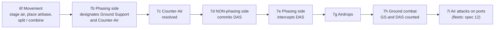
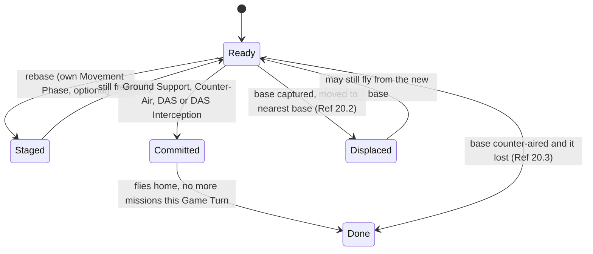
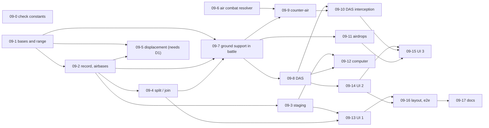

# 09. Air units: bases, staging, air support in battle, counter-air and airdrops

Status: **approved 2026-10-15 with the decision below (D1: displace). Ticket 09-1 is built (see "As built"); the rest is not.** Words and sketches only; the build plan is part G. Builds on spec 03 (movement), spec 04 (combat, air section), spec 05 (computer) and spec 07 (tap to attack). Comes from the play-test (docs/FEEDBACK.md, entry 2: "Could not use air factors").


## Decisions (product owner, 2026-10-15)

| # | Question | Decision |
|---|---|---|
| D1 / P1 | Air units and fleets left in a hex when its ground defenders are gone or it is taken | **Follow the manual: displace.** Air units go to the nearest friendly base within 8 hexes and are eliminated only if there is none; airbase counters go to their Capital; fleets in a captured port go to the nearest friendly port within sea range, or are eliminated if there is none. This replaces the "air alone is destroyed" rule that was confirmed from the Warsaw play-test (`ALONE_NONGROUND_DESTROYED`). Option B of rule R9 is chosen. |

How it was settled: the product owner researched it outside the project and returned the same reading as the manual text recorded in R9 (air: Ref 20.51; air committed to defensive air support shares the battle's fate; fleets: displaced to the nearest friendly port). **Rule numbers are still to be checked against the printed Reference Manual and the PC game (ask Frank what the DOS game does to planes in a captured city)**: the citations returned by the outside source do not all match the spec's own (for example the spec has 12.4 as the Attrition retreat rule and fleet displacement as 21.1). Until checked, they stay `TODO(verify)`, and `NONGROUND_ON_CAPTURE = "displace" | "destroy"` keeps the old behaviour one line away. Fleets: spec 12 (naval, not yet written) owns port displacement; until it is built the Warsaw sweep keeps destroying fleets.

## Summary (read this first)

- **Today** air units are only pictures on the map. They cannot be selected, moved, based or used, and they add nothing to a battle. Frank could see them (the hex card lists them) but not use them.
- **What this spec proposes**, in the order Frank would feel it:
  1. **Bases and range.** Tap an air unit and see the cities and airbases it can move to (up to 8 hexes) and the hexes it can reach in a fight (4 hexes).
  2. **Rebasing ("staging")** at the movement step, and the three movable airbases each Major Power owns.
  3. **Ground support and defensive air support.** Air factors join a ground battle and show on the attack card. This is the "air factors" Frank asked for.
  4. **Counter-air** (planes against planes on the ground) and **interception of defensive air support**.
  5. **Airdrops** by paratroops.
  6. **A computer that uses air** in a plain, safe way.
- **One rule decision for you (D1), now answered: displace (see "Decisions").** The rules say an air unit whose base is captured is **moved to the nearest friendly base**, not destroyed. Our "air units alone in a hex are destroyed" rule (the Warsaw fix, `ALONE_NONGROUND_DESTROYED`) does not match that text. The spec recommends replacing it, which also removes the "one infantry wipes a port" side effect. See rule R9 and open question P1.
- **Out of scope:** fleets and everything at sea (spec 12), strategic warfare (separate), supply wiring, Strategic Redeployment, exploitation (the exploitation air steps stay passed until exploitation is built).
- **Size:** 18 small tickets (09-0 to 09-17) in 4 waves. Frank gets what he asked for (air factors in an attack) after tickets 09-7 and 09-14; seeing range and rebasing comes earlier (09-3, 09-13). Releases B and C (counter-air, interception, airdrops) can wait.
- **Rules check:** 22 `TODO(verify)` items are listed in part J. The most important: one mission per **Game Turn** or per **Player Turn** (the two manuals differ), who picks air losses, and what "legal odds" means for committed ground support.

## Words used here

| Word | Meaning |
|---|---|
| **Air factor** | The strength of an air counter ("5" in a 5-4). Air units print "air factor - movement" like ground units, but the 4 is not a ground move. |
| **Base** | A hex where air units may sit: any city (including a port, capital or objective) holds up to 5 air factors; a hex with an **airbase** counter holds 5 more. |
| **Airbase** | A movable counter. Each Major Power owns three. It turns any hex into a base. Not the same as a city. |
| **Staging (rebasing)** | Moving an air unit from one base to another, up to 8 hexes, during the Movement Phase. Cannot be intercepted. |
| **Mission** | A flight in the Combat Phase, up to 4 hexes from the base, then back to the same base. Each air unit flies one mission per Game Turn. |
| **Ground Support (GS)** | Attacker's air factors added to a ground attack. |
| **Defensive Air Support (DAS)** | Defender's air factors added to the defenders. Not multiplied by terrain. |
| **Counter-Air** | The attacker's planes strike enemy planes sitting on a base. |
| **DAS Interception** | The attacker's unused planes try to shoot down the defender's DAS planes. |
| **Phasing Player / Non-Phasing Player** | The side whose turn it is / the other side. The Non-Phasing Player acts in some air steps (DAS). |
| **Game Turn** | One season: both sides take a Player Turn. |
| **"Interception" in this game** | Two different things: planes or fleets stopping a **fleet** at sea (the interception table, spec 12), and planes stopping **DAS** (this spec; no table, it is air combat). |

## Goal

Frank should be able to use his air force on the iPad without knowing a coordinate or a unit number:

1. **See what a plane can do.** Tap an air unit: its base, the bases it could move to, and the hexes it could fly to are outlined.
2. **Move it.** Tap a base to rebase one or several planes; split a 5-4 into smaller planes first if he wants.
3. **Help an attack.** At the attack step, add his planes to a battle and see the odds change before he rolls.
4. **Defend.** When the computer is about to attack, be asked whether to put planes over a threatened hex, with the effect shown.
5. **Fight planes** and **drop paratroops**, in the later releases.

Done means all of that works for both sides, the computer uses air without breaking a rule, and every number on the screen is the number the battle uses.

## What went wrong for Frank today

| He said | What it means | What this spec changes |
|---|---|---|
| "Could not use air factors." | `air` counters have no action. `attackNumbers` counts ground units only. | Rebase, GS, DAS, counter-air, airdrop actions; air factors in `attackNumbers`. |
| (Warsaw) 4 Polish units, 2 of them planes, "can no longer attack Warsaw". | The planes could not be attacked or displaced. Fixed by destroying them. | Rule R9: displace them to a nearby base, as the manual says (decision D1). |

## Sources, and how they were read

- **Primary:** the PC Reference Manual, sections 20.1 to 20.6 (air), 23.0 and 23.1 (airborne, airdrops), 4.51 (airdrop untriples), 5.0 (stacking), 11.2 to 11.7 (Options, movement, combat sequence, construction, SR), 12.1 to 12.4 (ground combat, attrition retreats), 33.0 (Malta); the Operations Manual 4.11, 5.45f and 5.46b to 5.46o (how the PC program asks for each air action, including the keys to split, combine and place an airbase); Peele's errata (20.45 Malta; partial air units; PC differences 28.62 to 28.64, 31.1, 31.5). Read from the scans listed in docs/SOURCES.md, kept outside the repo. Everything below is in our own words.
- **Cross-check:** the Advanced Third Reich text on RulesPal (docs/RULES.md "Web research"). For section 20 it says the same as the PC manual; numbers match.
- **The original program:** docs/GAME_DATA.md. The air-combat DRM tables are verified. The program's air-combat routine, ranges and caps are **not yet read**; ticket 09-0 does that.
- **Where the sources differ or are silent** the rule is marked `TODO(verify)` here and in part J. Nothing is invented: every number below is either in a manual passage cited, or is a named constant with a `TODO(verify)`.

## The air turn in one picture



Steps 6c and 6d (fleet interceptions in the movement phase) and 7k to 7n (exploitation air steps) stay "passed" in this spec.

**The ranges (schematic, not to scale):**

```
          stage 8 hexes: change base (Movement Phase)
        +-----------------------------------------+
        |        fly 4 hexes: a mission           |
        |        (Combat Phase), then home        |
        |             . . . . .                   |
        |            . . 4 4 4 . .                |
        |           . 4 4 [B] 4 4 .   B = base    |
        |            . . 4 4 4 . .                |
        |             . . . . .                   |
        +-----------------------------------------+
   Neither flight may pass over a hex with neutral land (Ref 20.2).
   Airdrop range for paratroops: 6 hexes (Ref 23.1).
```

**One air unit in one Game Turn:**



## Part A. Rules in scope, rule by rule

Each rule says what the manual says (our words), the options considered where several readings exist, and the recommendation. "Status" is **settled** (the manual text is clear), **TODO(verify)** (needs a check) or **PO** (a decision for the product owner).

### R1. Bases and basing capacity (Ref 20.1, 5.0, 4.7)

- Every city (a city, port, capital or objective hex) can base up to 5 air factors. A hex with two cities: 10. An airbase counter adds 5 to its hex: 5 on a plain hex, 10 on a city, 15 on a two-city hex. In the air or at sea, stacking is unlimited (Ref 5.0).
- **Today:** `AIR_FACTOR_STACKING_LIMIT = 5`, applied by `stackingProblem`; an airbase counter makes a hex a base but adds nothing; two-city hexes are not on the map data (docs/RULES.md, "every base holds 5").
- **Recommendation (settled rule):** replace the constant by `airCapacity(ctx, state, hex)` = 5 per city + 5 per airbase counter. Keep "5 per city" until the two-city hexes are known (open question R-3). Malta bases only 5 air factors (Ref 33.0): a map feature, already one city.
- A Capital holding relocated airbases still bases at most 10 air factors (Ref 20.1).

### R2. The three movable airbases (Ref 20.1, 11.3, 11.72; Ops F6 "Place Airbase")

- Each Major Power has three. Each may be placed in any friendly-controlled, supplied hex, even in an enemy armor Zone of Control, at any point in the friendly Player Turn; none, some or all at setup; at most one per hex. After that an airbase moves only by Strategic Redeployment (not built) and cannot be destroyed voluntarily.
- **Options for "at any point in the Player Turn":** (a) any waiting step of the owner's turn, (b) step 6f only, (c) setup and 6f. **Recommended: (c)**, because it is where a player would want it (before staging, so planes can use it) and it needs no new waiting step. Placing at other steps is a `TODO(verify)` extension (the PC has a key, F6, available any time).
- **Counter supply:** three per Major Power is a fixed rule (Ref 20.1), so it lives in a constant (`AIRBASES_PER_MAJOR_POWER = 3`), not in the 4 scenario files. The unplaced ones are counted, not stored as units (`AirState.reserve`, part C).
- **Nationality rule:** in the Player Turn it is placed, an airbase can be used only by air or airborne units of its own nationality (Italian lent units may use German ones).
- **Supply:** an airbase out of supply, or enemy-occupied, goes to its owner's Capital (Ref 20.1, 11.75, Ops 5.48h). Needs supply wired to the steps (spec 03): the relocation function is built here (ticket 09-5), the supply trigger is not.

### R3. Who may use which base (Ref 20.1)

- British and French air may not use each other's bases before 1942. Russian and Western Allied air may not use each other's bases. Italian lent units may use German ones. Settled; one function `mayBaseAt(unit, hex)` used by staging, displacement and the UI list of bases.
- The Anglo-French rule for ground units (Ref 26.0) is already in `stackingProblem`; air reuses it.

### R4. Staging, also called rebasing (Ref 20.2, 11.41, 11.42; Ops 5.45f)

- In its own Movement Phase an air unit may change base, up to **8 hexes**. The new base must be a base the staging side **controlled at the start of its turn** (so not one captured by ground units in this same step). It need not be on the same Front but must obey the Option of the Front it enters. Staging cannot be intercepted. It may cross all-ocean hexsides; the 8-hex limit is the only limit (`MAX_OCEAN_AIR_STAGE_HEXES` in terrain.ts already holds 8; it is renamed `STAGING_RANGE`).
- It may not pass over any hex that contains **neutral land** (not Switzerland: those hexes are not on our map at all).
- Armor ZOC does not affect air (Ref 11.41). Under a **Pass Option** a unit may stage only over hexes already controlled or all water (Ref 11.42).
- **Options for "how many times":** (a) once per Player Turn, like the ground rule `ONE_MOVE_PER_TURN`; (b) as often as the player likes provided each hop is at most 8 hexes. The manual says "up to eight hexes during its Movement Phase", which reads as (a). **Recommended: (a)**, as a named constant `ONE_STAGE_PER_TURN = true`, `TODO(verify)`.
- **Options for the neutral-land test:** a hex counts as neutral if its land belongs to a country that is not at war with the mover and not an active ally. That is the same test as `NEUTRAL_LAND_CLOSED` for ground units; it is reused, so one rule decides both. `TODO(verify)` whether an enemy minor country counts (it should not).
- Flight route: any route of map hexes that avoids neutral-land hexes, found by a breadth-first search (so a base 7 hexes away behind a neutral country can be unreachable although the straight distance is 7).
- An air unit may stage and then also fly a mission (Ref 20.2 says so in terms). It cannot be selected for Sea Transport after staging (Ops 5.46b): fleets, out of scope.
- Newly built units: cannot fly a mission in the Game Turn they are built (Ref 20.3). They can stage.

### R5. One mission per Game Turn (Ref 20.3)

- An air unit flies **one** mission per Game Turn, offensive or defensive. DAS counts as a mission even if the hex is never attacked (Ref 20.51).
- **The two manuals differ.** Ref 20.3 says **Game Turn** (both Player Turns). Ops 5.46k and 5.46m say "has not yet performed a Mission in the current **Player Turn**".
- **Options:** (a) Game Turn: a plane that flew in its own Player Turn is not available for DAS in the enemy's Player Turn; (b) Player Turn: it is. **Recommended: (a)**, the Reference Manual is the rules text and a reviewer of the PC game remarked that it tracks "whether air counters had already been used in a given season". `TODO(verify)` against the program. The record is keyed by Game Turn (year and season); the per-turn lists are keyed by Player Turn, like `GameState.combat`.
- Survivors of a Counter-Air mission (the defenders) may fly nothing for the rest of the Game Turn, with one exception (R7).

### R6. Partial air units (Ref 20.6, Ops 4.11, F4 and F5; errata 28.62 to 28.64, 11.251 is 11.61)

- Any air unit may be split into smaller units, and two units of the same nationality combined, at any time in the owner's Player Turn. A nation may never have more air factors than its Force Pool allows (so split and combine conserve factors). Each partial unit counts as one unit for every purpose.
- The PC has no limit on partial counters and **no 4-factor air counter**: losses "break down to the next available counter size" (a 1-factor loss from a 5-4 takes 2, leaving a 3-4).
- **Counter sizes:** 5, 3 and 1 are certain (5-4 and 1-4 are on the pages; the example gives 3-4). 2 is probable. The set is a named constant `AIR_COUNTER_SIZES = [1, 2, 3, 5]`, `TODO(verify)` against the Ops 4.11 dialog, which lists "all the increments".
- **Where it is offered:** at 6f and 7b, for the side to move; the hex card and the air panel list "Split" and "Combine". A split makes new units (new ids) and conserves factors; the log says "5-4 split into 3-4 and 2-4".
- Minor-country air (Vichy included) is not partial and can be rebuilt (construction, spec 02).
- Construction of partial air units: Ref 11.61. Existing `BUILD` already takes a strength; checking sizes belongs to a later construction fix (out of scope).

### R7. Air combat (Ref 20.44; tables verified, docs/GAME_DATA.md)

Used by Counter-Air and DAS Interception. Both forces are the air factors that **participate**.

1. Each side rolls one die. The side with more participating air factors gets +1 per factor of excess (`airAdvantageDrm`, verified). Each side also gets its nationality DRM (`airNationalityDrm`, verified: 0 Germany, U.S., Britain; -1 Russia, Italy, France; -2 all others); a mixed side uses its lowest.
2. The side with the lower modified roll loses participating air factors equal to the **difference of the modified rolls**. If that is more than it has participating, non-participating air factors **in the attacked hex** go too, down to none; any rest is ignored.
3. The winner loses **half**, rounded down, of the factors the loser actually lost.
4. **Tie:** a third die is rolled; each side loses that many factors, but never more than the smaller force has.
5. Survivors return to base and cannot fly again this Game Turn. **Exception:** if the Non-Phasing side had the **larger** force and **won** Counter-Air, its survivors are free for DAS and later missions; in a DAS Interception it may continue the DAS or go home (it still counts as having flown).
6. **Zero-factor case:** if every air factor in the Counter-Aired hex has already flown, the defender has 0 participants, the dice are still rolled, the defender gets **no** nationality DRM, and losses come out of the non-participating factors in the hex.

- **Who picks which units lose factors.** The manual does not say. Options: (a) the loser's owner picks, with the same "pending choice" pattern as Exchange losses (`ALLOCATE_LOSSES`); (b) automatic, fewest units broken, smallest first. **Recommended: (a) for people, (b) as the computer's rule**, and a constant `AIR_LOSS_CHOICE = "owner"` that can be switched to automatic. `TODO(verify)`: the PC dialog (Ops 5.46h) lets the player type the exact factors for a ground-combat loss, so owner choice is likely.
- Breaking down: removing k factors from a unit leaves the largest counter size not above (strength - k) (so a unit can lose more than k). Whether the total lost may exceed the amount owed because of break-down is `TODO(verify)`; the errata example says it does.
- Fleets-at-sea and port attacks use a different roll table (Ref 20.431, 20.45): spec 12.

### R8. Ground Support (Ref 20.41, 12.1, 12.2; Ops 5.46b, 5.46k)

- Phasing air units within **4 hexes** of a hex the side will attack may fly there; their air factors are added to the attackers' factors. **Cap:** the air factors counted may not exceed **3 times the ground factors attacking that hex**.
- It is chosen **before** the attacks (step 7b), and the hex **must then be attacked at legal odds or the committed air units are eliminated**; they cannot be withdrawn.
- Result "A": the attacking air is eliminated with the ground units. Result "Ex": the attacker may take the loss from air and ground in any mix, as long as enough factors go. "D": the attackers survive.
- It may be made only on a Front where the side chose an Offensive Option (Ref 11.2, Ops 5.42).
- **The cap needs the attackers, which are chosen later.** Options: (a) at 7b allow air up to 3 times the ground factors that *could* attack (everything eligible next to the hex), and at 7h count only `min(committed, 3 x chosen attackers)` so the cap is exact when it matters; (b) force the attackers to be named at 7b. **Recommended (a)**. What happens to air that exceeds the cap at 7h (counted for nothing but still committed) is `TODO(verify)`; built as "committed, not counted, not lost".
- **"Legal odds" is not defined.** Options: (a) any attack the engine lists (the odds table has no illegal column; below 1-4 is an automatic loss); (b) odds of at least 1-4. **Recommended (a)**, `TODO(verify)`. Then "step 7h ends with a committed hex not attacked" means: those air units are eliminated (event `GROUND_SUPPORT_LOST`), shown as an amber warning before "Done with step 7h".
- Counterattacks (CA, CA1 to CA3) use **basic** factors (Ref 12.2). Whether committed GS and DAS factors count in a counterattack is **not stated**. Options: count them (they are basic anyway); leave them out. **Recommended: count them**, `TODO(verify)`.
- Ground support against an Airdrop, a Seaborne Invasion or Exploitation: Airdrop target hex yes (7b and 7h see it as a hex "to be attacked" once the drop has been made, so GS for a drop is designated after the drop, `TODO(verify)` order); Seaborne and Exploitation: later.

### R9. When a base is taken: displacement, not destruction (Ref 20.2, 20.51, 12.4, 12.21, 11.41, 12.32) **PO**

- **What the manual says.** Air units on a base that becomes enemy-occupied are **not destroyed**: they move at once to the nearest friendly-controlled base with room, within 8 hexes (the owner picks between equal distances); if there is none they are eliminated. They may still fly a mission from the new base unless they were Counter-Aired. Air units that were *committed to DAS* are in the battle and share its fate (result "D" eliminates "defending units, including air"); air merely sitting in the attacked hex and not committed is "merely displaced" when the attacker advances in (20.51). Air units forced to retreat by Attrition go to the nearest friendly base (eliminated only if none within 8 hexes, 12.4).
- **What a ground unit may do to a hex with only enemy air in it.** Ref 11.41 forbids moving into or through a hex occupied by an enemy **ground** unit; air units do not block movement. A non-exploiting supplied armor unit may also "attack" a vacant enemy hex and advance into it (Ref 12.32).
- **What we do today.** `ALONE_NONGROUND_DESTROYED` (confirmed by the product owner for Warsaw, never checked against the PC manual): air units, fleets and airbases alone in a hex are destroyed, by an attack with no roll. Known side effect: one infantry unit can wipe an ungarrisoned port. `entryProblem` blocks movement into any hex with an enemy counter, which is why the sweep is needed at all.
- **Options.**
  - **A. Keep.** Nothing changes; the sweep stays; air units remain "targets".
  - **B. Follow the manual (recommended).** A ground move may enter a hex that holds no enemy ground unit; enemy air in it is then displaced to the nearest friendly base within 8 hexes (flight route, R4), or eliminated if there is none; airbase counters go to their Capital (R2); an advance after combat does the same. Fleets keep today's sweep until spec 12 (port displacement is a naval rule, Ref 21.1). The sweep attack becomes a plain move, so Warsaw is taken by walking in or by advancing after the infantry are gone.
  - **C. Hybrid.** Keep the sweep, but displace instead of destroy when a base exists.
- **Recommended: B**, with a constant `NONGROUND_ON_CAPTURE = "displace" | "destroy"` so the old behaviour can be restored in one line. This needs your decision because you confirmed the other rule (question P1). The preview's "sweep" wording and `tests/warsaw-playtest.test.ts` change with it.
- Owner's choice between equidistant bases: `TODO(verify)`; first slice breaks ties by the lowest hex id and says so in the log.

### R10. Defensive Air Support (Ref 20.51; Ops 5.46d, 5.46l)

- After the Phasing side has committed Ground Support, the **Non-Phasing** side's air units that have not flown and are within **4 hexes** of a hex that is under *potential* ground attack (including by seaborne invasion or airdrop) may fly to it. Their factors are added to the defenders after the terrain multiple: they stay **basic**. DAS goes to ground units only, and the counted DAS may not exceed **3 times the basic ground factors defending** that hex. The hex must hold defending ground units.
- DAS can be lost in the battle ("D" kills it; in an Exchange the defender picks losses from air and ground). Committed DAS has flown even if the hex is not attacked.
- If Ground Support and DAS meet with no interception, there is no air combat: each side just adds its factors.
- **"Potential attack" is not defined.** Options: (a) any of the Non-Phasing side's hexes with ground units that an enemy ground unit could attack now (the same set as `attackables`); (b) any hex within 4 hexes of an enemy ground unit. **Recommended (a)**, with the airdrop range (6 hexes of a paratroop unit on a base) added when airdrops exist.
- The human Non-Phasing player is asked at step 7d only if they have an eligible plane in range of such a hex; otherwise the step is passed, so nobody is nagged (spec 01: a step with nothing to do is passed).

### R11. DAS Interception (Ref 20.43, 20.44; Ops 5.46e)

- After DAS is committed, the Phasing side may use its own air units that have not flown and are within 4 hexes of the DAS hex, in any size, to intercept. Resolved as air combat (R7): the interceptors are one side, the DAS air the other.
- **What happens to DAS that loses** is implied, not stated: surviving factors return home and may not be used again, except in the one case R7(5). So a DAS force that loses (or wins while smaller) no longer supports the battle. `TODO(verify)`.

### R12. Counter-Air (Ref 20.42, 20.44, 20.45 errata; Ops 5.46b, 5.46c)

- Phasing air within 4 hexes of an enemy city or airbase hex may fly there and fight the planes based there that have not flown (R7). Resolved at 7c, before DAS is committed. A Front Offensive Option is needed.
- Malta-based air may decline; the decline counts as a mission (Ref 20.42, 33.0). **Not in the first slice** (needs a prompt for the Non-Phasing side at 7c); `TODO(verify)`: a decline hook.
- **Several attacks on one hex** pool into one combat? The manual speaks of "one or more air units ... may fly to that hex" so one combat per target hex. Recommended: one combat per hex per step.
- Counter-Air of a port also protects fleets there (20.45): spec 12.

### R13. Airdrops (Ref 23.1, 4.51, 12.21, 12.1; errata 31.1, 31.5; Ops 5.46g, 5.46n)

- An airborne unit must begin the Player Turn on a **supplied** airbase or city hex **not in an enemy ZOC**, and not have moved. It drops just before normal combat, on any hex within **6 hexes** of that base, not crossing neutral land, on a Front with an Offensive Option.
- Onto an **enemy-occupied** hex: it must attack those units (alone or with others) and no other adjacent units. Onto an empty hex: it may attack the enemy units next to the drop hex. A dropped unit counts as attacking from "on top"; it cancels a river or crossing-arrow triple (Ref 4.51); it ignores stacking limits (Ref 23.0).
- Afterwards it cannot move on its own until the next Game Turn, cannot advance after combat, and is in supply automatically on the next Game Turn.
- **PC differences (errata 31.1):** exploitation drops only if exploiting armor is present, and no drop from a hex in an enemy ZOC (ZOC removed by earlier combat counts). Exploitation drops are out of scope.
- **Permanent removal** (a dropped unit eliminated before the end of the next Game Turn is gone for good) needs rebuilding of eliminated units, which does not exist: recorded as a flag on the unit (`dropped`) and not used yet.
- **Supply and ZOC tests** use `supplyStatus` and `enemyZocFor` as they are. Both carry open `TODO(verify)` items (docs/RULES.md: friendly cancellation of ZOC; which units exert one), so drops inherit them.
- Airborne units exist in the force pools and builds of the 1939, 1942 and 1944 scenario files (for example `airborne(3, 3, 1)` in the German builds); the current automatic setup places them like any ground unit, not necessarily on a base, so tests build drop positions by hand.

### R14. Air in the Options, supply and Strategic Redeployment

- **Offensive Option.** Offensive missions (GS, Counter-Air, airdrop) need an Offensive Option on the Front of the **target** hex (the hex that "receives the action", Ref 11.21). The existing hook `frontAllowsAttack` returns true because the computer chooses no Option yet. Air uses the same hook, so it follows the day somebody wires it. **Do not wire it in this spec**: the computer would stop attacking.
- **Air is always in supply** (Ref 19.3); airbases and airborne units are checked.
- **SR of air and airbases** (Ref 11.72, step 9e): not built; this spec's flight-route function is written so SR can reuse it (8-hex chain over ocean).

### R15. Air and the dice

All dice come from `state.rngState` through `rollD6` in a fixed order (missions in the order designated, a combat's two dice then the tie die). Nothing in a preview rolls (spec 07 rule).

## Part B. Rules not decided by the text

Listed with the rest in part J. The five that most change what Frank sees are: R5 (Game Turn or Player Turn), R7 (who chooses air losses), R8 (what "legal odds" means), R9 (destroy or displace), R10 (what a "potential attack" is).

## Part C. Engine design

### C1. State (all additive; an old saved state without `air` still works)

```ts
// GameState gets one optional field, like `combat` and `moves`:
air?: AirState

interface AirState {
  /** "1940-summer": the Game Turn this part belongs to. One mission per Game Turn (R5). */
  gameTurn: string;
  /** Air units that have used their mission this Game Turn, and how. Includes DAS and units built this Game Turn. */
  flown: Record<string, "ground-support" | "counter-air" | "das" | "das-interception" | "declined" | "new">;
  /** "year-season-side" of the Player Turn the lists below belong to (replaced by a fresh record when it changes). */
  turn: string;
  staged: string[];                        // R4
  controlAtStart: Record<HexId, ForceOwner>; // copy of GameState.control at the start of the Player Turn (R4)
  groundSupport: Record<HexId, string[]>;  // target hex -> air units (R8)
  counterAir: { target: HexId; units: string[] }[];   // R12, in designation order
  das: Record<HexId, string[]>;            // R10
  dasInterceptions: { target: HexId; units: string[] }[]; // R11
  pending: PendingAirLosses | null;        // R7: factors a side must choose to lose
  reserve: Partial<Record<PowerId, number>>; // airbases not on the map; default 3 (R2)
  dropped: Record<string, string>;         // airborne unit -> Game Turn of its drop (R13)
}
```

- `airOf(state)` returns the stored record or a fresh one, exactly the pattern of `combatOf` and `movesOf`. Two lifetimes: the lists keyed by Player Turn start empty each Player Turn; `flown` and `dropped` carry over inside the same Game Turn. `controlAtStart` is filled when the Player Turn begins (one line in `turn.ts` `beginPlayerTurn`); the alternative, recording each captured hex in `enterHexes`, touches `control.ts` instead. Recommended: the copy at turn start (the `control` record is sparse, so the copy is small).
- Unit counters need no new field: a plane's base is `unit.at`; the factors are `unit.strength`; the nationality is `nationality ?? owner`. Airbases are `type: "airbase"` units.
- **Determinism and replay:** every action is a plain object; the record is JSON; resolution uses only `rngState`. A saved action list replays to the same state (a test, as for spec 04).

### C2. Actions (all new `type`s; every one carries the acting `side`)

| Action | Step | Who | What |
|---|---|---|---|
| `PLACE_AIRBASE { owner, at }` | 6f (and setup) | active | Rule R2. |
| `STAGE_AIR { units, to }` | 6f | active | R4. Units start together in one hex. |
| `SPLIT_AIR { unit, parts }` / `COMBINE_AIR { units }` | 6f, 7b | active | R6. |
| `DESIGNATE_AIR { mission, units, target }` | 7b | active | `mission` is `ground-support` or `counter-air` (R8, R12). |
| `RESOLVE_COUNTER_AIR` | 7c | active | Rolls the air combats of R12 in designation order. |
| `ALLOCATE_AIR_LOSSES { take: [{unit, factors}] }` | 7c, 7e | the loser | Chooses the factors to lose (R7); like `ALLOCATE_LOSSES`. |
| `DESIGNATE_DAS { units, hex }` | 7d | **non-active** | R10. |
| `DESIGNATE_DAS_INTERCEPT { units, hex }` | 7e | active | R11. |
| `RESOLVE_DAS_INTERCEPTIONS` | 7e | active | Rolls them. |
| `AIRDROP { unit, to }` | 7g | active | R13. |
| `ATTACK`, `ALLOCATE_LOSSES`, `END_STEP` | 7h | | Existing; `ATTACK` needs no new field (C4). |

`legalActions` lists the first useful choices, not every subset (as for `ATTACK`); `applyAction` accepts any legal subset and refuses the rest with a reason that names the rule. Malformed input is refused, never thrown (the pattern of `applyMove`).

**Resolve as one click, or automatic?** Options: (a) an explicit `RESOLVE_*` action that the UI may press for the player at once; (b) resolve when the designating step is left. **Recommended (a)**: the engine changes state only through an action, the log shows the dice, and the computer needs no special case. The UI sends it immediately after "Done" so the player sees one press.

### C3. Events (for the log and the hex card)

`AIRBASE_PLACED`, `AIR_STAGED`, `AIR_SPLIT`, `AIR_COMBINED`, `AIR_MISSION_DESIGNATED`, `AIR_COMBAT_RESOLVED` (kind, hex, both sides' factors, both rolls with modifiers, tie roll, losses), `AIR_LOSSES_CHOSEN`, `AIR_DISPLACED { unit, from, to | null }`, `AIRBASE_RELOCATED`, `AIRDROP_MADE`, `GROUND_SUPPORT_LOST`, `DAS_COMMITTED`. A log line each ("Counter-air on Lodz (N33): 5 German air against 3 Polish; rolls 4 and 2; Polish lose 2"); no raw ids.

### C4. How air enters ground combat (the key integration; keeps spec 07's rule "the numbers equal the battle")

`attackNumbers(ctx, state, attackers, defenders, target)` already feeds both `applyAttack` and the preview. It is extended to read `state.air` for the target hex and return two more numbers:

```
attackTotal  = ground attackers' factors + min(GS committed at target, 3 x chosen ground attackers)
defenseTotal = defenders' basic factors x multiplier + min(DAS at target, 3 x defenders' basic factors)
column       = oddsColumn(attackTotal, defenseTotal)
```

- Because the preview calls the same function, it needs no second rule. Its empty `modifiers` list gets two entries ("Ground Support: +5 air factors (cap 18)", "Defensive Air Support: +3"); the odds text becomes "12 against 4 x 2 + 3 = 11".
- `resolveOffensiveCombat` input gains `defenseExtraFactors` (DAS; default 0): the original attack tests `basic x multiplier + extra`, the counterattack uses basic + extra (R8 option). Every existing call passes 0, so all current tests and the self-play output are unchanged.
- **Losses.** `applyOutcome` / `exchangeCost` count an air unit at its strength x 1 (the terrain multiple applies to ground defenders only). In "A" the attacking GS air is eliminated; in "D" the defending DAS air is eliminated; in "Ex" air units may be chosen as losses in `ALLOCATE_LOSSES`: they are candidates with `values = strength`. **First slice: air units lose wholly in an Exchange** (the player splits first if finer loss is wanted; the card says so). Factor-level loss in an Exchange is a later refinement (it is how the PC dialog works, Ops 5.46h) and is listed in part J.
- Air units are `Unit`s, so `finishBattle`/`eliminate` need no change; the committed hex records are cleared after the battle.
- **Not committed air in the hex** is not part of the battle (R9): displaced, not destroyed.
- An unused committed GS hex at the end of 7h: R8.

### C5. Which steps wait, and for whom

| Step | Waits when | Actions | Notes |
|---|---|---|---|
| 6c, 6d | never (stay passed) | | Fleet interceptions only; no fleets move in this spec. Spec 12. |
| 6f | already waits | `STAGE_AIR`, `PLACE_AIRBASE`, `SPLIT_AIR`, `COMBINE_AIR` added | `hasMoveWork` also true if an air unit could stage or an airbase be placed. The step stays gated on there being something to do. |
| 7b | the side has an unflown plane within 4 hexes of a legal target (or an air unit to split) | `DESIGNATE_AIR` | Missions need the Option hook (R14). |
| 7c | a Counter-Air mission is designated, or air losses are pending | `RESOLVE_COUNTER_AIR`, `ALLOCATE_AIR_LOSSES` | |
| 7d | the **non-active** side has an unflown plane within 4 hexes of a hex under potential attack | `DESIGNATE_DAS` | First step where the non-active side acts. |
| 7e | a DAS is committed and the active side has an unflown plane within 4 hexes of it, or losses are pending | `DESIGNATE_DAS_INTERCEPT`, `RESOLVE_DAS_INTERCEPTIONS`, `ALLOCATE_AIR_LOSSES` | |
| 7g | an airborne unit is eligible to drop | `AIRDROP` | Release C. |
| 7h | already waits | `ATTACK` and the rest, now with air | A dropped unit may attack its own hex ("on top"): `attackerPool` allows `at === target` for it. |
| 7i | never in this spec | | Air attacks on ports: spec 12 (they roll against fleets). |
| 7k to 7n | never | | Exploitation is not built. The same actions are meant to be reused there. |

`IMPLEMENTED_STEPS` gains `7b 7c 7d 7e 7g` ticket by ticket, each with a `hasWork` case in `turn.ts`.

### C6. Who is asked (a small engine change)

Two places already let the non-active side act (`ALLOCATE_LOSSES` has a `chooser`). This spec adds a third (7d) and a fourth (air losses), so the engine exports `sideToAct(state)`: the pending chooser if any; the non-active side at 7d; otherwise `activeSide`. `applyMoveOn` (END_STEP) accepts that side; the UI's `computerToMove` and the computer's `chooseAction` use the same function instead of a special case. It is the only change to `actions.ts` besides routing.

### C7. Modules (proposed names; each under 300 lines)

`air-rules.ts` (constants and the `TODO(verify)` switches), `air-bases.ts` (capacity, nationality, base lists), `air-range.ts` (flight routes, hexes within range, neutral-land test), `air-record.ts` (`airOf`, flown), `air-units.ts` (split, combine, break-down), `air-stage.ts`, `air-combat.ts` (R7, pure), `air-missions.ts` (designate and resolve), `air-support.ts` (GS and DAS numbers), `air-displace.ts` (R9), `airdrop.ts`, `air-actions.ts` (legal and apply, routed from `actions.ts`).

**Shared files touched, each by the smallest edit:** `types.ts` (`GameState.air`), `action-types.ts` (actions and events), `actions.ts` (routing, `sideToAct`), `sequence.ts` (`IMPLEMENTED_STEPS`), `turn.ts` (`hasWork`, record start), `attack-rules.ts` (`attackNumbers`, `attackerPool` for drops, `lonersAt`), `attack.ts`, `attack-losses.ts` (air in losses), `combat.ts` (`defenseExtraFactors`), `movement.ts` (`entryProblem` for R9), `placement.ts` (capacity), `control.ts` (capture hook), `construction.ts` (new air has flown). The 300-line rule means `attack-rules.ts` (146 lines) and `attack-losses.ts` (171) have room; `types.ts` (336 lines of text) is already near the limit, so `AirState` lives in `air-record.ts` and `types.ts` imports it, as `CombatRecord` does.

## Part D. The screens

Principles from spec 07: one press, names not ids, nothing only on hover, every button at least 44 px, iPad first, a passive hex card. All new text in one module (`airText.ts`).

### D1. Select a plane, see its range (steps 6f and 7b)

Tapping a stack at 6f today selects ground units. A stack with planes in it shows its planes as chips next to the ground units. Tapping a plane (or the "Air (3)" chip of a base) selects air:

```
+------------------------------------------------------+
| AIR AT WARSAW (M35)                           [ X ]  |
| [x] 5-4 German air    ready                          |
| [x] 1-4 German air    ready                          |
| [ ] 3-4 German air    staged this turn               |
| Base holds 6 of 10 air factors.     [ Split ] [ Join ]|
| ---------------------------------------------------- |
| MOVE TO A BASE (up to 8 hexes)      4 bases          |
|   [ Lodz (N33)      3 hexes, room for 4 factors  > ] |
|   [ Poznan (M33)    5 hexes, room for 5          > ] |
|   [ Konigsberg (J36) 8 hexes, room for 5         > ] |
| Planes cannot cross neutral land.                    |
+------------------------------------------------------+
```

On the map: the bases it can reach are outlined (solid, with a small mark; not colour alone), the 4-hex mission range is a faint ring (toggle "show range"), unreachable bases are shown greyed with the reason on tap ("Over Sweden: neutral land", "Too far: 9 hexes", "Only 2 free spaces"). Tap a base or its row: one `STAGE_AIR`. The list is the way in on a phone or at full-map zoom (spec 07 part D). The ring is a drawing of `hexesWithin(unit.at, 4)` minus neutral hexes; it adds no rule.

### D2. Add air to an attack (step 7b, then 7h)

At 7b, for each enemy hex the side can attack, a row "Warsaw (M35): attackers could be 9 factors; air up to 27". Tap a row:

```
+------------------------------------------------------+
| AIR SUPPORT FOR WARSAW (M35)                [ Cancel ]|
| Planes within 4 hexes (tap to add):                  |
| [x] 5-4 German air   from Poznan (M33)    3 hexes    |
| [x] 5-4 German air   from Lodz (N33)      2 hexes    |
| [ ] 1-4 German air   from Lodz (N33)                 |
| [-] 5-4 Italian air  has already flown this turn     |
| Air counted: 10 of at most 27 (3 x attackers 9)      |
| You must attack Warsaw this turn or these planes     |
| are lost.                                            |
| [  Commit 2 planes (10 factors) to Warsaw  ]         |
+------------------------------------------------------+
```

The draft is screen state until the button; the button sends one `DESIGNATE_AIR` per hex. At 7h the attack card (spec 07) already has the two slots: in "ATTACKING WITH" an extra line "Air support: 2 x 5-4 German air = 10" and in the odds line "19 against 4 x 2 = 8, column 2-1". Chips for committed planes are shown but cannot be removed (the rule). The six-results table gets one extra sentence under "A" and "Ex": "Your 10 air factors are lost with them" / "You may choose air as part of your loss".
**If spec 07's tap-to-attack (07-6) is not merged yet,** the air lines go in the old button labels ("Attack Warsaw (M35): 19 factors (9 ground + 10 air) against 8, odds 2-1") and the preview model already carries the numbers.

### D3. Defend (step 7d, Non-Phasing human)

When the computer is about to attack, the human sees, after the computer's air designations:

```
+------------------------------------------------------+
| THE GERMANS MAY ATTACK. DEFEND WITH AIR?             |
| [ Warsaw (M35)  4 factors on the ground, planes in   |
|   range: 2 x 1-4 Polish air           (adds 2)    >  |
| [ Lodz (N33)    ...                               >  |
|                          [ No air defence, continue ]|
+------------------------------------------------------+
```

Only hexes that could be attacked, with planes in range, appear. The step is passed with nothing shown when there are none. The commit adds "Air defence: 2" to the later battle card. In watch mode (two computers) nothing is asked.

### D4. Counter-air, interception, airdrops

Release B and C. Counter-air: from a 7b row "Enemy bases within 4 hexes" (hex, planes there, "they have flown / they can fight"); the result card shows both rolls with modifiers and the loss chooser (a short list of chips with a "-" and "+" per plane for factors, the same dialog idea as the PC). DAS interception: a card for the Phasing human listing the committed DAS hexes in range. Airdrop: select a paratroop unit on a base; the drop hexes within 6 are outlined; tap one: the unit moves there and the 7h card lists it as an attacker "on top of" the target.

### D5. Messages and the log

Every refusal names the rule in words ("Planes cannot cross Sweden (neutral land)"). The log uses place names: "German air (2 planes, 6 factors) rebased from Poznan to Lodz", "Air support: 10 factors added at Warsaw", "Polish air at Warsaw moved to Lodz: Warsaw was taken".

### D6. Touch and access

The 44 px, 8 px spacing, `aria-pressed` chips, labelled regions, keyboard and screen-reader behaviour, reduced motion and all five layouts of spec 07 part D apply unchanged to the three new cards.

## Part E. The computer opponent: minimum viable

The computer plays by `legalActions` only (spec 05). Its air policy is the computer's, not a rule, all numbers `TODO(verify)` and tunable:

- **6f, staging:** move each air unit to the friendly base (within range, with room) nearest to the closest enemy ground unit, at least `AIR_STAGE_MIN_GAIN` hexes closer, never to a base that an enemy ground unit stands next to unless it is a capital. Keep at least one plane at each capital. Place airbases next to the front on a hex the ground units already hold.
- **7b, ground support:** for the two or three best attacks its existing attack scoring finds (same `attackNumbers`), commit the planes within range that raise the column by at least one and keep the total at or under the cap. It never commits air to an attack it would not make; if it commits, the existing attacker is already certain to attack (a test: the computer never leaves a committed hex unattacked).
- **7d, DAS (as Non-Phasing):** put planes over the one or two most threatened hexes (enemy attack factors within `DAS_THREAT_RATIO` of its defence), up to the cap, never all its planes.
- **Never in the first slice:** Counter-Air, DAS Interception, airdrops, splitting (`AIR_SPLIT` is used only to make a commit fit the cap), declining at Malta.
- **Always:** it answers every prompt (air losses: the first legal set; DAS prompt at 7d: end the step if nothing qualifies) so it never stalls. `chooseAction` uses `sideToAct`.
- **Human's turn:** nothing changes for the human; the computer's planes appear in the hex card and the log.
- Self-play (`npm run selfplay`) gets air lines in its report; the anomaly checks add "committed air eliminated unused", "air unit with no base", "stack over capacity".

## Part F. Tests and verification

### F1. What already exists, what is new

| Table or constant | Status |
|---|---|
| `airAdvantageDrm`, `airNationalityDrm` (Ref 20.44) | Verified against the chart screen and the program (docs/GAME_DATA.md). Reused as they are. |
| `interceptionRolls`, naval DRMs | Verified, belong to fleets (spec 12). Not used here. |
| Ranges 4, 8 and 6; caps 3 and 3; capacity 5; three airbases; counter sizes; Malta 5 | **New named constants, not yet checked against the program.** Ticket 09-0. |
| Two-city hexes | Not in our map data. Candidate source: `BINMAP.BIN` byte 17 bits 2 and 3 (set on five hexes, meaning unknown, docs/GAME_DATA.md). Ticket 09-0 checks the guess; until then 5 per city. |

### F2. Checking against the original game (ticket 09-0 and phase 9)

- **The program:** read the air-combat, ground-support and staging routines in `3R2.EXE` the way `scripts/gamedata/exe-checks.ts` reads the others; add an `air` module to `scripts/gamedata/` that reproduces the constants and compares them with `air-rules.ts` (exit 1 on a difference). Also look for the program's text strings about air ("no room", "neutral") for hints.
- **The chart screen:** `TABLE1.TAB` (air DRMs) is already checked.
- **Reference situations to run in the original under DOSBox** (docs/ROADMAP.md phase 9), each becomes a regression test: stage 8 and 9 hexes; stage over a neutral country; ground support above 3 times the ground factors; a committed hex left unattacked; counter-air against planes that already flew; DAS against a ground support attack; capture a city with a plane in it; a tie in air combat. Frank plays the DOS game: questions P5 to P7 ask him directly.

### F3. Unit tests (Vitest; each cites its rule and gets a mutation check: break the rule, see a test fail, restore)

| Test | Rule | What it proves |
|---|---|---|
| Capacity | R1, 5.0 | A city holds 5; a plain hex with an airbase 5; a city with an airbase 10; Malta 5; a Capital with three airbases still 10. |
| Base use | R3 | British on French base before 1942 refused, after 1942 allowed; Russian on Western base refused; airbase placed this turn is nationality-only. |
| Staging range | R4 | 8 hexes yes, 9 no; over sea yes; around a neutral country longer than straight; a base captured this turn refused; once per turn. |
| Neutral land | R4 | Spain, Turkey, Sweden refuse; an enemy minor does not. |
| Flown | R5 | A plane that flew in the first Player Turn cannot do DAS in the second; a new plane cannot fly; reset next Game Turn. |
| Split and combine | R6 | Factors conserved; combine only same nationality; losses break down 5 minus 1 to 3; sizes table. |
| Air combat | R7 | Every branch with fixed dice: larger side bonus, nationality DRM, mixed side lowest, winner loses half rounded down, loss beyond participants eats non-participants, tie with third die capped by the smaller force, zero-factor defender with no DRM. 20,000-seed cross-check of mean losses. |
| Counter-air | R12 | Targets: an enemy city or airbase with unflown planes in range 4; flown planes refuse to participate; survivors of the defender cannot fly again; larger winning defender can. |
| Ground support | R8 | Cap 3 times; air eliminated on A; Ex loss chosen from air; committed hex unattacked loses the planes; Option hook. |
| DAS | R10 | Basic not multiplied; cap 3 times basic; hex must hold ground units; counts as a mission if not attacked; no air combat when there is no interception. |
| DAS interception | R11 | Air combat between interceptors and DAS; survivors per the exception. |
| Numbers equal the battle | C4 | For many seeds and subsets, the preview's `attackTotal`, `defenseTotal` and column equal the battle's first round, with GS and DAS (extends `attack-preview-battle.test.ts`). |
| Existing behaviour | C4 | With no air committed, every existing combat, preview and self-play test passes unchanged and the fixed-seed self-play output is identical. |
| Displacement | R9 | A captured base moves planes to the nearest base within 8 with room, or eliminates them; airbase to the Capital; a Warsaw-style position now ends with the planes moved, not destroyed; the constant restores the sweep. |
| Airdrop | R13 | Base, ZOC, supply, 6 hexes, neutral land; onto an enemy hex it must attack it; cancels a river triple; cannot advance; cannot move until next turn. |
| Who acts | C6 | At 7d the non-active side's actions are listed and END_STEP accepts them; the computer chooser follows. |
| Determinism | R15 | The same actions replay to the same state; no `Math.random`, clock or DOM (engine-purity test). |
| Malformed input | | Every new action with bad shapes is refused with a reason, never throws. |

### F4. UI and end-to-end

Pure models first (`airPanel.ts`, `airChips.ts`: no DOM, like `attackPreview.ts`), with tests of the lists, reasons and button text, "no raw ids". Playwright (`tests/e2e/air.spec.ts`, mouse and touch): select a plane and see bases; rebase by tapping a row; add air support and see the odds line change; commit and attack; the DAS prompt appears for the human Non-Phasing side only when planes are in range; sizes of spec 07. Playwright is run by the build workers, not in writing this spec.

## Part G. Build plan

Difficulty: easy, medium, hard. Size: S (under half a day), M (about a day), L (more). One branch and one pull request each, a reviewer from a stronger level than the author (CLAUDE.md), at most 4 workers at once.

| # | Ticket | Difficulty | Size | Needs | Files |
|---|---|---|---|---|---|
| 09-0 | **Check constants against the program.** `scripts/gamedata/air.ts`; ranges, caps, sizes, Malta; the two-city guess; update docs/GAME_DATA.md. Needs the owner's game folder; if it cannot be done the constants stay `TODO(verify)`. | medium | S | none | scripts, docs |
| 09-1 | **Bases and range queries (pure).** `airCapacity`, `mayBaseAt`, base lists, flight routes, neutral-land test, hexes within range; `stackingProblem` uses capacity. No action yet. | medium | M | none | `air-rules.ts`, `air-bases.ts`, `air-range.ts`, `placement.ts`, tests |
| 09-2 | **Air record and airbases.** `AirState`, `airOf`, `reserve`; `PLACE_AIRBASE` at 6f and in setup; the 3-per-power rule; events. | medium | M | 09-1 | `air-record.ts`, `types.ts`, `action-types.ts`, `actions.ts`, tests |
| 09-3 | **Staging.** `STAGE_AIR` at 6f; `hasMoveWork`; `controlAtStart`; once per turn; built units. | medium | M | 09-1, 09-2 | `air-stage.ts`, `turn.ts`, `move-action.ts`, `construction.ts`, tests |
| 09-4 | **Partial units.** `SPLIT_AIR`, `COMBINE_AIR`, break-down helper, sizes table. | easy | S | 09-2 (types) | `air-units.ts`, tests |
| 09-5 | **Displacement on capture (decision D1).** `displaceAir`, airbase relocation, `entryProblem` change, `NONGROUND_ON_CAPTURE`; preview and Warsaw tests updated. Only after P1 is answered. | hard | M | 09-1, 09-2 | `air-displace.ts`, `movement.ts`, `attack-rules.ts`, `attack-losses.ts`, `control.ts`, tests |
| 09-6 | **Air combat resolver (pure).** `air-combat.ts` with all branches of R7 and the loss break-down; no state. | medium | S | none | `air-combat.ts`, tests |
| 09-7 | **Ground Support at 7b and in the battle.** Mission record, `DESIGNATE_AIR` (ground-support), the `attackNumbers` extension, `defenseExtraFactors`, air in `exchangeCost` and `applyOutcome`, the unattacked-hex penalty, `sideToAct`. | hard | L | 09-1, 09-2, 09-4 | `air-missions.ts`, `air-support.ts`, `attack-rules.ts`, `attack-losses.ts`, `combat.ts`, `actions.ts`, tests |
| 09-8 | **Defensive Air Support at 7d.** `DESIGNATE_DAS` by the non-active side, potential-attack test, 3 times cap, DAS losses. | hard | M | 09-7 | `air-missions.ts`, `turn.ts`, tests |
| 09-9 | **Counter-air at 7b and 7c.** `RESOLVE_COUNTER_AIR`, `ALLOCATE_AIR_LOSSES`, the flown rules, the zero-factor case. | hard | M | 09-6, 09-7 | `air-missions.ts`, tests |
| 09-10 | **DAS Interception at 7e.** | hard | M | 09-8, 09-9 | `air-missions.ts`, tests |
| 09-11 | **Airdrops at 7g.** `AIRDROP`, "on top" attackers, supply and ZOC reads, the no-move flag. | hard | M | 09-2, 09-7 | `airdrop.ts`, `attack-rules.ts`, tests |
| 09-12 | **Computer: minimum air.** Staging, GS, DAS; prompts answered. | medium | M | 09-3, 09-7, 09-8 | `src/ai/air.ts`, `choose.ts`, tests |
| 09-13 | **UI 1: select a plane, range, bases, rebase, split and join.** Pure model and view, map marks, the 6f flow. | medium | M | 09-3, 09-4 | `src/ui/air*.ts`, `moveTap.ts`, `mapLayers.ts`, `style.css`, tests |
| 09-14 | **UI 2: air support on the attack card and the 7b mission list; the 7d prompt.** | hard | L | 09-7, 09-8; and spec 07's 07-6 (or the label form) | `src/ui/air*.ts`, `attackPreview.ts`, `statusView.ts`, tests |
| 09-15 | **UI 3: counter-air, interception and airdrop cards; air loss chooser.** | hard | M | 09-9, 09-10, 09-11, 09-14 | `src/ui/air*.ts`, tests |
| 09-16 | **Layout, access and Playwright pass; self-play air checks.** | medium | M | 09-13, 09-14 | `style.css`, `tests/e2e/air.spec.ts`, `scripts/selfplay` |
| 09-17 | **Docs.** "As built" here, new open questions in docs/RULES.md, FEEDBACK.md, ROADMAP and PROGRESS. | easy | S | all | docs only |



**Parallel runs (at most 4 at once; same-file work runs one after the other):**

- **Wave 1 (3 workers):** 09-0, 09-1, 09-6. Different files, no state change.
- **Wave 2 (3 to 4):** 09-2 (the only one that edits `types.ts` and `action-types.ts`; announce first), then 09-3, 09-4 and 09-5 together once 09-2 is merged. 09-5 waits for the answer to P1.
- **Wave 3:** 09-7 alone (it edits `attack-rules.ts`, `attack-losses.ts`, `combat.ts` and `actions.ts`, the files other work also touches), with 09-13 beside it (UI only). Then 09-8, then 09-9 and 09-12 together, then 09-10 and 09-11.
- **Wave 4:** 09-14 (shared UI files with spec 07's 07-6: run after it or rebase), 09-15, 09-16, 09-17.

**Stopping points, in the order Frank would notice:**

1. After 09-3 and 09-13: he can select a plane, see bases and range, and rebase. (Release A0)
2. After 09-7 and 09-14: air support on the attack card. (Release A: what he asked for.)
3. After 09-8 and 09-12: the computer defends with air and attacks with air; the human is asked about DAS.
4. After 09-9, 09-10, 09-15: Release B (air fights air).
5. After 09-11: Release C (paratroops).

## Part H. Out of scope

| Not here | Why | Room left |
|---|---|---|
| Fleets, fleet movement, interception of fleets (6c, 6d, 7d naval half, 7e naval half), shore bombardment, sea transport, seaborne invasion, air attacks on ports and fleets at sea (7i, Ref 20.431, 20.45, 20.52), displacement of fleets | Spec 12 | The air range and flight-route functions are reused. The Warsaw sweep keeps destroying fleets until then. |
| Strategic warfare: SAC, interceptor and flak factors, the German 5-4 removed when SAC hurts (Ref 9.1) | Separate spec (spec 04 "Strategic warfare") | Air units are plain counters there; the removal is a Year Start effect. |
| Exploitation air steps (7k to 7n), Breakthrough, vacant-hex attack (Ref 12.32) | Exploitation is not built | The actions are written to be reusable with a different step. |
| Strategic Redeployment of air and airbases (Ref 11.72, step 9e); unsupplied airbase relocation trigger (9h) | Spec 03 5.6 and supply wiring | Flight route and `relocateAirbase` exist. |
| Rebuilding eliminated air units, permanent loss of dropped units, Force Pool bookkeeping | Construction and pools (spec 02) | The `dropped` flag is recorded. |
| Malta's right to decline Counter-Air; Vichy and Free French air rules; Russo-Allied and German-Italian cooperation of air | Special rules, later | A `declined` value exists in `flown`. |
| Wiring `frontAllowsAttack` to the Offensive Option | Would stop the computer attacking | Air follows the same hook. |
| Percentages of chances in air combat | Same decision as spec 07 (question 2) | Pure resolver can be summed exactly later. |
| A French interface | Not a priority | All text in `airText.ts`. |

## Part I. Rules references

Ref 3.0 (counters), 4.51, 4.7 (cities as bases), 5.0 (stacking), 9.1 (boundary only), 11.2, 11.21 (Options), 11.3, 11.41, 11.42 (movement and staging), 11.51 (combat sequence), 11.61 (air construction), 11.72, 11.74, 11.75 (SR, unsupplied units and airbases), 12.1, 12.2, 12.21, 12.32, 12.4, 19.3, 20.1 to 20.6 (including 20.431, 20.44, 20.45 and 20.52 for the boundary), 23.0, 23.1, 33.0 (Malta); Ops 4.11, 5.42, 5.45f, 5.46b to 5.46o, 5.48h; errata (20.45, partial air units, 28.62 to 28.64, 31.1, 31.5). Existing code and docs: `tables.ts` (air DRMs), `terrain.ts` (`AIR_BASE_FEATURES`, `MAX_OCEAN_AIR_STAGE_HEXES`), spec 04 (air section), spec 07 (preview `modifiers`).

## Part J. Open questions

**For the product owner (and Frank)**

- **P1. Warsaw: destroy or displace (rule R9).** The manual text says planes on a captured base are moved to the nearest friendly base within 8 hexes (or lost if there is none), and that air does not block ground movement. You confirmed "air alone in a hex is destroyed" for Warsaw, which was never checked. Option B (displace; recommended) changes the Warsaw ending (the planes fly off instead of dying) and removes the way one infantry unit erases a port's air force. Option A keeps today's rule. Which?
- **P2. Release order.** Recommended: A (bases, rebase, ground support, DAS, computer), then B (air against air), then C (paratroops). Frank asked only for "air factors". OK to ship A first?
- **P3. The question on defence.** At the computer's attack step Frank would be asked, hex by hex, whether to put planes over a threatened hex. Is that right, or should the game offer "put my air where it helps most" as one button (an automatic DAS)? The rule makes DAS a choice made before he sees the attack.
- **P4. Splitting planes.** The 5-4 is often too big to lose. Should the screen offer a one-tap "split to the right size" when you commit, or only the manual Split button (as the DOS game does)?
- **P5. Frank, the DOS game:** how does it ask for rebasing and air support (which words, which clicks)? Does it ask the Non-Phasing player about air defence every turn? Can he stage a plane 8 hexes and also fly in the same turn?
- **P6. Frank:** what happens in the DOS game to planes in a city that is captured (moved? lost?)? This settles P1 faster than any reading.
- **P7. Frank:** does the DOS game let you attack a hex that has only planes, or just walk in?
- **P8. Words.** "Ground support" and "defensive air support" (the manual's terms, used here), or "air support" for both on screen? Spec 07 chose the board game's words.
- **P9. Airborne units:** the current automatic setup never puts paratroops on a base. Fine to leave them for release C, with hand-built test positions?

**Rules to check against the PC manual or the program (all `TODO(verify)`; also to be added to docs/RULES.md)**

1. R5: one mission per Game Turn (Ref 20.3) or per Player Turn (Ops 5.46k, 5.46m).
2. R4: staging once per Player Turn (`ONE_STAGE_PER_TURN`); what counts as neutral land; a hex partly neutral; whether staging may cross a Front under a Pass Option beyond Ref 11.42.
3. R1: which hexes are double cities (10 factors); the guess from `BINMAP.BIN` byte 17.
4. R6: the set of counter sizes (`AIR_COUNTER_SIZES`); whether the total lost may exceed the amount owed.
5. R7: who chooses air-combat losses; whether non-participants at the attacked hex are chosen by the owner.
6. R8: the meaning of "legal odds"; GS above the cap at 7h; GS and DAS in a counterattack; the order for GS on an airdrop hex.
7. R9: displacement tie (equal distance) choice; "nearest" measured by flight route or straight distance; enemy-occupied versus entered hex (when exactly the air moves); whether infantry may move into an air-only hex.
8. R10: what counts as "potential attack" for DAS; whether the Non-Phasing side is asked at all when the enemy cannot attack that Front.
9. R11: what a losing or smaller-winning DAS force does after the interception.
10. R12: one combat per target hex; Malta decline.
11. R13: the order of airdrop and Ground Support; whether a drop onto an empty hex lets the dropper attack in the same step; supply and ZOC reads inherit the open ZOC questions.
12. R2: where else an airbase may be placed (beyond setup and 6f); who owns lent airbases.
13. R3: Free French and Vichy air nationality for the air DRM (`other` or France).
14. Whether the PC game lets a plane that flew in the Phasing side's own turn also do DAS in the enemy's turn (follow-on of R5).
15. Whether a Pass or Defensive Option on a Front blocks DAS there (the manual ties DAS to the enemy's Offensive Option).
16. Newly built air units may not fly in the turn they are built (Ref 20.3): whether this includes the enemy's following Player Turn (assumed yes, Game Turn).
17. Whether committed GS planes that cannot be attacked with any more are lost or only unused.
18. Exchange losses with air: whether the player may remove part of a unit (the PC dialog suggests yes).
19. `lonersAt` for airbases: whether a captured airbase counter is relocated or destroyed when it is the only counter left (R2).
20. Air units in a hex taken by Attrition occupation (Ref 12.4): displaced as R9.
21. Air rule text when a nation is out of the war (Italy 1944, Vichy): can its planes be used.
22. Whether unsupplied airborne units may drop (Ref 19.4 says no movement of any kind including Airdrop).

**For the builders**

- B1. `AirState` in its own module (not in `types.ts`, which is near the 300-line limit); the type import goes one way.
- B2. `sideToAct` in `actions.ts` or a small `actor.ts`; the browser's `computerToMove` and the computer's `chooseAction` both call it.
- B3. Whether the preview model gains typed `air` fields or keeps using `modifiers` only: proposed, both (`modifiers` for the card, typed numbers for the log).
- B4. The 6f move list is the longest list the engine builds; staging must not slow it. Stage queries are computed on demand per selected unit, not for every plane at every `legalActions`.

## As built (ticket 09-1: bases and range queries, pure)

- **Files.** `src/engine/air-rules.ts` (constants), `air-bases.ts` (capacity, who may use which base, base lists), `air-range.ts` (hexes within range, flight routes, staging choices). No state, no action, no event yet. `placement.ts`: `stackingProblem` reads `airCapacity`. `movement.ts`: the neutral-land half of `entryProblem` became the exported `neutralLandProblem` (same text, same result), so ground movement and air flight share one test, as R4 asks.
- **Capacity (R1).** `airCapacity(ctx, state, hex)` = 5 per city (`AIR_PER_CITY`, the old stacking limit) + 5 per airbase counter in the hex; a Capital never more than 10 (`CAPITAL_AIR_MAX`); 0 for a hex that is no base. Malta is one city, so 5. `stackingProblem` uses it for air; a hex that is no base keeps the old flat 5 (whether air may be there at all stays `suitsBase`'s question), and the message is unchanged. The only behaviour change: a city with an airbase counter now takes 10. Proved with a differential test (`tests/air-stacking-differential.test.ts`, a copy of the old function against the new on every hex and both boxes, for 3 owners and 9 counter kinds, in real 6f positions from self-play in all four scenarios; no airbase counter stands in them) and with fixed-seed self-play recordings (1939 seed 1, Campaign seed 2, 1942 seed 1: byte-identical before and after).
- **Who may use which base (R3).** `baseProblem` / `mayBaseAt(ctx, state, unit, hex)`: the hex is a base, is held by the unit's side, and the base's nation is not banned (British and French before 1942, Russians and Western Allies always; the nationality printed on the counter wins, so Italian units lent to Germany use German bases). The nation of a base is the controller of a city hex, or the owner of the airbase counter on open ground.
- **Range (R4).** `hexesWithin` (plain distance over map hexes, centre included), `flightDistances` / `flightRoute` (breadth-first over map hexes in the fixed neighbour order, never entering a hex that holds neutral land, so a base 7 hexes away behind a neutral country is 8, or out of reach), `flightProblem` (one sentence: neutral land, or too far), `missionHexes` (4 hexes), `stagingChoices` / `stagingBases` (every base of the side within 8 hexes in a straight line, with route length, room and the reason it cannot be used: base rules, route, stacking), `airBasesOf(ctx, state, side)`.
- **Not in this ticket (09-2/09-3).** Bases held at the start of the turn (`controlAtStart`), the Option of the Front, one stage per turn, the Pass Option limit (Ref 11.42), the nationality-only use of an airbase in the turn it is placed, the three-airbase reserve, any action or event.
- **Tests.** 40 new: `air-bases.test.ts` (16), `air-range.test.ts` (21), `air-double-city.test.ts` (1, mocks the empty double-city list), `air-stacking-differential.test.ts` (2). 18 mutation checks (constants 5/5/10/8/4, neutral test off, Anglo-French year, Russian ban, side check, stacking not using capacity, base feature test, straight-range filter, BFS depth, room floor): each failed a test; one equivalent mutant (a land test that sea hexes cannot reach) was removed from the code instead.
- **`TODO(verify)` left (all in part J):** `DOUBLE_CITY_HEXES` empty (R1: none are on the map data); `CAPITAL_AIR_MAX` read as the Capital's own cap (Ref 20.1); the set of Western Allies for the Russian ban (`WESTERN_ALLIED_OWNERS`: Free France in, Poland out); how the nation of a base is read (controller of the city, owner of an airbase counter on open ground); `NEUTRAL_LAND_CLOSED` as the neutral-land test for flight (an enemy minor country is not neutral, built so); the straight-line pre-filter of `stagingChoices` (a base beyond the staging range in a straight line is not listed at all).

## Done when

1. Tapping a plane at 6f lists the bases it can reach and the ring it can fly to, on iPad touch and with a mouse; rebasing is one tap; an illegal base gives a one-sentence reason.
2. At 7b Frank can commit planes to an attack hex, sees the cap, the odds with and without them and the warning that the hex must be attacked; the attack card and the battle use the same numbers (tests compare over many seeds); air in the losses behaves as the rules say.
3. At 7d the human Non-Phasing player is asked about air defence only when it matters, and the battle counts it.
4. A captured base moves its planes (or eliminates them if no base is in reach); the Warsaw ending is decided by P1 and tested; no way remains for one infantry to erase a port by a roll-free sweep unless P1 says to keep it.
5. Counter-air, DAS interception and airdrops follow R7, R11, R12 and R13 in tests with fixed dice (releases B and C).
6. The computer rebases, supports attacks and defends with air, answers every prompt, and never leaves a committed hex unattacked; self-play over the four scenarios finishes with no illegal action and the same result from the same seed.
7. Every constant is in `air-rules.ts` with its rule, and every unclear rule is a `TODO(verify)` listed in docs/RULES.md; 09-0 has compared what the program allows.
8. No existing test changed except the ones P1 changes; lint, typecheck, unit tests, build and the Playwright tests (mouse and touch) pass; every new button is at least 44 px.
9. Mutation checks: changing the range (8 or 4), a cap (3), the half-rounded-down rule, the tie rule, the Game Turn key, the capacity (5) or the neutral-land test each makes a test fail.
