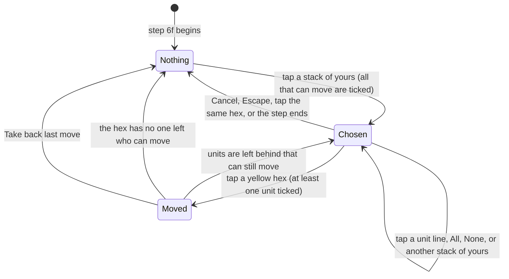
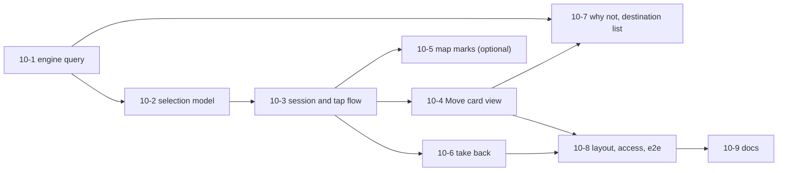

# 10. Choosing which units of a stack move

Status: approved 2026-10-15 with the decisions below (nothing built yet); first proposed 2026-10-15, from the play-test (docs/FEEDBACK.md, entry 2: "when you have 2 units on a hex they stay grouped when moving"). Roadmap "Next up" item 3. Builds on spec 03 (ground movement, built), spec 07 (the hex card, part A, now built as ticket 07-3, and the way the attack card keeps a draft; the map marks, 07-5, and the tap-to-attack flow, 07-6, are not built yet) and spec 08 (zoom buttons; its "zoom to the selected counter" fits the yellow hexes this spec draws). Words and sketches only; the build plan is part H. Nothing is built until the product owner says "let's go".


## Decisions (product owner, 2026-10-15)

| # | Question | Decision |
|---|---|---|
| 1 | Default ticks | Every unit that can move starts ticked (one tap fewer for the common whole-stack move). |
| 2 | "2 of 4" | The rules limit a hex to two ground units; the other counters in a stack of four are air or naval. Frank wants to pick only the ground ones, so the card must make the ground layer easy to pick and treat air and naval lines as separate. |
| 3 | Take back | Yes: repeatable until the step ends, or until something hidden is revealed (a combat roll). Hidden afterwards. |
| 4 | After a partial move | The hex stays chosen and the rest stay ticked. |
| 5 | Faster unit's extra reach | A **second shade of yellow** (rejected option 7 is now chosen); keep the one-sentence line as the text equivalent so colour is not the only cue. |
| 6 | Destination list for keyboard and small hexes (ticket 10-7) | Later. The map-based move is solved first. |

The engine facts listed under "Engine facts to confirm" stay `TODO(verify)`; the stacking-limit wording in answer 2 came from the owner's outside research and is checked against the rules text before the ticket that depends on it.

## Summary

- **Today** Frank taps a stack, taps a yellow hex, and the whole stack goes (or, if it cannot all go, "the biggest part that can", chosen by the game). He cannot say "only this one".
- **The engine already allows what he wants.** A move may name any units standing in one hex; each unit moves once per Player Turn; units left behind stay free to move later. Only the screen forces the whole stack. So this spec is almost all screen work, plus one small read-only engine query.
- **Recommended:** a **Move card** in the status column, where the step 6f prompt sits today (above the step buttons; the hex card of spec 07 stays below them). Tapping a stack opens it with every unit that can move already ticked, exactly as now, so the old two-tap move still works. Tap a unit's line to untick it; the yellow hexes at once shrink or grow to where the ticked units can go **together**. Tap a yellow hex: those units move, the others stay and stay selectable.
- **Yellow hexes** show where all ticked units can end up. A slower unit limits the group; the card says which one and what the faster one could do alone.
- **Take back last move**, a small safe undo for step 6f, is proposed (the engine has none).
- **Computer and watch mode** never see the card; nothing in the computer's moves changes.
- **Open for the owner:** 6 questions (part G). **To confirm in the rules:** 9 engine facts, all marked `TODO(verify)`.

## Goal

Frank can move **exactly the counters he wants** from a hex, one after another, without a coordinate or a unit number, with a finger on an iPad or a mouse on a computer:

1. See every counter in the hex and which of them can move now.
2. Tick the ones to move (by default all that can).
3. See where they can go together, tap the destination.
4. Move the rest of the hex somewhere else, or leave it.

## What exists today (checked in the code)

| Question | Answer | Where |
|---|---|---|
| What does the MOVE action accept? | `MOVE { side, units, path }`: **any non-empty set of distinct units that stand in one hex**, each able to move, along one path. A subset of a stack is accepted. Units in different hexes are refused. | `move-action.ts` (`resolveUnits`, `applyMove`) |
| Partial movement points? | **No.** A move uses the unit's whole move for the Player Turn: `ONE_MOVE_PER_TURN`. A unit that went 1 hex of its 4 cannot go on later. `TODO(verify, Ref 5.45f)`. | `movement.ts` |
| How units that start together but move apart are tracked | Per unit, not per stack: `GameState.moves = { turn, moved: [unit ids] }`, the key is "year-season-side", so it resets itself every Player Turn. A unit left behind is simply not in `moved`, so it can still move. There is no "group" in the state. | `move-record.ts` |
| What a group may do | It moves at its **slowest** unit's factor (`stackMovement`), one path for all, and all must fit at the end. | `movement.ts` |
| What the game lists (`legalActions`) | For a hex with 2 or more movable units: each unit **alone**, and the **whole** group. Not the sets in between. (For two units that is everything; for three, such as London's three British units or an airborne counter, the pairs are missing.) | `move-action.ts` (`computeMoves`) |
| Stacking at the destination | Two ground units per hex (three in London if all British); airborne are free; air and fleets have their own limits. The **whole moving group** must fit where it ends (`endProblem`); passing through a full hex is allowed. Anglo-French sharing before 1942 is refused. | `movement.ts`, `placement.ts` |
| Zones of control | Entering an enemy ZOC ends the move; leaving one is free; a friendly ground unit in a hex cancels the enemy ZOC there (`ZOC_POLICY`, `TODO(verify)`). The reach shown already accounts for this. | `zoc.ts`, `movement.ts` |
| Overstack elimination (step 6g) | Not wired. A move is **refused** if it would end over the limit, so the picker can never cause an elimination today. `eliminateOverstack` exists in `stacking.ts` but nothing calls it. | `stacking.ts`, PROGRESS |
| Control | Changes only for the hex where a move ends (`CONTROL_ON_PASS_THROUGH` off). Leaving a hex empty does not change who holds it. | `move-action.ts` |
| Dice | MOVE reads no dice. | `move-action.ts` |
| The tap flow | `moveFrom` holds the chosen hex; the yellow hexes are the **union** of every listed move from it; the tapped hex moves the biggest listed set that can go there, and the toast says who stayed. There is no way to name a smaller set. | `moveTap.ts`, `mapSync.ts` |
| Computer | It moves through `legalActions`-style choices and logs a one-line tally; unaffected if `legalActions` is unchanged. | `ai/move.ts`, `computerPlay.ts` |

**Which counters can be "in the stack" but cannot move.** A hex can hold air units, fleets, airbases and bridgeheads, and replacements, none of which move on the ground (`GROUND_MOVERS` is infantry, armor, airborne). Units that already moved this turn also stay. So Warsaw's "4 counters" are 2 that could move and 2 that never could. The card lists all of them and says why a counter is greyed.

## Words used here

- **Ticked**: chosen to move. **Free**: could be ticked but is not. **Greyed**: cannot move now, with the reason.
- **Together**: the ticked units move as one group to the same hex.
- **Left behind**: units of the hex not ticked. They stay where they are and can still move later this turn.

## Part A. Options considered

| # | Option | Good | Bad | Verdict |
|---|---|---|---|---|
| 1 | **Unit lines on a Move card** (tick or untick, then tap the destination) | Big targets (44 px), names and numbers visible, no new gesture, same pattern as the attack card of spec 07, works with mouse and keyboard. | One more card in the status column. | **Recommended.** |
| 2 | Tap the stack a second time to open a pop-up picker | Close to the map. | Today a second tap means "let go" (spec 08 rejected double-tap for the same reason). A pop-up hides the map and the yellow hexes. | No. |
| 3 | Long press on the stack | Fast once learned. | Invisible, iPad long-press also opens text and magnifier menus, no mouse equivalent, impossible to find by trying. | No. |
| 4 | "Select all / none / one by one" mode buttons | Simple to say. | Extra mode to forget. | **Kept as two small shortcut buttons** on the card ("All", "None"), not as a mode. |
| 5 | Tap the counters drawn on the map | Direct. | A counter is about 16 to 23 px on an iPad at first zoom and stacked counters overlap by 1.3 map units; a fat finger picks the wrong one. | No. The map only **shows** which are ticked (ticket 10-5). |
| 6 | Drag a counter to the destination | Natural on a board. | Dragging the map is how you pan it; fine control on a small hex is hard; no keyboard path. | No. |
| 7 | Show two kinds of yellow (solid: all can go; pale: only some can) and let a tap on pale move the ones that can | Shows the faster unit's extra reach. | The tap would move something the player did not tick; two colours to learn. | No for now (question 5). The card gives a sentence instead. |

## Part B. The screens

The Move card replaces the step 6f prompt line in the status column, above the step buttons (so "Done with step 6f" stays in view under it); under the pinned map on a phone; in the right-hand column on a wide iPad or computer. It exists only at step 6f, only for the human, only while a stack is chosen. The hex card built by ticket 07-3 stays where it is, below the step buttons, and still fills on every tap (`lookAt` writes only `lookedAt`); the choice is held in its own field (`moveFrom`, with the ticks), so looking never changes it. This is the rule 07-3 already tests: the whole session is compared before and after a look, and that test gains the new fields.



**State 1. Step 6f, nothing chosen** (as today, plus a list for fingers that miss small hexes):

```
+------------------------------------------------------+
| Step 6f: ground movement                             |
| Tap a stack of yours, tick the units to move, tap a  |
| yellow hex. Each unit moves once.                    |
| STACKS THAT CAN MOVE (14)                            |
| [ Lodz (N33)       2 units can move              > ] |
| [ Radom (N34)      1 unit can move               > ] |
|                       [ Done with step 6f ]          |
+------------------------------------------------------+
```

**State 2. A stack is tapped.** The hex is outlined thickly, the units that can move are ticked, the yellow hexes show where they can go together:

```
+------------------------------------------------------+
| MOVE FROM LODZ (N33)                       [ Cancel ] |
| Tick the units to move. 2 of 2 ticked.   [All][None] |
|  [x] 3-4 German armor                                |
|  [x] 2-3 German infantry                             |
|  [-] 1 German air   does not move on the ground      |
| Together they can go 3 hexes (the infantry's 3).     |
| The armor alone could go 4. Untick the infantry.     |
| Tap a yellow hex to move them there.                 |
+------------------------------------------------------+
```

`[x]` ticked, `[ ]` free, `[-]` greyed with the reason. Each line is a button with `aria-pressed`, at least 44 px high.

**State 3. Frank unticks the infantry.** One tap; the map changes before he lifts his finger:

```
|  [x] 3-4 German armor                                |
|  [ ] 2-3 German infantry              stays here     |
| 1 of 2 ticked. The armor can go 4 hexes.             |
```

**State 4. He taps a yellow hex.** The armor moves, the infantry stays, and the card stays open for the infantry (still chosen hex, infantry ticked, new yellow hexes):

```
| Moved: 3-4 German armor to Radom (N34).              |
| MOVE FROM LODZ (N33)                       [ Cancel ] |
|  [x] 2-3 German infantry          (not moved yet)    |
| [ Take back last move ]                              |
```

**State 5. Nothing ticked.** No yellow hexes; the line says "Tick at least one unit." A tap on the map says the same in the line over the map.

**State 6. A unit that cannot go anywhere** (hemmed in by enemy units or full hexes) is greyed with "no hex to go to"; if the ticked group has no yellow hex the card says which untick would help only when the engine can tell (ticket 10-7); otherwise it says "These units cannot all go anywhere together."

### What the yellow hexes show

- **Where all ticked units can end up together**: the hexes the group can reach at its slowest unit's factor, entering an enemy ZOC ends the path, and the whole group must fit at the end. The engine already computes exactly this for the group (`reachableHexes` and `endProblem`).
- **Different movement allowances.** The group takes the slowest. This equals the **overlap** of what each unit could reach alone, because a slower unit's reach lies inside a faster one's (every hex costs 1 today, and a larger budget never reaches less). Moving a group is only a shortcut for moving each unit to the same hex one by one, so nothing is lost: to send the fast unit further, untick the slow one (or move the slow one first, then the fast one).
- **Stacking.** Two units need room for two. Hexes with one free place appear for one ticked unit and vanish for two; the card says so in the line for a refused tap.
- **Refused tap.** A tap on a non-yellow hex says why when the engine can tell ("Radom (N34) holds an enemy unit: that is an attack, not a move"; "would hold 3 ground units, limit 2"), else "These units cannot get there together. The yellow hexes are the places they can." (ticket 10-7).
- **Nothing is hidden by the zoom**: spec 08's "zoom to the selected counter" button fits exactly these yellow hexes, so it keeps working.

### Units left behind

- They stay on the hex, **keep their right to move this turn**, and are not marked in any way except in the card's "stays here" text. No rule forces anyone to stay or to leave (nothing in the repo's rules text says a garrison is required, none is invented).
- After a move that leaves movable units behind, the hex **stays chosen** with the remaining movable units ticked, so a second move is one tap. If nobody there can move any more, the choice is dropped.
- Leaving a hex empty does not change who controls it (engine fact 5). A friendly unit that leaves no longer cancels enemy ZOC in its old hex for the **next** mover: the order of moves can matter, as on the board. The screen recomputes the yellow hexes after every move.
- The log says it in one line: "3-4 German armor move from Lodz (N33) to Radom (N34)." The toast adds "2-3 German infantry stay in Lodz (N33)."

### Undo and cancel

- **Cancel** (button, Escape, tapping the chosen hex again, or finishing the step) throws the choice away. Nothing was moved, nothing is recorded.
- **After a move there is no undo in the engine**, and a mis-tap on a small hex on an iPad is the likely accident (every other game step is also one press, but a move cannot be corrected by playing on). **Smallest safe thing proposed: "Take back last move"**, available only at step 6f, only for the human's own moves of the current Player Turn, repeatable back to the start of the step, and gone as soon as any other action is made (Done with step 6f, a build, the turn ending). It is not a game rule, only the screen. It is built **without touching the engine and without bypassing it**: the session keeps the game as it was when step 6f began and the list of MOVE actions made since; "take back" rebuilds the position by applying all but the last of them through `applyAction` again, and cuts the log back. MOVE reads no dice, so the result is identical; nothing is saved elsewhere, so a watched or saved record is unchanged (the human's games keep no record; a watch game has no human moves).
- Alternative considered: a "Move here" confirm button after the destination tap. Rejected: it adds a tap to every one of the dozens of moves in a turn and still does not fix the wrong-unit case.

## Part C. Step by step

| # | iPad (finger, no hover) | Mouse (computer) | What the game does |
|---|---|---|---|
| 1 | Reach step 6f. The list "Stacks that can move" fills. | Same. Hovering a hex shows the one-line hex info. | `legalActions` has MOVE actions; the screen groups them by starting hex. |
| 2 | Tap a stack on the map **or** its row in the list. | Click it. | The hex is outlined, the Move card opens with every unit that can move ticked, the yellow hexes appear. The hex card fills as well. |
| 3 | Read the lines. Greyed lines say why a counter stays. | Same. | Nothing changed in the game. |
| 4 | Tap a unit line to untick or tick it; or **All** / **None**. | Click it (Space or Enter on the keyboard). | The yellow hexes and the sentence under the list change at once. |
| 5 | Optional: tap another stack of yours. | Same. | The choice moves to that stack with its own default ticks. Nothing moved. |
| 6 | Tap a yellow hex (or zoom first with spec 08's buttons). | Click it. | One MOVE action with exactly the ticked units goes through `applyAction`. |
| 7 | Read the toast: who moved, who stayed. | Same. | The ticked units are marked moved; control may change at the end hex (shown in the log). |
| 8 | Move the rest the same way, or tap **Take back last move**, or **Done with step 6f**. | Same. | |
| Cancel | Tap Cancel, or tap the chosen hex again. Escape on a keyboard. | Same. | The choice is dropped. |

A tap on any **other** hex that is not yellow only fills the hex card and the line over the map (the same rule as spec 07's attack card), unless it is a stack of yours, which becomes the new choice.

## Part D. How it lives with what exists

| Thing | What happens |
|---|---|
| Hex card (spec 07, part A, built) | Unchanged and passive. Every tap still sets `lookedAt` first and then does what the step asks, so tapping a stack at 6f both chooses it (Move card) and lists it (hex card, with its "moved" notes). Tapping a yellow hex moves the units, and the hex card then shows the destination. The Move card's unit lines reuse the hex card's counter data (`CardCounter`: factors, kind, held-by, notes) and add a tick; the tick-line component spec 07 ticket 07-6 builds for the attack card is shared, whichever lands first. |
| Attack card (7h) | Never at the same time as the Move card (different steps). |
| Old tap flow | Replaced: "biggest part that can go" goes away; a tapped yellow hex moves exactly the ticked units. The default (all ticked) keeps the old two-tap move for a stack that can all go. |
| Computer | The Move card and the list are never shown during its turn (`computerToMove`). It chooses moves exactly as today. `legalActions` is unchanged, so self-play is byte-identical. Its moves appear in the log as the one-line tally; the hex card lets Frank look at what moved. |
| Watch mode (spec 06) | Taps only inspect. No Move card, no list (`s.watch`). |
| Saves and replays | The choice and the take-back history are screen state, not game state. What is applied is the MOVE action as before. |
| Zoom (spec 08) | The target button fits the yellow hexes; with nothing ticked it does nothing and says so. |
| Redraws | Lines and rows have stable `data-unit` and `data-hex` keys, so keyboard focus returns to the same line (`focusKeep.ts`) and the page does not jump while Frank ticks. |
| The old move prompt text | Reworded to mention the card ("tick the units to move"). |

## Part E. Touch, access, screen sizes

- **44 px.** Every button added is at least 44 px high and wide (unit lines, All, None, Cancel, Take back, list rows), at least 8 px apart. The map hex is not the only way in: the list rows select a stack with a full-size button; spec 08's zoom buttons help with the destination hex.
- **Keyboard and screen readers.** The map is not keyboard-operable today; the list rows and the card lines are real buttons, so a stack can be chosen and its units ticked from the keyboard. Choosing the **destination** needs the optional fold-out "Where they can go (N)" (ticket 10-7): place names, nearest first, one 44 px button each. Opening the card moves focus to its heading (`tabindex="-1"`); Escape cancels; a polite line says one sentence per change ("2 of 2 ticked. They can go 3 hexes."); lines carry `aria-pressed` and the text "ticked / not ticked", not colour alone.
- **Not colour alone.** The chosen hex has a thick outline, the yellow hexes keep today's style, and (ticket 10-5) ticked counters on the map get a small gold ring and left-behind ones a pale dash.
- **No hover.** Nothing is only on hover.
- **Layouts** as spec 07 part D: phone portrait and landscape and iPad portrait, single column under the pinned map; iPad landscape and computer, the right column (the Move card where the step prompt is), which scrolls on its own so the map never moves while Frank ticks.
- **Words.** English; all new text in one module (`moveText.ts`) next to `names.ts`, so a later French pass is a translation. No raw id may appear in any new text (a test checks `\bu\d+\b`); the engine's own refusal texts name ids, so the screen builds its own sentences from kinds and places.

## Part F. Tests

**Unit** (Vitest, `tests/move-options.test.ts`, `tests/move-selection.test.ts`, `tests/move-card-tap.test.ts`). Each cites its rule (Ref 5.0, 5.45f, 6.0, 26.0) and gets the usual mutation check.

| Test | What it proves |
|---|---|
| Subsets are accepted | In real 1939 and 1942 positions, for every subset of the movable units of a hex, every destination the new query lists is accepted by `applyAction`; a hex it does not list is refused or not reachable. |
| Equals the listing | For single units and for the whole stack, the query equals `legalActions` exactly. |
| Overlap | For a pair with different factors, destinations(pair) equals the overlap of the two single lists (this holds today; the test would flag a future terrain cost that breaks it). |
| Stacking | Moving 2 into a hex with 1 friendly unit: not offered for the pair, offered for each alone. London with three British; airborne free; Anglo-French refused. |
| ZOC | A group is stopped on entering an enemy ZOC; a ticked unit in an enemy ZOC may leave. |
| Defaults and reasons | All movable ticked by default; greyed for air, fleet, replacement, "already moved this turn"; no raw ids in any sentence. |
| Left behind | After moving one of two, the other is still movable and ticked; the mover is refused if tried again; the hex stays chosen; with nobody left the choice is dropped. |
| Tap routing | Ticking a line changes no game state; a tap on another hex fills the hex card only and keeps the choice; a tap on another stack of yours moves the choice; no card during the computer's turn or in watch mode; the choice is dropped when the step or the turn ends. |
| Take back | After 1, 2 and 3 moves, taking back restores the exact earlier state (deep equal) and the log; it is cleared by any other action; unavailable to the computer. |
| Computer unchanged | `legalActions` at 6f is identical to before; a fixed-seed self-play game is identical. |

**Playwright** (`tests/e2e/move-pick.spec.ts`, in the existing `mouse` and `touch` projects; the touch project uses `page.touchscreen.tap`). Not run while writing this spec.

1. 1939 as Axis, to step 6f as `move.spec.ts` does. Tap a hex with two movable units; the card opens with two ticked lines. Untick one; the yellow count does not drop below; tap a yellow hex; the log names one unit; the other is still on the origin and the card is still open with one line.
2. Take back: the moved unit is back; the log line is gone; a second move works.
3. Cancel, Escape and a second tap on the hex each drop the choice.
4. A hex with a greyed counter (air) shows the reason.
5. The list path: choose the stack from its row; same card.
6. Keyboard: Tab to a row, Enter, Space on a line, Escape.
7. Sizes 390 x 844, 844 x 390, 820 x 1180, 1024 x 768, 1366 x 1024, 1400 x 1000: every button in the cards is at least 44 px high, no sideways scroll, the map is still on screen with the card open.
8. Watch mode and the computer's turn: no card.

## Part G. Out of scope

| Not in this spec | Why not now | Room left |
|---|---|---|
| Air movement, fleets, airborne drops, Strategic Redeployment | Not built (roadmap 6.4; spec 03). | Greyed lines already say "air units do not move yet". The card works for any counter the engine says is movable. |
| Terrain costs, partial movement, moving a unit again | Rules not settled (engine facts 1 and 2). | The card reads "movable" from the engine, so a rule change shows up with no screen change. |
| Overstack elimination at 6g | Not wired; the engine refuses an overstacking move. | If the rule turns out to allow ending overstacked, yellow could show those hexes with a warning (engine fact 4). |
| Two-tone yellow, dragging, long press | Part A. | |
| Choosing the route | The engine takes the cheapest path; the route does not change control (`CONTROL_ON_PASS_THROUGH` off). | If pass-through control is ever on, a route choice becomes a rules ticket first. |
| Unit inspector fields (supply, notes) | Spec 07. | |

## Part H. Build plan

Difficulty easy / medium / hard; size S (under half a day), M (about a day), L (more). One branch and one pull request each, one reviewer from a stronger level than the author (CLAUDE.md). At most 4 workers at once.

| # | Ticket | Difficulty | Size | Needs | Files |
|---|---|---|---|---|---|
| 10-1 | **Engine query.** A pure `moveOptionsFor(ctx, state, unitIds)` that returns destinations and paths for any subset of one hex (built from `reachableHexes` and `endProblem`, the same code `legalMoves` uses). `legalActions` unchanged. Tests of Part F, mutation checks. | medium | S | none | `move-action.ts` (or a new `move-options.ts`), tests |
| 10-2 | **Selection model.** Pure `src/ui/moveSelection.ts`: lines (ticked, free, greyed with reason), defaults, the sentences (limit, "could go further alone"), left-behind summary. No DOM. | medium | M | 10-1; names (07-1, done) | `moveSelection.ts`, `moveText.ts`, tests |
| 10-3 | **Session and tap flow.** `moveChosen` in the session; rewrite `tapToMove` (tick, All, None, destination through `applyAction` with exactly the ticked units, hex stays chosen, drop on step change, computer and watch); `mapSync` uses the new targets; update `move-tap.test.ts`. | hard | L | 10-1, 10-2 | `moveTap.ts`, `session.ts`, `sessionActions.ts`, `mapSync.ts`, tests |
| 10-4 | **Move card view.** Card (in the place of the step 6f prompt), unit lines from `CardCounter`, All/None/Cancel, "Stacks that can move" list, live line, Escape, focus keeping, reworded prompt. | medium | M | 10-3 (07-3, the hex card, is merged) | `moveView.ts` (new), `statusView.ts`, `statusBind.ts`, `focusKeep.ts`, `style.css` |
| 10-5 | **Map marks** (optional). Gold ring on ticked counters, dash on left-behind ones; shares the layer of spec 07 ticket 07-5 (not merged yet). | easy | S | 10-3 | `mapCounters.ts`, `mapView.ts`, `style.css` |
| 10-6 | **Take back last move.** Replay-based, step-6f only, cleared by any other action; log cut. | medium | M | 10-3 | `moveUndo.ts` (new), `session.ts`, `moveView.ts`, tests |
| 10-7 | **Why not, and a list of destinations.** An id-free refusal sentence for a tapped non-yellow hex; the fold-out "Where they can go (N)" for the keyboard. | medium | M | 10-1, 10-4 | `moveWhy.ts` (new), `moveView.ts`, engine reason helper |
| 10-8 | **Layout, access and Playwright.** The sizes, 44 px measures, keyboard, scroll-into-view, the 8 browser checks. | medium | M | 10-4 (10-6 for the take-back check) | `style.css`, `tests/e2e/move-pick.spec.ts` |
| 10-9 | **Docs.** "As built" here, RULES.md open questions, FEEDBACK.md item ticked, ROADMAP "Next up" item 3. | easy | S | all | docs only |



- **Wave 1:** 10-1, then 10-2 (both small, different files).
- **Wave 2, alone:** 10-3. It edits `session.ts`, `sessionActions.ts` and `mapSync.ts`, which spec 07's ticket 07-6 (tap-to-attack) also edits. Run one after the other, or rebase the later one. 07-3 already changed `sessionActions.ts` (`lookAt`), `statusView.ts` and `main.ts`; start from main.
- **Wave 3, in parallel (up to 3):** 10-4, 10-5, 10-6 (different files; 10-4 and 10-6 both touch `moveView.ts` lightly, so 10-6 lands second; 10-5 reuses the map-marks layer of 07-5, so it waits for that or adds the layer itself).
- **Wave 4:** 10-7, then 10-8, then 10-9.
- **Useful stopping point:** after 10-4 Frank can already pick units. 10-6 (take back) should follow before he plays long turns on an iPad.

## Rules references

Ref 5.0 and 26.0 (stacking, Anglo-French), 5.45f and 5.45g (movement, overstack), 6.0 (ZOC), 7.0 (control); PC README 3.35 (free movement once setup is met). Section numbers as already used in specs 03 and docs/RULES.md.

## Open questions

**For the product owner (decisions that are yours)**

1. **Default ticks.** Proposed: every unit that can move is ticked (one tap fewer than the old flow for a whole stack). The other way, nothing ticked, makes Frank tick every unit every time. Right?
2. **"2 of 4".** The stacking limit makes a hex hold two ground counters (three in London, plus free airborne). Did Frank mean a hex with 2 ground and 2 air counters (like Warsaw), so "pick the ground ones", or a bigger stack he could build? The card handles both; the answer decides how much to polish air lines.
3. **Take back.** Proposed: yes, repeatable until the step ends, hidden afterwards. Or only the very last move, or none (he plays a real-board-game style where a moved piece stays moved)?
4. **Stay selected after a partial move.** Proposed: the hex stays chosen with the rest ticked. Or drop the choice every time?
5. **Faster unit's extra reach.** Proposed: one sentence ("The armor alone could go 4"). Or two shades of yellow (rejected option 7)?
6. **Destination list for the keyboard / small hexes** (ticket 10-7): wanted now, or later?

**Engine facts to confirm in the rules (all `TODO(verify)`, none invented)**

1. A unit moves **once** per Player Turn, using its whole move; no stopping part-way and going on later (`ONE_MOVE_PER_TURN`; Ref 5.45f).
2. Terrain costs: every hex costs 1 today (`TERRAIN_MOVE_COST`); a real cost would change the "overlap equals the slowest unit's reach" statement only if the test in Part F flags it.
3. Units of **different nations** (Germans with Italians) may move as one group (the engine allows it; only British and French are kept apart before 1942).
4. **Overstack:** stacking.ts describes "movement may leave a hex over the limit; step 6g eliminates", while movement.ts refuses to end over the limit. Which is right (Ops 5.45g)? This decides whether full hexes appear as destinations.
5. Control of a hex does not change when the last unit leaves it (`CONTROL_ON_PASS_THROUGH` off, Ref 7.0).
6. A friendly ground unit cancels enemy ZOC in its hex (`ZOC_POLICY.friendlyUnitNegates`), so moving a unit out of a hex can change what the next mover can do.
7. Replacements do not move on the ground (no movement factor); airborne counters are treated as ground movers with stacking free.
8. A group moves at its slowest unit's factor is an engine convention, equivalent to single moves to the same hex; confirm nothing in 5.45f treats a stack as one move (for example a shared Zone-of-Control stop).
9. Whether a moved unit keeps the right to enter a hex another unit just entered when both are ticked in the same group (stacking counted one at a time in `endProblem`).

**For the builders**

- B1. Ticket 10-1: a new read-only query, or list every subset in `legalActions` (cap at 7 sets for a 3-unit hex)? Proposed: the query, as spec 07 did for attack subsets; `legalActions` stays short and the computer's cost does not change.
- B2. Should `moveOptionsFor` live in `move-action.ts` (122 lines, lint limit 300) or its own file? Proposed its own file.
- B3. Reaching step 6f in e2e takes a dozen clicks (as in `move.spec.ts`); a shortcut belongs to a separate ticket.

## As built (tickets 10-1 and 10-2)

- **10-1** `src/engine/move-options.ts`: `moveOptionsFor(ctx, state, unitIds)` returns `{ ok, units, from, points, destinations: [{ to, path }], tooFull }` for any non-empty subset of the movable units of one hex, or `{ ok: false, error }`. It reuses `destinations` (now exported, with `resolveUnits`, from `move-action.ts`; nothing else there changed) so it is the code `legalMoves` runs; `tooFull` lists hexes in reach where the group may not all end. `legalActions` is unchanged: self-play for 1939 seed 1 and campaign seed 2 is byte-identical before and after. Tests: `tests/move-options.test.ts` (real self-play positions from all four scenarios).
- **10-2** `src/ui/moveSelection.ts` (`defaultTicks`, `toggled`, `selectionFor`, `movedLine`) and `src/ui/moveText.ts` (every sentence): lines are ticked, free or greyed with a reason, ground layer first; `destinations` is the yellow, `alone` the second shade (hexes a faster ticked unit reaches alone). A unit with no hex to go to alone is greyed and not ticked by default. Tests: `tests/move-selection.test.ts`, including a no-id check over real positions.
- The three open assumptions are named in `movement.ts`: `STACK_MOVES_AT_SLOWEST_UNIT` and `STACKING_CHECKED_ONE_AT_A_TIME` mark the assumption only; `MIXED_NATIONS_MOVE_TOGETHER` is a real switch (false refuses a group of several owners in `endProblem`). The tests name them as current assumptions, not settled rules.
- The second shade (`alone`) holds only hexes beyond the group's reach; hexes within reach that are too full for the whole group are told by the `room` sentence instead. The "cannot all go anywhere together" sentence is exactly the spec's (no hint to untick one: the spec leaves that to ticket 10-7).
- Still `TODO(verify)`: one move per Player Turn (Ref 5.45f), every terrain costs 1 so "hexes" equals movement points (Ref 4.5; `POINTS_ARE_HEXES` switches the words), replacements do not move (engine fact 7), mixed nations move as one group (fact 3), group at the slowest factor (fact 8), stacking counted one unit at a time (fact 9).

## As built (tickets 10-3 and 10-4)

- **10-3** `Session.moveChosen` (`src/ui/moveDraft.ts`: the hex, the ticked unit ids, the Player Turn, and two once-only flags `fresh` and `focus`) replaces `moveFrom`. `src/ui/moveTap.ts`: `tapToMove` (a stack of yours with a mover is chosen with every mover ticked, also on a yellow hex; the chosen hex again lets it go; a yellow hex moves exactly the ticked units with one MOVE through `run`/`applyAction`; the old "biggest part that can go" is gone), `chooseStack` (also for the list), `toggleTick`, `tickAll`, `tickNone`, `cancelMove`, `selectionNow` (cached per game state and ticks), `moveTargets` (yellow), `moveFurther` (the second shade), `normaliseMove` (called from `normaliseMode`: the choice is dropped when it is not the player's step 6f, the Player Turn changed, nobody in the hex can move, and ticks on units that cannot move any more are removed; never shown on the computer's turn or in watch mode). After a partial move the hex stays chosen with every unit that can still move ticked (decision 4); with none left the choice goes. The toast after a move is "Moved ... from X to Y." plus "Staying in X: ...". A tap on the second shade moves nothing and says the "alone could go" sentence; any other hex says "These units cannot get there together". `mapSync` draws the yellow hexes and, in `g.highlights`, the second shade as `polygon.further` (paler, dashed outline); a choice made from the list moves the map once if the hex or its destinations are out of sight.
- **10-4** `src/ui/moveView.ts` (card, list, announcement, `revealMove`) and `src/ui/moveBind.ts` (handlers, `onMoveKey`: Escape cancels, a unit-tested function like the attack card's). The card sits where the step 6f prompt was; the Next bar leads the column at the player's step 6f (`leadsStatus`, `nextText` in `nextBar.ts`) with "Done with step 6f" in it, then the toast, then the card or, with nothing chosen, the list "Stacks that can move (N)" under the reworded prompt. Unit lines are 56 px buttons (`aria-pressed`, "Ticked / Not ticked / Cannot move" in words), the hex card's `CardCounter` supplies the factors and kind, layers (Ground, Air, Naval, Other) get headings when a hex holds more than one, the live line is `together`, `further`, `room`, `advice`, `leftBehind` of the selection, the polite screen-reader line reuses the page's live node. The hex card stays below the step buttons; while a move choice is open a tap does not scroll to it or take the focus (the Move card stays where it is); Escape cancels the choice wherever the focus is (`bindMoveEscape`); All, None and Cancel clear a leftover toast; arriving at step 6f scrolls the column so the Next bar and the list are in view (`revealMoveStep`). The `moveFrom` of spec 07's text is now `moveChosen`. Styles in `src/move.css`.
- **Tests.** `tests/move-card-tap.test.ts` (27, session logic), `tests/move-card-view.test.ts` (10, wording over real positions, plurals, order, who sees it), `tests/move-tap.test.ts` and `tests/hex-look.test.ts` updated, `tests/e2e/move-pick.spec.ts` (mouse and touch: pick, untick, move one; two taps; None/All; Cancel, Escape, second tap; list; greyed air; no ids; watch; four sizes 1024x768, 1180x820, 768x1024, 390x844 with the Next bar and the card's buttons in reach and 44 px measured). The e2e game is the recorded game of `axis-at-7h.json` cut at its first MOVE.
- **Left for later tickets.** 10-5 (the chosen hex's thick outline and the rings on ticked counters), 10-6 (take back), 10-7 (why-not sentences for a refused tap, the destination list), 10-8 (keyboard e2e, 844x390, 1366x1024 and 1400x1000 sizes). No new engine fact: the `TODO(verify)` list above is unchanged.

## As built (tickets 10-5 and 10-6)

- **10-5 Map marks.** `src/ui/moveMarks.ts` is the pure model (`moveMarksOf(selection)`: the chosen hex, the ticked unit ids, the left-behind ones; a greyed counter is neither). The one marks layer of spec 07 (`g.attack-marks`) also draws the chosen hex: `AttackMarksInput.from` gives a thick dark outline (`.mk-from`, 4 px). The counters of a stack overlap (1.3 units), so a mark drawn on a counter was hidden under the next one (review fix): each marked counter now has a badge in a row under the stack, in its own group `g.unit-marks` above the counters (`src/ui/mapUnitMarks.ts`, pure geometry `badgesFor`): one slot per drawn counter, left to right in stack order, joined to the counter's bottom edge by a thin line; a ticked counter gets a round gold ring with a tick, a left-behind one (could move, not ticked) a flat pale dash. No badge touches a counter, so none covers a number or a symbol, and the counters are drawn exactly as without marks (no veil: number contrast is the counter's own, 4.5 to 1 or better for every nation; the USSR fill was darkened from #a0663e to #955d36 for that, it was 4.08 to 1). Badge strokes are in map units, so they scale with the counters; the gold against its dark case measures at least 3 to 1. `syncMap` passes `selectionNow` to `MapView.setUnits(units, marks)` and `setAttackMarks({ from })`; nothing changes in the engine, nothing is drawn for the computer or in watch mode, and the layer takes no taps. Tests: `tests/move-marks.test.ts` (geometry for stacks of 1 to 4, contrast), `tests/e2e/move-marks.spec.ts` (mouse and touch; at 1024x768, 1180x820, 768x1024, 390x844 a stack of two and of three, each marked counter's badge clear of every counter and of the other badges).
- **10-6 Take back last move.** `src/ui/moveUndo.ts` plus `Session.undo` (`MoveUndo`: the position before the first move of the step, the MOVE actions since each with its sentence and the log length before it, the position and log length after the last). After each move `noteMove` extends the history; `takeBack` rebuilds the position by applying all but the last action to the base through `applyAction` again, cuts `Session.log` back to the length before that move and deletes the `logSides` entries from that index on, drops the move choice and tells "Took back: Moved 2 German infantry from A to B." in the toast, the map toast and the polite live line. The reason and the refusal agree: outside the player's own step 6f (watch mode, the computer's turn) the button's reason says so. The history holds only while the session is still at its last position (`tip`) and log length, so any other action (a step button, a build, the turn ending, the computer playing) kills it without anyone having to remember to clear it (`takeAction` also clears it). `atStep6f` moved to `src/ui/step6f.ts` (re-exported by `moveTap.ts`) to keep the modules free of import cycles. Never recorded on the computer's turn or in watch mode. The engine is untouched (self-play 1939 seed 1 and campaign seed 2 reports are byte-identical to main apart from the wall-clock seconds).
- **The button.** "Take back last move" (`#move-undo`, `moveView.ts`) is the first row of the Move section at the player's step 6f, whether the list or the card is open, and stays when no unit can move any more (so the last move can still be taken back). At least 44 px; with nothing to take back it is greyed (`aria-disabled`, still focusable) and says why beside it ("Nothing to take back: no move made yet."), else it says "Last move: Moved ..." so the player knows what it will undo. Measured at 1024x768, 1180x820, 768x1024 and 390x844.
- **Hidden information.** The spec names only a combat roll (decision 3), and a MOVE reads no dice, so nothing at step 6f can reveal anything. The code takes the safer reading anyway: a move after which `rngState` differs starts a new history from that position (`revealedHidden`) and the reason reads "A die was rolled: earlier moves cannot be taken back." `TODO(verify, spec 10 decision 3)`: whether anything besides a die counts as revealing.
- **Tests.** `tests/move-undo.test.ts` (21 incl. a property test: random stacks, ticks, destinations and take backs over real positions from all four scenarios equal the replay of the surviving moves, state with `rngState`, log and log colours byte for byte), `tests/e2e/move-undo.spec.ts` (mouse and touch: greyed then lit, press undoes and cuts the log, repeat, redo gives the same log, Done ends it, four sizes, watch). Mutation checks: `slice(0, -1)` to `slice(0)`, log not cut, colours not cut, `tip` check removed, `rngState` check removed, base kept from the first move only, the greyed attribute removed, `noteMove` not called, `free` read as `greyed`, ticked and left swapped, the chosen-hex outline not drawn: each fails at least one test.
- **Left for later tickets.** 10-7 (why-not sentences, destination list), 10-8 (keyboard e2e, 844x390, 1366x1024, 1400x1000). Take back does not restore the Move card's choice (the state diagram goes to "Nothing"): the player taps the stack again.

## Done when

1. Frank can tick the counters of a hex he wants to move, see the yellow hexes change with the ticks, tap one, and exactly those counters move; the rest stay and can still be moved this turn. No coordinate and no unit number is needed on the way.
2. The yellow hexes are always the places **all** ticked units can end up together; a refused tap says why when the engine can tell.
3. A move can be taken back at step 6f (if the owner says yes), and a choice can be cancelled by button, Escape or a second tap.
4. The computer and watch mode never see the card; `legalActions`, the computer's moves and a fixed-seed self-play are identical to before.
5. Every button is at least 44 px on phone, iPad (both ways) and computer; the Playwright mouse and touch tests of Part F pass; lint, typecheck, unit tests and build pass.
6. No rule was added: anything not in docs/RULES.md is marked `TODO(verify)` and listed above.
