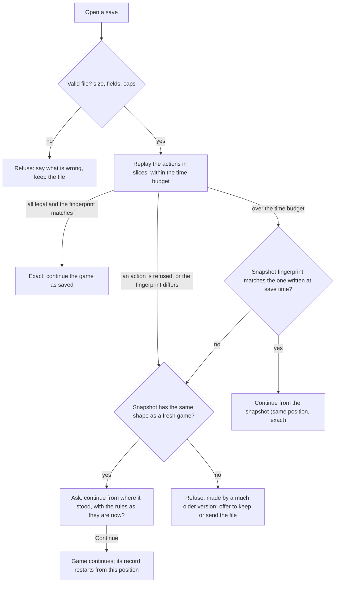
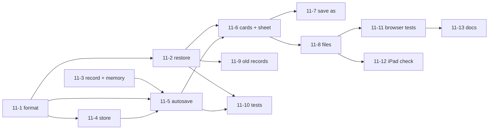

# 11. Save and load: autosave, saved games, a save file

Status: approved 2026-10-15 with the decisions below (nothing built yet); first proposed 2026-10-15. ROADMAP phase 8.5 ("Save, load, autosave, export file") and part of Release 1 ("autosave, save slots and a save file, iPad"). Builds on spec 01 (the steps, step 10b), spec 05 (the computer) and spec 06 (watch mode saves a record file already). Words and sketches only; the build plan (part K) is the next step. Nothing here changes a game rule.


## Decisions (product owner, 2026-10-15)

| # | Question | Decision |
|---|---|---|
| 1 | Old saves after an update | Continue from where the game stood, with today's rules, and say so plainly. Best-effort loading beats losing hours of play on a minor update. |
| 2 | Autosave | Always on, no switch. |
| 3 | Resume | A card that never blocks; a new game is one tap away. |
| 4 | Named saves | 12 slots, plus Autosave, Turn backup and Earlier game. |
| 5 | Turn backup | Keep it: a safety net against a catastrophic misclick. |
| 6 | Reminder to save to a file | Once per session, at the end of a turn (step 10b), to avoid alert fatigue. |
| 7 | File type | Plain `.json`: readable everywhere and easy to share for bug reports. |
| 8 | Home Screen app | Show a one-line warning: Safari and the Home Screen app use separate storage, so saves do not transfer automatically. |

The engine and platform facts (E1 to E8) stay `TODO(verify)`.

## Summary

- **The problem.** Frank plays on an iPad. Safari can close or reload a tab at any moment and can throw away a site's stored data. Today a reload loses the whole game.
- **Recommended: save the game as its list of actions, plus a small photo of the position.** The engine is deterministic (same start, same seed, same actions, same game), so the list of actions is exact and small, and `replay` already rebuilds a game from it. The photo (a "snapshot") is a rescue for the day the rules change and an old list no longer replays. Today a full game is about 50 to 65 KB of actions and 15 to 21 KB of snapshot.
- **A save is checked when it is opened.** The game replays the actions and compares the result with a short fingerprint of the position written at save time. Same fingerprint: the game continues exactly. Different or impossible: the player is told in plain words and may continue from the snapshot with the new rules, or keep the file.
- **Autosave is silent and always on** (about one second after each action, and whenever the tab is hidden or a Player Turn ends at step 10b). On the next visit a card asks "Continue your game?". A fresh game never overwrites an old autosave until the player acts.
- **Named saved games** (up to 12) and **a save file** (download on iPad to the Files app, or the share sheet; open with a file picker). The file is the real safety net, because Safari may delete stored data.
- **Stored in the browser's IndexedDB**, on the device only. No account, no sync, no network.
- **Files are treated as untrusted**: size and length caps, a strict check of every field, a time budget with a progress bar and a Cancel button, nothing is ever run as code, and nothing is written to storage until a load has fully worked.
- **Open for the owner:** 8 questions (Open questions). **Engine facts to confirm:** 8, marked `TODO(verify)`.

## Goal

1. Closing or reloading the tab never loses more than about a second of play.
2. The player can keep several games, name them, and come back to any of them.
3. The player can take a game out of the browser as a file (to back it up, to move it from the iPad to the MacBook, or to send it with a bug report) and open it again.
4. A save that cannot be opened says why, in words, and is never deleted by the game.

## Words used here

- **Record**: the list of every action taken in a game, from the first setup placement on, in order. With the scenario and the seed it rebuilds the game exactly (`replay`).
- **Seed**: the number that decides every die roll and the computer's tie-breaks. Chosen when a game starts.
- **Replay**: playing a record back through the engine, action by action.
- **Snapshot**: a copy of the whole position (`GameState`) at the moment of saving.
- **Fingerprint**: a short code computed from a position. The same position always gives the same code and any difference gives another. It detects damage and "this no longer replays the same"; it is not a lock and does not stop anyone from editing a file.
- **Autosave**: the save the game makes by itself. **Saved game**: one the player named. **Save file**: a saved game as a `.json` file outside the browser.
- **Storage**: the room the browser gives this site. **Evict**: the browser deletes that room's contents.
- **Home Screen app**: the game added to the iPad Home Screen with Safari's Share > Add to Home Screen.

## What exists today (checked in the code)

| Question | Answer | Where |
|---|---|---|
| Is there any saving? | No. Nothing uses `localStorage` or IndexedDB. A reload starts a fresh 1939 game. | `main.ts` ends with `start(SCENARIO_1939, "axis")` |
| Is the game replayable? | Yes. `replay(ctx, initial, actions)` re-applies a list and throws on the first illegal action. The record starts at `newGame(scenario, seed)` and includes the setup placements. | `engine/actions.ts`, `engine/game.ts` |
| Is it deterministic? | Dice come from `state.rngState` (a seeded generator, advanced on every roll and stored inside the state). The engine bans `Math.random`, clocks and timers (a test enforces it). The computer picks with `jitter(seed, key)`, which has no hidden counter. | `engine/rng.ts`, `ai/random.ts`, `tests/engine-purity.test.ts` |
| Is the state plain data? | Yes: "complete, JSON-serializable". 15 to 21 KB at the end of a game. | `types.ts` (`GameState`) |
| Who keeps a record? | Only watch mode: `Session.record`, filled by `run()` when it exists. A single-player game keeps none. | `session.ts`, `watchPlay.ts` |
| What else a game needs besides the state? | The side the player plays (`humanSide`), the seed, and the computer's memory (where each unit is heading, hexes it just left). The memory is not in the state, so a reload today would make the computer forget its targets. | `Session`, `ai/memory.ts` |
| An existing file format? | Yes: the self-play and watch-mode record, `format: 1`, with `scenario`, `seed`, `setupActions`, `actions`, `ended`, `anomalies`. Spec 06 says it cannot be loaded into the browser yet. | `watchRecord.ts`, `scripts/selfplay` |
| Step 10b "Save-Game prompt" | A step the engine waits at: the only action there is "End turn". The engine does nothing else with it. What the PC game does at this step is not written down here. | `sequence.ts` (Ops 5.49b), `TODO(verify)` |
| Take over (watch mode) | Clears `record`, so the new single-player game would have no record. | `watchPlay.ts` `takeOver` |

Measured on `main` (653 and 848 actions; a headless computer-against-computer game to the end of the scenario, seed 1):

| Scenario | Record | Snapshot | Replay on a development machine |
|---|---|---|---|
| 1939 | 49 KB | 15 KB | 0.5 s |
| 1942 | 64 KB | 21 KB | 1.1 s |

These games end early because many rules are not built (air, naval, supply, victory). Records and replay time will grow as they land. An iPad is probably several times slower than a laptop: measure it (ticket 11-12).

## Part A. What to save

| Option | Small? | Exact? | Survives a rules change? | Fast to open? | Risk |
|---|---|---|---|---|---|
| **1. Record only** (scenario, seed, actions) | Medium (50 to 65 KB now) | Yes, by construction | No: an old action list can become illegal | Slow (the whole game replays) | Every release that adds a waiting step or changes a rule can break old saves |
| **2. Snapshot only** (the position) | Smallest (15 to 21 KB) | Yes, if stored whole | Yes while the shape of the state is unchanged | Instant | No history; a damaged or hand-edited snapshot can break the engine; a new field in the state leaves old snapshots incomplete |
| **3. Both, record first** (recommended) | About 70 to 85 KB | Yes | Yes, through the snapshot | Replay time at worst | A little more storage |

**Recommendation: option 3.** The record is the truth and is what a load uses. The snapshot is stored beside it for two jobs only: rescue when the record no longer replays, and a fast path when a replay would take too long. A fingerprint of the final position is stored too.

### When a save was made by an older version of the game

The game never guesses. On opening, in this order:



- **Refuse?** Only when nothing can be recovered (no usable snapshot). The file is kept untouched.
- **Migrate?** No. A converter for every rules change is endless work and still guesses. The fingerprint tells us the truth without one.
- **Rescue** is the middle road: the position is exactly as saved, the rules from there on are today's. The card says so plainly (sketch 5). The new record then starts from that snapshot (`start`, part B).
- **No version number decides anything.** The fingerprint does: if the rules changed but this game replays the same, it opens exactly. The game version is stored only to word the message ("saved by version X").
- **Shape check without a version number.** A snapshot is accepted only if it has the same fields as a fresh game of its scenario (top level, each nation and each unit). A field added to the engine therefore blocks stale snapshots by itself. A hand-kept `stateVersion` number covers what that check cannot see (a field that changed meaning). `TODO(verify)`: builders to confirm the check is enough.

## Part B. The save file

One JSON file, also used for storage (a saved game in the browser is the same object). It keeps the keys of the self-play record (`scenario`, `seed`, `actions`, `setupActions`), so `replay(ctx, newGame(scenario, seed), actions)` still works on it; `format` is 2, and a `format: 1` file is still read (part G).

| Field | What it holds | Notes |
|---|---|---|
| `format` | `2` | A newer number than the game knows is refused: "made by a newer version". |
| `app` | `"3reich"` | To recognise our files. |
| `title` | Name typed by the player | At most 40 characters, shown as plain text only. |
| `savedAt`, `gameVersion` | Date and the build that saved it | For messages and the list. No personal data. |
| `scenario`, `seed`, `humanSide` | Which game, its seed, the side the player has | `humanSide` is `axis` or `allies`. |
| `start` | `{ kind: "new" }` or `{ kind: "snapshot", state }` | "new" = the record starts at `newGame(scenario, seed)`. "snapshot" = after a rescue, from that position. |
| `actions`, `setupActions` | The record | Capped (part H). |
| `fingerprint` | Code of the position after the last action | Computed from sorted-key JSON, so key order cannot change it. |
| `snapshot` | The position after the last action | The rescue. |
| `ai` | The computer's memory (targets, hexes just left) as plain data | Optional. Without it the game still opens; the computer just forgets its targets (open item E5). |
| `logTail` | The last 60 log lines | Optional, plain text, so the log is not blank after loading. |
| `note` | Text for a bug report | Optional; the later "Send feedback" button can fill it. |

**Dice and determinism.** The position includes `rngState`, so a loaded game rolls the same dice it would have rolled. Loading an earlier save and doing the same thing gives the same result; doing something else gives a different one. The computer's choices depend only on the position, the seed and (if saved) its memory. This is checked by tests (part I) and, once, between the iPad and the MacBook (E2).

## Part C. Where saves live

| | `localStorage` | **IndexedDB (recommended)** |
|---|---|---|
| Room | About 5 MB per site, counted in text characters | Far more (the browser decides; ask with `navigator.storage.estimate()`) |
| Writing | Instant but blocks the page | Off the main thread; objects are stored directly |
| Final write when the tab goes away | Completes | May not complete on iPad (E6) |
| Code | Simplest | A few more lines, behind a small `SaveStore` (list, get, put, delete) |

Ten saves of today's size are about 1 MB. Games will grow, so IndexedDB is the safer room. A hand-made in-memory `SaveStore` is used in tests and as the fallback when storage is not available (private window, storage blocked): the game still plays, autosave is off, and a one-line notice says "Saves are not kept in this browser window. Use Save to a file."

**Safari and eviction** (browser facts to confirm on Frank's iPad, `TODO(verify)`, ticket 11-12):

- Safari may delete a website's stored data after about a week of Safari use without the person visiting it. A game added to the Home Screen is said to be exempt.
- A Home Screen app and the same address in a Safari tab are said to have **separate** storage. Saves made in the tab will not appear in the Home Screen app. The save file moves them across.
- `navigator.storage.persist()` asks the browser not to evict. Recent Safari may grant it, mostly to Home Screen apps. The game asks once after the first autosave, and does not depend on the answer.
- None of this can be tested with the Chromium used in CI. A short manual check on the real iPad is part of the build plan.

**Rule: save files are the safety net.** The Saved games sheet says so in one sentence, with the Save to a file button next to it. No nagging.

## Part D. When the game saves

| Moment | What happens |
|---|---|
| After each action | The autosave is marked "needs saving". |
| `AUTOSAVE_DELAY_MS` (1 s) after the last action, but at least every `AUTOSAVE_MAX_WAIT_MS` (5 s) | The autosave is written. During the computer's turn many actions come quickly; this keeps it to one write. |
| The tab is hidden or leaving (`visibilitychange` to hidden, `pagehide`; iPad does not reliably send `beforeunload`) | A write starts at once. |
| A step changes, or step 10b is reached (the "Save-Game prompt") | A write starts at once. At 10b the player's turn is complete, so it is also copied to the **Turn backup** slot. |
| Never | While loading, in watch mode, and before the player's first action in a fresh game (below). |

- **Any moment between two actions is a safe save point.** Even an Exchange waiting for its losses to be chosen is in the position, and the setup phase works the same way: the record holds the placements.
- **A fresh game does not overwrite the old one.** The page opens on a new 1939 game as it does today. Its autosave is armed by the player's first action (or by "Start a new game" on the Continue card). Until then the stored autosave is untouched. When a new game's first write replaces an autosave that has progress, the old one moves to the **Earlier game** slot first.
- **Never half a save.** A write replaces the whole entry or fails; the previous entry stays. A load that fails writes nothing.
- **Slots.** Autosave, Turn backup, Earlier game, and up to `MAX_NAMED_SAVES` (12) named ones. Saving under a name already used asks "Replace?" in the page itself (not the browser's pop-up).
- **Storage full or refused.** The game says so under the Saved games button ("Could not save: the browser is full. Delete a saved game or save to a file"). Play continues.
- **Two tabs.** The last tab to write wins. Each write carries a random tab id; when a tab becomes visible and sees a newer autosave from another tab, it offers "Another window saved a newer game: open it?" (ticket 11-11, later).

## Part E. The screens

**1. The header gets one button.** It sits beside New game, 44 px high.

```
+--------------------------------------------------------------------+
| 3Reich  Scenario [1939 v]  Mode [Play Axis v]  [New game] [Saved games] |
+--------------------------------------------------------------------+
```

**2. Continue card**, at the top of the status column when the page opens and an autosave with play in it exists. It does not block the page: the fresh game is already underneath.

```
+------------------------------------------------------+
| CONTINUE YOUR GAME?                                  |
| 1939 scenario, you are the Axis.                     |
| Summer 1939, Axis player turn, step 6f. Saved 5 min. |
| [ Continue ]   [ Start a new game ]   [ Saved games ] |
+------------------------------------------------------+
```

While the card restores a long game: "Opening your game... 40%" with a Cancel button.

**3. Saved games sheet**

```
+------------------------------------------------------+
| SAVED GAMES                                [ Close ] |
| Autosave        Summer 1939, Axis, 6f    5 min ago   |
|                          [ Open ] [ Save to a file ] |
| Turn backup     Spring 1939, Axis, 10b   1 h ago     |
| Earlier game    Campaign, Allies, 7h     yesterday   |
| Poland done     1939, Axis, 8b           Mon         |
|                  [ Open ] [ Save to a file ] [ Delete ] |
| ---------------------------------------------------- |
| [ Save this game as... ]       [ Open a save file ]  |
| Your browser may delete saved games. A file in the   |
| Files app is safe: use Save to a file now and then.  |
+------------------------------------------------------+
```

**4. Save this game as...** A text field (starts as "Axis, Summer 1939"), Save, Cancel. If the name exists: "A saved game called 'Poland done' exists. Replace it?" [Replace] [Cancel].

**5. A save from an older version (rescue)**

```
+------------------------------------------------------+
| THIS GAME WAS SAVED BY AN OLDER VERSION              |
| The rules changed since, so its moves no longer play |
| back the same. You can continue from where it stood  |
| (Summer 1939, Axis, step 6f) with today's rules.     |
| Later turns may go differently from what you expected.|
| [ Continue from here ]  [ Keep the file ]  [ Cancel ] |
+------------------------------------------------------+
```

"Keep the file" leaves the entry in the list, marked "Needs an older version" with Save to a file and Delete.

**6. A file that cannot be read** is a one-line error under the sheet with the reason (part H). The game goes on as before.

### The touch flow

| # | iPad (finger) | Mac (mouse, keyboard) | What the game does |
|---|---|---|---|
| 1 | Play; nothing to do. | Same. | Autosave runs in the background. |
| 2 | Close the tab or lock the iPad. Come back, reload. | Same. | The page opens a new game; the Continue card shows if there was play. |
| 3 | Tap Continue. | Click, or Enter. | Replays the record in slices of about 40 ms (the page stays alive), checks the fingerprint, shows the game at the same step. Focus goes to the status heading. |
| 4 | Tap Saved games, then Save this game as... , type a name, tap Save. | Same. | Writes a named entry; the list shows it. |
| 5 | Tap Save to a file. | Click. | If the iPad offers the share sheet for files, it opens (Save to Files, AirDrop, Mail). Otherwise the browser downloads the file (Files app, Downloads). |
| 6 | Tap Open a save file; choose it in the Files picker. | Click; or drop a file on the page. | The file is checked and opened like a stored save, then offered as "Continue" and added to the list only after it has fully opened. |
| 7 | Tap Delete on an entry. | Click. | The entry asks "Delete 'Poland done'? [Delete] [Cancel]" in the page. |
| 8 | Tap Start a new game. | Same. | A new game; the old one stays as Earlier game once the new one is played. |

All buttons are at least 44 px, reachable by keyboard, and the sheet closes with Escape. A text announcement ("Game opened", "Could not open this file") is read aloud, as in watch mode.

## Part F. Export and import

- **Export** builds `3reich-<scenario>-<side>-<season><year>.json` (letters, digits and dashes only; the player's title is never used in the file name). On an iPad the share sheet (`navigator.share` with a file, only if `canShare` says yes, and only from the tap) is offered first; otherwise a download link as watch mode does today. `TODO(verify)` on the iPad: that a download of this size survives the 1-second link clean-up now used by `downloadRecord` (a longer delay may be needed).
- **Import** uses a file picker (`<input type="file" accept=".json,application/json">`; on the Mac a drop onto the page works too). The text is read as plain text, parsed with `JSON.parse`, validated, restored (part A), and only then offered. Nothing is stored before it opened.
- **The file doubles as a bug report.** Frank can send it to the owner, who opens it on the MacBook and sees the same position. A fingerprint check between the two machines is the determinism test (E2).

## Part G. Special games

| Game | Autosave | Notes |
|---|---|---|
| Single player, setup in progress | Yes, from the first action | The record holds the computer's setup and the player's placements. Setup selection state (chosen counter, mode) is not saved. |
| Single player, any step | Yes | Includes a pending Exchange. |
| Game over | Last autosave kept | Opens at the end screen. |
| Watch mode | **No** | A watched game is its scenario and seed; "Save game record" (spec 06) exists. Its file, `format: 1`, can be opened (ticket 11-9): the position is shown paused, with "Take over as Axis / Allies". |
| After "Take over" | Yes, from then on | The record continues from the watched game's actions (a one-line change in `takeOver`). |
| A game from a `format: 1` file | Rebuilt with `replay`; no fingerprint | The side is asked for when taking over. |

## Part H. Files are untrusted: safety and errors

The game has no server and no accounts, so a bad file can at worst make this tab misbehave. Reloading the page fixes it and the stored saves are untouched. The rules:

- **Size first.** A file over `MAX_FILE_BYTES` (4 MB, about 40 times a full game today) is refused before parsing. At most `MAX_ACTIONS` (100,000) actions, strings of at most 200 characters, nesting at most 20 deep.
- **Strict shape.** Every field is checked for type and range (seed a whole number 0 to 4294967295; scenario one of ours; side `axis` or `allies`). Keys named `__proto__`, `constructor` or `prototype` anywhere make the file invalid. Unknown extra fields are ignored and not stored.
- **Never run anything.** Parsing is `JSON.parse` only; no `eval`, `Function`, dynamic import, URL taken from a file, or `innerHTML` from file text. Titles and log lines go through the escape used by the log today.
- **Actions are checked by the engine itself.** `applyAction` is the judge; each step of the restore is inside a try/catch, because a malformed action may throw rather than be refused. A throw is "the file is damaged" at that action number.
- **Time budget.** The restore runs in slices of `RESTORE_SLICE_MS` (40 ms), shows progress and a Cancel button, and stops at `RESTORE_BUDGET_MS` (20 s, to be tuned on the iPad), after which the snapshot is used if its fingerprint matches. One slow action cannot be interrupted (about half a second today); a worker thread is a later option.
- **Fingerprint** is not security. Someone can edit a file and recompute it. That is fine here: a changed game only affects the person who opened it.

| What happened | What the player reads | What happens to the data |
|---|---|---|
| Not JSON, or cut short | "This file is not a 3Reich saved game, or it is incomplete." | Nothing stored. |
| Too big, too many actions | "This file is too large to open." | Nothing stored. |
| Made by a newer game | "This save was made by a newer version. Update the game (reload the page) and try again." | Kept if it was in the list. |
| Unknown scenario | "This save is for a scenario this version does not have." | Kept. |
| Field wrong or missing | "This saved game is damaged (the field 'seed' is not a number)." | Kept; offers Save to a file and Delete. |
| Action N refused | Rescue card (sketch 5) if a snapshot works, else "This game cannot be replayed (action 412 was refused: ...)". | Kept. |
| Fingerprint differs | Rescue card. | Kept. |
| Over the time budget, no good snapshot | "Opening took too long and was stopped." | Kept. |
| Storage unavailable or full | Notice under Saved games (part D). | Game keeps going. |
| A stored entry unreadable | The entry shows "Cannot be opened" with Save to a file and Delete. The list still shows the others. | Never deleted by itself. |

## Part I. Tests

**Unit (Vitest, no browser)**

- **Format**: write then read gives the same object; every field of the table; fingerprint stable under key order and under `JSON.parse(JSON.stringify(state))` (a state that holds `undefined`, `NaN` or a non-text key would show up here, E3, E4).
- **Round trip, all four scenarios, computer-played** (`runGame` from the self-play runner, 2 seeds each): save, serialise, parse, restore; the state equals the original (deep equality) and the fingerprints match. Cut at several points: right after setup, mid-turn, at every step 10b, in the middle of an Exchange, at the end of the game.
- **Continuation**: restore a mid-game save with its `ai` memory, let the computer play 200 more actions, and compare with the uninterrupted game: identical. Without the memory the game must still be legal (and the difference is reported, not asserted equal).
- **Corrupt and hostile**: every row of part H as a case (truncated text, wrong types, `__proto__`, huge arrays, oversize, deep nesting, an action refused at index k, an action that throws, a fingerprint that differs, a snapshot with a missing field, a future `format`, a `format: 1` record). Each yields the named message and writes nothing.
- **Old version**: a snapshot taken, then a field removed from the fresh-state shape in the test, gives "refuse"; a record with one action made illegal gives the rescue.
- **Time budget** with an injected clock (as the watch tests do): slices respect `RESTORE_SLICE_MS`; the budget switches to the snapshot; Cancel stops cleanly.
- **Autosave policy** with fake timers and an in-memory `SaveStore`: debounce, max wait, flush on hidden, no write before the first action, rotation to Earlier game, no write when a load fails, quota error leaves the old entry.
- **Mutation check** for each rule (break the check, see a test fail), as the project rules require.

**Browser (Playwright, mouse and touch projects, the build plan has the ticket)**

1. Play to step 6f, make a move, reload: the Continue card shows; Continue; same status line, same hex contents.
2. A new game without a move does not replace the autosave; after a move it does, and the old one is under Earlier game.
3. Save as, change the game, open the saved one: the first position is back. Delete asks first.
4. Export: wait for the download, read it, open it through the picker: same position.
5. Clear IndexedDB, reload: no card, no error, the game starts.
6. Put a damaged entry in storage, reload: the list shows "Cannot be opened", the game starts.
7. Touch project: every new button measures 44 px or more and the sheet is usable at 1024 x 768 and 768 x 1024.

**By hand on the iPad (once, before Release 1)**: the E6 write on tab hide; the share sheet and the Files app; the picker; Home Screen app versus tab storage; the replay time of a long game; a file exported on the iPad opens on the Mac with the same fingerprint, and the other way round.

## Part J. Out of scope

Online sync or accounts; cloud storage; undo and redo (the record makes "take back" possible later: spec 10 proposes a take-back for movement); a replay viewer; saving watch games automatically; encrypted or signed saves; compressing the record; French wording; the "Send feedback" button itself (its `note` field is ready); a worker thread for restores; changing any rule or the engine's actions.

## Part K. Build plan

Difficulty and size as in earlier specs (S under half a day, M about a day). Files under `src/` stay at 300 lines or fewer. New pure code goes in `src/save/` (no DOM); browser parts in `src/ui/`.

| # | Ticket | Difficulty | Size | Needs | Files |
|---|---|---|---|---|---|
| 11-1 | **Format, validation, fingerprint.** Types, strict reader, caps, sorted-key fingerprint, shape check from a fresh game. | medium | M | none | `src/save/format.ts`, `validate.ts`, `fingerprint.ts` (new), tests |
| 11-2 | **Restore.** Replay in slices with a budget and Cancel, rescue by snapshot, every result as data (opened / rescue / refused + words). | medium | M | 11-1 | `src/save/restore.ts` (new), tests |
| 11-3 | **Record every game; computer memory out and in.** `record` always on; `takeOver` keeps it; `exportMemory` / `importMemory` in the computer's memory module. | easy | S | none | `session.ts`, `watchPlay.ts`, `ai/memory.ts` (small edits) |
| 11-4 | **SaveStore.** IndexedDB wrapper, in-memory version, quota and "unavailable" handling, `persist()` request. | medium | M | 11-1 | `src/save/store.ts`, `memoryStore.ts` (new) |
| 11-5 | **Autosave.** The policy of part D, arming, Turn backup, Earlier game. | medium | M | 11-1, 11-3, 11-4 | `src/ui/autosave.ts` (new), a few lines in `main.ts` |
| 11-6 | **Continue card and Saved games sheet.** Sketches 1 to 3, 5, 6; load, delete; focus and announcements. | medium | M | 11-2, 11-4, 11-5 | `src/ui/savedGames.ts`, `continueCard.ts`, `shell.ts`, `style.css` |
| 11-7 | **Save as and the step 10b hint.** Sketch 4; the Replace question; a one-line "Saved" at step 10b. | easy | S | 11-6 | `savedGames.ts`, `statusView.ts` |
| 11-8 | **Save file and open file.** Share sheet or download; picker and drop; file name rule. | medium | M | 11-2, 11-6 | `src/ui/saveFile.ts` (new) |
| 11-9 | **Open a `format: 1` record** (watch or self-play) and Take over from it. Optional. | easy | S | 11-2 | `restore.ts`, `watchPlay.ts` |
| 11-10 | **Test pack.** Round trip over all four scenarios, corrupt and old inputs, continuation, fake-timer autosave. | medium | M | 11-2, 11-3, 11-5 | `tests/save-*.test.ts` |
| 11-11 | **Browser tests** (part I list) and the two-tabs notice (optional). | medium | M | 11-6, 11-8 | `tests/e2e/save.spec.ts` |
| 11-12 | **iPad check.** The manual list of part I; measure replay time and fix the constants. | easy | S | 11-8 | notes in this spec |
| 11-13 | **Docs.** "As built" here, ROADMAP and PROGRESS rows, RULES.md open questions. | easy | S | all | docs only |



- **Wave 1 (3 in parallel):** 11-1, 11-3 (different files), then 11-4 once 11-1 lands.
- **Wave 2:** 11-2 and 11-5 (different files). **Wave 3, alone:** 11-6, because it edits the shared UI files (`shell.ts`, `style.css`, `main.ts`) that spec 07 and spec 10 also touch. **Wave 4:** 11-7, 11-8, 11-9. **Then** 11-10 to 11-13.
- A useful stopping point: after 11-5 a reload resumes through a minimal "Continue" (the sheet can wait). That alone solves Frank's worst problem; it is Release 1's minimum.

## Rules references

None. Saving adds no rule. Ops 5.49b names step 10b "Save-Game prompt" (`sequence.ts`); this spec only uses it as the moment to flush an autosave and mark the turn as complete.

## Open questions

**For the product owner (decisions that are yours)**

1. **Old saves after an update.** Proposed: offer to continue from where the game stood, with today's rules, and say it plainly (sketch 5). The alternative is to refuse. Early on, releases will change rules often, so refusing would lose Frank's game almost every update.
2. **Autosave: always on, no switch?** Proposed yes. A switch means a way to lose a game by accident.
3. **Continue card or automatic resume?** Proposed a card that never blocks, so a new game is one tap away.
4. **How many named saves?** Proposed 12, plus Autosave, Turn backup and Earlier game.
5. **Turn backup.** A free copy of the position at the end of your last turn. It is a coarse "go back to the start of that turn". Keep it, or leave it out so a bad turn stands?
6. **Reminder to save to a file.** Proposed only the sentence in the Saved games sheet. Or a once-a-session line at step 10b?
7. **File name and kind.** Proposed `.json` (the iPad and the Mac open it in Files without help). A custom extension looks nicer but may not be offered by the picker.
8. **Home Screen app.** If Frank adds the game to the Home Screen later, his saves in Safari will not follow (part C). Is a one-line warning at that moment wanted?

**Engine and platform facts to confirm (all `TODO(verify)`; none is a game rule)**

- E1. What the PC game does at step 10b (Ops 5.49b): only a prompt, or a choice? This spec adds no action there.
- E2. The same record gives the same fingerprint in Safari on the iPad as in Chrome and in Node. Confirm by exchanging files between the machines.
- E3. Every part of `GameState` survives `JSON.stringify` and `JSON.parse` (no `undefined` that matters, `NaN`, `Infinity`, `Map`, `Set`).
- E4. No engine code depends on the order of keys of `units`, `control` or `fortresses`. JSON keeps the order of text keys, but integer-like keys would be reordered; unit ids ("u12") and hex ids ("M35") are not integer-like. Confirm there are none.
- E5. The computer's `distances` cache is rebuilt each Game Turn (`distancesTurn`) and so need not be saved; `targets` and `left` are enough for an identical continuation. Confirm by the continuation test.
- E6. A write started when the tab is hidden completes on iPad Safari. If not, add a one-key synchronous mirror of the latest autosave in `localStorage`.
- E7. How long a replay takes on the iPad for a full game, and the biggest record once air, naval and supply exist; tune `RESTORE_BUDGET_MS` and decide whether a periodic checkpoint is needed.
- E8. The Safari behaviours of part C (the week-long eviction, the Home Screen exemption and separate storage, what `persist()` returns, share sheet with files, download of a generated file).

## Done when

1. Reloading or closing the tab at any moment, in any step or in setup, brings the game back at the same step with at most the last second of play lost, on iPad touch and with a mouse.
2. A fresh game never replaces an autosave before the player acts, and a replaced game stays reachable as Earlier game.
3. A game can be saved under a name, opened, replaced and deleted, and saved to a file and opened from that file, on iPad and on the Mac.
4. For all four scenarios, a computer-played game saved at several points restores to an equal position with an equal fingerprint, and the computer then plays on identically.
5. Every damaged, oversize, hostile, too-old or too-new file gets the plain message of part H, writes nothing, and never freezes the page for more than the time budget.
6. A game saved by a version whose rules changed is either opened exactly (the fingerprint matches) or offered as a clearly worded rescue, never silently changed.
7. No rule was added; anything unconfirmed is marked `TODO(verify)`. Lint, type check, unit tests, build and the browser tests pass.

## As built, 11-1

Pure, unwired modules now define format 2, read bounded JSON into explicitly untrusted
snapshot/action data, compute sorted-key fingerprints, and screen snapshot shape against
`newGame`. No engine, computer, UI, storage or restore behavior changes.

Sources are Parts A, B, H and I (this spec has no numbered R rules). `setupActions`
is a count within `actions`, matching the existing record format. Format 1 returns a
separate `legacy` result for ticket 11-9. Game build strings do not decide acceptance;
future file formats do. Unknown envelope/start/memory/action fields and unknown
snapshot top-level/nation/unit fields are discarded. State subrecords remain untrusted
JSON; this reader does not assert that a snapshot is a valid `GameState`.

New provisional choices, recorded in RULES and TODO-VERIFY:

- AER52: required `stateVersion`, initially 1; shape screening requires exact equality.
- AER53: canonical ISO UTC timestamps with milliseconds, nonempty build strings;
  memory is `{ targets: Record<id, hex>, left: Record<id, { hex, turn }[]> }`.
  Cache data is omitted. E5 continuation equivalence remains for later tickets.
- AER54: eight lowercase hex digits, FNV-1a on UTF-16 code units of sorted-key JSON.
  This detects damage, with possible collisions; it is not authentication.
- AER55: fresh top-level and nation fields must match exactly; unit required fields
  follow the engine's Unit interface. Fields absent in fresh state have no inferred
  schema: snapshots carrying optional play records are conservatively unsuitable for
  rescue. Populated fresh substructures (including setup) are checked recursively;
  array entries may match any fresh exemplar; empty collections have no exemplar. Shape screening is not an engine-invariant validator or type guard.
  Restore must validate a selected snapshot before handing it to the engine; replay
  acceptance is independent of snapshot suitability (Part A).

Caps: 4 MiB of UTF-8 before parsing, 100,000 actions, 200 UTF-16 code units per
string/key, 20 container edges below the root; title 40, log tail 60. Caps and forbidden
keys apply even inside discarded fields. Engine action legality and sliced restore,
rescue decisions, browser storage, and cross-device/continuation tests remain later tickets.

## As built, 11-2

`src/save/restore.ts` is an unwired restore boundary (Parts A, B and H). It reads
format 2 text through the bounded reader, replays with `applyAction`, reports
completed/total actions, yields at 40 ms boundaries and checks a 20 s elapsed
budget. Clock, yielding and Cancel are injected; there are no platform globals,
UI or storage. One action remains indivisible. Cancel returns refused data.

Results are `opened`, `rescue` or `refused`, with plain words. Replay success
requires the saved fingerprint, independent of snapshot shape or build version.
Only budget exhaustion can open an exact snapshot directly. Divergence offers
rescue; its proposed save starts at the snapshot with an empty action record.
The caller must obtain consent before adopting that proposal.

AER55's shape screen is deliberately not a state validator. The API therefore
requires a `validateSnapshot` dependency that returns a validated copy or rejects
it. Both snapshot starts and fallback snapshots pass the shape screen and this
validator before use; validation must preserve the position's fingerprint.
An absent, throwing or rejecting validation result never hands untrusted state
to the engine. Integrators must provide this validator before enabling snapshot
loading. This ticket does not claim a complete engine-invariant validator.

No new provisional constants or verification ids. The timing defaults are those
in Part H (E7 still requires device measurement). No engine, computer, data, UI,
storage, fixed-seed hash or recording changes; expected computer-game effect: none.
Legacy format 1 remains refused for ticket 11-9. Broad computer-played round trips
and continuation coverage remain ticket 11-10.
