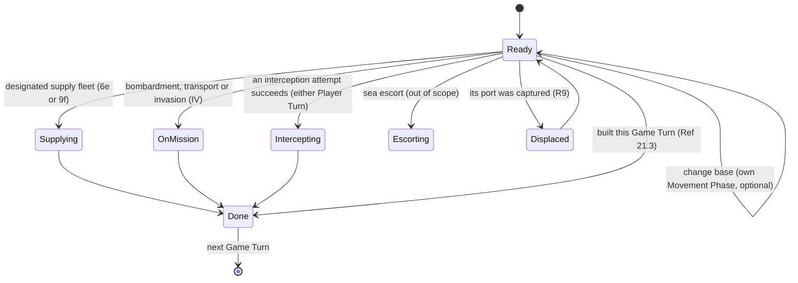
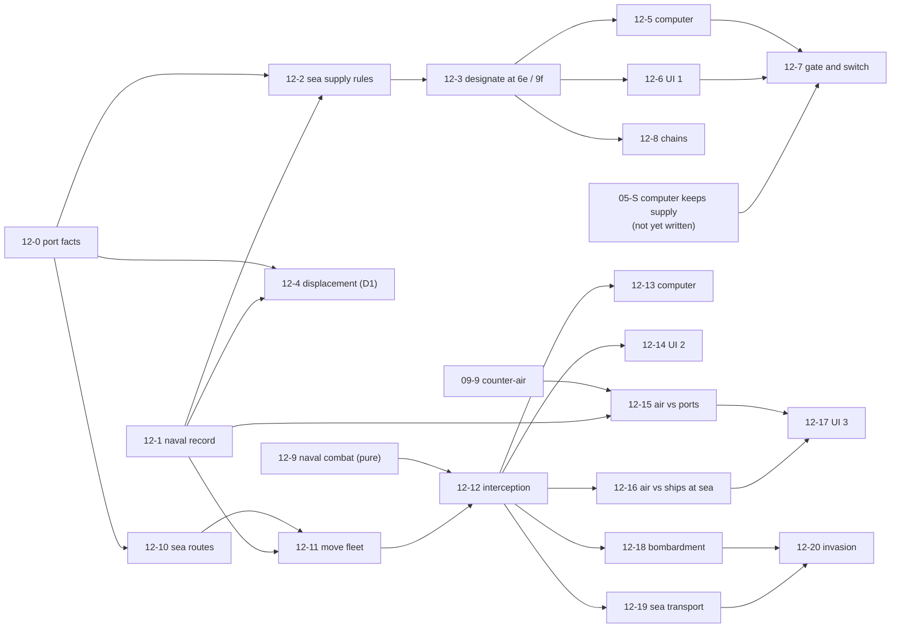

# 12. Fleets and naval warfare: ports, sea supply, displacement, movement, interception and naval missions

Status: **draft for review, 2026-10-16; DF-1 to DF-3 accepted as recommended on 2026-10-17. Only Release I is in the Beta milestone (docs/PLAN.md). Tickets 12-0 (port facts and sea distance), 12-1 (naval record) and 12-2 (sea supply rules, pure) are built (see "As built"); the rest is not, and nothing more is built until you say "let's go".** Words and sketches only; the build plan is part G. Builds on spec 03 (supply tracing), spec 04 (naval section), spec 05 (computer), spec 07 (tap to attack), spec 09 (air units, and its decision D1 on captured bases) and spec 13 (zones of control). Comes from the audit of 2026-10-16 (docs/PC-MANUAL-AUDIT.md, mismatch 8), from the supply switch that had to stay off (`SUPPLY_EFFECTS_ENABLED = false`) and from spec 09 leaving "everything at sea" to this spec.

## Decisions already taken, and decisions needed

| # | Question | Status |
|---|---|---|
| D1 (spec 09) | A fleet in a port that is captured is **displaced**, not destroyed: it goes to the nearest friendly port on its Front with room, or is eliminated if there is none. | **Taken** by the product owner on 2026-10-15 for air and fleets together. This spec writes the fleet half (rule R9, ticket 12-4). Until 12-4 is built, the Warsaw sweep keeps destroying fleets. |
| DF-1 | Release order: **I supply fleets and displacement, then II fleet movement and interception, then III air against ships, then IV naval missions** (part G). | Accepted 2026-10-17: the owner left it to the project manager, who took the recommendation. |
| DF-2 | Turn supply effects on only after a measured gate (part G, ticket 12-7), never by editing the switch alone. | Accepted 2026-10-17: the owner left it to the project manager, who took the recommendation. |
| DF-3 | A human whose units are cut off gets **one button that proposes the fleet and the port**, and can still choose another (the DOS game makes you click fleet, port and each unit). | Accepted 2026-10-17: the owner left it to the project manager, who took the recommendation (rule R6). |

## Summary (read this first)

- **Today** fleets are only pictures on the map. A fleet is a counter in a port (9 factors, a few smaller); it cannot be selected, moved, used or hurt, except in one way: if the last ground defender of its port is killed, the fleet is destroyed with no roll (`ALONE_NONGROUND_DESTROYED`). Sea supply (Ref 19.31) is a stub that returns "no line" (`seaSupplyLine`), so an island or a far coast with no land link to a capital can never be supplied.
- **Why that matters now.** The code for the effects of being cut off from supply is built and tested but switched off. Two things stood in the way when it was measured (docs/RULES.md, "Supply effects"): the computer runs its armies beyond their supply lines, and a few real pockets need a fleet. On the four automatic setups the pockets are Italian infantry in Cagliari (Sardinia, 1942), German units in Oslo (Norway, 1942 and 1944) and British armor in Cagliari (1944). **Fleets fix the second reason only.** The first is a computer-policy job that this spec lists as a dependency but does not solve (ticket 12-7).
- **What this spec proposes, in the order Frank would feel it:**
  1. **Release I, supply fleets.** At step 6e (and again at 9f) a side with units cut off designates a fleet to carry supply to a port; the game shows who is cut off, proposes the fleet in one tap, and checks the rule (one ground unit or airbase per naval factor, same Front, land link at both ends). The same release replaces the Warsaw sweep for fleets by the manual's displacement. **This is the smallest release that lets supply effects be turned on.**
  2. **Release II, fleet movement and interception.** Change base at 6b, enemy fleets try to intercept at 6c, resolved at 6d by the printed table and a naval combat.
  3. **Release III, air against ships.** Air attacks on ports (7i) and on fleets at sea. Needs spec 09 releases A and B.
  4. **Release IV, naval missions.** Shore bombardment, sea transport, seaborne invasions and bridgeheads (7b, 7f, 7h). Outlined here; written out before building.
- **Out of scope:** Strategic Redeployment of fleets and Sea Escort (needs SR: roadmap item 5.6 and the "Strategic Redeployment" section of spec 03; not built), Murmansk Convoys, Lend-Lease escorts, submarines and ASW (Strategic Warfare), the U.S. Box deployment rules, the Suez Canal damage clock, Vichy halving and the Italian fleet passing to Germany, rebuilt "gray" fleets. See part H.
- **Size:** 22 small tickets (12-0 to 12-21) in 4 releases. The smallest useful stop is after ticket 12-7 (supply switch on, with the computer ticket from spec 05).
- **Rules check:** 35 `TODO(verify)` rows (N1 to N35) are in docs/TODO-VERIFY.md, grouped under 25 headings in part J. The most important: does a Libyan port need a supply fleet (Ref 31.0 hints yes, the code says no), how interception distance is measured, which counter sizes of partial fleets exist, and what "nearest" means for a displaced fleet.

## Words used here

| Word | Meaning |
|---|---|
| **Fleet** | A naval counter. Prints one number, its **naval factors**; it has no movement factor. The full size is 9 factors; smaller ones appear only as losses (Italian 6-factor fleet in 1944, 2-factor fleets of minor countries). |
| **Port** | A city marked with an open circle, or a capital-port. Fleets sit only in ports (or in a Box off the map). |
| **Base** | The port a fleet is based in. A fleet is **based on a Front**: the Front of the sea its port opens on (rule R3). |
| **Two-Front port** | A port that serves two Fronts: Kiel, Gibraltar, Istanbul (and, for escorts, Suez city). |
| **Change base** | A fleet moves from one port to another on the same Front during the Movement Phase. Can be intercepted. (The manual's "port change".) |
| **Mission** | An offensive naval task of the Combat Phase: Shore Bombardment, Sea Transport or Seaborne Invasion. |
| **Function** | Everything a fleet may be used for in a Game Turn: carry supply, a Mission, intercept, escort. A fleet does **one** (rule R5). |
| **Supply fleet** | A fleet designated to carry supply (Ref 19.31). |
| **Interception / Counter-Interception** | Fleets (or planes, III) of the side not moving try to stop a moving fleet at sea; the moving side may answer the same way. |
| **Displace** | Move a fleet out of a captured port to the nearest friendly one (rule R9). |
| **Phasing / Non-Phasing Player** | The side whose turn it is / the other side. |
| **Cut off** | The engine's word for a ground unit or airbase with no supply line (spec 03). |
| **Pass Option** | The manual's third Front Option. The engine calls it "defensive" (`FrontOption`, spec 02). |

## Goal

Frank should be able to use his navy without knowing a coordinate:

1. **Keep islands and far coasts alive.** When units are cut off, see them, see which fleet can carry supply and to which port, and do it in one tap.
2. **Never lose a fleet to a footsoldier by accident.** A captured port sends its fleets to safety, as the manual says.
3. **Move fleets** between ports and **be stopped** by enemy fleets, with the dice shown.
4. **Fight ships and planes together**, and **land from the sea**, in the later releases.

Done means each of these works for both sides, the computer uses its fleets in a plain and safe way, and every number on the screen is the number the rules use.

## What exists today (facts from the repo, 2026-10-16)

| Fact | Where | Consequence |
|---|---|---|
| `UnitType` has `"fleet"`; strength is the naval factors; no `movement`. 9-factor fleets everywhere, a 6-factor Italian fleet in the 1944 German pool (`nationality: "italy"`), 2-factor fleets for Spain (4), Sweden (2), Turkey (3) as minor forces. | `types.ts`, `scenario-*.ts`, `tables.ts` `MINOR_COUNTRY_FORCES`, `minors.ts` | The counters needed already exist. |
| Fleets are placed in ports by setup (`baseSuits`: a city with `port` or `capital-port`), in the US Box for the U.S.A. in 1942, and may be placed in the Murmansk Box by Germany. | `placement.ts`, `terrain.ts` `NAVAL_BASE_FEATURES`, `OffMapBox` | Port and box logic exists; Fronts of ports do not. |
| Stacking: 36 naval factors per port (`NAVAL_FACTOR_STACKING_LIMIT`), checked by `stackingProblem` and `overstacks`; air and sea unlimited off base. **No 9-factor limit for Malta, Suda Bay and Famagusta (Ref 21.1); no two-port hex (none exists on our map).** | `placement.ts`, `stacking.ts` | Measured on 2026-10-16 by running `autoSetup` (seed 1) on all four scenarios and summing fleets per port (scratch script, not committed): the only port over its limit is Malta, with 18 factors in 1942 (Britain's two free fleets; the scenario file itself puts two fleets at Gibraltar AA7, which holds 36 and is within 36) and 36 in 1944 (three U.S. and one British fleet), against a limit of 9. 1939 and the Campaign are within limits (Malta 9). The query is built in ticket 12-0; the fix (capacity-aware `stackingProblem`, `autosetup` picking a port with room) is in ticket 12-4. |
| The map has **67 ports**. Counted by the `front` field of the port's own hex: 21 western, 8 eastern, 38 Mediterranean. Counted by the Front of the water they open on (the bucket rule: the Front of the sea hexes next to the port across a sea hexside, when all agree): 18 western, 8 eastern and 32 Mediterranean, plus 9 that need a hand check (Rostock J32, Vigo S11, Cadiz Z7, Gibraltar AA7, Batum X43, Istanbul Z33 open on two Fronts; Stettin K32, La Coruna R12, Haifa JJ34 touch no water hexside in the data). Marseilles V19 (western by land, Mediterranean by water) and Constanta W35 (Mediterranean by land, Black Sea and so Eastern by water) are the two ports whose water bucket differs from their land Front and which sit in the three clear buckets; this is why 21/8/38 and 18/8/32 differ. Oslo is not a port; Bergen C33 is. | `map.json` (read for this spec) | Rule R3 needs a table made once and checked (ticket 12-0). |
| Water data: 28 green-dot hexes (`usBoxEntry`) for the U.S. Box; 3 Suez Canal hexsides (`suezCanal`); 8 crossing-arrow hexsides, 4 of them in the Danish and Turkish straits. The Black Sea (6 ports) is a separate body of water in the data, and so is a second 61-hex inland sea with no port (the Caspian, presumably); the Baltic is joined to the North Sea through sea hexsides. | `map.json` | Black Sea to Baltic cannot happen by sea hexsides, as Ref 21.1 and 21.2 want. Straits need the arrow rule. |
| Tables: `interceptionRolls(distance)`, `navalAdvantageDrm`, `navalNationalityDrm` (Italy -1 in or south of row N, -2 north of it). **Verified against the original program** (docs/GAME_DATA.md); no caller. | `tables.ts` | Reused as they are. |
| Construction: a 9-factor fleet costs 27 BRPs, built in a home port. Not built: the "gray, unusable for a year" rule for a rebuilt fleet (Ref 11.62) and "a new fleet does nothing in the Game Turn it is placed" (Ref 21.3). The computer already builds fleets (`BUILD_PRIORITY`: fourth). | `construction.ts`, `ai/build.ts` | New fleets are usable at once today. Ticket 12-1 records "new". |
| Sequence: steps 6a to 6e, 7b, 7d, 7e, 7f, 7i, 9c, 9d and 9f exist in `sequence.ts` and are **passed** (not in `IMPLEMENTED_STEPS`). | `sequence.ts` | Each release turns on some of them (part C5). |
| Supply: `supplyStatus` traces land lines, special sources, Fortresses; `seaSupplyLine` returns null. Naval and air units are never checked ("always in supply", Ref 19.3). The record of who is cut off is taken **once, when the Player Turn begins**, not in the Movement Phase after naval movement (Ref 19.1). Eliminations happen when the Player Turn ends. | `supply.ts`, `supply-sources.ts` (`SupplyNet`), `supply-effects.ts`, `turn.ts` | Rule R8 moves the record to the end of 6e. |
| The sweep: fleets, air units and airbases alone in a hex are destroyed by an attack with no roll, or when a battle removes the last ground defender. | `attack-rules.ts` `ALONE_NONGROUND_DESTROYED` | Replaced for fleets by R9 (12-4). |
| UI: fleets are drawn on the map and listed on the hex card; nothing about them can be tapped. | `mapSymbols.ts`, `hexCard.ts` | New cards in part D. |
| The automatic setups leave these units cut off (one-off measurement, seed 1, computer setup): 1942: 2 Italian infantry at Cagliari, 2 German infantry at Oslo; 1944: 2 German infantry and a paratroop unit at Oslo, 2 British armor at Cagliari; 1939 and Campaign: one German armor at Helsinki (Finland is not at war: a setup oddity, not a sea matter). In each pocket a fleet of the same side sits on the same Front in a port that has a land line (probe units placed at Antwerp, Genoa and Alexandria are supplied; the destinations Bergen and Cagliari are not). The land link from Bergen to Oslo was not tested. | one-off script (not in the repo) | I can save all four pockets with single-fleet designations. |

## Sources, and how they were read

- **Primary:** the PC Reference Manual, sections 21.1 to 21.7 (naval), 19.1 to 19.4 (supply, with sea supply in 19.31), 4.3, 4.7, 4.9 (water, ports, islands), 5.0 (stacking), 11.2 to 11.5 and 11.62 to 11.76 (Options, movement, Pass Option, naval construction, SR limits for fleets), 12.2 and 12.4 (results, Attrition retreats), 20.431, 20.45 and 20.52 (air against fleets), 24.0 and 25.0 (convoys, boundary only), 26.0, 27.0 and 30.0 (cooperation limits), 31.0 to 35.0 (Africa, Gibraltar, Malta, Suez, Vichy); the Operations Manual 5.45a to 5.45e, 5.46b, 5.46d to 5.46f, 5.46i, 5.48c to 5.48f (how the PC program asks for each naval action); Peele's errata (PC differences). Read from a local text copy kept outside the repo. **Everything below is in our own words; no manual text is copied.**
- **Cross-check:** the Advanced Third Reich text on RulesPal (docs/RULES.md "Web research") says the same for 21.1 and 12.4. The audit of 2026-10-16 (docs/PC-MANUAL-AUDIT.md) found the manual and the engine agree on the naval tables and disagree on the sweep.
- **The original program:** the interception and naval-combat tables are verified (docs/GAME_DATA.md). The program's ranges, capacities and its supply-fleet routine are **not read**; ticket 12-7 includes that check where the game folder is available (moved from 12-0, which stayed a query-only ticket).
- **Where the sources differ or are silent** the rule is marked `TODO(verify)` here and in part J. Nothing is invented: each number below is in a manual passage cited, or is a named constant with a `TODO(verify)`.

## The fleet turn in one picture

```mermaid
flowchart LR
  S6a["6a Murmansk Box<br/>(out of scope)"] --> S6b["6b Phasing side<br/>changes base"]
  S6b --> S6c["6c Non-Phasing side<br/>intercepts; Phasing<br/>counter-intercepts; and so on"]
  S6c --> S6d["6d Resolved, last<br/>designated first"]
  S6d --> S6e["6e Supply check,<br/>designate supply fleets"]
  S6e --> S6f["6f Ground and air<br/>movement"]
  S6f --> S7b["7b Offensive missions<br/>(III, IV)"]
  S7b --> S7d["7d Non-Phasing intercepts<br/>offensive missions (IV)"]
  S7d --> S7e["7e Counter-interception;<br/>all resolved (IV)"]
  S7e --> S7f["7f Sea-transported<br/>units land (IV)"]
  S7f --> S7h["7h Ground combat<br/>(bombardment, invasion)"]
  S7h --> S7i["7i Air attacks on ports (III)"]
  S7i --> S9f["9f Supply fleets<br/>designated again"]
```



Release I builds only 6e and 9f (and the capture rule R9). 9c and 9d (convoys, ASW) and 6a stay passed.

**One fleet in one Game Turn:**



A failed interception attempt does not make the fleet Done, but that fleet may not try again in the same Player Turn.

## Part A. Rules in scope, rule by rule

Each rule says what the manual says (our words), the options considered where several readings exist, and the recommendation. "Status" is **settled** (the manual text is clear), **TODO(verify)** (needs a check) or **PO** (a decision for the product owner).

### R1. Fleet counters, sizes and partial fleets (Ref 3.0, 5.0, 11.62, 21.7)

- A fleet prints its naval factors only. Construction makes whole 9-factor fleets only (27 BRPs; already in `construction.ts`). A fleet cannot be split on purpose; a fleet that takes losses is replaced by the **fewest partial fleets** that add up, and if the right small counters do not exist more factors are lost than were owed. Partial fleets of one nationality at one base may be combined, for example just before SR, if counters of the right size exist. A partial fleet is one unit for every purpose. Partial fleets cannot be rebuilt.
- **Counter sizes.** The manual's own example turns two 6-factor fleets into a 9, a 2 and a 1, so 9, 6, 2 and 1 exist; whether 3, 4, 5, 7 or 8 exist is not stated. **Recommendation:** a named constant `FLEET_COUNTER_SIZES = [1, 2, 6, 9]`, `TODO(verify)` against the counter sheet and the Operations Manual dialog (as for air: spec 09 R6). The break-down function reuses the idea of `breakDownAirUnit` with this list.
- **Combining** is a later convenience (no SR yet); the first slice offers no combine action. `TODO(verify)`: whether combining is allowed outside SR.
- Minor-country fleets (Spain, Sweden, Turkey, 2 factors each) and the Vichy and Free French halving (Ref 35.0) follow the same counters; the halving itself is out of scope.

### R2. Ports and basing capacity (Ref 4.7, 5.0, 21.1, 33.0)

- Each port bases up to **36** naval factors; a hex with two ports 72; **Malta, Suda Bay (Crete) and Famagusta (Cyprus) only 9**. Plymouth and Brindisi can be entered or left only from one side of their hex (Ref 4.7), which matters for routes (R10). At sea stacking is unlimited (Ref 5.0). Capital-ports (Athens, Stockholm) are both.
- **Today:** a flat 36 (`NAVAL_FACTOR_STACKING_LIMIT`). **Recommendation (settled rule):** `portCapacity(ctx, hex)` = 36 per port, 9 for the three small ports, and `stackingProblem` uses it (ticket 12-4, with the Malta fix; ticket 12-0 builds only the query), as spec 09 did for air. Two-port hexes do not exist on our map (checked), so 72 needs no data now; as built, a list `DOUBLE_PORT_HEXES` (empty) stands in for a `ports: number` field, so a corrected map needs one line.
- The automatic setup must respect the new limit; today it does not (Malta). Ticket 12-4 changes `autosetup.ts` to pick a port with room (not 12-0: the fixed-seed recordings and the hashes in `tests/ai-stability.test.ts` must not change in the query-only ticket; owner decision of 2026-10-17: the Malta cap is done when fleets Release I is built).

### R3. The Front of a port, and two-Front ports (Ref 4.4, 21.1)

- A fleet belongs to the **Front of the water its port opens on**, even if the port's land lies on another Front. A fleet may move and act only on that Front, and leaves it only by SR. So the Front of a port is a fact about the water, not about the land.
- **Two-Front ports:** Kiel (Western and Eastern: Baltic and North Sea), Gibraltar (Western and Mediterranean), Istanbul (Mediterranean and Black Sea). A fleet there may act on either Front; Kiel is also a way for a fleet to go from one Front to the other during movement and then act on the other in the Combat Phase. Suez city is described as a two-Front port for escorts (Ref 34.0): SR only, out of scope.
- **Black Sea and Baltic are never joined by a base change or by SR** (Ref 21.1, 21.2). In our data they are not joined by sea hexsides either (checked), so route search enforces it by itself.
- **Today's data** gives each hex a Front, sea hexes included (verified against the original map file, docs/MAP_COMPARISON.md). **Recommendation:** a table `PORT_FRONTS: Record<HexId, Front[]>` made once from the Front of the water hexes next to each port, with the three two-Front ports written by hand and the nine odd ports checked by hand (see "What exists today"). A test proves every one of the 67 ports has one or two Fronts and the three small ports are marked. `TODO(verify)` for Batum, Vigo, Cadiz, Rostock, Stettin, La Coruna and Haifa (open question P4 asks Frank).
- **Naming:** the engine says "defensive" where the manual says "Pass Option"; this spec says Pass Option when it means the manual's rule.

### R4. Who may base where (Ref 26.0, 27.0, 30.0, 21.1)

- Before 1942, British and French fleets may not share a port, and a British fleet may base in a French port only if no French unit (airbases included) is in it, and the reverse. They may not combine for any mission. Each may **supply the other's units by sea** (Ref 26.0). Russian and Western Allied fleets may not base in each other's ports, and a Russian or Western fleet may not carry supply for the other (Ref 27.0). German and Italian fleets may not carry each other's units until the two are allies in the same war (Ref 30.0).
- **Reuse:** the base ban of spec 09 (`baseProblem`, `WESTERN_ALLIED_OWNERS`, `ANGLO_FRENCH_BASE_BAN_UNTIL`) is generalised to `mayBasePort(unit, port)`; the Anglo-French stacking check already exists in `stackingProblem` and applies to every counter. One function serves base changes, displacement and the list of ports on screen.
- The nation of a fleet is `nationality ?? owner` (the Italian fleet held by Germany in 1944 keeps Italian combat modifiers, Ref 16.0).

### R5. What a fleet may be used for in one Game Turn (Ref 21.3, 11.62, 11.72; 20.3 by analogy)

The manual gives every fleet a single job per full Game Turn. We keep a small ledger of it instead of a list of prohibitions:

| Activity | Uses up the Game Turn? | Notes |
|---|---|---|
| Carry supply (R6) | yes | The fleet may first change base, never after. |
| Offensive Mission: bombard, transport, invade (R16 to R18) | yes | The unused part of an invading fleet may bombard for that same invasion. |
| Intercept (R11) | yes, **only if the attempt succeeds** | Applies to both Player Turns of the Game Turn. A failed attempt leaves the fleet free but it may not try again in the same Player Turn. |
| Sea Escort, convoy escort (R20) | yes | Out of scope. |
| Change base (R10) | no | Allowed with any of the above, once per Player Turn. |
| Strategic Redeployment | not part of this spec | See the open point below. |

- **Fleets built this Game Turn** may do none of the above until the next Game Turn. A rebuilt ("gray") fleet waits a year (out of scope, R20).
- **Movement limits inside the Combat Phase.** A fleet that sails out in the Combat Phase comes back to its own port. It may not go home and sail again, may not call at a second port (a landing that has to be aborted is the one exception), and may enter the water of one target hex only unless no other route exists.
- **Where it is kept.** `NavalState.used[fleetId]`, keyed by Game Turn like the air record of flown missions (spec 09 R5), with values `"supply" | "intercept" | "mission" | "escort" | "new"`, plus `triedIntercept` for the Player Turn.
- **A consequence for the player.** In a Game Turn's second Player Turn, a fleet that already intercepted in the first cannot be named a supply fleet. That is why the ledger is per Game Turn, not per Player Turn. `TODO(verify)` (N7): the manual says "full Game Turn", and the PC program may check per Player Turn, as spec 09 R5 asks for air.
- **Open point (N33).** Ref 21.3 names only the escort jobs as barring a later redeployment, which reads as if a supply fleet could still be redeployed; Ref 11.72 says a fleet that gave sea supply cannot. The two disagree. Not needed before Strategic Redeployment exists. Recommendation when it does: follow 11.72 (the stricter reading), `TODO(verify)`.

### R6. Sea supply, part 1: naming the supply fleet (Ref 19.31, 19.1, 19.2, 11.41, 11.74; Ops 5.45e, 5.48f)

**When it happens.** There are two windows, both for the Phasing Player: step 6e (right after fleets have finished moving, before any other unit moves) and step 9f (after Strategic Redeployment, just before unsupplied units are removed). Units that are cut off at 6e and saved can then move at 6f; units still cut off at 9f get a last chance.

**What the player names.** Three things: the fleet (or the fleets sitting in one port), the port, Bridgehead or one-hex island that receives the supply, and the cut-off units that will be fed through it. The fleet carries supply from its own port over the sea to the receiving place; from there the units are reached by land (R7).

**Effect on the fleet.** It is used up for the Game Turn (R5), apart from the base change it may already have made this turn. It cannot be intercepted while carrying supply (Ref 21.5, R11) and gets no other job.

**Capacity.** One ground unit or airbase per naval factor, whatever the unit's printed factors: a 9-factor fleet feeds nine counters, a 6-factor fleet six. A fleet may serve several receiving places while capacity lasts. Factors the fleet does not use in this way are lost for the Game Turn.

**Where it may go.** Any friendly-controlled port can receive it (Ref 19.2) provided it lies on the fleet's own Front (Ops 5.45e); crossing to another Front takes a second fleet at a two-Front port (R7, chains).

**How the original asks.** Cut-off units are highlighted; you choose a fleet on the same Front, then the receiving place, then tick every cut-off unit that can be reached from it; you can repeat with the fleet's remaining capacity, and can back out before the receiving place is chosen. If nothing can save a unit, only a land line opened before the end of Strategic Redeployment prevents its removal.

**What we propose (decision DF-3).** Keep the three choices, but let the card offer a ready-made set in one tap: the receiving port that saves the most units, the nearest suitable fleet, and the units it can feed. The player can accept, swap the fleet or the port, or untick units. The computer uses the same proposal.

**When the step stops the game.** 6e and 9f wait only when supply effects are on and at least one cut-off unit could be saved by some legal naming. With the switch off (today) they stay passed and play is unchanged; with nothing to save they are skipped without a prompt (spec 01).

**Open points** (`TODO(verify)`): N8, whether a fleet named at 6e may be named again at 9f for the capacity it did not use (recommended: yes, capacity counts over the whole Player Turn); N9, whether a unit that was named and then walks onto a normal supply line still occupies capacity (recommended: yes, it is charged when named).

### R7. Sea supply, part 2: the lines, the limits, chains (Ref 19.31, 19.2, 26.0, 27.0, 31.0)

A designation is valid only if all of these hold when it is made, and again at the final check of the Player Turn:

1. **Source side.** The fleet's port is joined by an ordinary land supply line to a supply source (the capital net, special sources, Libyan or Egyptian ports as built in `supply-sources.ts`), through hexes the side controls with no enemy armor zone of control on any hex between (a zone of control does not extend over water, so enemy armor in Calais does not stop a line through the Channel). The port itself may be in an enemy zone, read as for a unit in its own hex or a source (Ref 19.3), `TODO(verify)`. Needs `portSupplied(ctx, state, side, hex)`, a view of the tracing `supplyStatus` already does.
2. **Sea leg.** Fleet and destination on a common Front (R3). The fleet's range on its Front is unlimited, so distance does not matter; enemy fleets and planes do not matter either, because a supply fleet cannot be intercepted. A line that must cross from one Front to another (through the Strait of Gibraltar, Kiel or the Turkish Straits) needs a chain of two fleets (below).
3. **Land side.** From the destination the unit traces a land line through friendly-controlled hexes with no enemy armor zone between, ending at the destination (which may itself be in a zone; `TODO(verify)` (N10): the note at docs/RULES.md "Supply (Ref 19.x on the web)" records Ref 19.31 as "land ends friendly and ZOC-free", which reads the other way; built permissive, as for a unit or a source in its own hex). Uses the same tracing as ordinary supply, with the destination as the source: in code, one more `SupplyNet` (`sources: [destination]`, `serves: the named units`), which is exactly what `specialNets` already does for Libya and Egypt. Today `serves` receives only the owner; it must also receive the unit id (a one-line widening).
4. **Capacity.** The units named, summed over all designations that use this fleet, do not exceed its naval factors.
5. **Group.** The fleet carries supply only for its own group: the Axis; the Western Allies (British, French, U.S., Free French); the Soviets alone (Ref 27.0). British and French fleets may carry for each other (Ref 26.0). The existing three groups of `supply.ts` (`SupplyGroup`) decide.
6. **Destination.** A port controlled by the side, a Bridgehead counter of the side (none exist until IV), or a one-hex island the side controls. The list of one-hex islands is not in the map data (the data cuts hexsides inside Sardinia, so a guess from hexsides fails): ticket 12-0 writes it by hand (Malta and Scapa Flow are named by Ref 4.9) and `TODO(verify)` the rest.

**Chains.** A line from one Front to another uses **two fleets**, one on each side of a two-Front port: London to Gibraltar and Gibraltar to a Mediterranean port; the same through Kiel and Istanbul, in either direction. Gibraltar itself supplies only the units inside it (Fortress); as a link in a chain it carries supply onward. A fleet in a two-Front port serves ports on both of its Fronts. A chain is **not in the first release**: ticket 12-8 adds it, so the single-fleet case (all four pockets above) can be switched on first.

**Limits tied to Africa.** Ref 31.0 caps the German factors supplied from Libyan sources and by sea through North African ports west of Suez at 18, less one for each Allied naval or air factor stationed on Malta (never below 4), and caps Axis supply through Antioch, Beirut, Haifa and Port Said at 18 including Italians and Spaniards. **Not built, and not needed for I.** With fleets existing, the Malta count becomes possible; recorded as a later ticket and open question N13 (docs/TODO-VERIFY.md).

**The program's silence worth noting.** The last paragraph of Ref 31.0 says that fitting under the cap does not by itself put an Axis unit in supply: fleets must still bring the supply to the ports concerned. It is not clear whether this also applies to Libyan ports as sources. Today `supply-sources.ts` makes Libyan ports plain sources with no fleet. **Options:** (a) keep, (b) Libyan ports supply only when a fleet is designated to them. **Recommended: (a) for now**, `TODO(verify)` (question P6).

### R8. When supply is read, and what changes in the engine (Ref 19.1, 19.4, 11.74)

- The manual reads supply in the Movement Phase after fleets move (6e) and at the end of the Player Turn. The engine records who is cut off **when the Player Turn begins** (`recordUnsupplied`). With fleets that is the wrong moment: a unit saved at 6e must be allowed to move at 6f. **Change:** keep the record at the start of the turn, and **take it again when 6e is left** (the same function, called once more; the new list replaces the old). Units saved by sea move and advance normally. The elimination at the end of the turn reads `supplyStatus`, which now includes the designations, re-checked then (and, with `ELIMINATE_ONLY_IF_CUT_OFF_AT_START`, the doomed units are the ones on the **new list taken when 6e was left**: that list replaces the at-start list, so a unit saved at 6e is no longer on it, and a unit cut off only later in the turn is not eliminated; N34) (a fleet lost, a port cut off or a destination taken in the Combat Phase makes a designation lapse; 9f is the chance to designate again).
- Everything else of `supply-effects.ts` stays: cut-off units attack at full strength but cannot move, advance or be redeployed (Ref 19.4), and are eliminated at the end of the Player Turn (`ELIMINATE_ONLY_IF_CUT_OFF_AT_START`, still `TODO(verify)`).
- `SUPPLY_EFFECTS_ENABLED` stays false until ticket 12-7 (part G).

### R9. A captured port: fleets are displaced (Ref 21.1, 12.4, 21.43; spec 09 R9 and decision D1) **settled by D1**

- **The rule.** A fleet in a port that becomes enemy-controlled is not destroyed. It moves at once to the **closest port on the same Front that its side controls and that can take it** (a Black Sea fleet never goes to the Baltic or the reverse); if two ports are equally near its owner chooses; if there is none the fleet is lost. The owner of a fleet in a two-Front port picks its Front (even if a port on the other Front is nearer) and then goes to the nearest controlled port on that Front. A French fleet with no French port on its Front goes to the nearest French-controlled port with room on any Front, else is eliminated. Fleets at Gibraltar may leave to either Front when an enemy ground unit occupies the hex.
- **Where it applies in the engine.** Wherever spec 09 R9 displaces air: a ground unit that walks into a hex with no enemy ground unit, an advance after combat into a vacated port, Attrition occupation. One shared call `afterHexTaken(ctx, state, hex)` runs `displaceAir` (spec 09, ticket 09-5) and `displaceFleets` (here, ticket 12-4). Whichever ticket is built first adds the call with its half; the second plugs in.
- **"Nearest".** Not defined. Options: (a) straight hex distance; (b) shortest sea route between the two ports (the way the fleet would sail, fixed neighbour order); (c) route including the land. **Recommended (b)**, because a fleet cannot cross land and the PC dialog moves fleets hex by hex over water, `TODO(verify)`. Ties: first slice picks the lowest hex id and says so in the log; the human choice is a later refinement (open question P8). A port counts only if it has room for the whole fleet counter (fleets cannot split).
- **The Warsaw rule becomes:** no fleet is destroyed by the sweep. The sweep switch `NONGROUND_ON_CAPTURE = "displace" | "destroy"` of spec 09 covers fleets too. Fleets then outlive their port and that is the point: the fleet is the supply carrier.
- **What the manual does not say** (`TODO(verify)`): a fleet away on a Mission when its port falls (recommended, as for air in Ref 20.2: treated as if it were in port and displaced when it returns); a displaced fleet's function for the Game Turn (recommended: unchanged, as for air that may still fly).
- Special captures (fall of France, Vichy halving, Italy's surrender passing fleets to Germany, Ref 35.0 and 16.0) use the same call later; their own rules are out of scope.

### R10. Changing base (Ref 21.2, 11.41, 11.42, 4.3, 34.0; Ops 5.45b) Release II

A base change is the only fleet movement of the Movement Phase (step 6b). It moves the fleet from one port to another and it can be intercepted.

**Checks, all of which must pass**

| Check | Rule |
|---|---|
| The Option | The Front's Option must be Offensive or Attrition. Under a Pass Option the change is allowed only if no enemy fleet is based on that Front and the whole course stays more than four hexes from every enemy plane (even a plane that could not intercept). |
| Same Front | Old and new port on the same Front for the fleet (R3). |
| Held at the start | The new port belonged to the side when its Player Turn began (the `controlAtStart` record spec 09 keeps, ticket 09-3). |
| Room and nation | The port has room (R2) and `mayBasePort` (R4) allows it. |
| Once | One change per Player Turn (`ONE_BASE_CHANGE_PER_TURN`, N19); no further change until Strategic Redeployment. |
| Before the rest | It happens before any air or ground unit moves. |

**Course.** Range on the Front is unlimited. Any hexside that is at least partly ocean may be crossed; hostile or neutral land and enemy units do not block. What does block: a strait with a crossing arrow when either land side is enemy- or neutral-held (a fleet may enter such a strait to act inside its hex, as long as it leaves by the way it came); the Front boundary at Gibraltar (SR only); rivers, except the Suez Canal while the hexes beside it are friendly (N22); and at Brindisi and Plymouth the one side from which the port opens (Ref 4.7). Armor zones of control do not affect fleets (Ref 11.41, spec 13).

**Recording the course.** `MOVE_FLEET` carries a path, because interception may strike at the departure hex, the arrival hex or any hex between (R11) and because the Pass Option check looks at it. With no path given, the engine sails the shortest sea route (breadth-first, fixed neighbour order), like the "auto-move" of the PC game.

**What counts as one force.** Each `MOVE_FLEET` action is one force for interception, so fleets that leave together form one target of their combined factors; fleets from different ports are separate forces even if they arrive in the same hex (Peele's PC difference for invasion fleets, applied by analogy; N21).

**Suez.** The canal's damage and repair clock (Ref 34.0) and the PC differences for 47.3 and 47.4 in Peele's errata are out of scope; for now the canal can be used only while all four hexes beside it are friendly (N22).

### R11. Interception and counter-interception (Ref 21.5, 11.41; Ops 5.45c, 5.45d, 5.46d, 5.46e) Release II

**Who may try.** The side that did not just move may use fleets based on the same Front as the moving fleet (N24). Fleets that carry supply, escort, or are being redeployed can never be targets. Fleets that have already done their job for the Game Turn (R5) cannot try.

**Rounds.** The Non-Phasing side declares first. The moving side may answer with fleets that have not moved or acted, the other side may answer that, and so on. Each round ends when its side passes; two passes in a row end step 6c. This is the second place after spec 09's DAS (7d) where the side to act is not the active side, so the engine needs `sideToAct(state)` (spec 09 part C6, ticket 09-7); whichever ticket is built first creates it.

**What a declaration contains.** A target (a move or an earlier interception), the fleets that will try, and one meeting point on the target's course: the departure hex (a sailing fleet is at sea as soon as it leaves port), the arrival hex, or any hex between. Only one meeting point per target. Fleets from one base must all aim at the same target; fleets from several bases aiming at the same target must agree on the meeting point.

**The dice.** One die per base, against the verified table `interceptionRolls(distance)`:

| Distance from base | Success on a die of |
|---|---|
| 1 | automatic |
| 2 to 10 | 1 to 5 |
| 11 to 18 | 1 to 4 |
| 19 to 24 | 1 to 3 |
| 25 to 30 | 1 or 2 (the program also accepts a 2 at exactly 30) |
| 31 or more | 1 |

Fleets in the U.S. Box count as 30 or more. **How distance is counted** is not written. Options: (a) straight hex distance from the base to the meeting point; (b) the length of the shortest sea route (the Operations Manual has the interceptor sail hex by hex to the point). Recommended (b), the same function as R9, N23, question P5.

**Order of resolution.** Last declared, first resolved. A counter-interceptor that wins can therefore undo the interception it answered. A fleet whose attempt fails is not committed (R5) but is barred from trying again this Player Turn. A success leads to naval combat (R12).

**Planes.** Air units that can reach the course may also attack fleets at sea: R15, Release III.

### R12. Naval combat (Ref 21.51; tables verified) Release II

When an interception succeeds, one die is rolled for each side and the higher modified roll wins; **a tie goes to the intercepting force** (unlike air, no third die).

1. **Modifiers.** Nationality (`navalNationalityDrm`: Germany +2; Britain, U.S., Sweden +1; France, Vichy, Free French 0; Italy -1 for a battle in or south of row N and -2 north of it; U.S.S.R., Turkey, Spain -2; a mixed force uses its lowest). The side with at least a third more naval factors than the other gets the advantage DRM of `navalAdvantageDrm` (the program's own thresholds 1.33, 1.67, 2, 3 and 4 to 1: +1 to +5; the printed rule says only "a third more", the two differ from 133 against 100 up).
2. **Loser's loss.** The loser eliminates naval factors equal to the difference of the two modified rolls. If the loser has **18 or more naval factors in the battle**, the loss is multiplied by the number of full fleets it brought (its factors in the battle divided by 9, for partial fleets). The winner then loses **half** of the loser's loss, rounded down.
3. **After the battle.** The loser returns to port at once and its mission, if any, is cancelled for the turn. A force that is intercepting (never one that is transporting, invading, bombarding or changing base) may **break off before the roll**: it loses automatically, its loss is halved (rounded down) and at most half its strength, and the winner's loss is reduced to match; if the breaker-off nonetheless "wins" the roll, nobody loses anything. Survivors of an interception go back to their original base. If the force that was stopped wins, it may go on with its task or turn back; turning back puts any units it carries ashore at their port of embarkation.
4. **Carrying capacity.** If losses leave a transport or invasion fleet unable to carry what it carries, the excess units are eliminated at once (air units may be broken down to fit); aborting does not save them.
5. **Who picks which fleets lose factors.** The manual says nothing beyond "fewest partial units" (R1). Options: (a) the owner picks, as for Exchange losses and spec 09's air losses; (b) automatic. **Recommended (a) for people, (b) for the computer** (`NAVAL_LOSS_CHOICE = "owner"`), `TODO(verify)`.
6. **Break-down.** A fleet that loses k factors becomes the fewest counters of `FLEET_COUNTER_SIZES` (R1); the total lost may exceed k if sizes do not fit (the manual says it does).

### R13. What "factors in the battle" means for stacks at one base

All fleets of one base that intercept the same target fight as one force; fleets of two bases that agreed on one hex also fight as one. Fleets that did not take part in the battle are untouched (unlike air, where non-participants in the hex are hurt: Ref 20.44). `TODO(verify)`: nothing in Ref 21.51 hurts non-participants; the Counter-Air rule is the only place that does.

### R14. Air attacks on naval bases (Ref 20.45; Peele on Malta; Ops 5.46b, 5.46i) Release III

- Phasing planes that can reach an enemy port (four hexes at most) may attack the fleets in it. It is **designated at 7b and resolved at 7i, after all ground combat**.
- **First the enemy planes in the hex** that have not yet flown are attacked by Counter-Air and must be beaten; otherwise the fleets cannot be attacked at all. Planes near the port but not in it cannot fly to defend. Air in Malta may decline Counter-Air, and then the whole force may go for the ships; since the PC game requires Counter-Air first for Malta, the same applies there (Peele).
- Air factors not used for Counter-Air then **each roll a die**: 1 or 2 removes a naval factor, 3 or 4 nothing, 5 or 6 removes the attacking air factor.
- If the target fleet is displaced by a successful ground attack at 7h before the air attack, the air attack does not happen but counts as the unit's mission (R9 and this rule meet here).
- **Reuse:** the resolver for Counter-Air is spec 09's (`resolveAirCombat`); the new part is a per-factor roll and the loss choice of fleet factors (R12(5)). `DESIGNATE_AIR` of spec 09 gains a mission kind `port-attack`.

### R15. Air attacks on fleets at sea (Ref 20.431, 20.52) Release III

- When a fleet sails (a base change, or a Combat Phase mission), enemy planes that have not flown and can reach its course (four hexes at most) may attack it in its base hex, its destination or any hex between. The two passages differ on the Option: Ref 20.431 says whatever the Option is, Ref 20.52 names the Offensive Option (both phases) and the Attrition Option (Movement Phase only); recommended: follow 20.431, `TODO(verify)`. The moving side's air can attack the intercepting fleets the same way (counter-interception).
- Resolved like R14 except at sea: a 1 removes a naval factor, 2 to 5 nothing, a 6 removes the attacking air factor. Planes used this way have flown.

### R16. Shore Bombardment (Ref 21.41; Peele) Release IV, outline

- In the Offensive-Option Combat Phase, fleets go to the water side of a coastal hex that will be attacked by Seaborne Invasion, or any coastal Fortress or playable one-hex island attacked by non-exploiting ground units. For every three naval factors **not** carrying ground units, one naval factor is added to the ground attack. Not for Exploitation attacks; usable together with Ground Support. The bombarding fleet is unaffected by the ground result. **PC difference (Peele): naval units no longer take losses from bombardment.**

### R17. Sea Transport (Ref 21.42; Ops 5.46b) Release IV, outline

- Fleets carry ground or air units from one friendly-held port to another friendly-held port on the same Front, in the Offensive-Option Combat Phase; two naval factors per ground or air factor; one or more pick-up ports, one landing port; both ports held by the side, and the unit supplied, at the start of the Player Turn. Units use their normal movement, paying nothing to embark and one to disembark; embarking in a port in enemy armor ZOC costs two (spec 13 row 6 is waiting for this). An air unit must start in the port of embarkation; the landing port becomes its base; it flies no mission that turn. Landing on a Bridgehead only if the hex also has a port.

### R18. Seaborne Invasion (Ref 21.43, 4.9, 5.0, 12.2; Peele) Release IV, outline

- Against a beach hex, Gibraltar or a playable one-hex island that holds **no** full-size (9-factor) enemy fleet (an Airdrop into a hex with a fleet and no ground unit displaces the fleet and permits the invasion). Naval factors in the hex but under 9 are displaced to the nearest friendly port (R9) and may then try to intercept. Three naval factors carry one ground factor; no air units; the fleet may carry as many units as its capacity allows, but **at most two of them, plus any Airdrop, attack the hex**; the rest of the fleet may bombard; Ground Support is allowed; the defender is tripled even if also attacked by land or air. Units must start in supply, in the port that is the fleet's base (a fleet may change base to it first); fleets from different ports are separate forces. Breakthrough and Exploitation are possible if armor attacked and survives and more armor stays aboard. If a unit survives and occupies the hex, a Bridgehead is placed; a Bridgehead hex with no port can be reinforced only by further invasions until a port is taken. Fleets are unaffected by the ground result (and, by Peele, take no bombardment loss). The landing happens at 7f; the attack at 7h.

### R19. Fleets and Front Options (Ref 11.2, 11.21, 11.42)

- A change of base needs an Offensive or Attrition Option on the fleet's Front (or the Pass Option conditions of R10). Offensive naval **missions** need an Offensive Option on the Front of the hex that **receives the action** (so a Mediterranean fleet can invade southern France with only a Western Offensive Option; it cannot land at Genoa for a Western attack without a Mediterranean Offensive Option). An Offensive Option with no ground attack and no air or naval mission is refunded.
- The hook `frontAllowsAttack` is true for everyone today (spec 09 R14); naval missions use the same hook and are not wired in this spec.

### R20. Boxes, convoys, escorts, submarines: boundary only (Ref 11.73, 21.6, 21.11, 24.0, 25.0, 9.1)

- **Nothing in these is built or specified here.** They are listed so the data model leaves room: `NavalUse` has `"escort"`; `OffMapBox` already has `us-box` and `murmansk-box`; a fleet in a Box is not in a port, so it has no Front and bases nothing. The table in part H says what each needs.
- One fact the first release does need: **fleets in the U.S. Box can be used only through the green-dot hexes (R10) or by SR**, and in 1942 the U.S.A. starts with four fleets there. In I they are inert (they cannot supply: Ref 21.11 lets them carry supply only if London and Paris are both Axis-held or isolated).

### R21. Dice and determinism

All dice come from `state.rngState` through `rollD6`, in a fixed order (interception attempts in resolution order, each base's one die, then the two combat dice, then per-factor air dice in designation order). Nothing in a preview rolls (spec 07 rule). Displacement and supply designation use no dice.

## Part B. Rules not decided by the text

Listed with the rest in part J. The five that most change what Frank sees are: R6 (a fleet designated twice, capacity), R9 ("nearest" and ties), R10 (path and one change a turn), R11 (how distance is measured), R7 (Libyan ports without a fleet).

## Part C. Engine design

### C1. State (additive; an old saved state without `naval` still works)

```ts
// GameState gets one optional field, like `air`, `combat` and `moves`:
naval?: NavalState

interface NavalState {
  /** "year-season": the Game Turn the `used` record belongs to. */
  gameTurn: string;
  /** What each fleet has been used for in this Game Turn (R5). Includes fleets built this Game Turn. */
  used: Record<string, "supply" | "intercept" | "mission" | "escort" | "new">;
  /** "year-season-side" of the Player Turn the lists below belong to (replaced by a fresh record when it changes). */
  turn: string;
  triedIntercept: string[];                     // R5, R11
  moved: string[];                              // fleets that changed base this Player Turn (R10)
  supply: SeaSupplyDesignation[];               // R6, R7
  moves: FleetMove[];                           // R10: id, fleets, from, to, path (for interception)
  interceptions: Interception[];                // R11: in designation order
  pending: PendingNaval | null;                 // break-off choice, losses to allocate, displacement tie (human)
}

interface SeaSupplyDesignation { fleets: string[]; from: HexId; to: HexId; units: string[] }
```

- `navalOf(state)` returns the stored record or a fresh one — the `combatOf` / `airOf` pattern. The type lives in its own module `naval-record.ts` because `types.ts` is at its size limit (spec 09 B1). Two lifetimes: `used` and `gameTurn` carry over inside a Game Turn; the other lists restart each Player Turn.
- The fleet's own base is `unit.at`; its factors are `unit.strength`; its nation is `nationality ?? owner`. No per-fleet field is added to `Unit`.
- A change of base moves `unit.at` at once and records the move; if the force then loses an interception it is put back (R12(3)). If the origin port is full on return, the fleet is displaced by R9.
- **Held at the start of the turn:** read `airOf(state).controlAtStart` (spec 09) through one small function `heldAtStart(state, hex)` that both modules use; no second copy.
- **Determinism and replay:** actions are plain objects; the record is JSON; resolution uses only `rngState`; a saved action list replays to the same state (a test).

### C2. Actions (all new `type`s; every one carries the acting `side`)

| Action | Step | Who | What |
|---|---|---|---|
| `DESIGNATE_SEA_SUPPLY { fleets, to, units }` | 6e, 9f | active | R6, R7. Rejected with a one-sentence reason naming the rule. |
| `MOVE_FLEET { fleets, to, path? }` | 6b | active | R10. Fleets start together in one port. |
| `DESIGNATE_INTERCEPTION { target, fleets, at }` | 6c (and 7d, 7e in IV) | side to act | R11. `target` is a move or an earlier interception. |
| `PASS_INTERCEPTION` | 6c | side to act | "Done" for this round. |
| `RESOLVE_INTERCEPTIONS` | 6d | active | Rolls them in reverse order (R11, R12). |
| `CHOOSE_BREAK_OFF { breakOff }` | 6d | the intercepting side | Only if `pending` asks (R12(3)). |
| `ALLOCATE_NAVAL_LOSSES { take: [{unit, factors}] }` | 6d | the loser | R12(5); like `ALLOCATE_LOSSES`. |
| `CHOOSE_DISPLACEMENT { unit, to }` | any step a capture happens | the owner | R9, only after the first slice; until then ties go to the lowest hex id. |
| `END_STEP` | all | | Existing. |

`legalActions` lists the first useful choices, not every subset: for `DESIGNATE_SEA_SUPPLY` one proposal per (origin port, destination) pair that would save at least one cut-off unit (`seaSupplyOptions`), so the list stays short; `applyAction` accepts any legal subset. Malformed input is refused, never thrown (the pattern of `applyMove`). Resolve as one click: an explicit `RESOLVE_INTERCEPTIONS` that the screen sends right after "Done" (spec 09 C2).

### C3. Events (for the log and the hex card)

`FLEET_DESIGNATED_FOR_SUPPLY`, `SEA_SUPPLY_LAPSED` (a designation no longer valid at the final check), `FLEET_MOVED`, `INTERCEPTION_DESIGNATED`, `INTERCEPTION_ATTEMPTED` (base, distance, die, needed), `NAVAL_COMBAT_RESOLVED` (both forces, both rolls with modifiers, losses), `FLEET_BROKE_OFF`, `NAVAL_LOSSES_CHOSEN`, `FLEET_DISPLACED { unit, from, to | null }`, `FLEET_RETURNED`. One log line each: "Italian fleet (9) carries supply from Genoa to Cagliari for 2 infantry units" or "British fleet (9) at Scapa Flow moved to Rosyth: Scapa Flow was taken". No raw ids.

### C4. How sea supply enters `supply.ts` (the key integration of release I)

```
supplyStatus(ctx, state, side) =
    land lines from the capitals            [exists]
  + special nets (Libya, Egypt, Tunis ...)  [exists]
  + Fortress self-supply                    [exists]
  + one net per valid designation           [new]  sources = [d.to], serves = d.units
```

- `seaSupplyLine(ctx, state, side, unit)` (today a stub returning null) becomes: find a valid designation of the side that names the unit; return the land path from the unit to the destination with `via: "sea"` and the fleets and origin port added (`SupplyLine.sea?: { fleets, from, to }`) for the screen. No other function changes its answer unless a designation exists, so **with no designation (and with the switch off) every existing test and recorded game is identical.**
- `seaSupplyProblem(ctx, state, side, designation)` returns the first failing condition of R7 in words; the action and the screen use the same function.
- `seaSupplyOptions(ctx, state, side)` returns the proposals; the computer and the "one tap" button use it.
- Cost: supply is already about 3 to 7 ms for both sides on a full board (spec 03). One more search per designation is negligible; `portSupplied` reuses the main search result instead of repeating it.

### C5. Which steps wait, and for whom

| Step | Waits when | Actions | Release |
|---|---|---|---|
| 6a, 9c, 9d | never (stay passed) | | out of scope |
| 6b | the active side has a fleet that can change base | `MOVE_FLEET` | II |
| 6c | the Non-Phasing (then the Phasing) side has an eligible fleet in reach of a moved fleet's course | `DESIGNATE_INTERCEPTION`, `PASS_INTERCEPTION` | II |
| 6d | there is an interception to resolve, or `pending` | `RESOLVE_INTERCEPTIONS`, `CHOOSE_BREAK_OFF`, `ALLOCATE_NAVAL_LOSSES` | II |
| **6e** | **supply effects on, and a cut-off unit could be saved** | **`DESIGNATE_SEA_SUPPLY`** | **I** |
| 7b | an eligible mission or port attack exists | spec 09's `DESIGNATE_AIR` with `port-attack`; naval missions in IV | III, IV |
| 7d, 7e | an interception of an offensive mission is possible | as 6c | IV |
| 7f | sea-transported units to land | automatic (a `STEPS_PASSED` note) | IV |
| 7i | a port attack is designated | `RESOLVE_PORT_ATTACKS` | III |
| **9f** | **as 6e** | **`DESIGNATE_SEA_SUPPLY`** | **I** |

`IMPLEMENTED_STEPS` gains `6e` and `9f` in I, `6b 6c 6d` in II, and so on, each with a `hasWork` case in `turn.ts`.

### C6. Who is asked

Spec 09 C6 exports `sideToAct(state)` (the pending chooser, else the non-active side at DAS, else the active side). This spec adds 6c and the naval pending choices to it. The browser's `computerToMove` and the computer's `chooseAction` both use it, so there is no special case.

### C7. Modules (proposed names; each under 300 lines)

`naval-rules.ts` (constants and `TODO(verify)` switches), `naval-ports.ts` (capacity, Fronts, `mayBasePort`, one-hex islands), `naval-routes.ts` (sea routes, strait test, distance), `naval-record.ts` (`NavalState`, `navalOf`, uses), `naval-supply.ts` (R6, R7: problem, options, nets), `naval-displace.ts` (R9), `naval-move.ts` (R10), `naval-intercept.ts` (R11, R12 resolution), `naval-combat.ts` (R12, pure), `naval-losses.ts` (R1, R12 break-down), `naval-actions.ts` (legal and apply, routed from `actions.ts`).

**Shared files touched, each by the smallest edit:** `types.ts` (`GameState.naval`), `action-types.ts` (actions and events), `actions.ts` (routing, `sideToAct`), `sequence.ts` (`IMPLEMENTED_STEPS`), `turn.ts` (`hasWork`, re-record at 6e), `supply.ts` and `supply-sources.ts` (`seaSupplyLine`, `SupplyNet.serves` with the id), `supply-effects.ts` (call point), `placement.ts` (capacity), `autosetup.ts` (ports with room), `attack-rules.ts` and `attack-losses.ts` (the sweep leaves fleets alone), `control.ts` (capture hook), `construction.ts` (new fleet is "new").

## Part D. The screens

Principles from spec 07: one press, names not ids, nothing only on hover, every button at least 44 px, iPad first, a passive hex card. All new text in one module (`navalText.ts`).

### D1. Release I: units cut off, and a fleet to save them (steps 6e, 9f)

When the step waits, a card sits where the 6f prompt sits. Cut-off units are also marked on the map (a hatched outline, not colour alone) and listed on the hex card with "cut off: no land link to Berlin".

```
+------------------------------------------------------+
| 3 UNITS ARE CUT OFF FROM SUPPLY                      |
| Oslo (C35): 2 German 3-4 infantry, 1 German 3-3      |
|   airborne.  No land line to a supply source.        |
|   You can supply them by sea:                        |
|   [x] 9-factor German fleet at Antwerp (L25)         |
|       carries supply to Bergen (C33). Oslo is joined |
|       to Bergen by land. It can carry 9, needs 3.    |
|       Afterwards this fleet can do nothing else      |
|       this Game Turn.                                |
|   [  Supply by sea  ]     [ Choose another fleet ]   |
| Cagliari (AA19): 2 Italian 1-3 infantry             >|
| If you leave them, they cannot move, and they will   |
| be eliminated at the end of your turn.               |
|                      [ Leave them cut off, continue ]|
+------------------------------------------------------+
```

"Choose another fleet" lists the fleets that qualify (same Front, a port with a land line, unused, capacity left) and, beside each fleet that does not, the reason in one sentence ("9-factor fleet at Taranto: its port has no land line to a supply source"; "9-factor fleet at Gibraltar: already used this Game Turn"). On the map, the fleet is outlined, the destination port is outlined and a dashed line joins the two. After the tap the units lose the cut-off mark and the log says what happened.

### D2. Release I: a captured port

No question is asked in the first slice. The log reads "British fleet (9) at Scapa Flow moved to Rosyth: Scapa Flow was taken" or "...was eliminated: no friendly port with room on the Western Front". The hex card of a port shows "naval factors 27 of 36 (Malta: 9 at most)". The Warsaw ending of spec 09 and this one share one toast.

### D3. Release II: moving a fleet, being intercepted

Tapping a fleet at 6b selects it (or the group at its port). The ports it may go to are outlined; unreachable ports are greyed with the reason on tap ("other Front", "Not held at the start of your turn", "port full: 36 of 36", "Pass Option: an enemy fleet is based on this Front"). Tapping a port sends `MOVE_FLEET` with the shortest route and shows the route as a line. A note under the card says how many enemy bases could try to intercept and from how far ("2 enemy bases within reach; the nearest is 3 hexes away"); no percentages (the same decision as spec 07, question 2). For the Non-Phasing human at 6c:

```
+------------------------------------------------------+
| THE GERMANS MOVE 2 FLEETS FROM KIEL TO BREST.        |
| Try to intercept?                                    |
| [ 9-factor British fleet at Scapa Flow    6 hexes  ] |
|   needs 1 to 5 on a die                              |
| [ 9-factor British fleet at Plymouth      2 hexes  ] |
|   needs 1 to 5 on a die                              |
|    where: [ Brest (N18) v ]                          |
|                      [ Intercept ]  [ Do not ]       |
+------------------------------------------------------+
```

After the dice, a result card shows both rolls with the nationality and advantage parts, who lost what, and a loss chooser (chips with "-" and "+" per fleet, as spec 09 for air).

### D4. Releases III and IV

Air attacks on ports: from the 7b row "Enemy ports within 4 hexes", the planes in the port are listed first ("they have flown / they can fight"), then the ships. Naval missions follow the plain pattern of the air cards (pick the fleet, the mission, the destination; units to carry are ticked). Written out when scheduled.

### D5. Messages, touch and access

Every refusal names the rule in words ("This fleet is based on the Mediterranean Front; Cherbourg is on the Western Front"). The 44 px targets, `aria-pressed` chips, labelled regions, keyboard and screen-reader behaviour, reduced motion and all five layouts of spec 07 part D apply unchanged to the new cards. French wording stays out of scope (all text in `navalText.ts`).

## Part E. The computer opponent: minimum viable

The computer plays by `legalActions` only (spec 05). Its fleet policy is the computer's, not a rule; the numbers are `TODO(verify)` and tunable.

- **Release I (needed to switch supply on):** at 6e and 9f it takes the `seaSupplyOptions` proposals in order of units saved, then of the lowest hex id, and designates while a proposal saves at least one unit. It never moves, intercepts or bombards. It answers every prompt (a capture: automatic; the tie rule picks the lowest hex id). It still builds fleets (`BUILD_PRIORITY`).
- **A dependency, not part of this spec: "the computer keeps its supply".** Over 30 seeds with the switch on, 1939 went from 289 to 202 Axis objectives and from 65 to 180 idle Player Turns (docs/RULES.md). Fleets do nothing for that. The proposed fix belongs in spec 05: the mover refuses a move that would end with no supply line, and prefers moves that extend one. It is ticket "05-S" in part G (not yet written). Without it the switch cannot be turned on, whatever this spec does.
- **Release II:** at 6b it changes base only to put a fleet into the port nearest to an unsupplied friendly pocket or to escape a port with an enemy ground unit next to it; at 6c it intercepts only at distance 1 (automatic) and only when its naval factors are at least equal; it breaks off never. It never moves a fleet if that would take it into reach of two or more enemy bases.
- **Releases III and IV:** it uses its planes against ports only when it already holds a Counter-Air plan (spec 09); no naval missions.
- **Watch mode:** nothing is asked; the computer's fleets appear in the log and the hex card.
- Self-play (`npm run selfplay`) gets lines for sea supply: units saved by sea per game, fleets displaced, fleets eliminated for lack of a port; and new anomaly checks: "unit eliminated for lack of supply that a legal designation would have saved", "fleet over port capacity", "fleet with no port".

## Part F. Tests and verification

### F1. What already exists, what is new

| Table or constant | Status |
|---|---|
| `interceptionRolls`, `navalAdvantageDrm`, `navalNationalityDrm` (Ref 21.5, 21.51) | Verified against the chart screens and the program (docs/GAME_DATA.md). Reused as they are. |
| Stacking 36 | In place; the 9-factor ports are new. |
| Capacity 9 (Malta, Suda Bay, Famagusta), counter sizes `[1,2,6,9]`, the 18-factor rule, one base change a turn, the Pass Option four-hex test | **New named constants, not yet checked against the program.** Ticket 12-7 compares where it can. |
| Port Fronts, two-Front ports, one-hex islands | **New data, hand-checked once** (ticket 12-0); the nine odd ports are listed in "What exists today". |

### F2. Checking against the original game (ticket 12-7 and phase 9)

- **The program:** read the supply-fleet routine, the port-capacity test and the displacement routine in `3R2.EXE` the way `scripts/gamedata/exe-checks.ts` reads the others; add a `naval` module to `scripts/gamedata/` that reproduces the constants and compares them with `naval-rules.ts` (exit 1 on a difference). Needs the owner's game folder; if absent, the constants stay `TODO(verify)`.
- **Reference situations to run in the original under DOSBox** (docs/ROADMAP.md phase 9), each a regression test: Sardinia cut off with a fleet at Genoa; a fleet with capacity 9 and 10 units; supply by a fleet already used for something else; capture an empty port with fleets in it; capture a port with two equally near ports; a base change over 30 hexes with an interception attempt at distance 31. Frank plays the DOS game: questions P1 to P8 ask him directly.

### F3. Unit tests (Vitest; each cites its rule and gets a mutation check: break the rule, see a test fail, restore)

| Test | Rule | What it proves |
|---|---|---|
| Capacity | R2 | A port holds 36; Malta, Suda Bay and Famagusta 9; the automatic setups of all four scenarios stay within capacity. |
| Port Fronts | R3 | All 67 ports have one or two Fronts; Kiel, Gibraltar and Istanbul two; Marseilles is Mediterranean; Constanta is the Black Sea; Black Sea and Baltic never connect. |
| Base ban | R4 | British and French do not share a port before 1942; British and French carry for each other; Russian and Western do not. |
| Uses | R5 | A supply fleet is Done; a failed attempt is not; a fleet built this Game Turn is Done; reset next Game Turn; a fleet that intercepted cannot be designated in the second Player Turn. |
| Sea supply | R6, R7 | Italian infantry at Cagliari saved by a fleet at Genoa; capacity 9 and 10 units refused at the tenth; destination on another Front refused; origin port with no land line refused; destination held by the enemy refused; unit's land leg cut by armor ZOC refused; ZOC on the destination itself allowed; Soviet and Western fleets do not serve each other; British and French do. |
| Reading supply at 6e | R8 | A unit saved at 6e can move at 6f; a unit not saved cannot; at the end of the turn a lapsed designation cuts the unit again; 9f can designate again. |
| Existing behaviour | C4 | With no designation, every existing supply, movement and self-play test passes unchanged and the fixed-seed recordings are identical. |
| Displacement | R9 | The nearest port with room; equal distance goes to the lowest hex id; none gives elimination; Black Sea to Baltic refused; a two-Front port picks a Front; French fleets fall back across Fronts; Gibraltar escape; a Warsaw-style position ends with the fleet moved; the constant restores the sweep. |
| Sea routes | R10, R11 | Breadth-first route is deterministic; a strait with a hostile side blocks; Brindisi and Plymouth by their one side; the Suez Canal needs friendly sides. |
| Base change | R10 | A base change to a port held only after this turn's capture refused; a port full refused; Pass Option restrictions; once a turn. |
| Interception table | R11 | Every distance band against the die; 30 versus 31; U.S. Box counts as 30+. |
| Naval combat | R12 | Every branch with fixed dice: higher roll wins, tie to the interceptor, advantage and nationality DRMs, Italy north and south of row N, the 18-factor multiplier, winner loses half rounded down, break-off with halved losses and the "wins the roll" case, carried units lost with the capacity, fewest-counter break-down. 20,000-seed cross-check of mean losses. |
| Air against ships | R14, R15 | Counter-Air first; the per-factor table at port and at sea; the displaced-before-attack case. |
| Who acts | C6 | At 6c the non-active side acts first and the sides alternate; the computer chooser follows. |
| Determinism | R21 | The same actions replay to the same state; no `Math.random`, clock or DOM (engine-purity test). |
| Malformed input | | Every new action with bad shapes is refused with a reason, never throws. |

### F4. UI and end-to-end

Pure models first (`seaSupplyCard.ts`, `fleetPanel.ts`: no DOM, like `attackPreview.ts`), with tests of the lists, reasons and button text, "no raw ids". Playwright (`tests/e2e/fleets.spec.ts`, mouse and touch): a cut-off card appears for Sardinia and one tap supplies it; the card shows a reason for each rejected fleet; a captured port moves its fleet and says so; later, a fleet is selected and moved; the interception prompt appears only when it matters. Playwright is run by the build workers, not in writing this spec.

## Part G. Build plan

Difficulty: easy, medium, hard. Size: S (under half a day), M (about a day), L (more). One branch and one pull request each, a reviewer from a stronger level than the author (CLAUDE.md), at most 4 workers at once.

| # | Ticket | Difficulty | Size | Needs | Files |
|---|---|---|---|---|---|
| **Release I: supply fleets and displacement** | | | | | |
| 12-0 | **Port facts and sea distance.** `naval-ports.ts`: `portCapacity` (36 and 9), `PORT_FRONTS`, two-Front ports, one-hex islands; `naval-routes.ts`: the shortest sea route and its length between two ports (breadth-first, fixed neighbour order; no strait or Option rules yet), which R9 needs for "nearest". **Query-only, by the owner's instruction:** `stackingProblem` using capacity and `autosetup` picking a port with room moved to 12-4, and the check of the constants in the program moved to 12-7. | medium | M | none | `naval-rules.ts`, `naval-ports.ts`, `naval-routes.ts`, tests |
| 12-1 | **Naval record.** `NavalState`, `navalOf`, uses per Game Turn, "new" on build, `FLEET_COUNTER_SIZES`, `heldAtStart`. | medium | S | none | `naval-record.ts`, `types.ts`, `construction.ts`, tests |
| 12-2 | **Sea supply rules (pure queries).** `portSupplied`, `seaSupplyProblem`, `seaSupplyOptions`, `seaSupplyLine`, the net per designation, capacity, group rule. No action yet. | hard | M | 12-0, 12-1 | `naval-supply.ts`, `naval-supply-options.ts`, `supply.ts`, tests (as built; `supply-sources.ts` was not touched) |
| 12-3 | **`DESIGNATE_SEA_SUPPLY` at 6e and 9f.** Steps wait (switch on only), re-record at 6e, lapse at the final check, events and log lines. **Watch:** once designations exist, `supplyNetwork` re-checks every recorded designation (`checkDesignations`, with land searches from each receiving place) on each call, and `supplyStatus`, `seaSupplyOptions` and the computer call it often; measure and cache per state if it shows. | hard | M | 12-2 | `naval-actions.ts`, `actions.ts`, `sequence.ts`, `turn.ts`, `supply-effects.ts`, `action-types.ts`, tests |
| 12-4 | **Displacement of fleets (decision D1).** `displaceFleets`, the shared `afterHexTaken` hook with spec 09's 09-5, the sweep leaves fleets alone, Warsaw tests updated. **Also the Malta cap (moved from 12-0):** `stackingProblem` uses `portCapacity`, and `autosetup` picks a port with room, so the automatic setups of 1942 and 1944 stop over-filling Malta; the fixed-seed hashes of `tests/ai-stability.test.ts` then change on purpose, with the new values checked. | hard | M | 12-0, 12-1 | `naval-displace.ts`, `control.ts`, `attack-rules.ts`, `attack-losses.ts`, `placement.ts`, `autosetup.ts`, tests |
| 12-5 | **Computer: supply designations, prompts answered.** | medium | S | 12-3 | `src/ai/naval.ts`, `choose.ts`, tests |
| 12-6 | **UI 1: cut-off card, map marks, hex card capacity.** Pure model and view. | medium | M | 12-3 | `src/ui/seaSupply*.ts`, `mapLayers.ts`, `hexCard.ts`, `style.css`, tests |
| 12-7 | **Gate and switch.** Run 30 seeds of each scenario with the switch on and off; compare objectives held, idle turns, units eliminated for supply, units saved by sea; if inside the bounds the owner approves, flip `SUPPLY_EFFECTS_ENABLED`; update tests. Also the check of the naval constants against the original program (part F2), moved from 12-0. | easy | S | 12-3, 12-5, 12-6, **05-S** (computer keeps its supply: a ticket in spec 05's area, not yet written) | `supply-effects.ts`, docs, tests |
| 12-8 | **Supply chains** through Gibraltar, Kiel and Istanbul (two fleets, two designations). | medium | S | 12-3 | `naval-supply.ts`, tests |
| **Release II: fleets move and fight** | | | | | |
| 12-9 | **Naval combat resolver (pure).** `naval-combat.ts`, `naval-losses.ts`: every branch of R12, break-off, break-down by `FLEET_COUNTER_SIZES`. No state. | medium | S | none | `naval-combat.ts`, `naval-losses.ts`, tests |
| 12-10 | **Base-change rules (pure).** On top of 12-0's routes: strait and Front-boundary tests, Suez, Brindisi and Plymouth sides, the Pass Option test, interception distance. | hard | M | 12-0 | `naval-routes.ts`, tests |
| 12-11 | **`MOVE_FLEET` at 6b.** Record of moves, once a turn, `sideToAct` (if 09-7 has not made it). | hard | M | 12-1, 12-10 | `naval-move.ts`, `naval-actions.ts`, `actions.ts`, `turn.ts`, tests |
| 12-12 | **Interception 6c and 6d.** Alternating designation, table, reverse-order resolution, break-off, losses, return to port. | hard | L | 12-9, 12-11 | `naval-intercept.ts`, `naval-actions.ts`, tests |
| 12-13 | **Computer: base change and interception minimum.** | medium | M | 12-12 | `src/ai/naval.ts`, tests |
| 12-14 | **UI 2: move a fleet, the interception prompt, the result card, the loss chooser.** | hard | L | 12-12 | `src/ui/fleet*.ts`, `statusView.ts`, tests |
| **Release III: air meets sea** | | | | | |
| 12-15 | **Air attacks on ports (7i).** Counter-Air first, per-factor dice, the displaced-before-attack case; mission kind `port-attack`. | hard | M | 09-9, 12-1 | `naval-air.ts`, `air-missions.ts`, tests |
| 12-16 | **Air attacks on fleets at sea** (as interception by planes). | hard | M | 12-12, 09-1 | `naval-air.ts`, tests |
| 12-17 | **UI 3: port attacks and air against ships.** | medium | M | 12-15, 12-16 | `src/ui/fleet*.ts`, tests |
| **Release IV: naval missions (outline; a short addendum is written before building)** | | | | | |
| 12-18 | **Shore Bombardment** (R16). | hard | M | 12-12, spec 09 ticket 09-7 | to be listed |
| 12-19 | **Sea Transport and step 7f** (R17). | hard | L | 12-12 | to be listed |
| 12-20 | **Seaborne Invasion and Bridgeheads** (R18). | hard | L | 12-18, 12-19 | to be listed |
| 12-21 | **Docs.** "As built" here, new open questions in docs/RULES.md and docs/TODO-VERIFY.md, FEEDBACK, ROADMAP and PROGRESS. | easy | S | all of a release | docs only |



**Parallel runs (at most 4 at once; same-file work runs one after the other):**

- **Wave 1 (3 workers):** 12-0, 12-1, 12-9. Different files, no shared state. 12-1 is the only one that edits `types.ts` (announce it; spec 09's tickets also edit it).
- **Wave 2 (3):** 12-2, 12-4 and 12-10 once 12-0 and 12-1 are merged. 12-4 and spec 09's 09-5 touch the same capture hook: run one after the other, or agree who adds `afterHexTaken`.
- **Wave 3:** 12-3 alone on the engine side (it edits `actions.ts`, `turn.ts`, `sequence.ts`, `supply-effects.ts`), with 12-6 beside it (UI only), then 12-5 and 12-8.
- **Wave 4:** 12-7 (needs the owner's go and 05-S), then release II: 12-11, then 12-12, then 12-13 and 12-14 together. III and IV follow spec 09's releases.

**Stopping points, in the order Frank would notice:**

1. After 12-4: ports never lose a fleet to a footsoldier; the Warsaw sweep is gone for ships. (First visible change.)
2. After 12-3 and 12-6: the cut-off card exists and works, but nothing is cut off in play yet (the switch is off).
3. After 12-7 (with 05-S): **supply matters**. Cut-off units cannot move and are eliminated at the end of the turn unless saved by sea. This is the stop the spec is built around.
4. After 12-12 and 12-14: Release II, fleets move and are intercepted.
5. After 12-15 to 12-17: Release III. After 12-20: Release IV (invasions).

## Part H. Out of scope

| Not here | Why | Room left |
|---|---|---|
| Strategic Redeployment of fleets and Sea Escort of units and BRPs (Ref 11.72, 21.6, step 9e) | SR is not built (roadmap item 5.6; spec 03, section "Strategic Redeployment") | `used` has `"escort"`; routes and the two-Front port list are reusable. |
| Murmansk Convoy Box, convoy escorts, German moves between Norway and the Murmansk Box (6a, 9c, Ref 25.0) | Strategic warfare and BRP effects | `OffMapBox` has `murmansk-box`; fleets can already sit there. |
| Lend-Lease escorts (Ref 24.0, 5.48b) | Grants through Persia and the first-turn double escort | Same record. |
| Submarines, ASW, SAC (Ref 9.1, 5.48d) | Separate spec (spec 04 "Strategic warfare") | None needed. |
| The U.S. Box rules: Initial Deployment limits, fleets carrying supply only if London and Paris fall, interception at "30+" (Ref 11.73, 21.11), and no British or French fleet to the Box before the U.S.A. enters (Peele) | Needs SR and the U.S. entering the war | R10 names the green-dot hexes; the interception table already treats the Box as 30+. |
| Suez Canal damage clock and the PC differences for Suez, and Axis forces east of Suez without the 18-factor cap (Ref 34.0, 31.0; Peele) | Not needed for I; needs ground play on the canal | R10 allows the canal only while friendly sides. |
| The 18-factor limit on German supply in Africa, with Malta's naval and air factors (Ref 31.0) | A later ticket once fleets exist | Question N13. |
| Vichy halving of the French fleet, French fleets to Marseilles, the Italian fleet passing to Germany when Italy falls (die roll plus two, Ref 35.0, 16.0, 21.1) | Special rules of conquest | `afterHexTaken` is the hook; `nationality` already marks the Italian fleet in 1944. |
| "Gray" rebuilt fleets, unusable for a year (Ref 11.62), and Minor-Ally fleets that may never be rebuilt (Spain, Sweden, Turkey, Vichy, Free French) | Needs elimination to the Force Pool and rebuilding (spec 02) | `used` can hold an `"unusable-until"` value later. |
| Combining partial fleets (Ref 21.7) | Only useful with SR | `FLEET_COUNTER_SIZES` is in place. |
| Fleets on Attrition retreats (Ref 12.4) | Attrition is not wired | Same displacement function. |
| Wiring `frontAllowsAttack` to the Offensive Option | Would stop the computer attacking | Naval missions use the same hook (R19). |
| Percentages of chances in interception | Same decision as spec 07 (question 2) | The pure resolver can be summed exactly later. |
| A French interface | Not a priority | All text in `navalText.ts`. |

## Part I. Rules references

Ref 3.0 (counters), 4.3 and 4.4 (water, Fronts), 4.7 (ports), 4.9 (one-hex islands), 5.0 (stacking), 9.1 (boundary only), 11.2, 11.21, 11.41, 11.42, 11.51, 11.62, 11.72 to 11.76, 12.2, 12.4, 16.0, 19.1 to 19.4 (including 19.31), 20.1, 20.3, 20.431, 20.44, 20.45, 20.52, 21.1 to 21.7 (including 21.11, 21.41 to 21.43, 21.51), 24.0, 25.0, 26.0, 27.0, 30.0, 31.0 to 35.0; Ops 5.45a to 5.45e, 5.46b, 5.46d to 5.46f, 5.46i, 5.48c to 5.48f; Peele's errata (bombardment losses, invasion fleets as separate forces, U.S. Box, Suez, Malta). Existing code and docs: `tables.ts` (naval tables), `terrain.ts` (`NAVAL_BASE_FEATURES`), `placement.ts`, `stacking.ts`, `supply.ts`, `supply-sources.ts`, `supply-effects.ts`, spec 03 (supply), spec 09 (air, D1, `sideToAct`), spec 13 (ZOC and embarking).

## Part J. Open questions

**For the product owner (and Frank)**

- **DF-1/DF-2/DF-3.** The three decisions at the top: release order; the measured gate before supply effects; the one-tap proposal for supply fleets.
- **P1. Frank, the DOS game, supply by sea.** When units are cut off, how does the game ask (which words, which clicks)? Does it propose a fleet, or do you pick fleet, port and each unit? Does it ask every turn? Can a fleet that just changed base still be picked?
- **P2. Frank:** what happens to a fleet in a port when the last defender dies or the enemy walks in? Does the game move it, destroy it, or does it stay? (Settles D1 faster than any reading.)
- **P3. Frank:** can you attack or walk into a port that holds only ships?
- **P4. Frank, the odd ports:** which Front does the game give to Batum, Vigo, Cadiz, Rostock, Stettin, La Coruna and Haifa? (They are on the water between two Fronts or touch no water in our data.)
- **P5. Frank:** when a fleet is intercepted, is the "distance" the number of sea hexes the interceptor sails, or the straight distance? Does the game show the die needed?
- **P6. Frank:** do Axis units in Libya need a fleet to be supplied, or do the Libyan ports supply by themselves?
- **P7. Frank:** can a fleet that supplied units this turn still be used to intercept in the enemy's turn (the manual says one function in a full Game Turn)?
- **P8. Displacement tie.** Equal distance between two ports: automatic (lowest hex id; first slice) or ask the human? Recommended: automatic first, ask later.
- **P9. Words.** "Supply fleet" and "cut off" (this spec) or the DOS game's? Spec 07 chose the board game's words.
- **P10. The automatic setup overfills Malta** (measured: 18 naval factors in 1942, 36 in 1944, limit 9; no other port is over its limit). Fixing it moves the free fleets to other ports (ticket 12-4). Fine? It changes the computer's start in 1942 and 1944, not the scenario files.

**Rules to check against the PC manual or the program (all `TODO(verify)`; also added to docs/RULES.md, and to docs/TODO-VERIFY.md as rows N1 to N35 grouped under the headings below)**

1. R1: the set of partial fleet counter sizes (`FLEET_COUNTER_SIZES`); whether combining is allowed outside SR; whether the total lost may exceed the amount owed.
2. R2: the three 9-factor ports and any other small port; two-port hexes (none on our map).
3. R3: the Front of the nine odd ports; Suez city as a two-Front port for escorts; whether Batum and the Black Sea ports are on the Eastern Front.
4. R4: Free French and Vichy basing; the German-Italian ban before they are allied.
5. R5: one function per Game Turn or per Player Turn; whether a fleet that intercepted at the other side's turn can supply; whether a supply fleet may be redeployed (Ref 21.3 against 11.72).
6. R6: a fleet designated twice (6e and 9f) for unused factors; whether a unit that later moves away still uses capacity; what happens to an unused designation at the final check.
7. R6: the one-tap proposal is a program convenience (the DOS game has none).
8. R7: whether the fleet's port must be in supply at the moment of designation or at the final check; whether the destination may be in an enemy zone (read yes, as for a source); the list of one-hex islands; Bridgeheads as destinations (IV).
9. R7: Libyan ports as sources without a fleet (`supply-sources.ts`) against the last paragraph of Ref 31.0.
10. R7: the 18-factor Africa limit and Malta's factors (later).
11. R8: supply read again when 6e is left rather than only at the start of the turn; the elimination timing and which list it reads (Ref 19.4 against 11.74, already open; `ELIMINATE_ONLY_IF_CUT_OFF_AT_START`).
12. R9: "nearest" by sea route; ties; a fleet away on a mission; a displaced fleet's function; equality of room (whole counter only).
13. R9: whether Attrition occupation, Vichy and conquest use the same rule.
14. R10: one base change a Player Turn; the Pass Option four-hex test measured from what to what; separate forces for invasion fleets from different ports (Peele); several fleets in one move as one force.
15. R10: Suez Canal passage and damage; Plymouth and Brindisi entry sides in route search.
16. R11: how interception distance is counted; the 30 boundary (settled by the program: a 2 at 30, a 1 beyond); whether U.S. Box fleets can intercept at all before the U.S.A. enters.
17. R11: whether a fleet that intercepts must be on the same Front as the moving fleet's course or as its base (read: base).
18. R12: who picks naval losses; whether non-participating fleets at the base are hurt; the ratio thresholds (settled by the program, differ from the printed text at 133 against 100).
19. R12: the 18-factor multiplier read as "factors divided by 9"; fleets of mixed sizes.
20. R12: Italy's row N test (battle hex's row, read by hand in the program, docs/GAME_DATA.md).
21. R14: Counter-Air before attacking ships, and Malta's decline; who picks fleet losses.
22. R15: whether fleets carrying supply are immune to planes too (the manual says they cannot be intercepted).
23. R16 to R18: all the usual (listed again when the addendum is written).
24. R19: `frontAllowsAttack` for naval missions.
25. R20: fleets in the U.S. Box in 1942 setups: inert in I.

**For the builders**

- B1. `NavalState` in its own module (not `types.ts`).
- B2. `sideToAct` in `actions.ts` or `actor.ts`: spec 09 (09-7) and this spec (12-11) both need it; the first to build creates it.
- B3. The capture hook `afterHexTaken` is shared with spec 09 ticket 09-5; agree who adds it.
- B4. `SupplyNet.serves` needs the unit id (one-line widening); check that `specialNets` callers still pass.
- B5. `portSupplied` should reuse the search `supplyStatus` runs, not repeat it.
- B6. The elimination at the end of the Player Turn must read the designations; check that `eliminateUnsupplied` runs after the last chance to designate (9f) in every path through `turn.ts`.
- B7. `legalActions` at 6e lists proposals, not subsets (C2).

## As built

Each ticket adds its own section here, as in spec 09 ("As built (ticket 12-N: ...)": files, the rule as built, differences from this text, what is not in the ticket, tests and mutation checks, the `TODO(verify)` items left).

## As built (ticket 12-0: port facts and sea distance, pure)

- **Files.** `src/engine/naval-rules.ts` (constants), `naval-ports.ts` (capacity, Fronts, one-hex islands), `naval-routes.ts` (sea routes and distances). Pure queries on the map: no state, no action, no event, no change to the computer or the screens, and no existing source file edited (the docs were: this spec, `docs/PLAN.md`, `docs/RULES.md`, `docs/TODO-VERIFY.md`).
- **Capacity (R2).** `portCapacity(ctx, hex)` = 36 per port (`NAVAL_PER_PORT`, the setup stacking limit of `tables.ts`), 9 for Malta, Suda Bay and Famagusta (`SMALL_PORT_HEXES`, `SMALL_PORT_CAPACITY`), 72 for a hex listed in `DOUBLE_PORT_HEXES` (empty: no such hex on our map), 0 for a hex that is no port. It counts nothing standing there: the caller subtracts. `isPort`, `portsOf` (every port, in the map's order).
- **Fronts (R3).** `PORT_FRONTS` is a literal table of all 67 ports, keyed by hex id; `portFronts(ctx, hex)` (one Front, or two; none for a hex that is no port), `isTwoFrontPort`, `portsOnFront`. It is the Front of the water next to the port, made once by the spec's bucket rule (the Front of the sea hexes across a sea hexside) and checked by `tests/naval-ports.test.ts` against the raw map: 67 ports, 21 western, 8 eastern and 38 Mediterranean by the Front of the port's own hex; 18, 8 and 32 by the water, plus the nine ports that need a hand check (Rostock, Stettin, La Coruna, Vigo, Batum, Cadiz, Istanbul, Gibraltar, Haifa). The table gives Marseilles the Mediterranean and Constanta the Black Sea, which is the Eastern Front. Written by hand: Kiel (western and eastern: North Sea and Baltic), Gibraltar (western and Mediterranean), Istanbul (Mediterranean and eastern: Black Sea). The seven ports the data does not settle took the Front of the all-water hexes beside them, and the test checks that: Rostock and Stettin eastern (the Baltic, as Danzig and Kiel's second Front), Vigo, La Coruna and Cadiz western (the Atlantic coast), Batum eastern (the Black Sea), Haifa Mediterranean. These seven are `TODO(verify)` (N4, open question P4). Counts by Front list with two-Front ports on both lists: 22 western, 13 eastern, 35 Mediterranean.
- **One-hex islands (Ref 4.9).** `ONE_HEX_ISLANDS` = Malta (GG19) and Scapa Flow (B29), the two the manual names; `isOneHexIsland`. Not listed, and not an exhaustive list of what is left out: hexes that are one hex on our map or joined to the rest of their land only by a crossing arrow or a sea hexside, among them Corsica (X20; a port, so supply reaches it as a port), Rhodes (FF30), Palma and its neighbour Y16 (Y15, Y16: Majorca, a port, joined by a sea hexside only), and the small Baltic, Danish and Greek islands (F33, F39, H36, I31, I32, CC30, DD29, EE28); NN26 (Egypt) is a Qattara hex, arguably no island. `TODO(verify)` (N11). Scapa Flow is joined to Scotland by a crossing arrow in the data, Malta touches no other land hex.
- **Sea routes.** `seaNeighbors(ctx, hex)` (the hexes across a sea hexside, in the fixed order E, W, NE, NW, SE, SW), `seaRoute(ctx, from, to)` (breadth-first; both ends included; among equal routes the first found in that order; null when there is none), `seaDistance` (hexes sailed; 0 for the same hex), `seaDistances(ctx, from)` (one search to every water hex, for "the nearest port" in ticket 12-4). Any water hex is an end, not only ports. A step crosses a plain sea hexside. **Left out on purpose** because whether a fleet may use them depends on who holds the land beside them, which a query on the map alone cannot know: crossing-arrow hexsides (8 on the map, among them the Danish and Turkish straits and the one at Scapa Flow) and the Suez Canal (3 hexsides, N22). Ticket 12-10 adds them with the state. What the data then gives (all by test): the main sea (North Sea, Baltic, Atlantic, Mediterranean) is one body of 620 hexes with 57 ports, joined without any arrow, so the Baltic reaches the North Sea and Kiel to Cagliari is 41 hexes through the Strait of Gibraltar; the Black Sea is a body of 61 hexes with 6 ports (Odessa, Sevastopol, Constanta, Batum, Istanbul and Izmit: the Marmara hexes are joined to it), so no route joins it to the Mediterranean or the Baltic, as Ref 21.1 and 21.2 want; Stettin, La Coruna, Haifa and Suez touch no plain sea hexside and reach only themselves (the first three: a gap in the data, `TODO(verify)`, N4). Range is unlimited and enemy units block nothing (Ref 21.2).
- **Differences from this text, by the owner's instruction for this ticket (the spec's R2, ticket row, P10 and Done-when 4 are amended above).** `stackingProblem` still uses the flat 36 and `autosetup` still puts Malta over its limit (18 factors in 1942, 36 in 1944): both moved to ticket 12-4 (owner decision of 2026-10-17: the Malta cap is done when fleets Release I is built), so the fixed-seed recordings and the hashes of `tests/ai-stability.test.ts` do not move in this query-only ticket. The program check (part F2: reading the capacity test in the original program with `scripts/gamedata`) moved to ticket 12-7; the constants stay `TODO(verify)` against it. Two-port hexes use the list `DOUBLE_PORT_HEXES` instead of a `ports: number` data field in the map. `mayBasePort` (R4) is a later ticket.
- **Tests.** 39 new: `tests/naval-ports.test.ts` (18; includes a mock of the empty `DOUBLE_PORT_HEXES` list to prove the 72) and `tests/naval-routes.test.ts` (21; an independent breadth-first search built from the hexside list alone is compared with `seaDistances` for all 67 ports to every water hex, and with `seaDistance` and `seaRoute` for 14 ports from every sea). Mutation checks, each made a test fail: 36 to 35, 9 to 8, each of the three small ports dropped, the double-port factor, small ports ignored, a non-port given capacity, the capital-port feature ignored in `isPort`, a one-hex island added or dropped, six `PORT_FRONTS` entries changed (Scapa Flow, Cadiz, Marseilles, Constanta, Rostock, Haifa), Kiel, Gibraltar and Istanbul made one-Front, the neighbour order reversed or changed at one place, crossing arrows sailed, the canal sailed, land hexsides sailed, any hexside sailed, distance counted double, the route not reversed, a depth-first order, the three grid-edge tests. Two equivalent mutants (a neighbour or water check that a sea hexside already implies) were removed from the code instead.
- **`TODO(verify)` left:** N3 (`SMALL_PORT_HEXES`, `SMALL_PORT_CAPACITY`, `DOUBLE_PORT_HEXES`), N4 (the seven ports, the three with no sea hexside), N5 (Black Sea and Baltic as the Eastern Front), N11 (`ONE_HEX_ISLANDS`), N22 (canal and arrows left out of the map-only route). No new row: all were listed.

## As built (ticket 12-1: naval record)

- **Files.** `src/engine/naval-record.ts` (new). Minimal edits: `types.ts` (`GameState.naval?: NavalState`, one import, two lines), `construction.ts` (a built fleet is marked "new"), `air-stage.ts` (its private `heldAtStart` was removed; it now imports the shared one, as part C1 asks, "no second copy"; same signature and same result, so the staging tests are unchanged). No action, no event, no screen, no change to the computer, no change to `supply.ts`, `turn.ts` or `sequence.ts`.
- **The record (C1).** `NavalState { gameTurn, used, turn, triedIntercept, moved, supply }`, `NavalUse` = `"supply" | "intercept" | "mission" | "escort" | "new"`, `SeaSupplyDesignation { fleets, from, to, units }`. `navalOf(state)` follows `airOf`: the stored record when it belongs to this Player Turn and is well formed; otherwise a fresh one. Two lifetimes, as in C1: `used` carries over from one Player Turn to the other inside the same Game Turn (so a fleet that intercepted on one side's turn cannot be named a supply fleet on the other's: R5, `TODO(verify)` N7, "full Game Turn"), and is empty in another Game Turn; the three lists start empty in each Player Turn. A malformed stored record (a list that is not a list of strings, a missing `used`) is replaced, never thrown at. Asking never changes the state.
- **Uses (R5).** `useOf(state, id)` (undefined when nothing is recorded; an id such as `constructor` is not a use), `hasUsed`, `markUsed(state, ids, kind)` (returns a new state; keeps the other fleets). A change of base uses up nothing, so it has no `NavalUse`; whether a fleet "may act" is a later ticket's question and is not decided here.
- **"New" on build (Ref 21.3).** `applyBuild` marks a built fleet `"new"` for the Game Turn it is placed in, the way an air unit is marked in `airFlown` (Ref 20.3). Both Player Turns of that Game Turn see it; the next Game Turn does not. Fleets placed at setup are not marked. A refused build marks nothing.
- **`FLEET_COUNTER_SIZES`** = 1, 2, 6, 9 (R1, `TODO(verify)` N1). Nothing uses it until the loss break-down of ticket 12-9. It lives in this module because the task named it here; `naval-rules.ts` of ticket 12-0 may take it later.
- **`heldAtStart(ctx, state, side, hex)`** reads the control copy that `airOf(state).controlAtStart` keeps (taken when the Player Turn began), through `controllingSide`; both the air staging and the later base change use this one function.
- **Differences from part C1.** (1) `moves` is not in the record yet: ticket 12-11 owns the "record of moves" (part G) and defines `FleetMove` there. `interceptions` and `pending` are not either: the spec names the fields but not the shape of their elements, so they arrive with ticket 12-12 that defines them (adding a field is additive; `navalOf` is the one place to fill it in). (2) `heldAtStart` takes `(ctx, state, side, hex)`, not the `(state, hex)` the sketch in C1 shows: it needs the map to read who controls a hex, and it answers for one side (it returns a boolean), as the air staging function it replaces did.
- **Fixed-seed play.** `tests/ai-stability.test.ts` is unchanged and its four hashes still hold; the full unit suite passes unchanged. The only play-visible change is that a built fleet now leaves a `naval` record on the state, which nothing reads yet.
- **Tests.** 16 new in `tests/naval-record.test.ts` (fresh record, stored record returned as it is, the other Player Turn of the same Game Turn, the next Game Turn by season and by year, malformed records, marking and merging, prototype-property ids, building a fleet / infantry / air / a refused build, setup fleets, counter sizes, held at the start including a mid-turn capture). 14 mutation checks, each made a test fail: the counter sizes, `used` dropped between Player Turns, `used` kept between Game Turns, the Game Turn key not checked, the Player Turn key not checked (lists kept), the shape check removed, the own-property test removed, `heldAtStart` inverted, `heldAtStart` reading current control, `markUsed` dropping the others or marking only the first id, a fleet not marked on build, every non-air unit marked, the wrong kind marked.
- **`TODO(verify)` left:** N1 (counter sizes), N7 (per Game Turn or per Player Turn). No new row.

## As built (ticket 12-2: sea supply rules, pure)

- **Files.** `src/engine/naval-supply.ts` (the checks of R7 and the source sets for `supplyNetwork`; imports nothing from `supply.ts` at run time, so there is no import cycle), `naval-supply-options.ts` (the questions a caller asks: `portSupplied`, `seaSupplyProblem`, `seaSupplyOptions`, `seaSupplyLine`; they build the side's network themselves), `naval-rules.ts` (`SEA_SUPPLY_UNITS_PER_FACTOR` = 1). `supply.ts`: `supplyNetwork` returns a new `SeaNetwork` (a `SupplyNetwork` with `reachFrom`, the land search of the network from other sources with the same obstacles, kept per source list, and `groupOf`; the type `SupplyNetwork` itself is unchanged); `SupplyReach.kind` gains `"sea"`; `SupplyLine` gains `sea?: { fleets, from, to }`; the stub `seaSupplyLine` moved to `naval-supply-options.ts`. No action, no event, no step, no screen, no change to the computer (`src/ai/lines.ts` reads the reaches as before: a `"sea"` set serves no owner, only named units). `SUPPLY_EFFECTS_ENABLED` is unchanged (false).
- **Where a designation lives.** In `GameState.naval.supply` (ticket 12-1). Nothing writes it yet (ticket 12-3); the tests set it by hand. A state with no record, or with an empty list, gives the answers it always gave (a test compares `supplyStatus` with and without a record and with other uses recorded; the fixed-seed hashes of `tests/ai-stability.test.ts` and every existing supply test are unchanged).
- **`supplyNetwork` / `supplyStatus` (C4).** For each designation in the recorded list, in order, `designationProblem` is asked with the valid ones before it as `earlier`; a valid one adds a `kind: "sea"` source set at its receiving place that serves only the units it names. `supplyStatus` tries it after the land sets, a Fortress and the special nets, and returns the land path from the unit to the receiving place with `via: "sea"` and the fleets and port in `sea`. An invalid designation is left out without a word, and does not count against the ones after it.
- **`designationProblem` (R7), the first rule broken, in one sentence naming it:** shape (distinct fleets, distinct units, port, place; at most 200 each); each fleet is a fleet, of the side, at the port named, and unused or used only to carry supply (R5, Ref 21.3; a fleet built this Game Turn is refused); the port is a port; the place is a port or a one-hex island, held by the side; a Front both serve (a port by `PORT_FRONTS`, an island that is no port by the Front of its hex); the fleets all of one group; each unit a ground unit or airbase of the side, of the fleet's group, named once; the fleet's port reached by a land line from a source (every fleet of the designation, for its own owner); each unit reached by land from the place (the place itself may stand in an enemy zone; a zone on the way blocks, Ref 19.3); capacity. Groups: the Axis; the Western Allies (British and French feed each other, Ref 26.0); the Soviets alone (Ref 27.0), the `SupplyGroup` of `supply.ts`.
- **Capacity.** One counter per naval factor, whatever its printed factors (`SEA_SUPPLY_UNITS_PER_FACTOR`), summed over every designation of the Player Turn: a 9-factor fleet feeds 5 and then 4 and refuses a tenth (N8, N9). A designation naming several fleets fills them in the order listed (`freeCapacity`). `TODO(verify)` N35, new: the manual does not say how several fleets share.
- **`seaSupplyOptions(ctx, state, side)` (C2, B7).** One proposal per origin port, group of its fleets and receiving place that saves at least one cut-off unit, best first (most saved, then the lowest port hex, then the lowest place hex; the places are built in hex order, so the last tie-break is defensive). The fleets are the fewest of that port and group, in id order, whose free naval factors cover the units; the units are the cut-off ones joined to the place, in unit-id order, as many as those fleets carry. Fleets used for something else, with no capacity left, or whose port has no line for their own nation are not used. Every option passes `seaSupplyProblem`. It is a proposal for the screen and the computer (DF-3): it does not choose "the nearest fleet" between ports, it lists each port.
- **What the real setups give (tests, seed 1, the position at the first Player Turn).** 1942, Axis: three proposals, Tripoli to Cagliari (2 Italian infantry; the Libyan ports supply, N12), Antwerp to Bergen (2 German infantry at Oslo) and Genoa to Cagliari; each alone saves its units, and Antwerp to Bergen together with Genoa to Cagliari leaves nobody cut off. 1944: Antwerp to Bergen saves the three units at Oslo for the Axis; Tripoli, Alexandria or Suez to Cagliari each saves the two British armor. 1939 and the Campaign: the German armor at Helsinki has no fleet that can reach it, so no proposal. This confirms the spec's own measurement ("What exists today"); the land link from Bergen to Oslo, untested there, holds.
- **Differences from this text.** (1) C4 and R7 item 3 give the sea set as `serves = d.units`, with `serves` receiving the unit id (B4). Built: `serves: () => false` plus a `units` set of the unit ids on the `"sea"` `SupplyReach`, and `supplyStatus` asks the set whether it names the unit. Reason: `SupplyReach.serves` takes an owner and `src/ai/lines.ts` (the computer) calls it for hypothetical units, so widening it would touch the computer and could not stay a pure addition. (2) C4 says `seaSupplyLine` "becomes" the lookup in `supply.ts`; built: the stub is removed from `supply.ts` and the function lives in `naval-supply-options.ts` (it needs the network builders, and `supply.ts` must not import it back), while `supplyStatus` reads the sea sets directly. (3) `portSupplied` takes an optional owner (the sets that serve that owner), because a special net serves one nation (Tunis, Beirut); without it, any non-sea set counts. (4) The zone reading of R7 item 3 is permissive and conflicts with the repo note quoted in the rule text (N10). A fleet in the U.S. Box is not in a port and is refused. `seaSupplyProblem(ctx, state, side, d)` takes the side. Not built, as the spec says: chains through Gibraltar, Kiel and Istanbul (ticket 12-8), Bridgeheads (Release IV), the Ref 30.0 German-Italian ban (N6), the Ref 31.0 Africa cap (N13), and any action, step or event (ticket 12-3).
- **Tests.** 46 new in `tests/naval-supply.test.ts` (the Sardinia and Norway pockets, capacity, every refusal with its sentence, malformed input, zones of control, groups, an island that is no port, port nets by owner, the options and their order, the four automatic setups). 40 mutation checks, each made a test fail, among them: the factor rate, `>` against `>=` in the capacity, the Front test, the fleet-group and the unit-group tests, the supplied-port test (first fleet only, or none), the land-leg test, the destination control, the use test, the "new" test, the twice-named test, the fleet side and port, the unit side and type (airbases included), capacity not accumulated across designations, an invalid designation counted, the island test, a sea set never added, never used, serving everyone, or reported as land, the sea line of an invalid designation, the options' sort, fleet prefix, unit truncation, group filter, used-fleet and unsupplied-port filters, and the cache of `reachFrom`. Redundant checks that nothing could observe were removed from the code instead.
- **`TODO(verify)` left:** N35 (new), and the existing N6, N8, N9, N10, N11, N12 as built here (their rows say how).

## Done when

1. Release I: in a position with Italian infantry at Cagliari and a fleet at Genoa, the card at 6e proposes the fleet and the port; one tap supplies the infantry; the fleet is then marked as used; the infantry may move at 6f; at the end of the turn they are not eliminated. With no fleet, or no room, the card says why and the units cannot move and are eliminated at the end of the turn (switch on).
2. The four automatic setups have no unit eliminated for lack of supply that a legal designation would have saved, with the switch on, and the computer designates in all of them.
3. A captured port moves its fleets to the nearest friendly port with room on its Front, or eliminates them if none; no fleet is destroyed by a roll-free sweep unless the constant says so; the Warsaw ending is decided by D1 and tested.
4. Port capacity is 36, with 9 at Malta, Suda Bay and Famagusta (the query: ticket 12-0), and the stacking check and every automatic setup respect it (ticket 12-4).
5. With the switch off, every existing test and every fixed-seed self-play recording is unchanged; with it on (after 12-7) the gate numbers the owner approved are met.
6. Release II: fleets change base at 6b, enemy fleets try to intercept at 6c, and 6d resolves them with the verified table and dice; the numbers on the card are the numbers the engine used.
7. Release III and IV follow R14, R15 and R16 to R18 in tests with fixed dice.
8. Every constant is in `naval-rules.ts` with its rule, and every unclear rule is a `TODO(verify)` listed in docs/RULES.md and docs/TODO-VERIFY.md.
9. No existing test changed except the ones D1 changes; lint, typecheck, unit tests, build and the Playwright tests (mouse and touch) pass; every new button is at least 44 px.
10. Mutation checks: changing the capacity (36, 9), the one-unit-per-factor capacity, the Front test, the group rule, the nearest-port rule, the interception table bands, the half-rounded-down rule, the 18-factor multiplier or the tie-to-the-interceptor rule each makes a test fail.
