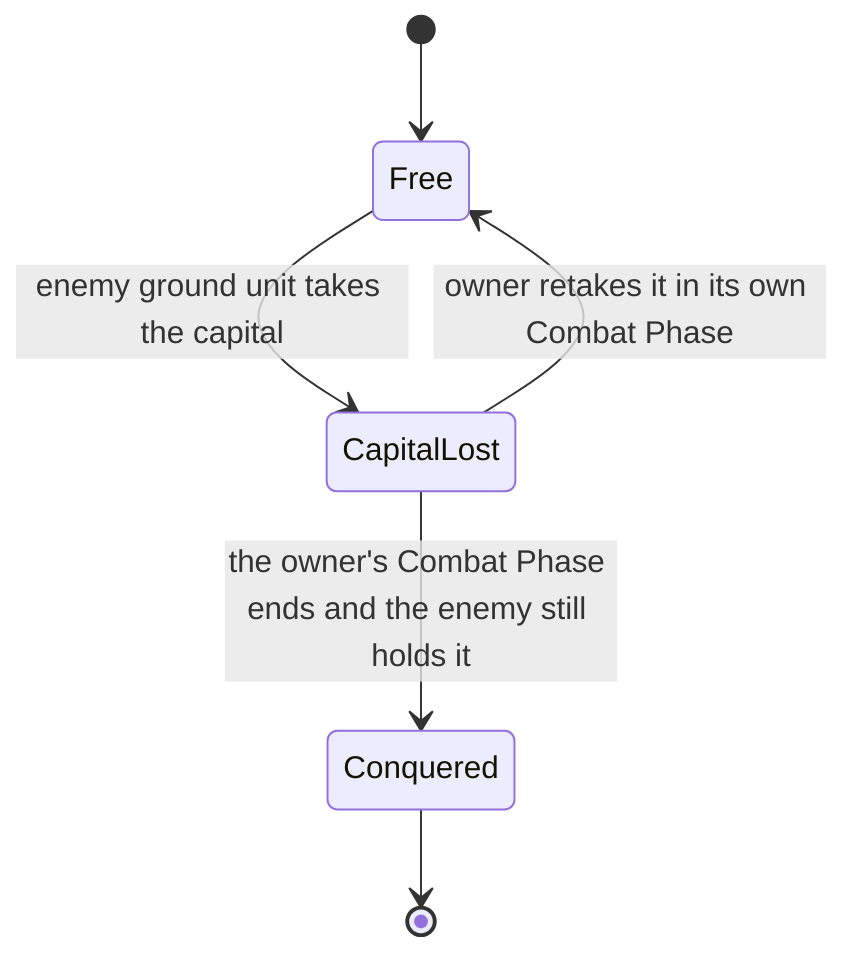
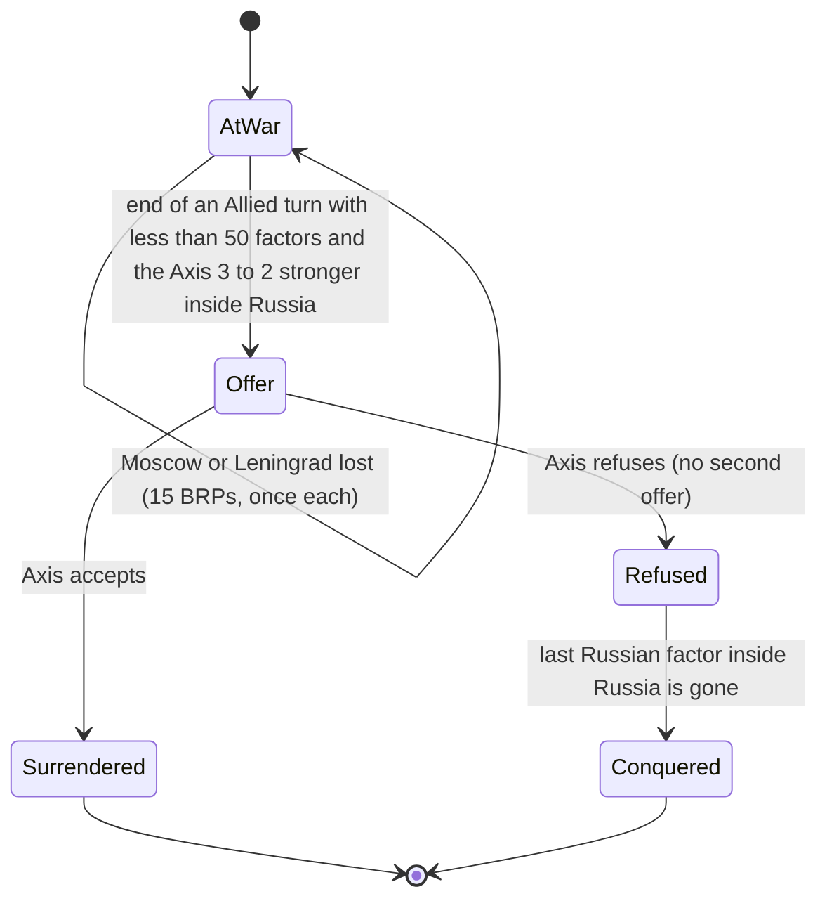
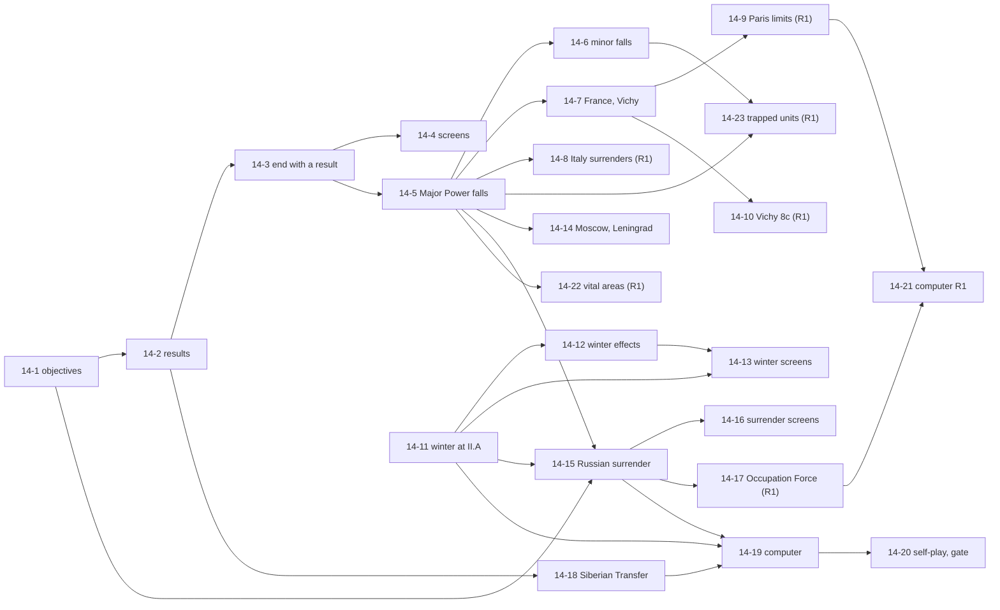

# 14. Victory, surrender, conquest and the Russian winter

Status: **tickets 14-1 to 14-7 and 14-11 to 14-13 built (2026-10-21 and 2026-10-22, "As built" below; 14-5 built for Germany, Italy and Britain, 14-6 for every minor country, Poland first, 14-7 for France with Vichy France, 14-11 for the Russian winter's record, roll and Allied choice, 14-12 for its effects and 14-13 for its screens); the rest is draft, built ticket by ticket when the owner says so. Part of the Beta milestone (docs/PLAN.md): a full 1939 game against the computer needs most of it. Seven tickets are marked R1 and wait for Release 1.** Words and sketches only; the build plan is part G. Builds on spec 01 (turn steps), spec 02 (economy), spec 03 (control and supply), spec 04 (ground combat; this spec takes over its victory, surrender and winter sections), specs 09 and 12 (the shared capture hook) and spec 13 (zones of control). Written from the PC Reference Manual, the Operations Manual, the PC README errata, the game's victory-conditions file and the text messages inside the game program (docs/GAME_DATA.md). The minor-country spec ([spec 15](15-minor-countries.md), PR 99: forces of an attacked minor, Minor-Ally activation, BRPs) is separate; part H sets out who owns what between the two.

## Decisions needed

Five questions, each answerable with yes or no. My recommendation comes first; if you have no view, the recommendation stands (as for DF-1 to DF-3 in spec 12).

| # | Question (yes or no) | Recommended | What changes if you say no |
|---|---|---|---|
| Q1 | When one move decides the game before the last turn, should the game **stop at once** and show the result? This happens only in the 1944 scenario and the Campaign (the Allies take Germany, or the Axis takes three Allied powers). In 1939 and 1942 the game always runs to the last turn. | Yes | The game would go on, with nothing left to win, until the last turn. A "Keep playing" button is not planned; ask for it and it becomes a small extra ticket. |
| Q2 | Show a running score under the turn line ("Objectives: Axis 17, Allies 21, nobody 4") with a button for the full list of the 42 objectives? The DOS game has the list in a menu. | Yes | Frank sees the score only at the end and learns it was close only when it is over. |
| Q3 | Build the **Free Siberian Transfer** in Beta? It gives the Allies free Russian ground units (four in Winter 1941, then three, two and one in 1942) and raises the Allied target by one objective. The 1939 scenario ends in Summer 1942, so a 1939 game gets **nine** units (the tenth, in Fall 1942, is reached only in the Campaign); the 1942 scenario gets six. The turns that count, Winter 1941 to Summer 1942, are inside Beta and are the years Russia is attacked. | Yes | The Allies miss nine free units in a 1939 game (a weaker Allied side than the real game) and the victory tables use their plain numbers. Ticket 14-18 moves to Release 1. |
| Q4 | Can three rules that are rarely felt wait until Release 1: the limits on French attacks while Paris is held by the enemy, Vichy waking up or going back to sleep, and the Axis having to keep 45 factors in Russia after a Russian surrender? | Yes | Tickets 14-9, 14-10 and 14-17 move into Beta (3 more medium tickets). |
| Q5 | When the computer plays the Axis and Russia offers to surrender, should it **accept**? (Accepting gives Germany half of Russia's yearly income; refusing lets the war go on until the last Russian unit is gone.) | Yes | The computer refuses; you could still accept when you play the Axis yourself. |

Questions for Frank, who knows the DOS game, are in part J. They do not block anything.

## Summary (read this first)

- **Today** a game cannot be won or lost. It runs to the last Game Turn of the scenario and prints "Game over". No objective is counted. When a capital falls nothing happens: Poland keeps its army after Warsaw is taken, France fights on after Paris is lost. The Russian-winter roll (card step II.A) and the Russian-surrender step (10a) are passed with no rule behind them. The Free Siberian Transfer (step 8a) does not exist. The only thing in place is the data: the 42 objectives are on the map, the scenarios have their end dates, and a country can be marked "out" of the game.
- **What this spec adds, in the order Frank would feel it:**
  1. **The Russian winter** (Beta). In the first winter of the German-Russian war the Germans lose their defensive bonus inside Russia and cannot take an Offensive Option in the East. Russia may sometimes postpone it one year. The game rolls four dice and asks.
  2. **Countries fall** (Beta). Poland falls when Warsaw is taken. France falls when Paris stays in German hands through the Allied turn, and Vichy France appears. Germany, Britain and Italy fall when their capital stays in enemy hands through their own Combat Phase. Units go, land changes hands, income moves.
  3. **Russia can surrender** (Beta). When Russia is weak and the Axis strong inside Russia, the Axis is offered a surrender. Taking it ends the war in the East and gives Germany half of Russia's income.
  4. **The game ends and says who won** (Beta). A running objective score, a result card with the DOS game's verdict names (Allied Decisive, Allied Tactical, Allied Marginal, Stalemate, Axis Marginal, Axis Tactical, Axis Decisive), and the same result in self-play and watch mode.
  5. **Free Siberian Transfer** (Beta if you say yes to Q3).
- **Out of scope:** the forces of an attacked minor, Minor-Ally activation, and the Year Start Sequence income a conquered minor pays (spec 15; but the moment of conquest itself, for every country, is here: part H); strategic warfare and the Murmansk and U.S. boxes; strategic redeployment; attrition; exploitation; the Suez Canal damage clock. Part H lists each with the room left for it.
- **Size:** 24 tickets: 17 for Beta (6 small, 8 medium, 3 large) and 7 for Release 1 (1 small, 6 medium). The sizes are the spec's scale (a medium ticket is about a day of a person's work). The "roughly 25 to 40 hours" for Beta is **wall-clock time** at the pace measured in docs/PLAN.md (about one medium ticket per 1 to 2 hours with the agents working, CI waits included), plus or minus half; it is not the sum of the sizes. The smallest useful stop is after ticket 14-4: the game ends and says who won.
- **Rules check:** 29 `TODO(verify)` rows (V1 to V29) are in docs/TODO-VERIFY.md and docs/RULES.md. The ones that change what Frank sees most: whether the game stops at once when a conquest decides it (V3), what counts as "factors on the map" for the Russian surrender (V17), what the winter does to Axis stacks that mix Finns and Germans (V23), how the four-dice test is shown (V24), and three messages inside the program that no manual explains (V25).
- **The reading of the manual changed in one place.** Spec 04 says "Ref 18.0" for the Russian Winter and surrender, and docs/RULES.md lists "Russian winter and surrender (18)" among the rules not yet encoded (both corrected by this PR). In the PC Reference Manual the winter is **28.0**, the Russian surrender is **11.8** and **18.41**, and 18.0 is the section on Major Powers. The board-game web text numbers them differently again. This spec uses the PC numbers throughout.

## Words used here

| Word | Meaning |
|---|---|
| **Objective** | One of the 42 red-printed cities that decide the score (14 per Front). Capitals are Objectives only when the map prints them red (Berlin, Paris, London, Rome, Moscow, Warsaw and others); Brussels, Copenhagen and Helsinki are capitals and not Objectives. |
| **Hold** | A side holds an Objective when the hex is controlled by a nation that fights on its side, with the exceptions in rule R1. |
| **Capital lost** | An enemy ground unit has taken the capital hex, but the owner has not yet had its Combat Phase to take it back. |
| **Conquered** | A Major Power whose capital stayed lost through its own Combat Phase, or a minor country whose capital was taken, or the U.S.S.R. after the events of rule R7. The nation is out of the game for good. |
| **Surrender** | Russia's one-time offer (rule R7), and Italy's (rule R6). A surrender is treated as a conquest for most purposes. |
| **Level** | The size of a win: Decisive, Tactical or Marginal (the DOS game's words). |
| **First winter** | The Game Turn in which the Russian Winter rule is in force (rule R10). |
| **Occupation Force** | The 45 Axis factors the Axis must keep in Russia after the war there is over (rule R7). |
| **Phasing side** | The side whose Player Turn it is. |
| **Pass Option** | The manual's third Front Option. The engine calls it "defensive". |

## Goal

Frank should be able to play a 1939 game to its end and be told, in plain words, who won and why.

1. **A game ends and says so.** At the last turn, or when a conquest decides it, a card shows the verdict and the score, and tells Frank what the winner needed.
2. **A country that falls, falls.** The player is told when it is going to happen (a capital taken, one turn to take it back) and when it has happened, and what it did to units, land and income.
3. **The Russian winter is a surprise Frank is not surprised by.** The game rolls the dice, shows them, asks when it must, and says each turn that the winter is on and what it does.
4. **Russia can give up.** The Axis player is asked, with the facts on the card; the Allied player is warned in time to avoid it.

Done means each of these works for both sides, the computer never stalls at a new prompt, and every number on a card is the number the rules used.

## What exists today (facts from the repo, 2026-10-17)

| Fact | Where | Consequence |
|---|---|---|
| `Phase` has `"game-over"`. The Game Turn after the scenario's `end` sets it and emits `GAME_OVER` (year and season). `legalActions` is then empty, the computer returns nothing, the status line says "Game over" and the log "The scenario ends after ...". No result. | `turn.ts` `endGameTurn`, `types.ts`, `actions.ts`, `ui/statusView.ts`, `ui/session.ts` | The end exists; the verdict does not. |
| The scenario end dates are in the data: 1939 Summer 1942 (12 Game Turns), 1942 Winter 1944 (12), 1944 Spring 1946 (9), Campaign Summer 1945 (24). | `src/data/scenario-*.ts` | Matches Ops 9.0; nothing to change. |
| The 42 Objectives are on the map as hexes with the feature `objective`, 14 per Front, with the manual's names. Twenty-six hexes are capitals; 12 of them are also Objectives. | `src/data/map.json`, `tests/map-data.test.ts` | Count the feature `objective` only. **Warning:** the computer's `OBJECTIVE_FEATURES` (`src/ai/geo.ts`) and the self-play tally (`scripts/selfplay/stats.ts`) include `capital` and `capital-port` as well, because they are targets; they must not be reused for the score. |
| Objectives held at the start (counted 2026-10-17 from the scenario data with the rules of R1): 1939 and Campaign: Axis 9, Allies 23, nobody 10 (Oslo, Stockholm, Riga, Antwerp, Budapest, Madrid, Belgrade, Ploesti, Istanbul, Athens). 1942: Axis 25, Allies 14, nobody 3 (Stockholm, Madrid, Istanbul). 1944: Axis 22, Allies 17, nobody 3. | one-off script, not in the repo | These become test fixtures (ticket 14-1). |
| Control of a hex: `controllerOf` (start territory plus `GameState.control`), `controllingSide`, `sideInWar`. A hex of a country nobody controls has no controller. There is **no way to say "nobody controls this hex any more"** once it had a controller. | `control.ts` | Needed for R4 (ticket 14-5). |
| Nations: `status` is axis, allied, neutral, vichy or out. "Out" is skipped by the Year Start Sequence and by declarations of war. There is no "conquered". The Initiative (`initiativeTotals`) adds Germany and Italy against France and Britain, plus the U.S. from Summer 1942 and the U.S.S.R. once it is at war with Germany. | `types.ts`, `yearstart.ts`, `war.ts`, `game.ts` | A conquered nation needs its own status and zero BRPs. |
| **Nothing happens when a capital is taken**: the hex changes controller like any other hex. Poland's units stay after Warsaw falls (`docs/FEEDBACK.md`: the air units left in Warsaw were the first symptom). `fortress.ts` says "no surrender rule exists yet". | `attack.ts`, `control.ts`, `fortress.ts` | Tickets 14-5 to 14-7. |
| Sequence: II.A, 8a, 8c, 6h, 9k and 10a are in `sequence.ts` and are **passed** (not in `IMPLEMENTED_STEPS`). The position `{ part: "russian-winter" }` exists and is passed at once; only Player Turn steps can wait. | `sequence.ts`, `turn.ts` `settle` | Ticket 14-11 lets II.A wait. |
| Defence multiplier: `defenseBasis` returns 4 (Fortress), 3 (mountains, swamp, river or arrow, beach against invasion) or 2 (anything else). Attack numbers call it in `attackNumbers`. | `terrain.ts`, `attack-rules.ts` | The winter changes only the plain 2, in one place. |
| Front Options are chosen at step 3 (`legalFrontOptions`), but `frontAllowsAttack` (the Offensive Option gating attacks) still returns true. | `frontoptions.ts`, `attack-rules.ts` | The winter's ban on the Axis Offensive Option is enforced at step 3 now and bites when the Options are wired to attacks (part C9). |
| Year Start Sequence part B exists. Conquered countries, the half-BRPs of a conquered Major Power and the +15/-15 for Moscow and Leningrad are not built (`yearstart.ts` header, TODO-VERIFY E4). | `yearstart.ts` | Lines added by tickets 14-5 and 14-14. |
| Free Siberian Transfer, Russian surrender and the winter appear nowhere in `src/` except the sequence data, the position name `russian-winter` and the comments that mention the winter (`types.ts` lines 91 to 98, `turn.ts` lines 42, 72 and 112). | `grep` | All new. |
| **What the program itself says** (read as text from `3R2.EXE`, facts only, nothing copied): it has a "Victory and Objectives" menu that lists all objectives and who holds them and notes when the Free Siberian Transfer changed the conditions; a Game Over dialog that names the victory; a "has been conquered" message and a "Conquered" status; a question to the Soviet side whether to postpone the winter; a message announcing that the winter rules apply for the Game Turn; an Axis question whether to accept the Russian surrender; warnings to the Soviet player, at construction, that Russia will surrender unless it builds a stated number of ground and air factors; messages that the Occupation Force is below 45 or has fewer than 30 ground factors, each at a 15 BRP cost; and a question whether the Allies wish to activate the Free Siberian Transfer. It also has three messages about a "severely hard winter" option, "+50 BRPs to the Soviets" and a Soviet "Five Year Plan" that no manual mentions (V25). | `docs/GAME_DATA.md` method | The PC game does these things; the rules text below says how. |

## Sources, and how they were read

- **Primary:** the PC Reference Manual, sections 2.0 to 2.4 (victory), 6.0 (hex control), 9.2 (BRP totals), 11.63 (Free Siberian Transfer), 11.74 and 11.75 (unsupplied units), 11.8 (possible Russian surrender), 12.4 (Attrition may not take a capital or Objective), 13.0 to 17.0 (declarations, minors, intervention, conquest of minors, Minor-Allies), 18.1 to 18.4 (Major Powers, Italy, France, the U.S.S.R.), 19.2 (capitals as supply sources), 28.0 (the Russian Winter), 29.0 (Poland and Eastern Europe), 32.0 to 35.0 (Gibraltar, Malta, Suez, Vichy France); the Operations Manual 5.2, 5.45h, 5.47a, 5.48k, 5.49a and the Status menu entry "Victory & Objectives"; the PC README (Peele's errata and the rules differences, in particular its rules 21.4, 24.23 and 49.6 and the index correction "Surrender, Russian: 11.8"); the game's victory-conditions file. Read from local copies kept outside the repo. **Everything below is in our own words; no manual text is copied.** The thresholds are numbers (facts), recorded as data. The PC README rule numbers (21.4, 24.23, 49.6), the program's text messages and the victory tables were read from the owner's local copy of the game folder and manuals, outside the repo; nothing in the repo checks them except ticket 14-2 (the victory numbers) and ticket 14-24 (the program check).
- **Cross-check:** the Advanced Third Reich text on RulesPal (docs/RULES.md "Web research") has the same victory tables. Its section numbers differ, which is the source of the old "Ref 18.0" in spec 04 and of the "(18)" in docs/RULES.md.
- **The original program:** only its text messages were read for this spec (see the last row above). Its victory logic, the exact comparison it makes in the Russian-surrender test, and the way it rolls the winter dice have **not** been read. Where that matters the rule is marked `TODO(verify)` and ticket 14-24 adds a program check to `scripts/gamedata/` if the owner's game folder is at hand.
- **Where the sources differ or are silent** the rule is marked `TODO(verify)` here and in part J. Nothing is invented: each number below is in a manual passage cited, or in the victory file, or is a named constant with a `TODO(verify)`.

## The turn, with the places this spec touches

```mermaid
flowchart LR
  A["II.A Russian winter<br/>roll and choice"] --> B["1 Declarations<br/>(Russia declares in a winter:<br/>winter starts now)"]
  B --> C["3 Front Options<br/>(winter: no Axis Offensive<br/>on the Eastern Front)"]
  C --> D["7h combat<br/>(winter: Axis defence in Russia<br/>not doubled)"]
  D --> E["end of 7p<br/>conquests settled<br/>Moscow and Leningrad"]
  E --> F["8a Free Siberian<br/>Transfer"]
  F --> G["6h and 9k<br/>Occupation Force (R1)"]
  G --> H["10a Russian surrender<br/>offer to the Axis"]
  H --> I["end of the Game Turn<br/>last turn reached?<br/>result"]
```



**A Major Power's fall:**



**The U.S.S.R.:**



## Part A. Rules in scope, rule by rule

Each rule says what the manual says (our words), the options considered where several readings exist, and the recommendation. "Status" is **settled** (the manual text is clear), **TODO(verify)** (needs a check) or **PO** (a decision for the product owner).

### R1. Objectives and who holds them (Ref 2.0, 6.0, 35.0, 18.41)

- There are 42 Objectives, 14 on each Front. A side holds an Objective when it controls the hex. Control follows Ref 6.0 as built (`controllerOf`).
- **Whose hex it is, case by case** (settled unless marked):
  - A hex held by a Major Power or an active Minor-Ally counts for the side that nation fights on.
  - A **neutral Italy** still counts for the Axis and a **neutral U.S.S.R.** for the Allies (Ref 2.0). This is why the 1939 start shows 23 Allied Objectives.
  - An Objective in a **minor country that was never at war** counts for neither side (Ref 2.0).
  - **Marseilles and Lyons count for the Axis** while Vichy France controls them (Ref 35.0). Objectives and land held by Free French units count for Britain (or the U.S.A.).
  - After a **Russian surrender** every Objective Russia holds at that moment counts for the Allies for good, and so does every Objective in Russia the Axis does not yet hold (a Russian marker is placed on it). Rule R7.
  - Land of an **inactive Minor-Ally** counts for neither side. `TODO(verify)` V2: the manual speaks of "minor countries never at war"; an inactive Minor-Ally is such a country until activated. Recommended: neither.
- **Recommendation:** one pure function `objectiveStandings(ctx, state)` that returns the three lists (Axis, Allies, nobody). Every screen, the self-play report and the result use it. The count never reads the map's `capital` feature.

### R2. The results (Ref 2.1 to 2.4, 11.63; the game's victory file)

Three kinds of scenario. The numbers are facts, recorded as data (`src/data/victory.ts`).

**Counted by Objectives held at the end of play (1939, 1942):**

| Result | 1939 | 1939 with Free Siberian Transfer | 1942 | 1942 with Free Siberian Transfer |
|---|---|---|---|---|
| Allied Decisive | Allies 17 or more | 18 or more | 28 or more | 29 or more |
| Allied Tactical | 16 | 17 | 27 | 28 |
| Allied Marginal | 15 | 16 | 26 | 27 |
| Stalemate | Allies 14 or fewer **and** Axis 24 or fewer | Allies 15 or fewer and Axis 24 or fewer | Allies 25 or fewer and Axis 13 or fewer | Allies 26 or fewer and Axis 13 or fewer |
| Axis Marginal | Axis 25 | 25 | 14 | 14 |
| Axis Tactical | 26 | 26 | 15 | 15 |
| Axis Decisive | 27 or more | 27 or more | 16 or more | 16 or more |

**Counted by when Germany falls (1944)**, measured by the Game Turn in which the conquest completes: in or before Winter 1944 Allied Decisive; Spring 1945 Allied Tactical; Summer 1945 Allied Marginal; Fall 1945 Axis Marginal; Winter 1945 Axis Tactical; Spring 1946 Axis Decisive. There is no Stalemate. If Germany is still standing when the scenario ends (after Spring 1946) the table implies the Axis wins at least as well as Decisive: read as Axis Decisive (`TODO(verify)` V5).

**Campaign:** the Allies win if the Axis is conquered: in or before Summer 1944 Decisive; Fall or Winter 1944 Tactical; Spring or Summer 1945 Marginal. With the Free Siberian Transfer each Allied date is one Game Turn earlier (Decisive in or before Spring 1944; Tactical in Summer or Fall 1944; Marginal in Winter 1944 or Spring 1945). If the Axis is not conquered in time: the Axis wins Decisive by conquering three Allied Major Powers, Tactical by conquering two, Marginal by holding at least 28 Objectives at the end of Winter 1943; otherwise Stalemate.

- **How the first table fits together (settled by arithmetic, `TODO(verify)` only for the corner).** The two halves are consistent only while some Objectives are in nobody's hands: with the three neutral cities (Stockholm, Madrid, Istanbul) out, at most 39 are held and the table covers every case exactly once (Allies 15 and Axis 24 is Allied Marginal; Allies 14 and Axis 25 is Axis Marginal; 14 and 24 is Stalemate). If Spain, Sweden or Turkey is conquered, both sides can reach a level at once. `TODO(verify)` V1. **Recommended:** the higher level wins; equal levels are a Stalemate. This case is rare and cannot be reached in a normal 1939 game.
- **"Conquered Axis"** needs a reading: the Axis Major Powers are Germany and Italy. If Italy never entered the war, the Allies must still conquer it, which needs a declaration of war (35 BRPs). `TODO(verify)` V6. **Recommended:** both, as the words say; ask Frank (question F7).
- **The Campaign's three Axis levels** are read as achievements remembered during play: the count of Objectives is taken when Winter 1943 ends and stored; "conquered" Allied powers are counted from the conquest records. They decide only if the Allies have not conquered the Axis in time. `TODO(verify)` V6. With the Free Siberian Transfer a conquest after Spring 1945 is no Allied result, so it falls through to the Axis tests and then Stalemate (V7).
- **The date of a conquest** is the Game Turn in which it completes (the end of the conquered side's Combat Phase), not the Game Turn the capital was first taken. `TODO(verify)` V4; this is what the words "conquest occurs immediately after" say (Ref 18.1).
- **When the Free Siberian Transfer applies:** from the first unit taken (rule R11) to the end of the game. The result function reads one flag.

### R3. When the game ends (Ref 2.0, Ops 9.0; Q1)

- **Always:** after the last Player Turn of the last Game Turn (the scenario's `end`). The result is computed then, from the tables of R2.
- **Early, only in the two scenarios that are decided by conquest:** the moment the deciding conquest completes (the 1944 scenario: Germany; the Campaign: the last Axis Major Power, or the third Allied Major Power for an Axis Decisive). `TODO(verify)` V3: the program has a Game Over dialog but it is not known whether it appears at that moment or at the end of the turn. **Recommended (Q1):** at once, because the result cannot change.
- Not early in 1939 and 1942: their result is the count at the end of play, which can still change (Ref 2.0 says "at the end of play").
- Once over, no action is legal, the computer stops, the state keeps the result, and the card of part D shows it.

### R4. A Major Power is conquered by its capital (Ref 2.0, 18.1)

- **When.** Germany, Italy, Britain and France are conquered when an enemy holds the capital at the end of the owner's own next Combat Phase. The owner gets exactly one Combat Phase to take it back. The U.S.A. cannot be conquered (rule R8). The U.S.S.R. follows rule R7.
- **Only a real attack takes a capital.** Attrition may not occupy a capital (Ref 12.4, already built as `NO_ATTRITION_OCCUPATION`).
- **A unit that counterattacks the capital** must be supplied from some source other than that capital. Since the captured capital stops supplying its owner (it supplies its captor, `supply.ts`), this comes out of the supply rules and needs no code of its own.
- **When it happens:** at the end of step 7p of the conquered side's Player Turn, and not before.
- **What happens, thing by thing:**

| Thing | The rule (our words) | Design |
|---|---|---|
| Units | All ground, air and naval units of the conquered Power, and of its active Minor-Allies, leave the game. `TODO(verify)` V10: "leave the game" is read as for good: the Force Pool and the Allowable Builds go too, nothing can be rebuilt. Italian units lent to Germany are removed with Italy; if Germany falls they go back to Italy (lending is not built). | `fall()` deletes the units and the pools and logs one summary event. |
| Airbases and bridgeheads | Go with the rest. | Same call. |
| Hexes of the Power itself | They pass to the conqueror at once: the Major Power whose unit holds the capital. Exception: hexes with hostile Major-Power ground units that can still trace supply, and the supply line they use, stay as they are (V12). | `control` entries for every home hex. |
| Everything the Power or its active Minor-Allies had **conquered or held elsewhere**, and its non-French colonies | Controlled by nobody, and belongs to the first nation that walks in (not during a Pass Option, because nobody controls it). `TODO(verify)` V11: which hexes are "in the Major Power" (its own map country: East Prussia is Germany, Ulster is Britain, Sicily and Sardinia are Italy) and how to record "nobody". | `control[hex] = null` (part C1). |
| BRPs | In every later Year Start Sequence the conqueror gets half (rounded down) of what the conquered Power began the scenario with, while it still holds the capital. If the capital fell in the second half of a Winter turn the half-BRPs start one Year Start Sequence later, because the conquest completes in Spring. The conquered Power's own total and spending limit become 0. `TODO(verify)` V9: "began the scenario with" is read as the printed total (370 for Germany in 1944), not the Base. | `Conquest` record plus one line in `yearstart.ts`. |
| Supply | The captured capital is a source for the conqueror's side as today. A conquered Power has no units to supply. | No change; the existing `TODO(verify)` stays. |
| Grants | A conquered Power gives and receives no grants. | `legalGrants` skips it. |
| Declarations of war | A conquered Power is not a target and not a declarer. | `declarationTargets` skips status "conquered". |
| The Initiative | A conquered Power adds 0 to its side's total (the sum is Germany and Italy against France and Britain, plus the U.S. from Summer 1942 and Russia while at war with Germany). | Zero BRPs; no change to `initiativeTotals`. |

- **The conqueror** is the owner of the unit that holds the capital hex, found as `controllerOf(capital)`. When several Allied Major Powers are in play, it is the one whose counter stands there. `TODO(verify)` V8: the same reading decides who gets the half-BRPs.
- **A warning, not a rule:** when a capital is taken the owner is told, in words, that the Power falls at the end of its own Combat Phase unless it takes the capital back (part D).

### R5. France (Ref 18.3, 35.0, 26.0; PC README rule 49.6)

France is conquered by rule R4, at the end of the **Allied** Combat Phase while Paris is German-held. It then gets special treatment (Ref 35.0), all at the moment of the conquest:

1. **Vichy France is created.** The Vichy hexes of European France become Vichy-controlled: the 17 mainland hexes of the `1942/vichy-france` zone (from `VICHY.CON`) and Corsica. (`VICHY.CON` marks 19 hexes: those 17 and two in Corsica, X20 and W21; our map still calls W21 sea, so 18 are land today. The 1939 scenarios need the zone added: ticket 14-7.) The rest of European France passes to the conqueror.
2. **French units in European France are halved.** Half (rounded up) of each type, with air and naval factors each totalled and halved, becomes Vichy; the rest is eliminated for good. The Vichy half goes into the Vichy Force Pool and is set up in Vichy hexes at the start of the next Axis turn. `TODO(verify)` V13. **Recommended:** the engine places the Vichy units itself, in map order inside the Vichy hexes, within the stacking limits (the DOS game's "set up" is a screen the Axis player does; ours is automatic and logged).
3. **Two die rolls decide the colonies.** One for Lebanon-Syria and one for Tunisia-Algeria-Morocco. Even: that colony and its French units become Vichy. Odd: Free French. (A colony the Axis already holds is not changed.) Units stay where they are. `TODO(verify)` V14.
4. **French conquests and other French-held hexes become Axis**, except hexes that can trace supply to a Free French colony, which stay Free French unless they are closer to European France or to a Vichy colony. `TODO(verify)` V15: first slice gives them all to the Axis and lists the exception as unbuilt.
5. **British units in Vichy territory are eliminated** (the PC changed the board game here: README rule 49.6).
6. **Vichy France is an inactive German Minor-Ally** that never pays BRPs to Germany. The city of Vichy is its capital until Vichy is conquered. The nation France gets status "vichy" and 0 BRPs, exactly as the 1942 scenario has it. Waking Vichy up (step 8c, five BRPs, a die roll) and putting it back to sleep is ticket 14-10 (R1).
7. **Free French** units work as British; ones destroyed later may be rebuilt in Britain. The Free French pool is created for the colonies' units.

- **While Paris is enemy-held and France is not yet conquered** (Ref 18.3, one Allied turn): French attacks are limited to Paris and the hexes next to it, at odds of 1:2 or better, with supplied units; France may not use an Attrition Option, may use the Offensive Option only on the Western Front, may not declare war, cannot move units out of France and traces supply only from London. Ticket 14-9 (R1). In Beta these limits are not enforced; the fall itself still comes one Allied turn after Paris is lost.
- All of French hexes' fleets and air in ports that pass to the enemy use the capture call shared with spec 09 (09-5) and spec 12 (12-4): `afterHexTaken`.

### R6. Italy (Ref 18.1, 18.2)

- Italy is conquered by rule R4 (Rome).
- **Italy can also surrender** (Ref 18.2), when **all four** hold at the end of the Axis Combat Phase: it is Spring 1943 or later and the Allies have a supplied non-airborne unit on mainland Italy (Sicily does not count); no Axis forces are in Africa (all of Egypt included; unactivated Vichy units do not count); the Allies hold every hex of Sicily, or every hex of both Sardinia and Corsica; and the Allies hold the Initiative that Game Turn (they moved first). Ticket 14-8 (R1). **It cannot happen in the 1939 scenario**, which ends in Summer 1942.
- On a surrender every Italian-held hex passes to Germany, Italian units are removed, Germany gets half of Italy's starting BRPs per Year Start Sequence while it holds Rome, and the surrender counts as a conquest. At the end of that Combat Phase the program rolls a die, adds two, and Germany keeps that many of Italy's naval factors (any mix of Italian partial fleets, up to what existed), placed in German-held ports on the same Front. They keep the Italian naval DRM and can never be rebuilt. `TODO(verify)` V16.

### R7. The U.S.S.R. (Ref 11.8, 18.4, 18.41, 9.2, 2.0; Ops 5.45h, 5.48k, 5.49a)

Russia is not conquered when Moscow falls. Four separate things happen.

**a. Moscow and Leningrad (Ref 18.4, 9.2).**
- The Axis capture of either city is an **immediate** gain of 15 BRPs for Germany and loss of 15 for Russia, once for each city. If control swings back and forth there is no second gain or loss. Russia gets no turn to retake it first.
- In **every Year Start Sequence** in which the Axis holds a city, Germany gets another 15 for it and Russia loses 15. `TODO(verify)` V22: it is "the Axis" in the text; Germany is the recipient in this spec. After a Russian surrender these stop.

**b. The offer (Ref 11.8, 18.41; Ops 5.49a), at step 10a.**
- At the end of any **Allied** Player Turn in which Russia is at war with the Axis, has **less than 50** ground and air factors on the map, and the Axis ground and air factors inside Russia's original boundaries are **at least three halves** of the Russian total, Russia makes a **one-time** offer to surrender. Counting: Russian factors are the strengths of Russian ground and air units standing on map hexes; Axis factors are the strengths of Axis ground and air units standing on hexes of the map country "ussr" (485 land hexes). `TODO(verify)` V17: replacements and airborne count as ground; airbases, fleets and units in boxes do not; Italian and Minor-Ally units count as Axis; "three halves" means the Axis total times 2 is at least the Russian total times 3.
- **Once only.** Whether the Axis accepts or refuses, no second offer is made (V18).

**c. If the Axis accepts (Ref 18.41).**
- Every Objective not yet in Axis hands has a Russian marker placed on it and counts for the Allies from then on (rule R1).
- From the next Year Start Sequence Germany gets half (rounded down) of Russia's starting BRPs each year and no longer gets or loses the 15s for Moscow and Leningrad. `TODO(verify)` V19: who receives it (Germany), and the base ("started the scenario with").
- **The Axis must keep an Occupation Force** of 45 factors inside Russia, at least 30 of them ground, until the scenario ends. Checked at the end of each Axis Movement Phase (step 6h) and each Axis Player Turn (step 9k). A shortfall costs 15 BRPs and the Axis must hand one Axis-held Russian Objective of its choice back to Russia for good, once per turn, until none is left; until the 45 are restored the Axis may Strategically Redeploy only to fix the shortage. Air and naval units may count and may still fly from their Russian bases. The Axis cannot declare war on Russia again. `TODO(verify)` V21: Ref 18.41 says "within Russia's original borders", Ops 5.45h says "on the Eastern Front" and counts naval factors too. Ticket 14-17 (R1).
- Russian units: this spec removes them and Russia's pool at once, as for any conquered Power (V19). Russian land stays Russian-controlled and, because Russia then takes no side, the existing rule that closed neutral land keeps Axis units out (`NEUTRAL_LAND_CLOSED`).

**d. If the Axis refuses (Ref 18.41).** It cannot change its mind. Russia stays in the game until its **last combat factor inside its original borders** is eliminated; at that moment Germany starts to get the half-BRPs, and the Occupation Force applies from the refusal on. Until then Moscow and Leningrad keep their 15s. `TODO(verify)` V20: the engine has no "instant"; it checks after every Combat Phase and after the unsupplied-unit eliminations.

- **A convenience the DOS game has and the board game does not:** while the Allied player builds (step 8b) the program warns that Russia will surrender at the end of the turn unless it builds at least N more ground and air factors. We copy it (ticket 14-16); N is worked out with the same test, so the warning is true.

### R8. The U.S.A., and Britain's fall (Ref 18.1)

- **The U.S.A. cannot be conquered.** If London falls the U.S. stays in the game; its units may supply from the U.S. Box (a later supply item).
- **Gibraltar and Suez (Ref 32.0, 34.0).** Losing Gibraltar costs Britain 25 BRPs at once, once only. If the Axis controls both Suez city and Alexandria, Britain loses 25 BRPs at once, once only; this is separate from the Gibraltar loss. A deficit stops British spending for the year and is taken from the next Year Start Sequence. The program has a message for each. Ticket 14-22 (R1). `TODO(verify)` V27.
- **Britain** is conquered by rule R4 (London). What happens to Free French, to U.S. entry and to British colonies after that is outside this spec (`TODO(verify)` V29); the generic fall removes British units and passes British land, and the rest stays as it is.

### R9. Minor countries and Minor-Allies (Ref 14.0, 16.0, 17.1, 29.0; PC README 24.23)

- **A minor country falls when a hostile unit stands in its capital.** It gets no turn to retake it. At the end of the **attacker's** Combat Phase its units are removed for good, and **every hex of the country** becomes the conqueror's, except hexes under hostile Major-Power units that can still trace supply (the program picks their route; V12). A Minor-Ally falls the same way, active or not; an inactive Minor-Ally whose capital falls to the Allies can never be activated.
- **Poland** is the first case in every 1939 game. Its capital is Warsaw. Poland east of the Partition Line becomes part of Eastern Europe at the end of the Axis Fall 1939 turn (Ref 29.0); this spec passes only the hexes that are still Poland. `TODO(verify)` V28.
- **Colonies and Eastern Europe** are conquered by holding **all their cities**, not a capital. Spec 15 (R12, R13) writes that test; when it is met it calls this spec's `fall()` (ticket 14-6), which does the rest for every country: the `Conquest` record, the control change, the units removed and the event. The BRPs a conquered country pays at the Year Start Sequence, intervention and activation are spec 15's (part H).
- Who the conqueror is: the owner of the hostile unit in the capital. When a Minor-Ally's allied Major Power falls, the Minor-Ally's units go with it (rule R4).

### R10. The Russian Winter (Ref 28.0; Ops 5.2)

- **When it starts.** On the first Winter Game Turn after the German-Russian war has begun. Step II.A is checked at the start of **every** Winter Game Turn; the winter starts if Germany and Russia are at war at that moment and it has not been in force yet. A German declaration made during a Winter turn comes after II.A, so the first winter is the **next** one. If **Russia** declares war on Germany during a Winter turn, that turn is the first winter at once, even if the Axis already played its Winter Player Turn, and Russia cannot postpone it.
- **1942 and 1944:** the first winter is taken as over; the rule never applies (`ScenarioRule` "first winter past").
- **The postponement.** At the start of the first winter turn the program rolls **four dice** and counts the non-Finnish Axis ground units east of the original Russian border. If there are **fewer** units than the total of the dice, Russia may postpone the whole effect to the next winter, announcing it at the start of the turn after seeing the roll. Otherwise no choice is offered. `TODO(verify)` V24: which units are counted (recommended: every non-Finnish Axis ground-type counter, replacements and airborne included, Minor-Allies' included), and how the DOS game shows the roll (it prints a line with the number rolled).
- **What the winter does, for that one Game Turn** (the program announces that the winter rules apply for the whole Game Turn):
  1. **The Axis defence is not doubled.** Every Axis unit (the Finns excepted) that is east of the original Russian border is not doubled when defending. Where the terrain triples (rivers, swamp, mountains, crossing arrows) or quadruples (a Fortress) the bonus stays; only the plain "times two" goes, so those defenders count once. `TODO(verify)` V23: what a hex shared by Finns and others does (recommended: the doubling is lost if any non-Finnish Axis ground unit is in the hex), and whether a Fortress keeps its fourfold.
  2. **The Axis may not take an Offensive Option on the Eastern Front** in its Player Turn of that Game Turn (Attrition and Defensive are still allowed). When Russia declares in a Winter turn after the Axis has moved, this does nothing.
- "East of the original Russian border" is read as the hexes of the map country "ussr" (the same 485 hexes as in rule R7). `TODO(verify)` V23.
- After the first winter (the first or the postponed one) the rule never applies again.
- **The program also has three messages that the manuals do not explain:** one about a "severely hard winter" option, one giving the Soviets 50 BRPs, one calling it a Five Year Plan (V25). They look like a hidden option. Not built; the question to Frank is F5.

### R11. Free Siberian Transfer (Ref 11.63; Ops 5.47a; the victory file)

- In the Allied construction phase (step 8a) of **Winter 1941** the Allies may take, at no BRP cost, any **four** ground units from the Russian Force Pool; **three** more in Spring 1942, **two** in Summer 1942 and **one** in Fall 1942. Units not taken in a turn are lost. Only non-airborne ground units; in each turn the armor taken cannot outnumber the infantry taken. Each is placed in a Russian-controlled city in Russia that has a supply line to the east edge of the map.
- If the Allies use it **at all**, the victory tables change (rule R2). The 1944 scenario is exempt; its dates are past anyway. The 1942 scenario starts in Spring 1942, so it gets three, then two, then one (six). The 1939 scenario ends in Summer 1942, so a 1939 game gets four, three and two (**nine**); the Fall 1942 unit is reached only in the Campaign (ten).
- `TODO(verify)` V26: whether it needs Russia to be at war with the Axis; whether using one unit counts as "using" it for the victory change (the program asks a yes-or-no question, so recommended: yes, any unit); the exact reading of the supply condition (the existing east-edge supply source is used).
- The state keeps one flag, `siberian.used`, and what was taken each turn.

### R12. Where each check happens

| Check | Where | Why there |
|---|---|---|
| Winter roll and Allied choice | start of every Winter Game Turn, position II.A | Ops 5.2 |
| Winter starts by a Russian declaration | when `applyDeclaration` records Russia against Germany in a Winter turn | Ref 28.0 |
| No Axis Offensive Option in the East | step 3 | Ref 28.0 |
| No doubling | step 7h, in the attack numbers | Ref 28.0 |
| Conquests, Moscow and Leningrad, the last Russian factor, early end | leaving step 7p of either side | "end of the Combat Phase" (Ref 16.0, 18.1) |
| Italy's surrender | leaving 7p of the Axis | Ref 18.2: "end of the Axis Combat Phase" |
| Free Siberian Transfer | step 8a (Allied turn) | Ops 5.47a |
| Occupation Force | steps 6h and 9k (Axis turn) | Ref 18.41, Ops 5.45h and 5.48k (R1) |
| Russian surrender offer | step 10a (Allied turn) | Ops 5.49a |
| Half-BRPs, the 15s, conquered income | Year Start Sequence part B | Ref 9.2 |
| Last-turn result | after the second Player Turn of the last Game Turn | Ref 2.0 |
| Campaign checkpoint (28 Objectives) | end of the Winter 1943 Game Turn | Ref 2.4 |

## Part B. Rules not decided by the text

Listed with the rest in part J. The five that change what Frank sees most: V3 (does the game stop at once), V17 (what counts as factors for the Russian offer), V23 (the winter on mixed stacks, Fortresses, minor allies), V24 (the dice test), V13 (who places the Vichy units).

## Part C. Engine design

### C1. State (additive; an old saved game without any of it reads as "nothing has happened")

```ts
// GameState gets six optional fields, like `air`, `combat` and `moves`. Their types live in
// their own modules because types.ts is over the size limit (spec 09 B1, spec 12 B1).
winter?:    RussianWinter    // winter-record.ts
conquests?: Conquest[]       // conquest-record.ts
soviet?:    SovietRecord     // soviet-record.ts
siberian?:  SiberianRecord   // soviet-record.ts
victory?:   VictoryRecord    // victory-record.ts
result?:    GameResult       // victory-record.ts; set once, together with phase "game-over"

type RussianWinter = {
  /** "ahead": none yet; "postponed": the Allies waited for the next one; "over": it has been (or the scenario assumes it was). */
  stage: "ahead" | "postponed" | "over";
  /** The Game Turn ("1941-winter") in which the rule is in force; absent when it is not. */
  inForce?: string;
  /** The roll made at II.A, kept for the card: four dice, their total, the Axis units counted, whether Russia may wait. */
  roll?: { dice: number[]; total: number; axisUnits: number; mayPostpone: boolean };
  /** True while the Allies have to answer. */
  asking?: boolean;
};

type Conquest = {
  country: PowerId | Combatant | "eastern-europe";
  by: ForceOwner;            // the conqueror (the owner of the unit in the capital); Germany for a Russian surrender
  side: Side;
  how: "capital" | "surrender" | "last-unit" | "italian-surrender";
  at: GameTurn;              // the Game Turn in which it completed
  startingBrps?: number;     // for a Major Power: what it began the scenario with
};

type SovietRecord = {
  citiesTaken: { moscow?: boolean; leningrad?: boolean };   // the once-only 15s
  offer: "none" | "asking" | "accepted" | "refused";
  credited: HexId[];         // Objectives the Allies hold for good after a surrender (and those handed back later)
  shortfallTurn?: string;    // "year-season" of the last Occupation Force penalty (once a turn)
};

type SiberianRecord = { used: boolean; taken: Record<string, number> };   // "1941-winter" -> units taken that turn
type VictoryRecord = { checkpoints: Record<string, number> };             // "1943-winter" -> Axis Objectives then
type GameResult = {
  winner: Side | null;                                  // null: Stalemate
  level: "decisive" | "tactical" | "marginal" | null;   // null with a Stalemate
  basis: "objectives" | "conquest" | "powers-conquered" | "turn-limit";
  objectives: { axis: number; allies: number; nobody: number };
  at: GameTurn;
  early: boolean;
  siberian: boolean;                                    // which table was used
};
```

- **`Nation.status` gains `"conquered"`.** Three places already test `"out"`: `war.ts` (no declarations on it), `yearstart.ts` (skipped) and `fortress.ts` (`franceFallen`); a small helper `isGone(nation)` replaces them. `sideOfPower` already returns null for any status that is not axis or allied, so a conquered nation fights for nobody. Its `brpTotal`, `spendLimit` and `spent` are set to 0 when it falls; `brpBase` stays (the record keeps `startingBrps`).
- **`GameState.control` may hold `null`** ("nobody controls this hex"). `controllerOf` must then use `hex in state.control` instead of `??`, or a nobody-hex falls back to its start owner. This is the one change to `control.ts` that other code can feel; its test list is in F3.
- **The scenario carries its victory rules** (`Scenario.victory`, data in `src/data/victory.ts`): the three kinds of R2, with the Free Siberian Transfer variants, the Campaign checkpoint, and `ScenarioRule` gains `{ kind: "first-winter-past" }` for 1942 and 1944.
- **Determinism and replay:** actions are plain objects, records are JSON, dice come only from `rngState` (four dice at II.A, two colony dice at the fall of France, one die for Italy's fleet); a saved action list replays to the same state.
- **Saves (spec 11):** all fields are optional and plain data, so the save format needs no change beyond including them; the result is saved with the game so "Continue" on a finished game shows the card again.

### C2. Pure queries (no state change; each tested alone)

| Function | Returns |
|---|---|
| `objectiveStandings(ctx, state)` | `{ axis: string[]; allies: string[]; nobody: string[] }` of Objective hex ids by R1. |
| `evaluateVictory(ctx, state, moment)` | the `GameResult` that stands now, or null if the game goes on. `moment` is "after-conquest" or "end-of-play". |
| `victoryTarget(ctx, state)` | the plain-words conditions for the card: what each side needs now, with the Free Siberian Transfer applied; and how far each side is from its next level. |
| `capitalState(ctx, state, power)` | `"free"`, `"capital-lost"` (enemy holds it) or `"conquered"`. |
| `fallingNow(ctx, state, side)` | the Powers and minors of `side` or hostile to it that fall at the end of this Combat Phase. |
| `winterRoll(state)` | the four dice from `rngState` and the count (the one place that touches the RNG for the winter; it returns the next `rngState`). |
| `winterInForce(state)` | whether the rule is on this Game Turn. |
| `sovietOffer(ctx, state)` | the two sums and the test of R7b, with the number of factors Russia is short of 50 (for the construction warning). |
| `occupationForce(ctx, state)` | the Axis factors in Russia, total and ground (R1). |
| `siberianOptions(ctx, state)` | how many units may be taken now and which pool entries qualify. |

### C3. Actions (every one carries the acting `side`)

| Action | Step | Who | What |
|---|---|---|---|
| `CHOOSE_WINTER { side: "allies", postpone }` | II.A | Allies | R10. Legal only while `winter.asking`. |
| `SURRENDER_ANSWER { side: "axis", accept }` | 10a | Axis (not the active side) | R7b to R7d. Nothing else is legal while the offer waits (as for a pending Exchange). |
| `SIBERIAN_TRANSFER { side: "allies", unit: { type, strength }, at }` | 8a | Allies | R11. One unit per action, like `BUILD`, free of charge, refused with the reason when the quota, the armor-to-infantry rule or the placement fails. |
| `END_STEP` | 8a, 10a once nothing is pending | | Existing. |

Conquests, the winter's effects and the game's end are **not** actions: they follow from the others and the sequence (R12). `legalActions` lists the first useful choices; malformed input is refused with a reason, never thrown (the pattern of `applyMove`).

### C4. Events (for the log, the cards and self-play)

`WINTER_ROLLED { dice, total, axisUnits, mayPostpone }`, `WINTER_POSTPONED`, `WINTER_STARTED { turn, postponedFrom? }`, `CAPITAL_LOST { power, capital, by }`, `CAPITAL_RETAKEN { power }`, `COUNTRY_CONQUERED { country, by, how, unitsRemoved, hexesPassed }`, `UNITS_REMOVED_BY_CONQUEST { country, units }` (one event with the list, like `UNITS_SWEPT`), `CONTROL_PASSED { country, to, hexes }` (one event, not 64), `VICHY_CREATED { halved, colonies }`, `ITALY_SURRENDERS`, `RUSSIA_OFFERS_SURRENDER { russian, axis }`, `RUSSIA_SURRENDERED`, `SURRENDER_REFUSED`, `RUSSIA_BRPS_MOVED { city, amount }`, `OBJECTIVES_CREDITED { hexes }`, `SIBERIAN_TRANSFER_USED { unit }`, `GAME_OVER` (now with the `GameResult`). One log line each, in words, no raw ids: "Germany takes Moscow: +15 BRPs for Germany, -15 for Russia."

### C5. Which steps wait, and for whom

| Step | Waits when | Actions | Ticket |
|---|---|---|---|
| **II.A** | a Winter Game Turn and `winter.asking` (Russia may postpone) | `CHOOSE_WINTER` | 14-11 |
| 3 | unchanged | `legalFrontOptions` hides the Axis Offensive Option on the Eastern Front while the winter is in force | 14-12 |
| **8a** | Allied turn and `siberianOptions` is not empty | `SIBERIAN_TRANSFER` | 14-18 |
| 6h, 9k | (R1) the Axis owes an Occupation Force and is short | none (a note in the log); the penalty is automatic | 14-17 |
| **10a** | `soviet.offer === "asking"` | `SURRENDER_ANSWER` | 14-15 |

`IMPLEMENTED_STEPS` gains `8a` and `10a`. II.A is the first position that is not a Player Turn step to wait: `settle` must stop there when the winter is asking, and `legalActions` must answer for it. That is the one structural edit of this spec (part C9).

### C6. Who is asked

Spec 09 C6 and spec 12 C6 export `sideToAct(state)`: the pending chooser, else the non-active side at 7d and 6c, else the active side. This spec adds two more: the **Allies at II.A** and the **Axis at 10a**. The browser's `computerToMove` and the computer's `chooseAction` use the same function, so there is no special case. The first ticket that needs it creates it (B2).

### C7. Modules (proposed names; each under 300 lines)

`objectives.ts` (R1), `victory.ts` and `src/data/victory.ts` (R2, R3), `victory-record.ts`, `conquest.ts` (the generic fall, R4, and the settle hook), `conquest-record.ts`, `conquest-minor.ts` (R9), `conquest-france.ts` (R5), `conquest-italy.ts` (R6, R1), `winter.ts` and `winter-record.ts` (R10), `soviet.ts` and `soviet-record.ts` (R7, R11), `siberian.ts` (R11), `victory-actions.ts` (legal and apply for the three actions, routed from `actions.ts`).

### C8. How a fall works (one function, three callers)

```
fall(ctx, state, who, conqueror, how)
   1. remove the units and the pools of `who` (and of its active Minor-Allies, if a Major Power)
   2. pass the home hexes to `conqueror`; set held-elsewhere hexes to nobody; keep hexes under supplied hostile Major-Power units (V12)
   3. set status "conquered" (Major Power), zero its BRPs; mark a minor as conquered in `conquests`
   4. record the Conquest (turn, conqueror, starting BRPs)
   5. emit COUNTRY_CONQUERED, UNITS_REMOVED_BY_CONQUEST, CONTROL_PASSED
   6. call afterHexTaken for every hex that passed to an enemy of some unit's owner (fleets and air alone there)
   7. ask evaluateVictory: if the game is decided, set the result and phase "game-over"
```

France (R5) and Italy's surrender (R6) call the same function with a small variant before step 1 (France keeps half of its units as Vichy; Italy keeps naval factors for Germany). The settle hook at the end of 7p walks `fallingNow`.

### C9. Shared files touched, each by the smallest edit

`types.ts` (the six fields, the status), `action-types.ts` (actions, events), `actions.ts` (routing, `sideToAct`, `legalActions` for II.A), `sequence.ts` (`IMPLEMENTED_STEPS`), `turn.ts` (enter II.A with the roll; the hook when leaving 7p; the result at `endGameTurn`; `settle` stops at II.A), `war.ts` (the "gone" test; Russia declaring in a Winter turn starts the winter), `control.ts` (nobody), `attack-rules.ts` (`attackNumbers` asks `winterInForce` and the hex), `terrain.ts` (a `winter` flag on `DefenseSituation` and a new `DefenseBasis` "winter-plain"), `frontoptions.ts` (hide the Offensive Option), `yearstart.ts` (the income lines), `grants.ts` (conquered powers), `construction.ts` (placement reuse for 8a), `game.ts` (zero BRPs in the Initiative), `scenario-*.ts` (`victory`, the first-winter rule), `ui/*` (part D), `ai/*` (part E), `scripts/selfplay/*` (the result). `NEUTRAL_LAND_CLOSED` (`movement.ts`) is read, not changed.

## Part D. The screens

Principles from specs 07 and 12: one press, names and not ids, nothing only on hover, every button at least 44 px, iPad first, cards that move focus to their title, text in one module (`endText.ts`) so the later French pass is a translation. **The Beta end screen and every card here are in English; the French interface comes after Release 1 (docs/PLAN.md section F).** **For a French-speaking reader on an English interface:** short sentences, numbers instead of adjectives where possible, no idioms and no jokes, the DOS game's own verdict names kept as they are ("Allied Marginal Victory") with a one-line plain meaning under the title, and BRP spelled out once on each card.

### D1. The running score and the Objectives list (Q2)

The turn line gets a second short line: **Objectives held: Axis 17, Allies 21, nobody 4**, and a "Victory and objectives" button. The button opens a card (the DOS game has a menu of the same name):

```
+------------------------------------------------------+
| VICTORY AND OBJECTIVES                               |
| Held now:  Axis 17   Allies 21   Nobody 4            |
| Free Siberian Transfer: not used                     |
|                                                      |
| WESTERN FRONT (14)                                   |
|  Antwerp ......... nobody    Berlin ........ Axis    |
|  Birmingham ...... Allies    Bonn .......... Axis    |
|  ...                                                 |
| EASTERN FRONT (14)   MEDITERRANEAN FRONT (14)        |
|  ...                                                 |
|                                                      |
| WHAT EACH SIDE NEEDS when Summer 1942 ends           |
|  Allies: 15 = Marginal, 16 = Tactical, 17 = Decisive |
|  Axis:   25 = Marginal, 26 = Tactical, 27 = Decisive |
|  In between: Stalemate.                              |
|                                         [ Close ]    |
+------------------------------------------------------+
```

For the two scenarios decided by conquest the last block says, for example, "The Allies win by conquering Germany: Decisive in or before Winter 1944, Tactical in Spring 1945, Marginal in Summer 1945. The Axis wins by holding on: Marginal if Germany falls in Fall 1945, Tactical in Winter 1945, Decisive in Spring 1946 or later." On the map each Objective gets a small mark for who holds it: a square for the Axis, a circle for the Allies, a dashed ring for nobody (shape, not colour alone). Tapping a name in the list centres the map on it.

### D2. The end of the game

```
+------------------------------------------------------+
| GAME OVER                                            |
| Allied Marginal Victory                              |
| (a small win for the Allies)                         |
| The scenario ended after Summer 1942.                |
|                                                      |
| Objectives held:  Axis 24   Allies 15   Nobody 3     |
| The Allies needed 15 for a Marginal victory.         |
| They needed 16 for a Tactical victory (1 more).      |
|                                                      |
| [ Look at the map ] [ Read the log ] [ New game ]    |
+------------------------------------------------------+
```

For an early end the second line says what decided it: "Germany was conquered in Fall 1944." For a Stalemate: "Neither side reached its target." The map stays tappable but read-only; the status line says "Game over: Allied Marginal Victory". "New game" is the existing title-screen button.

### D3. A capital is lost; a country falls

When a Major Power's capital is taken, the owner and the other side see a **banner** (it stays until settled): "Paris has been taken. France falls at the end of the Allied Combat Phase unless an Allied unit takes Paris back." When it falls, a **card** (Major Powers) or a **toast** (minors):

```
+------------------------------------------------------+
| GERMANY HAS BEEN CONQUERED                           |
| The Allies still held Berlin at the end of the       |
| German Combat Phase.                                 |
|  - 143 German units leave the game.                  |
|  - 64 German hexes now belong to Britain.            |
|  - Britain will receive 75 BRPs a year while it      |
|    holds Berlin (half of Germany's 150).             |
|  - Land Germany had taken belongs to nobody until    |
|    a unit walks in.                                  |
|                                         [ OK ]       |
+------------------------------------------------------+
```

The nation table shows "Conquered" in the status column (the DOS game does) and the Status card lists, for each Major Power, the countries it has conquered. For France the card adds the Vichy lines: "Vichy France now exists. 11 French units became Vichy and 12 were lost. Lebanon-Syria is Vichy French. Tunisia, Algeria and Morocco are Free French." (As built in 14-7 the log line says "N French units became Vichy" and counts only the units of European France that were set up as Vichy; French units in a colony that the die makes Vichy change owner but are not in that number.)

### D4. The Russian winter (II.A)

```
+------------------------------------------------------+
| RUSSIAN WINTER                                       |
| This is the first winter of the war between Germany  |
| and Russia.                                          |
| Dice: 4 + 6 + 3 + 5 = 18                             |
| Axis ground units inside Russia: 12 (not counting    |
| Finns).                                              |
| 12 is fewer than 18, so Russia may wait one year.    |
|                                                      |
| [ Wait for next winter ]   [ Winter starts now ]     |
+------------------------------------------------------+
```

If Russia may not wait, one button: "OK, the winter starts now". The Axis human sees the same card with "OK". While it is on, the turn line carries a banner for the whole Game Turn: "Russian winter this turn. In Russia the Axis defence is not doubled. The Axis may not use an Offensive Option in the East." At step 3 the Axis Offensive button on the Eastern Front is greyed with that reason on tap. In the attack card's defender line the odds preview says "Russian winter: Axis defence not doubled" and shows the smaller number.

### D5. Russia offers to surrender (10a)

For an Axis human:

```
+------------------------------------------------------+
| RUSSIA OFFERS TO SURRENDER                           |
| Russia has 38 ground and air factors on the map.     |
| The Axis has 71 inside Russia.                       |
|                                                      |
| If you ACCEPT                                        |
|  - Russia leaves the war. Its units are removed.     |
|  - Every objective Russia still has counts for the   |
|    Allies at the end.                                |
|  - Germany receives 45 BRPs a year from Russia.      |
|    (45 is half of 90, the 1939 figure; 55 in 1942.)  |
|  - You must keep 45 factors in Russia (30 ground)    |
|    or lose 15 BRPs and an objective each turn.       |
| If you REFUSE                                        |
|  - The war goes on until the last Russian unit is    |
|    gone. You cannot ask again.                       |
|                                                      |
|            [ Accept ]        [ Refuse ]              |
+------------------------------------------------------+
```

For an Allied human: at step 8b a note under the build list: "Russia will surrender at the end of this turn unless it has 12 more ground or air factors on the map. Build, or move units into Russia, to stop it." The note is shown only when the offer would follow (R7b), and the number is the exact shortfall below 50 (or the exact amount that breaks the 3 to 2 test, whichever is smaller). A Soviet Objectives line in the Objectives card says "Credited to the Allies for good" for those held after a surrender.

### D6. The Free Siberian Transfer (8a)

A card listing the Russian pool by type, with a counter "You may take 4 this turn (4 in Winter 1941)", chips to tick, a note "Armor taken may not exceed infantry taken", the cities where they can be placed, and the sentence "Using this raises the Allied targets by one objective." One confirm button and "Do not take any".

### D7. Messages, touch and access

Every refusal names the rule in words ("The Axis may not use an Offensive Option in the East during the Russian winter"). The 44 px targets, `aria-pressed` chips, labelled dialogs with focus on the title, reduced motion and the five layouts of spec 07 apply unchanged. The result card is a dialog, not a toast, so it cannot be missed on a phone. French wording stays out of scope; the French pass changes `endText.ts` only.

## Part E. The computer opponent: minimum viable

The computer plays through `legalActions` only (spec 05). Its policies are the computer's, not rules, and tunable (`TODO(verify)` as policy).

- **It always answers a new prompt**, so a game never stalls: II.A (Allies), 8a (Allies), 10a (Axis). Conquests and the end need no answer. `chooseAction` uses `sideToAct`.
- **Winter, Allies:** postpone when allowed (`WINTER_POSTPONE_WHEN_ALLOWED = true`). The reason is that the dice test only allows it when few Axis units are inside Russia, so the loss of the Axis bonus would be small now and larger next year. **Axis:** nothing to decide; the Offensive Option in the East is simply not offered during the winter.
- **Surrender, Axis:** accept (`ACCEPT_SURRENDER = true`, Q5). After accepting it does not take the Occupation Force into account until ticket 14-21 (R1).
- **Free Siberian Transfer, Allies:** take everything every turn, infantry first, then armor up to the infantry count, placed in the Russian city nearest the front that qualifies (`SIBERIAN_TAKE_ALL = true`). This raises the Allied target by one, which the computer does not weigh.
- **No victory awareness in Beta.** The computer already marches toward Objective hexes; it does not count the score.
- **A dependency, not part of this spec:** "Defend Berlin" (docs/PLAN.md section E). Once capitals can be conquered, a computer that leaves its capital alone loses its Power in two turns, and in the 1944 scenario and the Campaign that ends the game. That item moves from "good to have" to "needed for a fair Beta".
- **Release 1:** the Allied computer builds Russian factors to avoid the surrender when the shortfall is small; the Axis computer keeps its Occupation Force and does not strip Russia after a surrender (ticket 14-21).
- **Watch mode and self-play:** the result is shown on the last line of the watch panel and in the self-play report (a "Result" column and a "Conquests" list per game). New self-play anomaly checks: a game that ends without a result; a unit of a conquered nation on the map; a hex still controlled by a conquered nation; the winter in force for more or fewer than one Game Turn; a surrender offered twice; an Objective counted twice or counted as capital-only.

## Part F. Tests and verification

### F1. What already exists, what is new

| Item | Status |
|---|---|
| The 42 Objectives, their names and Fronts | Checked by `tests/map-data.test.ts`. |
| The scenario end dates | In the scenario data; one test pins them. |
| The victory numbers | **New data**, checked by ticket 14-2 against the game's victory file (the numbers are in the file as text; a test compares our table with a table written out again from it). |
| Everything else in this spec | New. |

### F2. Checking against the original game (ticket 14-24 and phase 9)

- **The program:** read the victory routine (what it compares, when it runs, whether it stops the game), the Russian-surrender test (what counts as factors on the map and inside Russia) and the winter dice with the unit count, the way `scripts/gamedata/exe-checks.ts` reads the others. Add a `victory` module to `scripts/gamedata/` that compares them with `victory.ts` and the constants (exit 1 on a difference). Needs the owner's game folder; if absent the constants stay `TODO(verify)`.
- **Reference situations to run in the original under DOSBox** (docs/ROADMAP.md phase 9), each becoming a regression test: take Warsaw and look at the Polish units; take Paris and see when France falls and what Vichy gets; Russia at 49 and 50 factors with the Axis at 3 to 2; the winter dice and the postponement question; a Russian declaration in a Winter turn; the end of the 1939 game at 14, 15 and 16 Allied Objectives. Frank plays the DOS game: questions F1 to F8 ask him directly.

### F3. Unit tests (Vitest; each cites its rule and gets a mutation check: break the rule, see a test fail, restore)

| Test | Rule | What it proves |
|---|---|---|
| Objective count | R1 | 42 Objectives; the start counts of all four scenarios (9/23/10, 25/14/3, 22/17/3); neutral Italy counts Axis and neutral Russia Allies; a minor never at war counts for nobody; Vichy-held Marseilles and Lyons count Axis; Free French count British; credited Objectives after a surrender; a capital that is not an Objective is not counted. |
| Result tables | R2 | For every Allied count 0 to 42 and Axis count 0 to 42 with their sum at most 39, exactly one result in each table; the boundaries 14/15, 16/17, 24/25, 26/27 (1939), 17/18 and 25/26/27 with the Free Siberian Transfer, 13/14, 15/16, 25/26, 27/28 (1942); the overlap rule when the sum is above 39; the 1944 table at every Game Turn from Winter 1944 to Spring 1946 and "not conquered"; the Campaign with and without the transfer, the Winter 1943 checkpoint, two and three Allied Powers conquered. |
| End of play | R3 | The result is set once at the end of the last Game Turn, `legalActions` is empty, the computer stops, replay gives the same result; early end happens only in the two conquest scenarios and only at the conquest. |
| Capital and fall | R4 | Capital taken: not yet conquered; retaken in the owner's Combat Phase: free; the owner's Combat Phase ends with the enemy still there: conquered, at step 7p of the owner's turn, in that order; Winter timing and the first half-BRPs a Year Start Sequence later; units and pools gone; home hexes pass; held-elsewhere hexes become nobody; a nobody-hex does not revert to its start owner; grants, declarations and the Initiative ignore a conquered nation; Attrition cannot take a capital. |
| France | R5 | The fall comes after the Allied Combat Phase; half (rounded up) of each type becomes Vichy, air and naval totals halved; the two colony dice, even and odd; British units in Vichy territory eliminated; Marseilles and Lyons count Axis; status "vichy"; the placement is deterministic and within stacking. |
| Italy | R6 | Each of the four conditions is needed (four tests, each removing one); Spring 1943 boundary; the die plus two and the cap; the surrender counts as a conquest. |
| Moscow and Leningrad | R7a | +15 and -15 at the first capture, none at the second; the Year Start Sequence lines; stops after a surrender. |
| Surrender offer | R7b | 49 factors and the 3 to 2 test at exactly 3 to 2 offers; 50 factors or 1.49 to 1 does not; not at an Axis turn; not before the war; offered once whatever the answer; replacements and airborne count; air units count; fleets and airbases do not. |
| Accept and refuse | R7c, R7d | Accept: units gone, Objectives credited and frozen, Russia closed to the Axis, half-BRPs from the next Year Start Sequence. Refuse: Russia stays, no second offer, conquered when the last factor inside Russia is gone (not when only the outside ones remain). |
| Occupation Force | R7c | (R1) 45 total and 30 ground; the shortfall costs 15 BRPs and one chosen Objective; once a turn; SR limited. |
| Winter timing | R10 | No roll in a non-Winter turn; a German declaration in a Winter turn means next winter; a Russian declaration in a Winter turn starts it at once, no postponement; 1942 and 1944 never; after the one winter, never again. |
| Winter dice | R10 | Four dice from the seeded generator; units equal to the total allows no postponement and units one below allows it; the postponed winter starts at the next Winter with no question. |
| Winter effects | R10 | Plain defence is 1 for a non-Finnish Axis unit in the "ussr" country and 2 for a Finn; triple and Fortress unchanged; outside Russia unchanged; the Offensive Option in the East is hidden for the Axis in that Game Turn only and other Fronts and options are not. |
| Free Siberian Transfer | R11 | Quotas 4, 3, 2, 1 by calendar; armor not above infantry; airborne refused; placement in a supplied Russian city; the flag switches the tables; unused units are lost. |
| Minor fall | R9 | Poland: Warsaw taken, units and pool gone at the end of the attacker's Combat Phase, hexes pass, Polish air alone in Warsaw gone with the country; a Minor-Ally falls with its capital and can no longer be activated; the Free Siberian Transfer and the winter do not touch minors. |
| Who acts | C6 | At II.A the Allies act, at 10a the Axis acts; the computer chooser follows; a human sees the card. |
| Determinism | C1 | The same actions replay to the same state, with every new field in it; no `Math.random`, clock or DOM (the engine-purity test). |
| Malformed input | C3 | Every new action with bad shapes is refused with a reason, never throws. |
| Old saves | C1 | A state without any new field behaves as "none yet". |
| Existing tests | | `tests/state.test.ts` (the end now has a result: as built, covered by the new `tests/game-end.test.ts`, so `state.test.ts` is unchanged), `tests/warsaw-playtest.test.ts` and `tests/lone-units.test.ts` (Poland now falls with Warsaw), the self-play report tests and the watch-mode tests change, and only those. |

### F4. UI and end-to-end

Pure models first (`endCard.ts`, `objectivesCard.ts`, `winterCard.ts`, `surrenderCard.ts`: no DOM, like `attackPreview.ts`), with tests of the lists, numbers and button text, "no raw ids". Playwright (`tests/e2e/victory.spec.ts`, mouse and touch): a scripted short game ends and the result card shows; the Objectives card lists 42; a conquest card appears for a Major Power; the winter card shows dice and the two buttons; the surrender card shows its two buttons; the Axis Offensive button is greyed in winter. Playwright is run by the build workers, not in writing this spec.

### F5. Mutation checks (change the line, see a test fail)

The threshold numbers; the 3 to 2 ratio; the 50-factor limit; the "fewer than the dice total" comparison; the doubling removed only for the plain case; "the owner's Combat Phase" in the conquest timing; rounding up in the Vichy halving; half rounded down for BRPs; "once" for the 15s; the neutral Italy and neutral Russia counting; the Free Siberian Transfer switch.

## Part G. Build plan

Difficulty: easy, medium, hard. Size: S (under half a day), M (about a day), L (more). One branch and one pull request each, a reviewer from a stronger level than the author (CLAUDE.md), at most 4 workers at once. **B** = Beta, **R1** = Release 1. Beta-critical tickets are the ones marked B.

| # | Ticket | Difficulty | Size | Milestone | Needs | Files |
|---|---|---|---|---|---|---|
| **Victory and the end of the game** | | | | | | |
| 14-1 | **Objective standings (pure).** `objectiveStandings` by R1; the start counts of the four scenarios as fixtures. | easy | S | B | none | `objectives.ts`, tests |
| 14-2 | **Victory data and the result function (pure).** `src/data/victory.ts`, `Scenario.victory`, `evaluateVictory`, `victoryTarget`; every boundary; the Campaign checkpoint; a test against the victory file. Includes the types of `conquest-record.ts` (types only), so the 1944 and Campaign tables are tested with hand-built records; 14-5 produces the real ones. | medium | M | B | 14-1 | `victory.ts`, `victory-record.ts`, `data/victory.ts`, `types.ts`, `scenario-*.ts`, tests |
| 14-3 | **End the game with a result.** `GameState.result`, the result at the last turn, `GAME_OVER` with it, watch mode and self-play show it. (The early end after a conquest is in 14-5.) | medium | M | B | 14-2 | `turn.ts`, `action-types.ts`, `actions.ts`, `scripts/selfplay/*`, `ui/watch*.ts`, tests |
| 14-4 | **Screens for the end:** the score line, the Objectives card, the result card, the Objective marks on the map. | medium | M | B | 14-3 | `ui/objectivesCard.ts`, `ui/endCard.ts`, `ui/endText.ts`, `ui/statusView.ts`, `ui/mapCities.ts`, tests, one Playwright spec |
| **Conquest** | | | | | | |
| 14-5 | **A Major Power is conquered by its capital.** `Conquest` record, status "conquered", `fall()`, nobody-control, the settle hook at the end of 7p, half-BRPs in the Year Start Sequence, grants and declarations refused, the capital-lost banner event, and after every fall the question "is the game decided?" (the early end of Q1). The Wars list keeps its history. | hard | L | B | 14-3 | `conquest.ts`, `conquest-record.ts`, `control.ts`, `turn.ts`, `yearstart.ts`, `war.ts`, `grants.ts`, `game.ts`, `types.ts`, tests |
| 14-6 | **Every other country falls (Poland first); owns the conquest mechanics of spec 15 too.** Capital taken: units and pool gone at the end of the attacker's Combat Phase, hexes pass, Minor-Allies, the `Conquest` record for any country, the event, the `afterHexTaken` call, the entry point spec 15 calls for colonies and Eastern Europe; the Warsaw tests keep passing (they needed no change). | medium | M | B | 14-5 | `conquest-minor.ts`, tests |
| 14-7 | **France falls; Vichy France is created.** The fall at the end of the Allied Combat Phase, the Vichy zone data for the 1939 scenarios, halving, the two colony dice, Free French, British units eliminated, Vichy as an inactive Minor-Ally. Spec 14 owns the creation of Vichy France. (If this grows past a day, split the colony dice and Free French off.) | hard | L | B | 14-5, spec 09 09-5 or spec 12 12-4 for `afterHexTaken` (or agree who adds it) | `conquest-france.ts`, `data/scenario-1939.ts`, `data/zones.ts`, tests |
| 14-8 | **Italy surrenders (Ref 18.2).** The four conditions, the German fleet share. | medium | M | R1 | 14-5 | `conquest-italy.ts`, tests |
| 14-9 | **France under occupation (Ref 18.3).** The limits on French attacks, Options, declarations, supply and moves while Paris is German-held. | hard | M | R1 | 14-7 | `conquest-france.ts`, `attack-rules.ts`, `frontoptions.ts`, `war.ts`, tests |
| 14-10 | **Vichy activation and deactivation at 8c (Ref 35.1).** Five BRPs, the die and its modifiers. | medium | M | R1 | 14-7 | `vichy.ts`, `sequence.ts`, tests |
| 14-23 | **Trapped hostile units keep their hexes (Ref 16.0, 18.1).** The supply-line exception to the passing of control. Spec 14 owns it; Beta keeps the simplified rule "the hexes they stand on" (V12), which spec 15 adopts too. | hard | M | R1 | 14-5, 14-6 | `conquest.ts`, `supply.ts` use, tests |
| **The Russian winter** | | | | | | |
| 14-11 | **Winter record, the roll and the Allied choice at II.A.** Dice, the count, `CHOOSE_WINTER`, II.A waits, `sideToAct`, a Russian declaration in a Winter turn, the scenario rule. | hard | M | B | none (creates `sideToAct` if 09-7 or 12-11 has not) | `winter.ts`, `winter-record.ts`, `turn.ts`, `actions.ts`, `war.ts`, `sequence.ts`, scenarios, tests |
| 14-12 | **Winter effects.** The plain defence not doubled in Russia, the Finns excepted; the Axis Offensive Option in the East hidden; the preview basis "winter". | medium | M | B | 14-11 | `terrain.ts`, `attack-rules.ts`, `frontoptions.ts`, tests |
| 14-13 | **Winter screens.** The II.A card, the turn-line banner, the greyed button, the preview line. | easy | S | B | 14-11, 14-12 | `ui/winterCard.ts`, `ui/endText.ts`, `ui/attackPreview.ts`, tests |
| **The U.S.S.R.** | | | | | | |
| 14-14 | **Moscow and Leningrad.** The once-only 15s and the Year Start Sequence lines (spec 14 owns these; spec 15 does not build them). | easy | S | B | 14-5 | `soviet.ts`, `yearstart.ts`, tests |
| 14-15 | **Russian surrender (10a).** The test, `SURRENDER_ANSWER`, acceptance (units, credit, income, closed land), refusal and the last-factor conquest. | hard | L | B | 14-5, 14-1, `sideToAct` (14-11) | `soviet.ts`, `soviet-record.ts`, `victory-actions.ts`, `sequence.ts`, `turn.ts`, tests |
| 14-16 | **Surrender screens.** The offer card and the construction warning. | medium | M | B | 14-15 | `ui/surrenderCard.ts`, `ui/buildView.ts`, tests |
| 14-17 | **Occupation Force (6h and 9k).** 45 factors, 30 ground; the penalty and the conceded Objective; SR limit. | medium | M | R1 | 14-15 | `soviet.ts`, `sequence.ts`, `turn.ts`, tests |
| 14-18 | **Free Siberian Transfer (8a).** Quotas, rules, placement, the flag, the card. | medium | M | B (Q3) | 14-2 | `siberian.ts`, `victory-actions.ts`, `ui/siberianCard.ts`, tests |
| **The computer, checks and docs** | | | | | | |
| 14-19 | **Computer: answers every new prompt.** Winter, surrender, transfer; policies as constants. | easy | S | B | 14-11, 14-15, 14-18 | `src/ai/*.ts`, tests |
| 14-20 | **Self-play and the gate.** A result and a conquest list per game, the anomaly checks of part E, 30 seeds of each scenario; the owner is shown the numbers. | easy | S | B | all Beta engine tickets | `scripts/selfplay/*`, docs |
| 14-21 | **Computer, release 1:** avoids a Russian surrender when cheap; keeps the Occupation Force; keeps French units out of the Paris trap. | medium | M | R1 | 14-9, 14-17 | `src/ai/*.ts`, tests |
| 14-22 | **Vital production areas (Ref 32.0, 34.0).** Britain loses 25 BRPs once for Gibraltar and once for Suez and Alexandria together. | easy | S | R1 | 14-5 | `economy`-side file, tests |
| 14-24 | **Docs and the program check.** "As built" here, new questions in docs/RULES.md and docs/TODO-VERIFY.md, `scripts/gamedata/` victory check if the folder is at hand; once per milestone. | easy | S | B | all of a milestone | docs, `scripts/gamedata` |

**Totals.** Beta: 17 tickets: 6 small (14-1, 14-13, 14-14, 14-19, 14-20, 14-24), 8 medium (14-2, 14-3, 14-4, 14-6, 14-11, 14-12, 14-16, 14-18), 3 large (14-5, 14-7, 14-15). Release 1: 7 tickets: 6 medium (14-8, 14-9, 14-10, 14-17, 14-21, 14-23) and 1 small (14-22). Altogether 24.



**Parallel runs (at most 4 at once; same-file work runs one after the other):**

- **Wave 1 (3 workers):** 14-1, 14-11, and the data half of 14-2 (the victory table and its test against the victory file). Different files; only 14-2 edits `types.ts` (announce it).
- **Wave 2 (3):** 14-2 finished, 14-12, 14-3. 14-3 and 14-5 both edit `turn.ts`: one after the other.
- **Wave 3:** 14-5 alone on the engine side (`turn.ts`, `control.ts`, `types.ts`), with 14-4 and 14-13 beside it (UI only).
- **Wave 4:** 14-6, 14-14, 14-18 and 14-15 (one engine worker each, different files), then 14-7 and 14-16.
- **Wave 5:** 14-19 first; then 14-20 (it needs 14-19) and, after every other Beta ticket is merged, 14-24; then the R1 tickets in the order 14-10, 14-9, 14-17, 14-8, 14-23, 14-21, 14-22.

**Stopping points, in the order Frank would notice:**

1. After 14-1 to 14-4: **the game ends and says who won.** (First visible change; the smallest useful stop.)
2. After 14-11 to 14-13: the Russian winter is on the screen, with dice.
3. After 14-5 and 14-6: Poland falls with Warsaw, Germany or Britain can fall.
4. After 14-7: France falls and Vichy appears.
5. After 14-14 to 14-16: Russia can give up.
6. After 14-18 and 14-19: **Beta rules complete.** After 14-20 the numbers of 30 self-played games per scenario are shown to the owner.

## Part H. Out of scope, and where the lines are

**Ownership between spec 14 and spec 15** (decided by the project manager, 2026-10-17; spec 15's file is not edited here, its agent removes the duplicates):

| Piece | Owner | Ticket |
|---|---|---|
| The mechanics of a conquest for **every** country, minors and Minor-Allies included: the conquest record, the control change, the units eliminated, the event | Spec 14 | 14-6 (14-5 for Major Powers) |
| The income of a conquered minor or colony at the Year Start Sequence (pay and lose its BRP value, reading the record) | Spec 15 | its 15-5, reduced |
| Half the starting BRPs of a conquered Major Power | Spec 14 | 14-5 |
| Moscow and Leningrad: 15 BRPs in each direction, `yearstart.ts` | Spec 14 | 14-14 (spec 15 drops its 15-10) |
| Creation of Vichy France, its halving, colonies and Free French; Vichy activation and deactivation | Spec 14 | 14-7, 14-10 (spec 15 already calls Vichy out of scope) |
| The supply-line exception for trapped Major-Power units: Beta uses the simplified rule "the hexes they stand on" (V12), which spec 15 adopts too; the full exception is Release 1 | Spec 14 | 14-23 |

| Not here | Why | Room left |
|---|---|---|
| Forces of a newly attacked minor, the declaration rule of PC README 21.4, intervention, Minor-Ally activation and its BRPs, the Year Start Sequence income of conquered minors and colonies, the test for conquering a colony or Eastern Europe (hold all cities) | [Spec 15](15-minor-countries.md) (PR 99). | Spec 15's conquest ticket is reduced to paying and losing the country's BRP value at the Year Start Sequence, reading the record of 14-6; its test for colonies and Eastern Europe calls 14-6's `fall()`. |
| Strategic warfare and the Murmansk and U.S. boxes | Another spec. | None needed. |
| Strategic Redeployment, including the SR limit in the Occupation Force rule | SR is not built (roadmap 5.6). | Ticket 14-17 stores the limit as a flag the SR work reads. |
| Attrition and exploitation | Other specs. | The settle hook at the end of 7p runs after 7p whatever it holds. |
| The U.S.A. entering the war, British aftermath of London's fall, Free French transfer to the U.S.A. | Rare, and tied to the economy spec. | V29. |
| Lent Italian units | Lending is not built. | R4 notes the two cases. |
| The Suez Canal damage clock | Not needed. | Ticket 14-22 reads only the 25-BRP loss. |
| Partisans, variants, Russo-Allied cooperation | Not in the PC game (README). | None. |
| Gibraltar's SR rules | Not here. | None. |
| Percentages of chance and "what if" projections | Same decision as spec 07. | None. |
| A French interface | Not a priority. | All text in `endText.ts` and the card modules. |

## Part I. Rules references

Ref 2.0 to 2.4 (victory), 6.0 (hex control), 9.2 (BRP totals), 11.8 (possible Russian surrender), 11.63 (Free Siberian Transfer), 11.74 and 11.75 (unsupplied units and airbases), 12.4 (Attrition and capitals), 13.0 to 17.0 (war, minors, conquest of minors, Minor-Allies), 18.1 to 18.4 (Major Powers, Italy, France, the U.S.S.R.), 19.2 (capitals as sources), 26.0 (Anglo-French cooperation), 28.0 (the Russian Winter), 29.0 (Poland and Eastern Europe), 30.1 (lent Italian forces), 32.0 to 35.1 (Gibraltar, Malta, Suez, Vichy); Ops 5.2, 5.45h, 5.47a, 5.48k, 5.49a and the Status menu; PC README (rules 21.4, 24.23, 49.6 and the index correction for the Russian surrender); the victory-conditions file. Existing code and docs: `turn.ts`, `sequence.ts`, `control.ts`, `terrain.ts`, `attack-rules.ts`, `frontoptions.ts`, `yearstart.ts`, `supply-sources.ts`, `fortress.ts`, spec 01 (the sequence), spec 04 (the earlier victory text), spec 09 and spec 12 (`afterHexTaken`, `sideToAct`), spec 11 (saves).

## Part J. Open questions

**For the product owner:** Q1 to Q5 at the top.

**For Frank, who knows the DOS game (also in docs/TODO-VERIFY.md; none blocks the work):**

- **F1.** When the last turn is played, or a country is conquered, what does the game show and say? Does it stop at that moment? In the 1944 game, when Germany falls, does the game end that turn? (V3)
- **F2.** When Russia offers to surrender, what does the box show: the Russian factors, the German factors, a ratio? Do you remember the box ever coming before the Axis had many units in Russia? (V17, V18)
- **F3.** When the winter box appears, does it show the dice and the number of German units? Do Italian and Rumanian units in Russia suffer the winter too? (V23, V24)
- **F4.** After Germany takes Paris, does the game tell the French player that France falls at the end of the Allied turn? When France falls, does the game place the Vichy units or do you? (V13)
- **F5.** Have you ever seen a message about a "severely hard winter", "+50 BRPs for the Soviets" or a Soviet "Five Year Plan"? We found the words inside the program; no manual explains them. (V25)
- **F6.** When Warsaw falls, do the Polish units disappear at once? (V28)
- **F7.** In the Campaign, if Italy never joined the war and Germany is conquered, is the game over? (V6)
- **F8.** After Russia surrenders, can German units still enter the Russian land that is left? (V19)

**Rules to check against the PC manual or the program (all `TODO(verify)`; also in docs/RULES.md and, as rows V1 to V29, in docs/TODO-VERIFY.md):**

1. R2: both sides reaching a level (V1); the Campaign "Axis" and its tiers (V6, V7); the 1944 case where Germany stands at the end (V5); the date of a conquest (V4).
2. R1: land of an inactive Minor-Ally (V2).
3. R3: the early end (V3).
4. R4: who is the conqueror (V8); the BRP base (V9); permanence of the removal and the pools (V10); which hexes are "in" the Power and the representation of "nobody" (V11); the supply-line exception (V12).
5. R5: the Vichy halving and placement (V13); the colony dice and which hexes belong to each colony (V14); French conquests and the Free French exception (V15).
6. R6: Italy's surrender (V16).
7. R7: what counts as factors (V17); one offer only (V18); the effects of acceptance (V19); refusal and the last factor (V20); the Occupation Force (V21); the 15s (V22).
8. R10: the scope and effects (V23); the dice and the declaration timing (V24); the unexplained messages (V25).
9. R11: the Free Siberian Transfer (V26).
10. R8, R9: the 25-BRP losses (V27); minors, Poland and Eastern Europe (V28); Britain's fall (V29).

**For the builders**

- B1. New types in their own modules, not `types.ts`.
- B2. `sideToAct` in `actions.ts` or a small `actor.ts`: specs 09 and 12 and this spec all need it; the first ticket to need it creates it.
- B3. The capture hook `afterHexTaken` is shared with spec 09 (09-5) and spec 12 (12-4); agree who adds it.
- B4. `controllerOf` with `null` entries: check every caller that reads `state.control` directly (`grep "state.control"`).
- B5. The Objective count must not reuse `OBJECTIVE_FEATURES` of the computer or the self-play tally (they include capitals).
- B6. `settle` stopping at II.A: check the watch-mode loop and `computerToMove`, which assume only Player Turn steps wait.
- B7. The settle hook after 7p must run in every path through `turn.ts`, including a turn with nothing to do at 7h.

## As built

Tickets 14-1 to 14-7 and 14-11 to 14-13 are built (14-1 to 14-3 in one pull request, 14-4 in the next, 14-5 in a third, 14-6 in a fourth, 14-7 in a fifth, 14-11 in a sixth, 14-12 and 14-13 together in a seventh). Each later ticket adds its own section here, as in spec 09 ("As built (ticket 14-N: ...)": files, the rule as built, differences from this text, what is not in the ticket, tests and mutation checks, the `TODO(verify)` items left).

## As built (tickets 14-1 to 14-3: objective standings, victory data and result, the game ends with a result)

- **Files.** New engine modules: `objectives.ts` (`objectiveStandings`, `objectiveSide`, `objectiveHexes`), `victory.ts` (`evaluateVictory`, `victoryTarget`, `recordCheckpoint`, `objectiveCount`), `victory-record.ts` (the shapes: `VictoryRules`, `GameResult`, `VictoryRecord`, `verdictName`), `conquest-record.ts` (the `Conquest` type only) and `soviet-record.ts` (the `SiberianRecord` type only). New data: `src/data/victory.ts`. New screen text: `src/ui/victoryLine.ts` (one line for the log and the watch panel). Tests: `tests/objectives.test.ts`, `tests/victory.test.ts`, `tests/victory-data.test.ts`, `tests/game-end.test.ts`, `tests/helpers-victory.ts`.
- **Shared files changed (announced in the PR).** `types.ts`: `GameState` gains four optional fields, `conquests`, `siberian`, `victory` and `result` (their types live in the new modules, B1), and `Scenario` gains a required `victory`; `action-types.ts`: `GAME_OVER` gains a required `result`; `turn.ts`: `endGameTurn` takes the context, remembers the Campaign checkpoint and sets the result with the phase; the four `scenario-*.ts` files set `victory` and their "not encoded yet" note now points to the data; `ui/session.ts`, `ui/watchPlay.ts` (log line and End of game text); `scripts/selfplay/report.ts` (a Result line and a Result column). `GameState.winter`, `soviet` and the `first-winter-past` rule are not added (tickets 14-11 and 14-14 to 14-18).
- **14-1, the standings (R1).** One pure function reads the map feature `objective` only (42 hexes, 14 per Front; Brussels, Copenhagen and Helsinki are capitals and not Objectives, by test) and puts each hex in the Axis, Allies or nobody's list from its controller: a Major Power or an active Minor-Ally counts for the side it fights on, Poland and the Free French for the Allies, a neutral Italy for the Axis and a neutral U.S.S.R. for the Allies, Vichy France for the Axis (Marseilles and Lyons are the only Objectives in its zone, by test), and an inactive Minor-Ally, a nation that is out and a minor never at war for nobody. The start counts are the spec's fixtures: 1939 and Campaign 9, 23, 10; 1942 25, 14, 3; 1944 22, 17, 3 (counted again from the scenario data and equal). Not in this ticket: the Objectives the Allies keep after a Russian surrender (ticket 14-15).
- **14-2, the result function (R2).** The rules are data (`VictoryRules`): thresholds per level for 1939 and 1942 (plain and with the Free Siberian Transfer), windows of Game Turns for 1944 and for the Campaign (plain and with the Transfer) and the Campaign's Axis levels. `evaluateVictory(ctx, state, "end-of-play")` always answers; with `"after-conquest"` it answers only in the 1944 scenario (Germany conquered) and the Campaign (the Axis conquered in time, or the third Allied Major Power conquered) and is null otherwise, and never for 1939 and 1942. The Campaign counts Britain, France and the U.S.S.R. as the Allied Major Powers (the U.S.A. cannot be conquered, R8) and needs both Germany and Italy for "Conquer Axis"; a conquest too late for the Allied dates falls through to the Axis tests, then Stalemate. It reads `state.conquests` (nothing writes it until ticket 14-5, so today no game has a conquest) and `state.siberian.used` (nothing writes it until ticket 14-18). `recordCheckpoint` stores the Axis count when Winter 1943 ends, once, in the Campaign only. `victoryTarget` returns the numbers for the cards of ticket 14-4: the table in force, how far each side is from its next level, the windows. `Conquest.side` is read here as the side the conquered country fought on, and no code depends on it.
- **The data test (F1).** `tests/victory-data.test.ts` holds a second copy of the victory list, written row by row in the list's own words, and for all four tables (1939 and 1942, plain and with the Free Siberian Transfer) visits every cell of Allied count 0 to 42 by Axis count 0 to 42 with a sum of at most 39 (820 cells each; the Objectives not held by either side go to a neutral owner), asserting that exactly one row matches and that the engine's verdict is that row; the date tables are walked turn by turn. On 2026-10-21 the numbers of `src/data/victory.ts` were also compared by hand with the list itself (VIC_COND.TXT in the owner's game folder, outside the repo): all eight tables agree. The program check of ticket 14-24 is still to do.
- **14-3, the game ends with a result (R3).** At the end of the last Game Turn `endGameTurn` calls `recordCheckpoint`, then `evaluateVictory(..., "end-of-play")`, and sets `GameState.result` together with the phase "game-over"; `GAME_OVER` carries the same result. The 1939 scenario ends Summer 1942 as before. In the do-nothing games of the tests: 1939 is an Allied Decisive Victory (Allies 23), 1942 an Axis Decisive Victory (Axis 25), 1944 an Axis Decisive Victory by the turn limit (V5), the Campaign a Stalemate. Watch mode: the End of game text and the log line add "Axis Decisive Victory. Objectives held: Axis 25, Allies 14, nobody 3."; self-play: a `- Result:` line in each report and a Result column in the comparison ("none" and "-" when the game did not reach the end). The early end after a conquest is not here (14-5): `evaluateVictory(..., "after-conquest")` is built and tested, but nothing calls it yet. The status line, the result card and the score line are ticket 14-4.
- **Recordings and hashes.** No action list changes: the four hashes of `tests/ai-stability.test.ts` are unchanged.
- **Existing tests changed.** `tests/log-side.test.ts` (the `GAME_OVER` literal gains a result). Added assertions in `tests/selfplay.test.ts` and `tests/watch-play.test.ts`.
- **Tests and mutation checks.** 13 + 22 + 11 + 7 new tests and 2 added assertions. Mutations tried by hand, each making a test fail, then restored: a threshold of each of the four Objectives tables (1939 Allied Marginal 15 to 14, 1942 Axis Marginal 14 to 15 and 14 to 13 (the latter only the cells off the diagonal catch), Transfer Allied Marginal 16 to 15); the 1944 Allied Decisive window ending one turn late; the Campaign Transfer Decisive date one turn late; the equal-level Stalemate rule removed (V1); the higher level winning reversed; "Germany and Italy" turned into "Germany or Italy"; USA and Poland counted as Allied Major Powers; the checkpoint recorded twice; the 28-Objectives comparison made strict; Germany standing at the end of 1944 left unanswered; the three-powers early end removed; the early-end switch turned off (a switch with a test that fails when it is off); the Transfer flag ignored; the Objectives scenario answering before the end of play; the neutral Italy, the neutral U.S.S.R. and Vichy France counting for nobody; capitals counted as Objectives; the checkpoint not recorded at the end of a Game Turn; the result not set with the phase. One mutant lives and is equivalent: ignoring the `from` of a window changes nothing because the windows are tried in order, earliest first.
- **`TODO(verify)` built as named constants (V3, V5) or as comments at the rule (the others):** V1 (a comment in `byObjectives`, no switch), V2, V3 (`END_EARLY_ON_CONQUEST`), V4, V5 (`GERMANY_STANDING_AT_END`), V6, V7. Listed in docs/RULES.md and docs/TODO-VERIFY.md under the same ids.

## As built (ticket 14-4: screens for the end)

- **Files.** New: `src/ui/endText.ts` (every word of the victory screens, the headings and labels of the Objectives card included, so the French pass changes this file only; every number it words comes from the engine's `victoryTarget`: the table in force, each side's next level, the date windows, the Campaign's Axis levels, so the UI holds no rule and no second copy of the Free Siberian Transfer choice; `nextLevel` is exported from `victory.ts` for it), `objectivesCard.ts` (model and HTML of the "Victory and objectives" card and of the score line), `endCard.ts` (model and HTML of the result card, the status text), `endBind.ts` (click, keyboard and focus handling, and the map sync), `src/end.css`; tests `tests/end-text.test.ts`, `end-card.test.ts`, `objectives-card.test.ts` (33), `tests/e2e/victory.spec.ts` (mouse and touch), `tests/e2e/fixtures/ended-1939.json`. Edited (shared files, announced in the PR): `statusView.ts` (the score line under the turn line, the card, the dialog, "Game over: Allied Marginal Victory"), `mapCities.ts` (`objectiveMarksMarkup`), `mapLayers.ts` and `mapView.ts` (a layer `objective-marks` and `MapView.setObjectiveMarks`), `session.ts` (six screen-state fields, never saved), `main.ts`, `e2eLoad.ts` (the test-only `end` option: the scenario ends after that Game Turn, so a browser test can reach a finished game), `scripts/make-e2e-fixture.ts` (also writes the finished-game fixture; it was run for that one file only: running it again would also rewrite `axis-at-7h.json`, which has gone stale against the engine and was left as it is).
- **D1, the score line and the card.** Under the turn line, from the first Player Turn on: "Objectives held: Axis 9, Allies 23, nobody 10" and the button "Victory and objectives" (44 px). The card lists the 42 Objectives in three blocks of 14 (Western, Eastern, Mediterranean Front), by name, each row a button with the holder in words and a shape (square, circle, dashed ring); tapping a row centres the map on the Objective. Below: the Free Siberian Transfer line and "What each side needs", from the rules data: the table for 1939 and 1942 (with the Transfer one higher for the Allies), the sentences of D1 for 1944, and the Allied dates plus the three Axis ways for the Campaign. Close button and the Escape key; the heading takes the focus when it opens and the button gets it back when it closes. The card is a section in the status column, not a dialog. Not built: "Credited to the Allies for good" (it needs the Russian surrender, ticket 14-15).
- **The marks on the map.** One mark per Objective at the top right of the city symbol: a square (Axis), a circle (Allies), a dashed ring (nobody), with colour only as a help. They are drawn during play and not during setup, follow every change of hand, and never take taps (`pointer-events: none`). The view draws them at a size of at least 7 screen pixels across at any zoom (the radius is worked out from the zoom each time the map's box changes: `markRadius`), pulled toward the centre as they grow so that they stay inside their hex; zoomed in they grow with the map. A Playwright check measures the rendered boxes at 390x844 and 1180x820.
- **D2, the result card.** When a single-player game ends a dialog (role `dialog`, `aria-modal`, labelled by the verdict) covers the page: "Game over", the verdict, its plain meaning in brackets, why it ended ("The scenario ended after Fall 1939."; for an early end the conquest sentence; "Neither side reached its target." for a Stalemate; for 1944 with Germany standing, the sentence that says so; for the Campaign's 28-Objective test, the count), the Objective counts, what the winner needed and what the next level needed (1939 and 1942: "The Allies needed 15 for a Marginal victory. They needed 16 for a Tactical victory (1 more)."; a Stalemate says what each side missed), and a line when the Free Siberian Transfer tables were used. The three buttons are "Look at the map" (puts the card away; the map stays tappable), "Read the log" (puts it away and focuses the log, whose last lines name the result) and "New game" (presses the header's own New game button). The Escape key does the first; the Tab key stays inside the card; the heading has the focus. The status line says "Game over: Allied Decisive Victory". After the card is put away a button "Show the result" brings it back. In the scenarios decided by conquest the card has no "needed" lines (D2 gives none; the Objectives card has the dates). **Deviation from D2:** the spec says the map stays tappable but read-only while the card is up; the card is a modal overlay, so the map is covered and cannot be tapped until "Look at the map" (or Escape) puts the card away, and then it can. This follows D7 (a dialog that cannot be missed on a phone). For 1944 with Germany standing the card says it once ("Germany was still standing when the scenario ended after Spring 1946."). The Objectives card says "The Free Siberian Transfer does not apply in this scenario." in 1944 (R11: exempt).
- **Not in the ticket.** The conquest banner and cards (D3), the winter (D4), the surrender (D5), the Siberian card (D6). The early end (14-5) is not called by anything yet, but the card already says what an early end needs to say, by tests with a built result.
- **Choices the spec left open (screen policy, no rule).** (1) A watched game does not get the dialog: its End of game panel already shows the result, and a dialog would cover the controls. (2) The button "Show the result" is new. (3) The Objectives rows are sorted by name; the order in D1's sketch is also by name. (4) The plain meanings under the verdict are ours: `TODO(verify)` V30, listed in docs/RULES.md and docs/TODO-VERIFY.md. (5) The card is a section and not a dialog (D7 asks the dialog for the result card only).
- **Existing tests changed.** None. `e2eLoad` gained an optional field and `tests/e2e-load.test.ts` an extra test.
- **Recordings and hashes.** No action list or engine behaviour changes: the hashes of `tests/ai-stability.test.ts` are unchanged.
- **Tests and checks.** 33 model and text tests (every sentence, the numbers from the rules data, "no raw ids" in the card and the dialog, the 42 rows, the marks per holder) and 1 added to `tests/e2e-load.test.ts`. Behaviour checks by hand, each failing a test and then restored: the three meanings of the levels swapped; "1 more" off by one; the next level computed with `>=`; "or later" dropped; the "in or before" window turned round; Germany and the Axis swapped in the conquest sentence; the three-and-two Allied Powers swapped; the two holders swapped in the card; the rows left unsorted; the card always open; the "Show the result" button inverted; the score line shown during setup; the Axis square drawn for the Allies; the dialog shown in a watched game; the stalemate sentence dropped; the needed lines dropped; the Transfer table ignored; the status line without the verdict; the card without checking the phase. After the review fixes, checked again by hand (each failing a test, then restored): the engine's `nextLevel` compared with `>=`; the mark radius without its screen minimum; the 1944 "standing" sentence said twice; "or more" dropped from the 28-Objective line; the 1944 exemption line dropped. One mutant lived and was removed by simplifying the code (the dashed ring was a little larger than the circle, a cosmetic difference that no test should pin). Playwright `tests/e2e/victory.spec.ts` (mouse and touch): the score line and its button; the card with 42 rows, 3 blocks and the needs lines; Escape and Close give the focus back; a tap on a name moves the map; the marks (9 squares, 23 circles, 10 dashed rings in 1939); the result card at seven sizes (1024x768, 768x1024, 1180x820, 1400x1000, 390x844, 844x390, 568x320: wholly on screen, heading in focus, buttons 44 px, no sideways scroll); the status line; Look at the map, Show the result, Read the log, New game, Escape, Tab.

## As built (ticket 14-5: a Major Power is conquered by its capital)

- **Files.** New engine modules: `capital.ts` (map facts: `capitalOf`, `powerOfCapital`, the list `CONQUERED_BY_CAPITAL`), `conquest.ts` (`capitalState`, `fallingNow`, `fall`, `settleConquests`), `conquest-forces.ts` (the parts of a fall that do not depend on the country: `removeUnits`, `removePools`, `hostileGroundHexes`, `passControl`; ticket 14-6 and spec 15 reuse them), `conquest-income.ts` (`conquestRecipient`, `conquestIncome`). New screen text: `src/ui/conquestText.ts` (the log lines). Tests: `tests/conquest.test.ts` (39), `tests/conquest-brps.test.ts` (9), `tests/conquest-play.test.ts` (2), `tests/conquest-text.test.ts` (6), `tests/control-nobody.test.ts` (4).
- **Shared files changed (announced in the PR).** `types.ts`: `NationStatus` gains `"conquered"`, `GameState.control` becomes `Record<HexId, ForceOwner | null>`; `air-record.ts`: the same type for `controlAtStart`; `action-types.ts`: five events (`CAPITAL_LOST`, `CAPITAL_RETAKEN`, `COUNTRY_CONQUERED`, `UNITS_REMOVED_BY_CONQUEST`, `CONTROL_PASSED`; the others of C4 come with their tickets); `turn.ts`: leaving step 7p calls `settleConquests` (in `advance`, so it runs however the turn got there, B7); `control.ts`: `controllerOf` and `controlMap` read a `null` entry as "nobody", `controlAfterEntry` gives nobody's land to the first ground unit to enter, `enterHexes` adds the two capital events, new `isNobodys`; `yearstart.ts`: half the starting BRPs of a conquered Power for its conqueror, and `isGone` for the skip; `war.ts`: no declaration on a conquered Power (`isGone`); `nations.ts`: `isGone` (out or conquered); `fortress.ts`: the Maginot Line goes when France is conquered too; `movement.ts`: nobody's land is not neutral land (`neutralLandProblem`); `ui/session.ts`, `ui/logSide.ts`, `ui/watchPlay.ts`, `ui/victoryLine.ts` (the log lines, `gameOverLine`). **Not changed, with the reason:** `game.ts` (the Initiative adds BRP totals, and a conquered Power has 0), `grants.ts` (a conquered Power has no side, so `grantRoom` already returns 0; a test pins it), `sequence.ts` and `actions.ts` (conquests are not actions and no step waits for them), `attack-rules.ts`, the computer (`src/ai`: it needs no new answer, because nothing new is asked of a player).
- **The rule as built (R4, C8).** When an enemy ground unit takes the capital of Germany, Italy or Britain, `CAPITAL_LOST` is emitted (the banner event; "the Power falls at the end of its own Combat Phase unless it takes the capital back"), and `CAPITAL_RETAKEN` when its side takes it back. Leaving step 7p of a side's Player Turn, each Major Power of that side whose capital is controlled by the other side falls (`fallingNow`, one after the other): its units and those of its active Minor-Allies leave the game, their pools go, the land the Power holds in its own map country passes to the owner of the unit that holds the capital, the land it or its Minor-Allies held anywhere else becomes nobody's (`control[hex] = null`), its status becomes `"conquered"` with 0 BRPs and a spending limit of 0, the `Conquest` is recorded (with the Game Turn and the BRPs the Power began the scenario with), and the question "is the game decided?" is asked (`evaluateVictory(..., "after-conquest")`; if it answers, the phase is `"game-over"` at once and `GAME_OVER` carries the early result). The Wars list is untouched. In every later Year Start Sequence the conqueror gets half, rounded down, of the starting total while its side controls the capital; a capital lost in the second Player Turn of a Winter turn is conquered in Spring, after that sequence, so the half-BRPs come one sequence later without a rule of their own (a test walks it). The first ground unit to enter nobody's land takes it, at war with anyone or not, and such land is open to every ground unit even inside a minor country.
- **Differences from the text above.** (1) **France is not in the list yet.** `CONQUERED_BY_CAPITAL` is Germany, Italy and Britain. Row 14-7 owns "the fall at the end of the Allied Combat Phase" with Vichy, the halving and the colony dice, and the computer takes Paris in Spring 1940 in the fixed-seed games (seeds 1 and 5), so a generic fall of France here would have changed the 1939 hashes of `tests/ai-stability.test.ts` (seeds 1 and 5), the 7h list hash and a supply snapshot, for a result that 14-7 replaces. `capitalOf` already knows Paris, `fall()` conquers France like any Power when called (a test does it), and 14-7 adds `"france"` to the list and its own steps to `fall()`. Paris taken says and does nothing, as before. (2) A fall writes one `UNITS_REMOVED_BY_CONQUEST` and two `CONTROL_PASSED` events (to the conqueror, to nobody), and no `UNIT_ELIMINATED` for each unit. `hexesPassed` counts the hexes that changed hands (Berlin, taken by the conqueror's own unit, is not among the 63 German hexes that pass). (3) `fall()` takes a Major Power; the entry point for minors, colonies and Eastern Europe is ticket 14-6 (it will reuse the four functions of `conquest-forces.ts`). (4) The conqueror's counters left alone in the passed land are dealt with by `afterHexTaken` (fleets displaced, the rest destroyed) as in any capture.
- **Not in the ticket.** The banner and the card of D3 (the events and the pure queries `capitalState` and `fallingNow` are there; the log says one plain line each), France and Vichy (14-7), the minors (14-6), Italy's surrender (14-8), Russia (14-14, 14-15), the supply line of trapped units (14-23), the computer's answers (14-19) and "Defend Berlin" (PLAN section E). The computer's own movement code still treats nobody's land inside a minor country as closed (`ai/geo.ts`), which only means it does not plan to walk into it.
- **What the computer does now.** In a recorded full game (1939, seed 1) the French take Berlin in Winter 1941 and Germany falls: the Axis computer does not defend its capital, which is exactly the "Defend Berlin" dependency of part E. Nothing else in the computer changed.
- **Recordings and hashes.** The four hashes of `tests/ai-stability.test.ts` and the two snapshot tests (`tests/supply-snapshot.test.ts`, the 7h list hash) are unchanged: none of those games conquers Germany, Italy or Britain. Checked by playing whole games of the computer before and after (`vite-node`, actions hashed): 1939 seeds 2, 3, 5, 12, 13, 1942 seed 1 and 1944 seed 1 give the same action list; 1939 seed 1 differs from action 660 on (743 actions before, 670 after), because the French take Berlin in Winter 1941, Germany is conquered and the scenario ends with the Allies at 16 Objectives and the Axis at 4 instead of a Stalemate at 10 and 22. This is the one game that changes, and it changes because a conquest happens.
- **Existing tests changed.** `tests/fortress.test.ts` (the Maginot Line case also runs with the status `"conquered"`). Added: the new files above.
- **Tests and mutation checks.** 60 new tests. Mutations tried by hand, each making a test fail, then restored: the hook firing for the other side's Powers; the hook at step 7o instead of 7p; the hook never running; half rounded up; the whole total instead of half; income without holding the capital; the Base instead of the printed total; every hex passing to the conqueror; every hex becoming nobody's; the hexes under hostile ground units not kept; a `null` control entry falling back to the start owner; nobody's land not taken by the first unit; `controlMap` keeping nobody's hexes; the game not ending after a deciding fall; the pools kept; the status not set; the BRPs not zeroed; the Minor-Allies left active; a declaration on a conquered Power allowed; the Year Start Sequence not skipping a conquered Power; the Maginot Line staying after the fall of France; nobody's land closed to movement; `CAPITAL_LOST` for any change of hands; `CAPITAL_RETAKEN` never; a capital held by nobody read as lost; the units not removed; lent counters not returned; enemy counters alone in the passed land not swept; the conqueror fixed instead of read from the capital; France added to the list early; the trapped-units exception switched off. Two findings: the mutant "status not set" made the hook loop for ever, so the loop is now bounded by the number of Powers; and one mutant lives and is equivalent (the `side === null` guard in the capital events is unreachable, since a Power with no side cannot have a hex taken from it).
- **`TODO(verify)` items.** V8 to V12 are now built (V12 as the named switch `TRAPPED_UNITS_KEEP_ONLY_THEIR_HEX`, the others as comments at the rule), and four new ones: V31 (who receives the half-BRPs when the unit in the capital is not a Major Power's; "still holds the capital" as "the conqueror's side controls the hex"), V32 (lent counters when a Power falls), V33 (the Minor-Allies of a fallen Power become inactive and their land is nobody's), V34 (nobody's land is open to all and taken by the first ground unit). Listed in docs/RULES.md and docs/TODO-VERIFY.md under the same ids.

## As built (ticket 14-6: every other country falls, Poland first)

- **Files.** New engine modules: `conquest-stages.ts` (`conquer`, the stages of C8 that every fall shares, with the two extension points `before` and `after`), `conquest-minor.ts` (`minorCapital`, `minorsFalling`, `fallCountry`, `countryLand`, `settleMinorConquests`, the list `CONQUERED_BY_CAPITAL_MINORS`). `conquest.ts`: `fall()` is now a few lines that build the plan of a Major Power and call `conquer` (14-5 review point: it was one monolithic function); `settleConquests` calls `settleMinorConquests` after the Major Powers. `conquest-forces.ts`: `PassRule.land` (the country's own land). `conquest-record.ts`: `FallenCountry`, `ColonyId`, `how: "all-cities"`, `conquestOf`, `isConquered`. Tests: `tests/conquest-minor.test.ts` (38), two more in `tests/conquest-play.test.ts`.
- **Shared files changed (announced in the PR).** `war.ts` (the scheduled declaration and one guard in `declarationTargets`, see below), `nations.ts` (`combatantName` knows "Eastern Europe", "Lebanon-Syria", "Baltic States"), `conquest-record.ts` (the type widened; `types.ts` itself, `actions.ts`, `action-types.ts`, `turn.ts` and `control.ts` (a comment only) are not changed in behaviour: the events keep their shape, `Conquest["country"]` is only wider), `conquest-income.ts` (reads the wider type: a Conquest with BRPs is a Major Power's). `tests/ai-stability.test.ts`: three hashes (see below).
- **The rule as built (R9, C8).** Leaving step 7p of a side's Player Turn, after its Major Powers have been settled, each minor country in `CONQUERED_BY_CAPITAL_MINORS` (the 17 with a capital hex on the map, Luxembourg's one hex included; Persia and Arabia have none) falls when the controller of its capital is on that side, is an enemy of the country (opposite sides, or at war; a Minor-Ally's unit fights for its Major Power's wars) and did not control the capital when the scenario began. There is no turn to retake it. `fallCountry` then runs the stages: the units and the pool of the owner named like the country go (Poland and the Axis Minor-Allies have them today; the minor counters of spec 15 will be owned by the minor's id), the Conquest is recorded (`how: "capital"`, no BRPs), every land hex of the country passes to the conqueror except the hexes under hostile ground units, the land it held elsewhere becomes nobody's, a Minor-Ally's record becomes inactive for good, `COUNTRY_CONQUERED`, `UNITS_REMOVED_BY_CONQUEST` and `CONTROL_PASSED` are written, lone enemy counters in the land that passed are swept (`afterHexTaken`), and a deciding conquest ends the game (a minor never decides one: the victory tables count Major Powers only). The Wars list keeps its history. Poland falls with Warsaw in Winter 1939 or when it is taken (action 220 of 1939 seed 1).
- **The contract for spec 15 (and for the colonies and Eastern Europe).** Its all-cities test, when true, calls `fallCountry(ctx, state, { country, conqueror, how: "all-cities", hexes? })` once. `country` is a `FallenCountry` (a minor country, a colony of `ColonyId`, or `"eastern-europe"`); `hexes` is the country's land when it is not every land hex whose map country is `country` (Eastern Europe: the scenario's zone of that name if there is one, else the hexes it passes, since the 1939 scenarios have no such zone yet). The call is idempotent (a conquered country is left alone), pays no BRPs (spec 15's income reads `state.conquests` through `conquestOf` / `isConquered`) and does not decide whether the country is conquered. A Minor-Ally's wake-up (15-8) must refuse a country with `isConquered`: the record is the flag, there is no second one. Spec 15's `ColonyId` list is the one in `conquest-record.ts`; when its `minors-record.ts` is written it should import that type. For Poland the call passes every hex of the map country until Eastern Europe exists; ticket 15-11, which moves the Partition hexes to Eastern Europe, must leave them out of `countryLand("poland")` (V28).
- **Extension points kept for 14-7 and 14-8 (14-5 review point).** `fall(ctx, state, who, conqueror, how, steps)` takes optional `before` and `after` steps (`FallStep`: a pure function of the state returning the new state and its events). `before` runs first, so France can halve its units into Vichy France before the stages remove the rest; `after` runs after the lone-counter sweep and before the question "is the game decided?", so the colony dice can come last. Neither is used by a fall that is built; a test pins that a fall without them is exactly the plain fall, and that both run in that order. `TRAPPED_UNITS_KEEP_ONLY_THEIR_HEX` now says in its comment that as built the kept units are those of any owner at war on the other side, not only Major Powers', and that a kept hex keeps whatever control it had.
- **The loose end of the 14-5 review (R4, R8).** `scheduledDeclarations` (the U.S. on Germany, Spring 1942, 35 BRPs, in the 1939 scenario and the Campaign) made the declaration even when Germany had been conquered. R4 settles that a conquered Power is not a target and not a declarer, and `declarationTargets` already says so; the scheduled declaration now does the same: nothing is charged, no war is recorded and no `WAR_DECLARED` is written. What the text does not settle is whether the U.S. then still enters the war; the smallest choice is that it does (it joins the Allies on that turn, as in the existing branch for a war that exists already), because the rule is the U.S. entry and the target only names the war: `TODO(verify)` V35. A declarer that is itself gone does nothing. `declarationTargets` also leaves a conquered minor out (a conquered country is not a target).
- **Differences from the text above.** (1) Spec R9 says "every hex of the country becomes the conqueror's, except hexes under hostile Major-Power units": as built every hex passes whoever holds it, except the hexes under hostile ground units and the hexes already held by the conqueror's side (V37). (2) The condition "did not control the capital at the start" is not in the text; it keeps Norway in 1942 and Poland in 1942 and 1944 (taken before play) from being conquered again by a unit that stands in their capital (V36). (3) The record names the colonies and Eastern Europe (`FallenCountry`) and a way of falling, "all-cities", as spec 15 asked. (4) The entry point for the other countries is `fallCountry(ctx, state, req)` in `conquest-minor.ts`, not the `fall(ctx, state, who, conqueror, how)` that spec 15 names, and the stages of C8 are a separate function, `conquer` (`conquest-stages.ts`): C8's "one function (`fall`), three callers" now means `fall` (Major Powers) and `fallCountry` (all others) sharing `conquer`, with France and Italy adding their steps through `fall`'s `before` and `after`. (5) A hex under a hostile ground unit that the fallen country held keeps the control it had, so a kept Polish hex stays "poland" after the fall and plays as Allied control (V12, V37).
- **Not in the ticket.** The banner and the card of D3 for a minor (the log says one plain line, as for a Major Power), spec 15's tests of all cities and its income, the Eastern Europe zone of the 1939 scenarios, the supply-line exception (14-23), France (14-7), and the computer: it needs no new answer.
- **Recordings and hashes.** Poland now falls in every 1939 and Campaign game, so the computer's play changes after that point. Checked by playing whole games of the computer on the old engine (origin/main at 56c3951) and on this branch (`vite-node`, every recorded action compared, 44 games): 1939 seeds 1 to 20, Campaign seeds 1 to 8, 1942 seeds 1 to 8, 1944 seeds 1 to 8. Result: 5 games give the identical action list (1939 seeds 2 and 10 and Campaign seed 2: Poland falls with its army already gone; 1942 seed 8: Finland falls with no unit left; 1944 seed 7: no minor falls), 39 differ, and in every one of the 39 the first different action comes after the first conquest of a minor country (never before): in the 1939 and Campaign games Poland falls at action 211 to 302 and the first difference is 1 to 12 actions later (a build or move that looks at the land and units of Poland; for example 1939 seed 5: fall at 215, first difference 216, a German BUILD at N26 instead of L33; seed 1: fall at 220, difference at 223); in the 1942 and 1944 games Finland (Hungary and Rumania once each) falls to the Soviets from Fall 1942 to Spring 1946 (Hungary in Fall 1944 of the 1942 scenario, Rumania in Summer 1945 of the 1944 scenario) and the first difference is 4 to 200 actions later (the 14 games of these two scenarios that differ). No anomaly in any new game. In `tests/ai-stability.test.ts` three values change on purpose and are explained there: 1939 seed 1 (2972029949 to 3772813808), 1939 seed 5 (1280678831 to 764929019) and the 7h list hash of seed 5 (3933492014 to 2524576926), all because Poland falls inside the first four Game Turns; the 1942 seed 1 hash, the 1939 seed 2 hash and the supply snapshot are unchanged. The result of each game (who wins) was not compared: only the actions.
- **Existing tests changed.** Only the hashes of `tests/ai-stability.test.ts` (the "another seed plays another game" test compares with the new seed 1 hash). `tests/warsaw-playtest.test.ts` and `tests/lone-units.test.ts`, which F3 expected to change, pass unchanged.
- **Tests and mutation checks.** 40 new tests (rule by rule, each citing its Ref: the capital facts; the timing, the side and the step; the units, pool, land, record and events; hostile units; the 1942 Poland and Oslo cases; a pure minor and the war it needs; the protector's war; Finland active and asleep; the entry point for a colony and Eastern Europe; idempotence; the extension points; the scheduled declaration; the declaration guard; two whole computer games). Mutations tried by hand (17), each making a test fail, then restored: the hook for the wrong side; minors never settled; the "held at the start" gate removed; hostile-unit hexes not kept; the conqueror's side not spared; a kept hex nobody held not made nobody's; the units not removed; a Minor-Ally left active; `fallCountry` not idempotent; the protector's war ignored; Luxembourg without a capital; any holder counting as an enemy; the side of the country fixed; the scheduled declaration made on a conquered Power; a conquered minor still a target; the `before` and `after` steps not run. Two mutants lived and were removed by simplifying the code: a gate "the country is in the scenario" (the "held at the start" gate already decides every case it decided) and a repeated check of the game phase before the minors (the loop checks it).
- **`TODO(verify)` items.** V28 is now built; three new ones: V35 (the scheduled U.S. declaration on a conquered Germany), V36 (when a minor falls: the readings), V37 (which hexes pass). Listed in docs/RULES.md and docs/TODO-VERIFY.md under the same ids.

## As built (ticket 14-7: France falls; Vichy France is created)

- **Files.** New engine module `conquest-france.ts` (`vichyHexes`, `halve`, `franceSteps`, `franceMark`, `FRENCH_COLONIES`, `VICHY_ZONE_IDS`). `capital.ts`: `"france"` joins `CONQUERED_BY_CAPITAL`. `conquest.ts`: `fall()` gives France its own steps, `mark` and `isHome` (a caller's `steps` still replace them), and `capitalState` also reads the Conquest record (France's status after the fall is "vichy"). Data: `zones.ts` gains `VICHY_FRANCE` (the 1942 scenario now uses it too), and the 1939 scenario, hence the Campaign, gains the zones `vichy-france` (17 hexes) and `corsica`. Events: `VICHY_CREATED { halved: { kept, lost }, colonies: [{ colony, die, becomes }], britishEliminated }` (`action-types.ts`), with log lines in `ui/conquestText.ts` (`ui/logSide.ts` and `ui/session.ts` only route it). Tests: `tests/conquest-france.test.ts` (38).
- **Shared files changed (announced in the PR).** `action-types.ts` (one event), `capital.ts` (the list), `conquest.ts`, `data/zones.ts`, `data/scenario-1939.ts`, `data/scenario-1942.ts` (the same zone object, no data change), `ui/conquestText.ts`, `ui/logSide.ts`, `ui/session.ts`. Not changed: `types.ts`, `control.ts`, `yearstart.ts`, `war.ts`, `fortress.ts`, `objectives.ts` and the computer: they already read status "vichy", the owners `vichy-france` and `free-france`, and the Conquest record (the 1942 scenario had them).
- **The rule as built (R5).** France is conquered by the general rule: leaving step 7p of the ALLIED Player Turn with Paris controlled by the Axis. `fall("france")` then does, in this order: `before` (1) rolls the colony dice, Lebanon-Syria first and Tunisia-Algeria-Morocco second (always both); even makes the colony Vichy, odd Free French: the French units standing in the colony change owner (`vichy-france` or `free-france`), the hexes France controls there change controller to that owner; (2) every hex of the Vichy zone and Corsica becomes controlled by `vichy-france`, whoever held it; (3) British units standing in Vichy territory (the zone, Corsica, and a colony the die made Vichy) are eliminated; (4) the French units in European France (map country France, Corsica included) are halved (`halve`) and the Vichy half is set up in the Vichy hexes, in zone order. Then the stages of `conquer`: the rest of the French units and the pool go, everything else France holds passes to the conqueror, the Conquest is recorded (with 85), the nation becomes status "vichy" with no BRPs and no Base, Vichy France is added as an inactive German Minor-Ally and the Vichy and Free French get an empty Force Pool. `after` writes `VICHY_CREATED`, the `CONTROL_PASSED` to Vichy and to the Free French, and one `UNIT_ELIMINATED` per British unit. The question "is the game decided?" comes last, as for any fall (the Campaign counts France among the three Allied Powers).
- **Differences from the text above.** (1) The colony dice are rolled in `before`, not `after` (14-6 note): the colonies' units must leave France's ownership before the stages remove its units. (2) The Vichy half is set up at once, not at the start of the next Axis turn (the recommendation of V13). (3) The status is "vichy" and the Base is 0 (R5 point 6), not "conquered"; the Conquest record is the same as for any Power, so Germany gets half of 85 in each later Year Start Sequence while it holds Paris. (4) The Free French exception of V15 is not built, as announced. (5) `data/scenario-1939.ts` lists the zones `vichy-france` and `corsica` although no setup uses them; `tests/scenario-data.test.ts` accepts them as used by the fall of France.
- **Not in the ticket.** The city of Vichy as Vichy's capital and the conquest of Vichy France, the limits on French attacks while Paris is held (14-9), waking Vichy up (14-10), the rebuilding of Free French units in Britain, the supply exception of V15, the banner and the card of D3 (the log says one line), the computer: it needs no new answer (a Vichy counter takes no side).
- **Recordings and hashes.** Checked by playing whole games of the computer on the old engine (origin/main at 357f3f2) and on this branch (`vite-node`, every recorded action compared): 1939 seeds 1 to 10, Campaign seeds 1 to 4, 1942 seeds 1 to 4, 1944 seeds 1 to 4 (22 games). France falls in 11 of the 14 games of 1939 and the Campaign (seeds 2 to 8 and 10 of 1939, 2 to 4 of the Campaign); in each of them the first different action comes after the action that makes France fall (1939 seed 3: fall at action 278, first difference 281; seed 5: 279 and 282; seed 2: 403 and 404; counting the setup actions), never before. The other 11 games (1939 seeds 1 and 9, Campaign seed 1, 1942 and 1944 seeds 1 to 4, where Paris is never taken or France is already Vichy or out) give the identical action list. No anomaly in any game. Three values of the existing tests change on purpose: the 1939 seed 5 hash of `tests/ai-stability.test.ts` (764929019 to 2925722605), its 7h list hash (2524576926 to 1192667303; 22 lists become 18), and the 1939 seed 2 supply snapshot of `tests/supply-snapshot.test.ts` (125 positions, 3952921572 to 108 positions, 1416377456; the first 81 positions hash the same on both engines, the fall is after the 80th). The 1939 seed 1, seed 2 and 1942 hashes and the 1942 snapshot are unchanged. Three expectations of the same file could not stay as they were, because once France has fallen in Spring 1940 the computer's Axis has no enemy on the Western Front: the "does not sit idle" test no longer asks for activity in Fall 1940 when France fell before it (seeds 5 and 13), the combat count of seed 5 is 19 instead of 22 (floor 15 instead of 20), and the number of 7h lists is 18 (floor 15). The result of each game (who wins) changes where France falls (for example 1939 seed 5: Allied Marginal before, a Stalemate now).
- **Existing tests changed.** `tests/conquest.test.ts` (the list now holds France; the "France is not conquered yet" test became the test that it falls at the end of the Allied Combat Phase), `tests/scenario-data.test.ts` (the Vichy zones are used by the fall of France), `tests/conquest-text.test.ts` (one test added), and the three files above.
- **Tests and mutation checks.** 38 new tests in `tests/conquest-france.test.ts` (the zone data; the timing, the conqueror and the 1942 and 1944 scenarios; the nations, BRPs, Year Start Sequence and Objectives after the fall; the land; the halving rule by rule and in play; the set-up; the four dice outcomes and North Africa as one colony; British units; the event order; purity; two whole computer games, one built position and a replay) and one log test. Mutations tried by hand (41), each making a test fail except the equivalent one named below, then restored: France removed from the list; the steps not applied; status "conquered"; Base kept; Vichy not added as a Minor-Ally; Vichy active; pools not created; ground halving rounded down; air and fleet half rounded down; "over half" instead of "at least half"; kinds merged; the highest unit numbers kept; airbases halved; units outside European France halved; kept units still French; no check for Allied counters; no stacking check; no base check; unplaced counters kept; Corsica left out; the zone not made Vichy; the zone only where France held it; British units not eliminated; only ground ones; any Allied nation's; colony parity inverted; colony order swapped; North Africa without Morocco; one die for both colonies; the dice not advancing the random state; Free French hexes to Britain; colony units not changed; colony hexes not changed; colonies the Axis holds taken too; French hexes elsewhere to nobody; the British count wrong; the kept count wrong; `capitalState` ignoring the record; Corsica missing in the 1939 data; the lost count shown as the kept count. Two mutants lived at first (the air total rounded down, airbases halved with strength 0) and each got a test. One mutation (a comment only) is equivalent. An earlier run was cut short by a container restart that left one mutation in the working tree; it was found, restored and the run repeated.
- **`TODO(verify)` items.** V13 to V15 are now built (first slice for V15), and four new ones: V38 (how the halving reads for counters, the set-up), V39 (which hexes become Vichy, which British units go), V40 (the colonies and the Free French), V41 (France after the fall: status, Base, the land going to the conqueror). Listed in docs/RULES.md and docs/TODO-VERIFY.md under the same ids.

## As built (ticket 14-11: the Russian winter's record, the roll and the Allied choice at II.A)

- **Files.** New engine modules: `winter-record.ts` (the shapes `RussianWinter` and `WinterRoll`, `winterKey`, `winterStage`, `winterInForce`, `winterAsking`, `startWinter`, and `winterAfterDeclaration`, which `war.ts` calls; kept apart from `winter.ts` so `war.ts` and `turn.ts` import it without a cycle), `winter.ts` (`winterRoll`, `axisUnitsInRussia`, `germanRussianWar`, `enterWinter`, `legalWinterActions`, `applyChooseWinter`) and `actor.ts` (`sideToAct`, created here: nobody had built it). Computer: `src/ai/winter.ts` (the minimal answer). Screen text: `src/ui/winterText.ts` (three log lines). Tests: `tests/winter.test.ts` (43) and `tests/winter-play.test.ts` (20).
- **Shared files changed (announced in the PR).** `types.ts` (`GameState.winter?`, the rule `first-winter-past`), `action-types.ts` (`CHOOSE_WINTER`, `WINTER_ROLLED`, `WINTER_POSTPONED`, `WINTER_STARTED`), `actions.ts` (routing, `legalActions` at II.A, refusal texts that name step II.A), `turn.ts` (`enterWinter` when a Game Turn begins; `settle` stops at II.A while the Allies are asked; `advance` refuses to leave II.A while they are), `war.ts` (the Russian declaration), `data/scenario-1942.ts` and `data/scenario-1944.ts` (the rule), `ai/choose.ts` (one line), and in `src/ui`: `computerPlay.ts` (`computerToMove` and `computerSide` now ask `sideToAct`; same behaviour as before everywhere else), `session.ts` and `logSide.ts` (route the three events), `statusView.ts` (a plain label for the two answers, and a turn line for II.A that does not name the side that played last). Not changed: `sequence.ts` (II.A is not in `IMPLEMENTED_STEPS`: it waits only while asked, so a game that is not asked passes it and records it in STEPS_PASSED as before), `control.ts`, `terrain.ts`, `attack-rules.ts`, `frontoptions.ts` (the effects are 14-12).
- **The rule as built (R10).** When a Game Turn begins (`endGameTurn`, or the Year Start Sequence, which only precedes Spring) the game stands at II.A. In a Winter Game Turn, if the winter has not been (`winterStage` "ahead": no record, and the scenario has no `first-winter-past`) and Germany and the U.S.S.R. are at war (neither gone), four dice are rolled from the seeded generator and the Axis ground units (infantry, armor, airborne, replacements) of an Axis side in war, Finns left out, on the map country "ussr" are counted. `WINTER_ROLLED` is emitted. With fewer units than the total the record gets `asking` and the game waits at II.A: `legalActions` is the two `CHOOSE_WINTER` answers (only the Allies; nothing else, `END_STEP` included, is accepted, and every refusal says the game waits at II.A). Otherwise the winter starts at once (`WINTER_STARTED`, `inForce` is the Game Turn, stage "over"). Postponing sets stage "postponed" and `WINTER_POSTPONED`; the answer uses no dice and the game goes on to II.B and the Player Turns in the same action. A postponed winter starts at the next Winter Game Turn with no roll and no question (V42). The U.S.S.R. declaring war on Germany in a Winter Game Turn while the winter has not been starts it at once (`WINTER_STARTED` with `early`); a German declaration in a Winter turn comes after II.A, so it is the next winter that rolls (V43). 1942 and 1944 take the first winter as over (never a roll). `winterInForce(state)` is what 14-12 will read: true for both Player Turns of that Game Turn.
- **`sideToAct`.** The Allies while the game waits at II.A with the question open; else the chooser of a pending Exchange; else the active side. The browser's `computerToMove` and `computerSide` use it. The computer's `chooseAction` does not call it (a deviation from C6): it plays the legal list of the state it is given, which at II.A is the Allies' two answers, so the caller decides whose turn it is. The cases of specs 09, 12, 15 and 16 are added to it when those are built.
- **The computer (minimal, ticket 14-19 does the rest).** `chooseAction` at II.A answers `CHOOSE_WINTER` with `WINTER_POSTPONE_WHEN_ALLOWED = true` (the policy of part E; V44). Without it every computer game in which the Allies are asked would stop at II.A (the chooser returned nothing there). Nothing else of 14-19 is built.
- **Differences from the text above.** (1) `RussianWinter` has `asking` where the sketch has `early` (its comment says "true while the Allies have to answer"), `postponedFrom`, and no `siberian` (ticket 14-18). (2) The events carry a `GameTurn` (`turn`, `postponedFrom`) rather than the string key. (3) II.A is not in `IMPLEMENTED_STEPS` (it never waits by the general rule). (4) The label of the two buttons and the II.A turn line exist so that a person is not shown a raw action name; the card, the banner and the greyed button stay ticket 14-13.
- **Not in the ticket.** The effects (no doubling, no Axis Offensive in the East: 14-12), the II.A card and the banner (14-13), the computer's other answers (14-19), the Free Siberian Transfer, the surrender.
- **Hazards probed.** (a) No empty legal list: in the whole games of `tests/winter-play.test.ts` the legal list is checked after every action (including the state that waits at II.A, whose list is the two answers). (b) A step nobody can act on: at II.A the human Allies see two buttons whichever side played last; a computer Allies is asked by `computerToMove` (also when the Axis played last, the case the old test of the active side got wrong), by `chooseAction` and in watch mode; a computer that tried `END_STEP` there is refused and the self-play runner reports a refusal, not a loop. (c) Old saves and recordings: `GameState.winter` is optional and absent means "no winter yet"; `tests/e2e/fixtures/*.json` still replay (`tests/e2e-load.test.ts`); no saved-game file format exists yet. An action list recorded on the old engine replays unchanged until Winter 1941 of a 1939 or Campaign game; from the roll on it differs (below), and where the Allies are asked it has no answer, so replaying such an old list stops with a refusal at that point.
- **Recordings and hashes.** Checked by playing whole games of the computer on origin/main (849e652) and on this branch (`vite-node`, every recorded action compared): 1939 seeds 1 to 10, Campaign seeds 1 to 4, 1942 seeds 1 to 4, 1944 seeds 1 to 4 (22 games). 1942 and 1944 (8 games): identical action lists. 1939 and Campaign (14 games): every game rolls once in Winter 1941 (Germany declares on Russia in Summer 1941). The Allies are asked in six of them (1939 seeds 1, 2, 6, 9; Campaign seeds 1, 2: no Axis unit, or two, in Russia) and each time the computer postpones, which adds one `CHOOSE_WINTER` action to the list at the action right after the roll; in the other eight the Axis has 19 to 30 units in Russia against dice totals of 9 to 17, so the winter starts at once. The Campaign seed 2 game then starts the postponed winter in Winter 1942 with no question. Every game also differs later because the roll uses four dice of the generator, which shifts every later die. Proof that nothing else changed: the same branch with the roll made not to advance the generator (a throw-away copy, not in the repo) gives, with the `CHOOSE_WINTER` actions taken out, exactly the old action list in all 14 games. With the real roll, the first action that differs (the answers taken out) comes after the roll: 1939 seed 1: roll at action 431, first difference at 459; seed 2: 488, 512; seed 3: 459, 488; seed 4: 515, 637; seed 5: 494, 520; seed 6: 469, 496; seed 7: 495, 512; seed 8: 493, 516; seed 9: 412, 441; seed 10: 504, 552; Campaign seed 1: 431, 459; seed 2: 488, 512; seed 3: 459, 488; seed 4: 515, 701. No game has an anomaly. Results: the verdict of 1939 seed 6 changes from Allied Marginal to Allied Tactical (a different game from Winter 1941 on); the other 13 keep theirs. The four hashes of `tests/ai-stability.test.ts` (four Game Turns, which end before Winter 1941) and the snapshots of `tests/supply-snapshot.test.ts` are unchanged; no existing test was changed.
- **Tests and mutation checks.** 63 new tests: the roll (four dice in order, range, determinism); the count (kinds, Finns, air and fleets, Allies, outside Russia, an active and an inactive Minor-Ally, off-map); the war; the stage and the scenario data; the timing (no roll out of Winter, without the war, in 1942 and 1944, after the winter, a postponed winter, the Spring after it); the dice against the units at the boundary (equal, one fewer, more); every answer and every refusal (no question, the Axis, a malformed answer, eighteen other actions while it waits); Russian and German declarations in a Winter turn; `sideToAct`; replay and the JSON round trip; six whole computer games (postponing, answering "now", the same game twice, 1939 seed 1 to its end, 1942, and a chooser that refuses); the browser (both humans, both last players, a computer tick, watch mode, a watched game) and the log lines. Mutations tried by hand (33), each making a test fail, then restored: `<=` for `<` in the dice test; three dice; Finns counted; air counted; any country counted; a postponement that leaves the stage "ahead"; a roll in any season; a roll again after the winter; the scenario rule ignored (and removed from each of the two scenarios); `sideToAct` blind to the question; `settle` not waiting at II.A; a Russian declaration read from anyone and in any season; the war test ignoring the war; the Axis allowed to answer; a postponed winter that rolls again; the browser ignoring `sideToAct`; `postponedFrom` and `early` lost; never asking; one answer only; the generator not advanced; a total of three dice; postponing that starts the winter; `inForce` never set; stage "ahead" after the start; the computer never postponing and not asked; `enterWinter` not called; `advance` not refusing while asked; the refusal text not naming II.A (it lived once, the test now checks it). The call in the Year Start Sequence path is not mutation-tested: it precedes Spring, where `enterWinter` does nothing.
- **`TODO(verify)` items.** V23 and V24 are built in part (the roll, the count, the timing; the effects are 14-12) and three new ones: V42 (a postponed winter has no dice), V43 (which war and which declaration), V44 (the computer's answer is a policy). Listed in docs/RULES.md and docs/TODO-VERIFY.md under the same ids.

## As built (ticket 14-12 and 14-13: the winter's effects and screens)

- **Files.** Engine: new `winter-effects.ts` (`winterDefence`, `winterBansOffensive`; the one place the winter touches the fighting). `terrain.ts` gains the flag `DefenseSituation.winter` and the basis `"winter"` (multiplier 1; the sketch's C9 called it "winter-plain", the ticket row says "winter"). `attack-rules.ts` (`attackNumbers` passes the flag; the preview, the computer's choice and the battle all read `attackNumbers`, so the odds shown and the battle fought are one number), `frontoptions.ts` (`legalFrontOptions` hides the Eastern Offensive Option for the Axis while the winter is in force; `applyFrontOption` refuses it with `WINTER_BAN_TEXT`), `winter-record.ts` (the constants `RUSSIA_COUNTRY` and `WINTER_EXEMPT_OWNER` moved here from `winter.ts`, which re-exports them, so the rule can be read without a cycle). UI: new `ui/winterCard.ts` (the models and HTML of the card, the banner and the greyed button), the words in `ui/endText.ts` (`WINTER_TEXT` and four small functions: the one place for the words), and small edits to `statusView.ts` (turn line, banner, card, the two buttons, the greyed one), `statusBind.ts`, `sessionActions.ts`, `session.ts` (`winterSeen`, `winterFocused`, screen state, never saved), `endBind.ts` (`revealWinter`), `attackPreview.ts` (the reason), `attackResults.ts` (a word for a defence counted once), `main.ts`, `end.css`. Not changed: `turn.ts`, `actions.ts`, `war.ts`, `sequence.ts`, the AI.
- **The effects as built (R10).** While `winterInForce` (both Player Turns of the Game Turn the record names, no other): (1) a defence loses its plain doubling when the hex is on the map country "ussr" and at least one defender is an Axis unit that is not a Finn (any Axis side: Germans, Italians, Rumanians, an active Minor-Ally); the multiplier is then 1 and the basis "winter". Mountains, swamp, a river or arrow and a beach against an invasion stay tripled, a Fortress stays quadrupled. A hex of Finns alone keeps the doubling; a hex with any non-Finnish Axis unit loses it as a whole (V23, marked at `winterDefence`; V23 also marks the Fortress line in `terrain.ts`). Allied defenders and defenders outside Russia are untouched. (2) The Axis cannot choose the Offensive Option on the Eastern Front at step 3: it is not in the legal list and the action is refused with a reason; Attrition and Defensive stay, and the Allies' Eastern Offensive Option is unchanged. The Allies' Player Turn of the same Game Turn has the defence rule too (a Russian declaration in a Winter turn after the Axis moved gives it for the Allied turn only, the Option ban does nothing then, as R10 says).
- **The screens as built (D4).** The card (`#winter-card`) under the turn line, in two forms. Asked (the Allies are the human and the game waits at II.A): the title "Russian winter", "This is the first winter of the war between Germany and Russia.", "Dice: 4 + 6 + 3 + 5 = 18", "Axis ground units inside Russia: 12 (not counting Finns).", the test ("12 is fewer than 18, so Russia may wait one year.") and what the winter does, then the buttons "Wait for next winter" and "Winter starts now", which are the engine's own `CHOOSE_WINTER` actions (the heading takes the keyboard focus once). A computer answering for the Allies is not asked on the screen: the turn line says "the computer, playing the Allies, decides whether it waits" (also in a watched game: the reviewer's note on watch-mode wording at II.A). Told: when the winter starts with no question (the dice leave no choice, the Allied computer chose to start it, a postponed winter comes round, Russia declared in a Winter turn) a card for a human player says so once with the one button "OK, the winter starts now"; it changes nothing in the game, and answering the question "start now" counts as seen. The banner under the turn line for the whole Game Turn: "Russian winter this turn. In Russia the Axis defence is not doubled. The Axis may not use an Offensive Option in the East." At step 3 the Eastern Offensive Option is a greyed button in the fold of Front Options (`aria-disabled`, so a tap reaches it: the toast, also over the map, gives the reason). The attack card says "Russian winter: Axis defence not doubled, so 3 to beat" and the list of attacks "Russian winter x1". English throughout, like the neighbouring cards; every word is in `ui/endText.ts` for the French pass. The playtest guide is unchanged.
- **Differences from the text above.** (1) The card has a "told" form that the sketch only hints at ("the Axis human sees the same card with OK"): it is drawn to any human player once per winter, and not in a watched game. (2) The two buttons are in the order of the sketch (wait first), not the engine's list order. (3) The basis is named "winter". (4) The Axis's Offensive ban in the East is enforced at step 3 only (`frontAllowsAttack` is still always true: the Options are not wired to attacks yet, part C9).
- **Not in the ticket.** Surrender (14-15), Free Siberian Transfer (14-18), the computer's choices (14-19: the computer's attack choice reads `attackNumbers`, so it sees the winter odds, and in the 22 games above it never chose an Axis Eastern Offensive Option at all, in or out of a winter, so the ban changed no game); the free-Option scenario rule is not touched (no scenario has the Eastern Offensive free in a Winter turn).
- **Recordings and hashes.** The same whole-game comparison as ticket 14-11, now of 14-11's merge commit (1c6a601) against this branch: 1939 seeds 1 to 10, Campaign, 1942 and 1944 seeds 1 to 4 (22 games, `vite-node`, every recorded action compared). 1942 and 1944 (8 games): identical action lists. 1939 seeds 1, 2, 6, 9 and Campaign seed 1: identical (the Allies put the winter off and a 1939 game ends in Summer 1942, before the next Winter turn; in Campaign seed 1 Germany is conquered before Winter 1942, so the put-off winter never starts). The other nine games (1939 seeds 3, 4, 5, 7, 8, 10, Campaign seeds 2, 3, 4) differ, and only after the winter has started: replaying the old action list on both engines in step (state and events compared after every action) the first divergence is, each time, an Allied ATTACK in the winter on Axis defenders in Russia whose multiplier is 1 instead of 2 (1939 seed 3 and Campaign seed 3: action 508 at J43; seed 5: 537 at Q41; seed 8: 537 at H47; seed 10: 551 at H47; Campaign seed 2: 768 at O39). For seeds 4, 7 and Campaign seed 4 the old list replays identically over its whole length: the states are the same, and it is the computer's own choice that differs (the first new action is an Allied ATTACK where the old game ended step 7h, at P42, H47 and P42, because the odds it reads are now better), from action 561, 532 and 561. Every game's first changed action comes after its winter started (action 459 to 745 by game) and no game has an anomaly. Results: the verdict of 1939 seed 10 changes from Allied Tactical to Allied Marginal (a different game from Winter 1941 on); the other 13 keep theirs. The four hashes of `tests/ai-stability.test.ts` (four Game Turns) and the snapshots of `tests/supply-snapshot.test.ts` are unchanged; the only existing test lines changed are the two button labels in `tests/winter-play.test.ts` (the card's words) and one assertion added there.
- **Tests and mutation checks.** New: `tests/winter-effects.test.ts` (30: the basis at every terrain, `winterDefence` by case, `attackNumbers` under the winter, preview and battle agreeing, the timing of both Player Turns and the Spring after, step 3 for both sides, a whole computer game: every winter battle on Axis defenders in Russia undoubled, none before, no Eastern Offensive of the Axis in the winter, the winter in force in no other Game Turn), `tests/winter-card.test.ts` (20: the words, the card in each form, the status area for a human Allies, a human Axis and a watcher, the banner, the greyed button, the preview line), `tests/helpers-winter.ts`, `tests/e2e/winter.spec.ts` (mouse and touch; 390x844, 768x1024, 1024x768 and 1180x820 for the card; the answer, the wait, the Axis human not asked, the told card, the greyed button at 390x844 and 768x1024) with two recorded games (`tests/e2e/fixtures/winter-question.json` and `winter-started.json`, written by `scripts/make-e2e-fixture.ts`). Mutations tried by hand (40), each making a test fail and then restored: the winter in force ignored, in force for ever, only in the Axis turn, only in the Allied turn; applied outside Russia, only outside Russia; the Finns not exempt (it survived once: the Finns' tests had Finland out of the war, so its units were not Axis units; the tests now put it in the war); a mixed stack needing every defender non-Finnish; Allied defenders, or only Allied defenders, affected; the winter beating the Fortress, the mountains, the river and beach; multiplier 2; the basis reported as plain; `attackNumbers` not passing the flag or passing the attackers; the ban for the Allies, on every Front, on every Option, without the winter; the legal list still offering it; the action accepting it; on the screens a stale roll shown for a postponed winter, a seen card shown again, the banner without the winter, the grey button at every step, after the East has its Option, after the first Eastern choice, an asked card without buttons, a told card for a watcher, the answers repeated in the generic list, the buttons in the other order, an answered question leaving a card, the line saying the Allies decide when the computer does, the preview saying "doubled", no word for a defence counted once, the test line wrong, the dice never shown, the question never a card. Not mutation-tested: the focus and scroll of `revealWinter` and the click wiring (the browser tests cover them).
- **`TODO(verify)` items.** No new ids. V23 is now built (the markers are at `winterDefence` in `winter-effects.ts` and at the winter line of `defenseBasis` in `terrain.ts`), with these readings: a mixed hex loses the doubling as a whole, every Axis side suffers it, the Fortress keeps its fourfold.

## Done when

1. A 1939 game played to its last turn ends with a result card that names the verdict, shows the Objective counts and says what the winner needed; the same result is in the saved game, the self-play report and the watch panel. With the Free Siberian Transfer used, the tables shown and applied are the changed ones.
2. The result is right at every boundary of every table, in a test that walks all of them.
3. Taking a Major Power's capital warns the owner; if the owner's Combat Phase ends with the capital still lost, the Power is conquered: units and pools gone, home hexes passed, other land nobody's, half-BRPs from the next Year Start Sequence, status "Conquered" on the screen. Poland falls with Warsaw. France falls after the Allied Combat Phase and Vichy France exists.
4. In the first winter of the German-Russian war the game rolls four dice, shows them, asks when Russia may wait, and then, for one Game Turn, Axis defenders in Russia are not doubled (Finns excepted) and the Axis cannot take an Offensive Option in the East. 1942 and 1944 have no such winter.
5. Moscow and Leningrad move 15 BRPs each, once, and again at each Year Start Sequence while held. Russia's surrender is offered once, at the right moment, answered by the Axis, and its effects are those of rule R7.
6. The computer answers every new prompt, the 30-seed self-play of each scenario ends every game with a result and no anomaly of part E.
7. Every constant is named and sourced, and every unclear rule is a `TODO(verify)` listed in docs/RULES.md and docs/TODO-VERIFY.md.
8. With the new fields absent, every existing test and every fixed-seed self-play recording is unchanged except the ones listed in F3; lint, typecheck, unit tests, build and the Playwright tests (mouse and touch) pass; every new button is at least 44 px.
9. Mutation checks (F5): changing a threshold, the 3 to 2 ratio, the 50-factor limit, the dice comparison, the "plain only" winter rule, the timing of conquest, the Vichy rounding, the half-BRP rounding or the neutral counting each makes a test fail.
