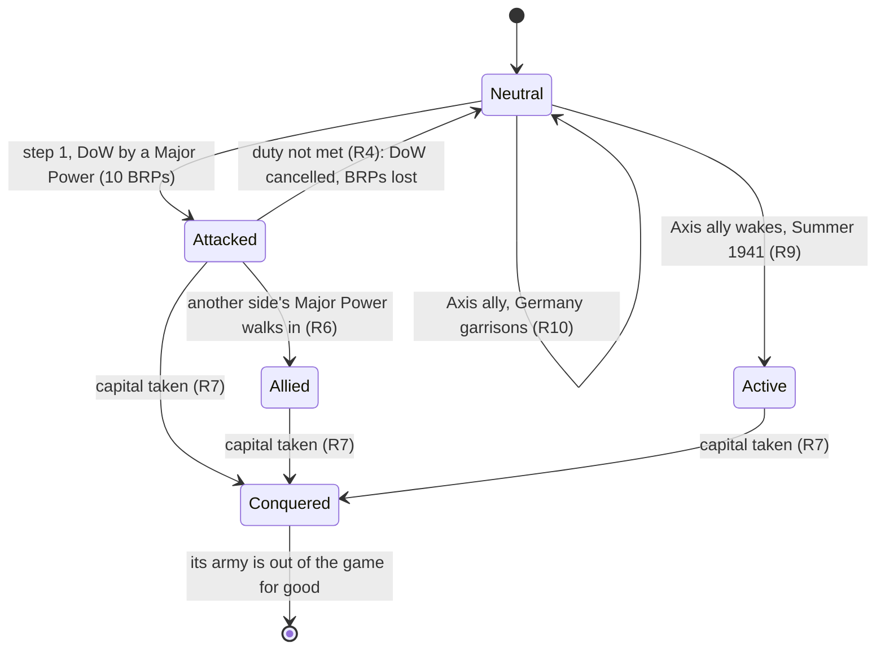
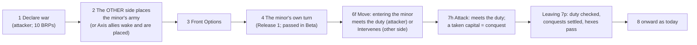
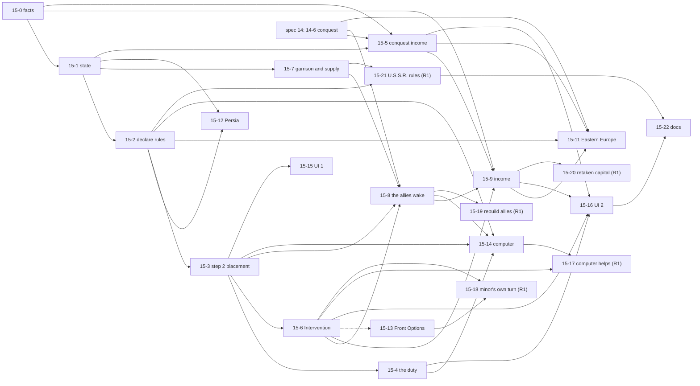

# 15. Minor countries: an attacked minor's army, Intervention, the Axis Minor-Allies, conquest, and the BRPs that come from territory

Status: **approved 2026-10-23 (owner: all six recommended answers to Q1 to Q6). Was: draft for review, 2026-10-17. Belongs to the Beta milestone (docs/PLAN.md): 17 of its 22 tickets are needed for a full 1939 game against the computer; the other 5 are Release 1. Nothing is built until you say "let's go".** Words and sketches only; the build plan is part G. Builds on spec 02 (economy: declarations, the Year Start Sequence, Front Options), spec 03 (movement and supply), spec 05 (computer), spec 12 (fleets: supply by sea; ports), spec 13 (zones of control), and on **spec 14 (victory, surrender and the Russian winter), which owns the conquest of every country, Vichy France, Moscow and Leningrad and the trapped-units exception** (the line between the two specs is in part H). Closes the audit items 9, 10 and 13 of docs/PC-MANUAL-AUDIT.md, designs item 11 (it closes once Frank has confirmed the eye-read values, MC12), and leaves item 12 open (part G).

## Decisions needed (plain questions; each has my recommendation)

| # | Question | My recommendation |
|---|---|---|
| Q1 | A small country that is attacked: may its army **only defend** in the first playable version (Beta)? In the full game it also gets a short turn of its own (it may attack the units next to its border). | **Yes, defend only.** Their own turn is a lot of work for a small gain; I would add it in the full version, after the first playable one. |
| Q2 | When **you** are the one defending, may the game place the small country's army for you with **one button** ("Place automatically"), while you can still place each counter by hand? | **Yes.** Automatic first; by hand stays available. The computer places its own armies the same way. |
| Q3 | Should the computer, when it plays Germany, **attack the small countries on a historical timetable** (Denmark, Norway and the Low Countries in Spring 1940; Yugoslavia and Greece in Spring 1941)? Dates can be changed later. | **Yes.** Without it the Axis computer never leaves Poland and France and the game is not recognisable. |
| Q4 | Should the computer, when it plays the Allies, **send units to help** an attacked small country? | **Not in the first playable version; in the full version.** You can help a small country yourself from the start. |
| Q5 | When you press "Done with combat" and a small country you declared war on has not been entered or attacked yet, should the game show an **"Are you sure? You lose the BRPs"** box? | **Yes.** The rule cancels the declaration and the BRPs are lost; it is easy to do by accident. |
| Q6 | Is Eastern Europe (the Baltic States, eastern Poland, Bessarabia) **part of Beta**? Germany needs it to reach the Soviet border, so without it the 1941 attack cannot happen. | **Yes.** |

Questions for Frank about how the DOS game behaves are in part J (P1 to P8); none of them blocks Beta, each has a recommended reading.

## Summary (read this first)

- **Today** a declaration of war on a small country costs 10 BRPs and writes a pair into the list of wars. Nothing else happens: no army appears, nothing forces the attacker to enter or attack, nobody can conquer the country, the war brings no income, and the closed-neutral-land rule (`NEUTRAL_LAND_CLOSED`) lets the declarer walk in once the war exists (`atWar` is true, and `tests/movement.test.ts` pins it) while it blocks every nation that is not at war with the minor, so nobody can Intervene. Germany cannot enter Hungary, Rumania, Bulgaria or Finland, which the rules treat as German ground (audit item 9). The four Axis Minor-Allies do not exist at all in the 1939 and Campaign scenarios, so they cannot join in Summer 1941. The year-start income of the Minor-Allies is a lump sum (45) that vanishes if one of them is missing (audit item 11).
- **What this spec adds, in the order Frank would meet it:**
  1. **Declare** on a small country with its price and its duty explained; **its army appears** (step 2), set up by the *other* side, inside its borders, with a unit in its capital.
  2. **The duty:** the attacker must enter the country or attack it in the same turn, or the declaration is cancelled and the BRPs are lost (PC rule 21.4).
  3. **Help and conquest:** the other side's Major Powers may **Intervene** by walking in; a country whose capital is taken is **conquered** (the mechanics, the record and the card belong to spec 14; this spec adds what a conquered minor is worth and the minor-specific facts).
  4. **The Axis Minor-Allies:** Germany may enter and supply units in the four sleeping allies (a **Garrison**); they **wake up** by themselves in Summer 1941 with their armies and 45 BRPs.
  5. **Money from land:** at each Year Start Sequence, each Major Power adds the value of the allies it has, the countries and colonies it holds, and Eastern Europe (25); Moscow and Leningrad (15 each) are spec 14's (14-14). A value table is part of the work (15-0).
  6. **Small special cases:** Persia, Eastern Europe, Front Options changed inside the step.
- **Out of scope (spec 14 owns them):** the conquest of every country, minors, colonies and Major Powers included (its tickets 14-5, 14-6); Vichy France and its colonies (35.0; 14-7, 14-10); Moscow and Leningrad's 15 BRPs (14-14); the surrender of a Major Power (Ref 18.0); the Russian winter. Also out: Lend-Lease itself (24.0: only the Persia hook is here), the Russian winter, strategic warfare, partisans (not in the PC game), rebuilding a Minor-Ally's lost units (Release 1). See part H.
- **Size:** 22 tickets (the numbers 15-0 to 15-22; 15-10 moved to spec 14 as 14-14). **Beta: 17 (5 S, 12 M). Release 1: 5 (4 M, 1 L).** The smallest useful stop is after 15-6, with spec 14's 14-6: attacked minors appear, can be helped and are conquered.
- **Rules check:** 22 `TODO(verify)` rows (MC1 to MC22) in docs/TODO-VERIFY.md and docs/RULES.md. The ones that matter most: where activation happens in Summer 1941 (MC9), what counts as "entering" for the duty (MC3), whether the sleeping Axis minors' capitals feed German supply (MC10), who gets a minor's BRPs when two powers Intervene (MC19), and the unread colony values (MC12).

## Words used here

| Word | Meaning |
|---|---|
| **Minor country** | A small independent country on the Minor Country Forces chart (19 of them; part A, R1). Not a colony, not a Major Power. |
| **Defenseless minor** | A minor the chart gives no counters: Arabia, Ireland, Luxembourg, Persia, Portugal. |
| **Attacked minor** | A minor that a Major Power has declared war on and that is not yet conquered. |
| **Intervene** | A Major Power of the *other* side sends units into an attacked minor. The minor then fights with it (Ref 15.0). The game calls the action "Intervention". |
| **Minor-Ally** | A minor that fights as part of a Major Power: the four Axis ones (Finland, Hungary, Rumania, Bulgaria), and Spain or Turkey once someone Intervenes in them. **Active** or **inactive** (asleep). |
| **Garrison** | German ground units standing in an inactive Axis Minor-Ally (Ref 17.2, 17.4). |
| **Conquered** | A hostile ground unit stands in the minor's capital (Ref 16.0). |
| **Colony** | Land of a Major Power that is not a Major Power's home: Egypt, Libya, Albania, the French colonies. It has a value too, and is conquered by holding all its cities (Ref 16.0). |
| **Value** | The BRPs a country adds to its holder at each Year Start Sequence. |
| **Placing side** | The side that sets up an attacked minor's army: the side that did *not* declare. |
| **YSS** | Year Start Sequence, between a Winter and the next Spring (spec 02). |

## Goal

Frank should be able to attack a small country and see what happens, in the manual's order, without knowing a rule number:

1. **Declare** knowing the price, the duty and what the country has.
2. **See the army appear**, placed by the other side (the computer, or himself with one tap).
3. **Fight, help or be helped**, and **conquer** a capital, with the result explained on a card.
4. **See the money**: what each country adds at the next year start, and why.
5. **Walk through the sleeping Axis allies** without declaring anything, and see them wake in 1941.

Done means: the 1939 scenario can be played from Fall 1939 to Summer 1942 against the computer with Germany attacking the countries the history says, the numbers in the year-start totals are explainable line by line, and every unclear rule is a `TODO(verify)`.

## What exists today (facts from the repo, 2026-10-17)

| Fact | Where | Consequence |
|---|---|---|
| The chart is data: 19 minors, six counter kinds, all 114 counts checked against the game's chart screen. `minorForceEntries(minor)` turns a row into counters; empty for the five defenseless minors. Poland's and the four Axis allies' chart rows equal their scenario force pools. | `tables.ts` `MINOR_COUNTRY_FORCES`, `minors.ts`, `tests/minors.test.ts`, docs/GAME_DATA.md | The counters needed exist. Nothing calls `minorForceEntries` yet. |
| `DECLARE_WAR { by, on }` at step 1: 10 BRPs against a minor, 35 against a Major Power, within the spending limit; adds a pair to `state.wars`. Targets exclude a minor already at war with a Major Power, every minor listed in `state.minorAllies` (active or not: `minorAllies.has`), and all minors in a "no war on neutrals" scenario (1944). | `war.ts` | No follow-up duty, no army, no 35-BRP case, none of the "who may declare on whom" limits (Ref 13.1). Once the four sleeping allies are added to the 1939 scenario (15-1) the `minorAllies.has` exclusion would also hide them from the Allies, so 15-2 narrows it to allies that are active. A **neutral** Major Power (Italy, the U.S.S.R.) cannot declare at all (`sideOfPower` is null); that is the "Italy declaring" item of PLAN section E, not this spec. |
| Persia is an ordinary declaration target at 10 BRPs, for both sides. | `war.ts` (the chart row is all zero) | Audit item 10. |
| Neutral land is closed: a unit may not enter, and air may not cross, land of a minor that is not at war with its owner, or land held by a power that takes no side. The declarer is let in as soon as `atWar` holds (nothing checks for a counter already inside). | `movement.ts` `NEUTRAL_LAND_CLOSED`, `neutralLandProblem` (also read by air range) | Germany cannot enter the inactive Axis allies (audit item 9). Nobody can Intervene. |
| A counter's owner must be a Major Power, Poland, the Free or Vichy French, or one of the four Axis allies (`ForceOwner`). An attacked Belgium has no way to own a counter. `sideInWar` knows Poland (Allied for good) and the four allies (Axis only while active). | `types.ts`, `control.ts` | The owner type must widen (15-1). |
| `state.minorAllies`: the four Axis allies with an `active` flag, present in 1942 and 1944; **empty in the 1939 scenario and the Campaign**, so they can never wake. | `scenario-1939.ts`, `scenario-campaign.ts`, `scenario-1942.ts`, `scenario-1944.ts` | Scenario data change (15-1). |
| Year Start Sequence part B adds one lump `brpTotal - brpBase` for a nation's Minor-Allies, and only while every Minor-Ally active at the start is still active; otherwise 0. No conquests, no Moscow or Leningrad (spec 14's), no Eastern Europe. | `yearstart.ts` `minorAllyBrps` | Audit item 11. |
| Control of hexes: only the differences from "controlled at start" are kept in `state.control`. Land nobody controls (neutral minors) has no controller. A ground unit at war with a minor takes the hex it enters. No conquest of a whole country exists. | `control.ts` | A fighting minor's land needs a controller (derived, C4). Conquest is new (15-5). |
| Supply: a line runs through hexes the side controls to a capital the side controls; a minor's capital is a source "while that minor fights on the side" (`capitalCounts` through `sideInWar`, which today knows only Poland and the four allies, so an attacked Belgium's capital is not yet a source). German units in inactive Axis minor land have no controlled hexes to trace through. Supply effects exist but are switched off (`SUPPLY_EFFECTS_ENABLED`, spec 12 gate 12-7). | `supply.ts`, `supply-effects.ts` | With the switch on (Beta), a German garrison in Rumania would be cut off. Spec 12 measured one such case already: a German armor at Helsinki in 1939 and Campaign. Ticket 15-7. |
| Front Options: one choice per Front per Player Turn for the whole side, chosen at step 3, no change inside the step (`state.frontOptions`). | `frontoptions.ts` | Audit items 12 and 13. |
| Sequence: steps 2 and 4 are in `sequence.ts` and are **passed**; `IMPLEMENTED_STEPS` has II.B, 1, 3, 6f, 7b, 7h, 8b, 9a, 10b. The active side acts at every step except one case: at 7h the side that must choose Exchange losses can be the non-active side (`PendingLosses.chooser`, read by `computerToMove` in `src/ui/computerPlay.ts`). There is no general `sideToAct` (spec 09 C6 proposes one for 7d and spec 12 needs one for 6c; not on main). | `sequence.ts`, `turn.ts`, `actions.ts`, `attack-losses.ts` | Step 2 is a second place where the non-active side acts, so 15-3 builds or shares `sideToAct`, which also covers the 7h chooser. |
| The map has a capital for 16 of the 19 minors (the `capital` feature, or `capital-port` for Athens and Stockholm: Oslo, Helsinki, Stockholm, Dublin, Copenhagen, The Hague, Brussels, Warsaw, Budapest, Lisbon, Madrid, Belgrade, Bucharest, Sofia, Ankara, Athens). **Luxembourg, Persia and Arabia have none.** Switzerland is not on our map (unplayable). Persia has 19 hexes (Tabriz a city), Arabia 13. | `map.json` | Conquest needs a rule for the three (R7, MC7). |
| The computer declares only Major-Power wars (`DECLARATION_PLANS`: Italy on France and Britain, Germany on the U.S.S.R.) and never attacks a minor. | `ai/declare.ts` | Ticket 15-14. |
| Eastern Europe, Poland's partition, the Baltic States: the 1939 scenario has the partition-line zone and an `eliminate-in-zone` rule for German units at the end of Axis Fall 1939. Nothing creates the country. `baltic-states` is a map country with no owner. | `scenario-1939.ts`, `zones.ts`, `map.json` | Ticket 15-11. |

## The audit items that belong here

From docs/PC-MANUAL-AUDIT.md (read again on 2026-10-17 against `main`; "closed in code" means the tests already pin it).

| Audit # | Item | State on main | This spec |
|---|---|---|---|
| 2 | The U.S.S.R. may not grant BRPs (Ref 11.71) | **Closed in code** (`grants.ts`) | nothing to do |
| 3 | A Major Power may grant at most half its yearly allotment | **Closed in code** (`grantedThisYear`) | nothing to do |
| 9 | Germany may enter an uninvaded inactive Axis Minor-Ally without declaring war (a Garrison, Ref 17.2) | Open | **Closed by 15-7** (entry, Garrison, supply), with 15-8 (wake-up) |
| 10 | The Axis pays nothing to enter Persia once the Allies have opened the route (Ref 24.0) | Open (Persia costs 10) | **Closed by 15-12** (the hook that opens Persia and the declaration list); the opening itself is the Lend-Lease ticket of strategic warfare |
| 11 | Each active Minor-Ally's own value is added at the YSS (Ref 9.2); only Bulgaria's 10 was known | Open | **Designed by 15-0 and 15-9**: the values are on the printed map card (part A, R13) and the four allies sum to the scenario pages' 45. It stays open until Frank confirms the eye-read values (MC12, P8) |
| 12 | Each at-war country designates its own Option per Front (Ref 11.2); the engine keeps one per side | Open | **Stays open** for Major Powers: ask Frank (P7). Minors' Options are in 15-13 and 15-18 |
| 13 | A Front Option can be changed until the step is left (Ops 5.42) | Open (no change allowed) | **Closed by 15-13** |
| 1, 4, 5, 6, 7, 8, 14, 15 | ZOC, Replacements, supply on advance and at turn end, captured bases, displaced fleets, stacking, one attack per hex | spec 13, built, spec 09, spec 12 or no change proposed | not here |

## Sources, and how they were read

- **Primary:** the PC Reference Manual, 9.2 (income), 11.2 and 11.21 (declarations, Options), 13.0 and 13.1 (declaring on minors), 14.0 (a minor's army), 15.0 (Intervention), 16.0 (conquest), 17.0 to 17.4 (Minor-Allies, Garrison), 18.1 (conquered Major Powers, for the half-value hook), 24.0 (Persia), 29.0 (Poland and Eastern Europe), 35.0 to 40.0 (Vichy, Spain, Turkey, Ireland, Switzerland, Iraq: only what bears on minors); the Operations Manual 5.41, 5.41a, 5.42, 5.43 (how the PC program asks), 4.1 (setup exception for minors); Peele's errata (rules differences 21.4, the two entries numbered 24.23, 25.6; the Reference Manual page 39 sentence on Polish units; the Bulgaria value; the repo's docs cite Peele only for 21.4 and 25.6 so far); the Minor Country Forces chart (verified in docs/GAME_DATA.md). Read from a local text copy kept outside the repo. **Everything below is in our own words; no manual text is copied.**
- **The map card** (docs/SOURCES.md, the printed values): country values are small print on the map. I read them by eye from the scan on 2026-10-17 (part A, R13). Five facts cross-check them: the Low Countries, Poland, the four Axis allies and Eastern Europe.
- **Cross-check:** the Advanced Third Reich text (docs/RULES.md "Web research") has the same 13.0, 14.0, 16.0 and 17.0 as the PC manual in the sentences compared.
- **Where the sources differ or are silent** the rule is a `TODO(verify)` here and in part J. Nothing is invented: each number is cited, or is a named constant with a `TODO(verify)`.

## A minor country's life, and one Player Turn with a declaration





## Part A. Rules in scope, rule by rule

Each rule says what the manual says (our words), what the engine does today, and the reading chosen. "Status" is **settled** (the text is clear), **TODO(verify)** (a check is needed; MC ids are in part J) or **PO** (a decision for the product owner).

### R1. Which countries are minors (Ref 14.0, 29.0, 38.0 to 40.0; Ops 5.41a) settled
- The Minor Country Forces chart lists 19: Arabia, Belgium, Bulgaria, Denmark, Finland, Greece, Hungary, Ireland, Luxembourg, the Netherlands, Norway, Persia, Poland, Portugal, Rumania, Spain, Sweden, Turkey, Yugoslavia.
- **Not minors:** Switzerland (nobody may declare on it, no ground unit enters and no plane crosses it; our map leaves it out, so nothing to build), Iraq (a British colony), Northern Ireland (part of Britain), the colonies, Vichy France (35.0, another spec). **Eastern Europe** is made during the game (R12).
- **Defenseless:** Arabia, Ireland, Luxembourg, Persia, Portugal. The chart gives them nothing and the PC program skips placement for them (Ops 5.41a). A declaration on them still costs 10 BRPs and their land is conquered like any other (R7).
- Spain and Turkey can only become allies of whoever Intervenes (R6).

### R2. Declaring war on a minor (Ref 13.0, 13.1, 11.2; Ops 5.41) settled except where marked
- Made at the start of the declarer's own Player Turn (step 1); 10 BRPs, within the spending limit, as today.
- Nobody attacks, enters or flies over a country it is not at war with (or allied to). Already built as the closed neutral land.
- **35 instead of 10** when the declaration on a minor or a colony automatically brings war with a Major Power. The rule is printed; **no Beta case exists** (colonies are not targets, minors allied to a Major Power are already at war with the declarer). Carried as a pure `declarationCost` with the printed case, tested, used when colonies and Vichy arrive. MC4.
- **Who may not declare on what** (13.1), as a pure `minorDeclarationProblem` the target list uses:
  - nobody on Switzerland or the U.S.A.; no declaration that would start a war between Germany and Italy, or among Britain, France, the U.S.A. and the U.S.S.R.;
  - Germany and Italy not on the same minor until Italy is at war with the Western Allies;
  - the U.S.S.R. and the Western Allies not on the same minor until Russia is at war with Germany or Italy;
  - the U.S.S.R., before it is at war with Germany or Italy: only a bordering minor, and not an Axis Minor-Ally that holds a German ground factor (even a Replacement), and not before Fall 1941 against Germany; after it has conquered a minor it may declare on those that border the conquered one.
  These 13.1 bullets are in the PC Reference Manual (pp. 19 to 20), read from the local manual copy; of them the repo's own docs carry only the U.S.S.R.-before-Fall-1941 line (the 1939 scenario notes).
  The last three need a neutral Major Power that can declare, which the engine does not allow yet, so they are **Release 1** (15-21). The rest is Beta (15-2).
- Eastern Europe: Germany not before 1940; the U.S.S.R. from the Allied Fall 1939 turn (R12).
- **Reading chosen:** the declaration is recorded as a pair in `wars` as today, plus the new country record (C1) that marks it attacked, "army to place" and "duty open".

### R3. The attacked minor's army, and who sets it up (Ref 14.0, p. 19; Ops 5.41a, 4.1) settled for who and the capital; stacking and bases TODO(verify), MC1
- The chart row becomes counters (`minorForceEntries`). **The side that did not declare** sets them up, inside the minor's borders, with **at least one ground unit in the capital**, at step 2 of the same Player Turn, before Front Options. That side then moves and controls them while they live. **Both manuals say so:** Ref 14.0 (p. 19) says the opposing side sets up the minor's forces within its borders, with a ground unit in the capital, and then moves and controls them; Ops 5.41a says the Phasing Player's opponent deploys them. The older notes that call this unknown (docs/TODO-VERIFY.md row O4, spec 02 "As built, part 3", the header comment of `minors.ts`) were written from the web text, which does not give it; this PR updates O4 and spec 02, and ticket 15-3 changes the code comment. What the manual does not say is where inside the country and how stacking applies (MC1).
- Defenseless minors: nothing to place; step 2 is skipped for them.
- Poland in the 1939 scenario: set up at the opening setup as today; it is recorded as attacked by Germany from the start.
- **Not stated, readings chosen (MC1):** the normal stacking limit applies to the placed counters (2 ground units a hex; air factors by base size; fleets by port capacity); air counters stand in a city, fleets in a port of the minor (Sweden, Spain and Turkey have fleets and ports); nothing else restricts the choice. The same functions that check the opening setup check this.
- Placement is **one atomic action** (all counters at once, validated together), so a replay and the computer see no half-placed army.

### R4. The duty after declaring on a minor (Ref 13.0; Peele, PC rule 21.4) settled in the text; what counts is TODO(verify), MC3
- On the turn of declaration the declarer must **move ground units into the minor, or attack its forces** (an Offensive or Attrition Option attack). If it cannot, the declaration is **revoked**: the 10 BRPs are lost, the minor is at peace with that country and would need a new 10-BRP declaration. The PC errata adds: units of the declarer's *allies* that went into the minor to attack are eliminated and return to their pool.
- **Reading chosen:** only a move into the minor's land, or an attack on a hex of the minor, **by units of the declaring nation** counts. The check is made when the Combat Phase ends (leaving step 7p), because an attack in 7h or an Exploitation attack both count. Attrition attacks (6.2 of the roadmap) are not built, so in Beta a ground move at 6f or a ground attack at 7h is what counts; air and naval missions do not (MC3).
- **What the engine does at the check:** a met duty is cleared with no event. An unmet one: the minor goes back to Neutral, its placed army is removed, other nations' units inside are eliminated to their pools, the declarer's BRPs stay spent (they were spent at step 1), an event says so.
- The **warning** before this happens is a screen matter (D3, Q5), not an engine rule: `legalActions` still lists "done with step".

### R5. What may enter a minor's land (Ref 13.0, 15.0, 17.2 to 17.3, 24.0; today `NEUTRAL_LAND_CLOSED`)
Closed to everyone unless one of these opens it for that unit's owner. Ground movement and air flight use the same test (spec 09 R4 does already).

| Opens it | For whom | Rule |
|---|---|---|
| The minor is at war with the owner (an attacked minor, the declarer) | the declarer | R2 |
| An attacked minor that an enemy of its attacker enters | the other side's Major Powers | R6 (that entry *is* the Intervention) |
| An inactive Axis Minor-Ally | **Germany** | R10 |
| The minor's own land, for its own units | the minor's units, inside their home country only | R8 |
| Persia once opened | the Axis (no declaration) and the Allies | R11 |
| An Axis ally that is active | Axis units | it is allied land |

### R6. Intervention (Ref 15.0, 17.2; Ops 5.43) settled in outline; details MC5
- An attacked minor that is not conquered on the turn of declaration can be helped: a Major Power of the other side **sends ground, naval or air units there during its own Player Turn**. If it is not yet at war with the attacker it must first declare war on it at the start of that turn (Beta: Britain and France are already at war with Germany, so this does not come up).
- The minor then **fights with that power**: it takes its turn in unison, shares its Front Options, and if its capital does not fall the attacker's year-start income from it goes to the intervening power(s) (R13). Intervening units may share hexes with the minor's units.
- A naval or air *mission* over the minor, or intercepting an invasion bound for it, does not count.
- **Reading chosen (MC5):** Intervention happens when a unit of the helper **ends a ground move in a hex of the minor** (a pass-through is the same, the path lists every hex entered, as control does). Air units basing in the minor and Strategic Redeployment into it are not built in Beta.
- A minor already conquered cannot be helped. A conquered minor's units are gone.
- If the Allies declare on an inactive Axis ally while a German unit stands in it, Germany's Intervention is automatic (17.2). In Beta this is covered by R10's rule (a German unit is already inside, so the DoW creates a war that Germany already joins).

### R7. What conquest means for a minor (Ref 16.0, pp. 20 to 21; Peele's two entries numbered 24.23) mechanics are spec 14's; the minor-specific facts and edges here, TODO(verify), MC7, MC8
- **Who owns what.** Spec 14 owns the conquest of every country (its R9, tickets 14-5 and 14-6): the `Conquest` record, the control change of every hex, the removal of the units, the event, the `afterHexTaken` call and the card. This spec **reads** its record and adds the facts below. Ref 16.0 says a minor is conquered when a hostile unit occupies its capital, with no turn to retake it, and that at the end of the attacker's Combat Phase its units are removed for good and every hex of the country passes to the conqueror; that answers the open note in `control.ts` and the "Minor conquest" question in docs/RULES.md for minors (the Baltic States part is Eastern Europe, R12), and ticket 14-6 closes both.
- **What a conquered minor is worth** (R13): its value, paid to the holder of its capital at each Year Start Sequence (ticket 15-5 reads the record). A conquered sleeping Axis ally can never wake; an active one's army goes with it.
- **Capital-less minors (MC7):** Luxembourg has one hex and no capital on our map; **recommended: its one hex is its capital**, so 14-6 can conquer it. Persia and Arabia have no capital and no value; they are never conquered (nothing is lost).
- **The exception for trapped hostile Major-Power units** (hostile units that can still trace supply keep their hexes and a supply line the program picks): **spec 14 owns it** (14-23, Release 1). Beta uses spec 14's simplified reading, **the hexes those units stand on** (its V12). Nothing of it is in this spec (MC8 is only a pointer).
- **Order at the end of the Combat Phase (leaving 7p):** the duty check of R4 first (it can remove a minor's army), then spec 14's settle hook.
- **Colonies and Eastern Europe** fall when the conqueror holds **all** their cities (R12, R13). The test "does a nation hold every city" is this spec's (15-5); when it is true it calls spec 14's `fallCountry(ctx, state, { country, conqueror, how, hexes? })` (14-6, `src/engine/conquest-minor.ts`; built: the record type names colonies and Eastern Europe and has the way of falling `"all-cities"`).

### R8. Limits on a minor's units, and their supply (Ref 14.0, 15.0) settled
- A minor's ground units may **not leave their country**, and after a cross-border attack they **may not advance** over the border. Air and naval units base only inside the home country. On the turn of invasion its air and naval units act only against the units attacking it.
- Its units can be supplied from its own capital, or from any supply source of a Major Power already at war with its attacker, even before Intervention; that power may supply them by sea.
- A minor's units, once eliminated, never come back (Ref 14.0), **except those of an active Minor-Ally**, which its Major Power rebuilds at its own cost, at home (17.1, 17.3). Beta builds no rebuilding (15-19, Release 1); where an eliminated Minor-Ally unit waits meanwhile is MC18.
- Beta applies the first two sentences through the same functions as ground movement (`movableProblem`, `entryProblem`, the advance test); the air rules read the same home-country test when a minor's air unit exists in play; the supply sentence is `capitalCounts` plus the helper list.

### R9. The Axis Minor-Allies wake up (Ref 17.0 to 17.3, 9.2; Ops 5.41a) settled; timing MC9
- Finland, Hungary, Rumania and Bulgaria are Axis allies, **asleep** in the 1939 scenario and the Campaign, **active** from the start in 1942 and 1944. They wake **automatically at the start of the Summer 1941 turn**, or earlier if the Allies attack one and Germany Intervenes. Vichy France wakes only by its own die roll (35.1: spec 14, ticket 14-10).
- **On waking:** it is at war with the enemies of its Major Power at once, with **no declaration price**; its **value is added to the German total immediately**; its army (the chart row) is **placed by Germany** in its own country, with a unit in the capital (17.3); Germany moves it, moves it by Strategic Redeployment (not built), and (Release 1) rebuilds its losses at German cost. Its units go when Germany is conquered.
- If Germany does not Intervene in an Allied attack on a sleeping ally, nothing German may enter it, its army is not German-controlled and is not replaced, Germany gets no value from it, and it chooses its own Options like any attacked minor.
- A sleeping ally whose capital falls to the Allies can never wake (the flag is set by spec 14's fall; 15-8 reads it). If Germany or Italy declares on a possible ally, it can never be an Axis ally.
- **Reading chosen (MC9):** the wake-up happens at **step 2 of the Axis Player Turn of Summer 1941** (the card puts "activate Minor-Allies" at step 2), and its value is added then, so the Initiative of that Game Turn is unchanged. If the Allies move first that turn the allies are still asleep during the Allied turn. The rare case the text describes (the U.S.S.R. has attacked an ally while Germany and the U.S.S.R. are not yet at war, so activation happens in the declaration step) is Release 1.

### R10. Sleeping Axis allies: Germany walks in, a Garrison (Ref 17.2 to 17.4; Peele on 25.6; audit item 9) settled; supply and details TODO(verify), MC10, MC11, MC22
- Germany treats the four sleeping allies (and Vichy territory, with a side effect on Vichy's chance, 35.0: not here) **as its own ground**: it may **move, redeploy, trace supply through them and attack from them**. Other nations, the Allies and (reading) Italy may not.
- A **Garrison** is German ground units there. Before they wake, after the opening setup, the only limit is **five factors in Finland** (errata: the 20-factor limit is gone). Finland has no port or beach, so a missing Garrison there can only be repaired by an airborne drop. Germany may not put one in Bessarabia without declaring war on the U.S.S.R.
- If an Allied power has declared on a sleeping ally but has no unit inside at the end of its turn, Germany may send units in with no Intervention and no declaration: that is a Garrison, it **revokes the attacker's declaration**, forbids that country from attacking it again, and does **not** wake it.
- A Garrison blocks the U.S.S.R. from declaring on that ally before Fall 1941 unless it is already at war with Germany (R2; Release 1).
- **Reading chosen for supply (MC10):** the sleeping ally's land counts as Axis-controlled for supply tracing by German units, and **its capital is a supply source for Germany while it sleeps** (19.2 makes the capital of each minor with an army a source; 17.3 makes the land German). That is what keeps the German armor at Helsinki, today an unsupplied oddity, in supply. Control of the hexes is **not** changed (no Objective counts for Germany because of it).
- In Beta Germany's units may be in a sleeping ally from the setup (as today) and walk in later (new).

### R11. Persia and the other defenseless minors (Ref 24.0; Ops 5.41a; audit item 10) settled; the earlier state MC14
- Persia, Arabia, Ireland, Luxembourg and Portugal: no army (R1).
- **Persia** (Ref 24.0, p. 36; the repo has no Lend-Lease code yet, so these figures come from the manual copy alone): when a Western Allied power pays 25 BRPs the first time it tries Lend-Lease (the Lend-Lease ticket of strategic warfare), **all Persian hexes become Allied-controlled**; Allied units may but need not enter; Soviet units only with the payer's agreement; **the Axis need not declare war to enter Persia afterwards.**
- **Before the route is opened,** Persia is an ordinary defenseless minor: either side may declare on it for 10 BRPs (assumed, MC14).
- **Built here (15-12):** `openPersia(state, by)`, which the Lend-Lease ticket calls; it sets control of the Persian hexes, marks Persia opened, and removes it from every declaration list and from the closed-land test. A test calls it directly. The engine's current "Persia costs the Axis 10" is the behaviour after the call: none.

### R12. Eastern Europe (Ref 29.0, pp. 39 to 40; Peele's errata) settled; details TODO(verify), MC13
- Created at the **end of the Axis Fall 1939 turn**: the Baltic States, Poland east of the Partition Line, and Bessarabia (the east of Rumania). **Value 25** (it does not lower Poland's or Rumania's). Those lands stop belonging to Poland and Rumania for good.
- It acts as a normal country, except it is conquered like a colony: **all its cities**. Entering it needs a declaration (10 BRPs). Germany may not declare on it before 1940; the U.S.S.R. may from the Allied Fall 1939 turn (all Ref 29.0, p. 40). Germany may not set up in Bessarabia in Fall 1939.
- **German** units still east of the Partition Line at the end of that Axis turn are eliminated (Ref 29.0, p. 40; the scenario rule `eliminate-in-zone` already does it). **Polish** units east of the line are eliminated at the same moment if Poland is still unconquered: that sentence is in Peele's errata for the Reference Manual's page 39 (Poland and Eastern Europe), not in the repo yet; 15-11 adds it.
- **No chart row,** so no army (defenseless) is the reading (MC13); its cities come from the map features.
- Who controls its hexes when it appears: nobody (neutral), so the closed-land rule applies until someone declares.

### R13. BRPs from territory at the Year Start Sequence (Ref 9.2, 16.0, 17.1, 18.1, 29.0) settled; the values and edges TODO(verify), MC12, MC19, MC20
At each YSS (part B, spec 02) a Major Power's **total = Base + the following**:

1. the value of each **active Minor-Ally** it owns (immediately when woken, and again each YSS while it stays allied);
2. the value of each **attacked minor it Intervened in** that is not conquered (the invader did not take the capital);
3. the value of every **country and colony it holds** that its side did not hold when the scenario began (a minor needs the capital; a colony or Eastern Europe needs **all cities**), read from spec 14's `Conquest` record (a country counts from the first Year Start Sequence after its conquest completed; the opponent's retaking one turn later is Release 1, 15-20);
4. **Germany +15 for each of Moscow and Leningrad it holds** (unless the U.S.S.R. has surrendered); **the U.S.S.R. −15 for each it does not hold**: **spec 14 owns this line** (14-14, in `yearstart.ts`); it is listed here only so the totals read line by line;
5. half (rounded down) of a **conquered Major Power's starting BRPs** to its conqueror (Ref 18.1): **spec 14 owns it** (14-5 does it in the Year Start Sequence); this spec only has to leave its line out of `territoryIncome` and print it with the others.

Also: a nation can neither gain nor lose BRPs from land its side held at the start (Ref 16.0, p. 21; the 1942 and 1944 allies are the printed exception, counted in the start totals); losing a country it was not paid for this year costs nothing (Ref 16.0, p. 21, with an exception for Minor-Allies paid in the middle of a year; the same page has the rule about land held at the start); the unused-BRP and growth arithmetic is spec 02's and unchanged.

**The values** (the table that audit item 11 asked for; "card" means read by eye from the printed map card scan on 2026-10-17):

| Country | Value | How known |
|---|---|---|
| Finland 10, Hungary 10, Rumania 15, Bulgaria 10 | 45 together | **Sum equals** Germany's total minus Base on the 1942 and 1944 pages; Bulgaria's 10 is also in the PC README |
| Denmark 10, Belgium 15, the Netherlands 10, Luxembourg 5 | 40 together | **Sum equals** the 40 BRPs the 1941 worked example in Ref 9.2 (pp. 9 to 10) adds for conquering those four |
| Poland | 20 | card, and the 20 conquered Polish BRPs in the 1940 worked example in Ref 9.2 (the 1942 example in the same section counts 45 for Germany's active Minor-Allies, matching the four-ally sum). These three figures are read from the local manual copy; spec 02 notes that only part of the examples was available when it was written |
| Eastern Europe | 25 | Ref 29.0 |
| Norway 10, Sweden 15, Yugoslavia 20, Greece 10, Spain 30, Turkey 30, Portugal 5 | | card only (MC12) |
| Albania 5, Algeria 5, Morocco 5, Tunisia 5, Lebanon-Syria 5, Egypt 5, Palestine 5 | | card only (MC12) |
| Libya, Transjordan, Iraq | not read | to read in 15-0 at higher zoom; "none printed" is a possible answer |
| Persia, Arabia, Ireland | none printed | card |

**When several powers Intervene (MC19):** the printed text says the value goes to the intervening power or powers and does not say how it is shared. Giving each the full value would inflate both totals, so the engine keeps **one holder, the first to Intervene**, and logs the choice. Frank can settle it (P6).

### R14. Front Options and minors (Ref 11.2, 11.21; Ops 5.42, 5.43; audit items 12 and 13)
- Each country of the phasing side at war chooses an Option on each Front; a Major Power pays 15 for an Offensive one; allies of one nation must join its Offensive or Attrition Option or Pass, never mix Attrition with an ally's Offensive. A minor that a friendly Major Power has Intervened in does **not** choose: it shares that power's.
- An attacked, un-helped minor chooses its own, at step 3 of its controller's Player Turn. Nothing says a minor pays; assumed free (MC15).
- **Changing a choice** inside step 3 is allowed until the step is left (Ops 5.42). Reading chosen: the new choice replaces the old one and a paid Offensive Option is **refunded** when replaced (the cost is the price of the Option actually used). Closes item 13 (15-13).
- **Beta:** a minor has no turn of its own (Q1), so its Options never matter before it is helped; after that it follows its ally. Per-country Options for Major Powers (item 12) stay as today: ask Frank (P7).

### R15. The minor's own turn (Ref 14.0, 15.0; Ops 5.43) Release 1, outline
At step 4 of the controller's Player Turn each attacked, un-helped minor takes a short turn of its own: a Movement Phase inside its borders and an Offensive or Attrition combat phase (unless it Passes), with the limits of R8. It comes after the Player Turn in which it was invaded and before the controller's own movement. **Not in Beta** (Q1). Which Player Turn it falls in is MC2; the reading is "the controller's own, step 4".

### R16. Dice and determinism
This spec adds no dice. The suggested placement of an army (R3) is a deterministic function of the state (fixed order: capital, then Objectives, then hexes nearest the attacker, lowest hex id breaks ties), so a replay and the computer agree.

## Part B. Rules not decided by the text

Listed with the rest in part J. The five that most change what Frank sees: MC3 (what counts as entering), MC9 (when the allies wake), MC10 (does a sleeping ally's capital feed German supply), MC19 (two helpers, one value) and MC12 (the values read by eye).

## Part C. Engine design

### C1. State (additive; an old saved state without these fields still works)

```ts
// types.ts: ForceOwner widens to include MinorCountry. Unit.owner, pools, OWNER_NAMES follow.
// (Recommended over a second owner type: one name for "who owns a counter" everywhere.)
// GameState gets one optional field, like `air`, `combat` and `moves`:
countries?: Partial<Record<CountryId, CountryRecord>>;   // in minors-record.ts

type ColonyId = "albania" | "algeria" | "egypt" | "iraq" | "lebanon-syria" | "libya"
              | "morocco" | "palestine" | "transjordan" | "tunisia";
type CountryId = MinorCountry | "eastern-europe" | ColonyId;

interface CountryRecord {
  status: "neutral" | "attacked" | "allied";   // "conquered" is read from spec 14's `conquests` record, not stored here
  /** attacked or allied: the Major Power that declared. The minor's army belongs to the OTHER side. */
  attacker?: PowerId;
  /** Step 2 still to do: the side that places the army. Cleared by PLACE_MINOR_FORCES. */
  toPlace?: Side;
  /** R4: the declarer has not yet entered or attacked. The Game Turn is in `declared`. */
  duty?: { by: PowerId; declared: GameTurn };
  /** allied: the helping Major Powers, first to Intervene first (R6, MC19). */
  helpers?: PowerId[];
  /** Powers that may not declare on it again (a Garrison revoked their war, R10). */
  closedTo?: PowerId[];
  /** Persia only: opened by the Lend-Lease route (R11). */
  opened?: true;
}
```

- `MinorAlly` (existing, `{ owner, of, active }`) stays the record of **Axis and intervened allies** and their activity; Spain and Turkey get an entry when someone Intervenes. 15-1 adds the four sleeping allies (`active: false`) to the 1939 scenario and the Campaign.
- Poland in the 1939 scenario is recorded `attacked` by Germany from the start (units placed by the opening setup, `toPlace` empty).
- Minor counters use the normal `Unit` with the minor's id as owner and fresh ids from `nextUnitId`.
- A **fighting minor's land is controlled by the minor, derived, not stored**: `controllerOf` falls back, after `state.control` and the start map, to the minor when its record is `attacked` or `allied` and spec 14's `conquests` has no entry for it. No hundred-hex write for Spain; spec 14's fall writes the conqueror per hex.

### C2. Actions (every one carries the acting `side`; replays unchanged for old recordings)

| Action | Step | Who | What |
|---|---|---|---|
| `DECLARE_WAR { by, on }` (existing) | 1 | declarer | now also checks `minorDeclarationProblem`, charges `declarationCost`, and records the country as attacked with `toPlace` and `duty` |
| `PLACE_MINOR_FORCES { side, minor, placements: { type, strength, at }[] }` | 2 | the placing side (not the active side when attacked) | all counters of the chart row at once; checked: exactly the chart's counters, hexes of the country, a ground unit in the capital, stacking, bases and ports |
| `MOVE`, `ATTACK`, `ADVANCE` (existing) | 6f, 7h | active side | no new type; each updates the duty (R4), Intervention (R6), Garrison (R10) as a side effect, and records the hexes entered |
| `SELECT_FRONT_OPTION` (existing) | 3 | active side | replaces an earlier choice and refunds (R14) |

`legalActions` at step 2 lists, for the placing side, one `PLACE_MINOR_FORCES` (the suggested placement: fixed order, R16) plus the placement hexes the human can edit; the move-on action ends the step only when nothing is left to place (a minor's army is not optional). No action wakes an ally, conquers or opens Persia: those are consequences, not choices.

### C3. Events (for the log, the cards and the self-play report)

`WAR_DECLARED` (existing, gains `minor: true`), `MINOR_FORCES_PLACED { minor, side, units }`, `MINOR_DUTY_MET`, `MINOR_DECLARATION_REVOKED { by, minor, brpsLost, removed }`, `MINOR_INTERVENED { minor, by }`, `MINOR_CONQUERED { minor, by, removed, hexes }`, `MINOR_ALLY_WOKE { minor, of, brps }`, `MINOR_GARRISONED { minor, by, revoked? }`, `PERSIA_OPENED { by }`, `EASTERN_EUROPE_CREATED`, `COUNTRY_INCOME { nation, lines }` (a line per country: name, value, reason), and `BRPS_CHANGED` (existing) for every change of a total, with the reason in words.

### C4. Where it plugs into what exists (each by the smallest edit)

1. **`control.ts`**: `sideInWar` learns minor owners from `countries` (attacked: the side opposite the attacker; allied: the helper's side; Poland and the four allies as today; neutral: null). `controllerOf` gets the derived minor control. `areEnemies` needs nothing else.
2. **`movement.ts`**: `neutralLandProblem` gets the rows of R5 in one place; `movableProblem` and the advance test get "a minor's unit stays home"; `entryProblem` unchanged otherwise. Air range reads the same function (one rule decides both).
3. **`supply.ts`**: a sleeping Axis ally's land counts as Axis ground for German supply tracing, and its capital as an Axis source while it sleeps (R10). One function, `supplyFriendly`, used where `controllingSide` is read for tracing, so nothing else about control changes. `capitalCounts` already reads `sideInWar`.
4. **`war.ts`**: `declarationTargets` uses `minorDeclarationProblem`; `declarationCost` replaces the constant.
5. **`yearstart.ts`**: `minorAllyBrps` is replaced by `territoryIncome` (15-9). The lump 45 goes; the sum of the four values must equal it in 1942 and 1944 (a test).
6. **`turn.ts` and `sequence.ts`**: step "2" joins `IMPLEMENTED_STEPS` and `hasWork` (waits only when a country has `toPlace`); leaving 1 for 2 runs the wake-up (R9); leaving 7p runs the duty check and then conquests; the end of the Axis Fall 1939 turn creates Eastern Europe (next to the existing `eliminate-in-zone` handling). Step 4 stays passed in Beta.
7. **`actions.ts`**: `sideToAct(state)`: the placing side at step 2, the active side elsewhere. The two other specs that need it (09 C6, 12 B2) can share it: whoever builds first creates it.
8. **`frontoptions.ts`**: replace-and-refund (15-13); `frontOptionOf` for a helped minor reads its helper's choice.
9. **`construction.ts`**: no change in Beta (a minor's counters are not built); Release 1 adds the rebuild of an active Minor-Ally's losses (15-19).
10. **`areas.ts`**: the country-wide area for a minor already exists (`{ kind: "country" }`).

### C5. Which steps wait, and for whom

| Step | Waits when | Acts |
|---|---|---|
| 1 | as today | active side |
| **2** | some country has `toPlace` (an attacked minor, or the allies waking) | the **placing side**: the non-active side for an attacked minor; the Axis for the wake-up (the active side then, since it is the Axis Player Turn) |
| 4 | never in Beta; Release 1: when an attacked, un-helped minor of the active side has units | active side |

### C6. Who is asked
`sideToAct(state)` (C4.7). The UI's `computerToMove` and the computer's `chooseAction` use it, so at step 2 a human defender is asked and a computer defender answers at once, whichever side is active.

### C7. Modules (proposed names; each under 300 lines)
`minors-rules.ts` (constants: values, defenseless list, colony cities, wake-up turn, all with the rule), `minors-record.ts` (types, reading helpers, `countryOf`), `minors-declare.ts` (R2, R4: problems, cost, duty, revoke), `minors-place.ts` (R3: legal, apply, `suggestMinorPlacement`), `minors-intervene.ts` (R6, R8), `minors-axis.ts` (R9, R10), `minors-income.ts` (R13), `minors-special.ts` (R11, R12). **Shared files touched:** `types.ts` (owner type; the record lives in `minors-record.ts` like `CombatRecord`), `action-types.ts`, `actions.ts`, `sequence.ts`, `turn.ts`, `control.ts`, `movement.ts`, `supply.ts`, `war.ts`, `yearstart.ts`, `frontoptions.ts`, the scenario data files.

## Part D. The screens

English text for now (the French interface is later); each sentence below is short, in the present tense and avoids abbreviations, so it translates cleanly. "BRP" stays, as in the game. Touch targets at least 44 px, as everywhere.

### D1. Declaring war on a small country (step 1)
- The declare list groups **Major Powers** and **Small countries**. Each small-country row: name, price, one line of what it has ("Belgium: 15 BRPs. 5 infantry factors, 1 air.") and its state ("neutral", "sleeping ally of Germany", "closed to you: a German garrison").
- Tapping a row opens a card, not an immediate declaration: **"Declare war on Belgium for 10 BRPs? This turn you must move a unit into Belgium or attack it. If you cannot, the declaration is cancelled and the 10 BRPs are lost."** Buttons: "Declare war" and "Cancel". Rows that are not allowed show the reason in plain words ("Italy is not yet at war with the Western Allies").
- After declaring, the status line shows a small red chip: **"Belgium: enter or attack this turn"**.

### D2. The army appears (step 2)
- **Computer places (you attacked):** the log line "The Allies place Belgium's army: 3 infantry in ..., 1 air in Brussels" and the new counters appear on the map with the usual reveal pulse. One "OK" moves on.
- **You place (you are the defender):** a panel like the construction panel. Title: **"Germany attacked Belgium. Place Belgium's army."** One chip per counter (drawn symbol, strength), the legal hexes lit yellow, a hint line "At least one infantry must stand in Brussels." Two buttons: **"Place automatically"** (the suggestion of R16; the default and the first button) and "Done" (enabled when every chip is placed and the capital rule holds). A chip tap then a hex tap places or moves it. Nothing is lost by pressing "Place automatically" first and then editing.
- **Defenseless minor:** no panel; a log line "Luxembourg has no army."

### D3. The duty, and Intervention (steps 6f and 7h)
- The red chip from D1 stays until the duty is met; the **hex card of a hex in that country** says "Belgium is at war with Germany."
- **Leaving combat unmet (Q5):** pressing "Done with step 7h" shows a card: **"You have not entered or attacked Belgium. If you end combat now the declaration is cancelled and you lose the 10 BRPs."** Buttons: "Go back" and "End combat". (A screen check only; the engine just checks at the end of the Combat Phase.)
- **A unit of the other side entering the country:** the move card adds one sentence: **"Moving here helps Belgium. Britain will fight beside it (Intervention)."** After the move the log says "Britain intervenes in Belgium" and the hexes of the country take a ring in the helper's colour.

### D4. Conquest
- The result card for a fallen country is **spec 14's** (its D3). This spec adds one sentence to it for a minor: **"Germany gains 15 BRPs at each year start while it keeps Brussels."** (the value of R13), and the map colouring is spec 14's.

### D5. The sleeping Axis allies and Summer 1941
- On the map, a sleeping ally's hexes carry a **light Axis tint with a small "asleep" marker** on its capital; the hex card says **"Hungary sleeps. It joins Germany in Summer 1941. German units may enter."**
- The wake-up card at step 2: **"Finland, Hungary, Rumania and Bulgaria join Germany. Germany gains 45 BRPs. Place their armies."** with the same placement panel as D2 for each in turn (the Axis player is the placer) and "Place automatically" first.

### D6. The money
- The nation table gets a line under it, **"Next year start"**, per Major Power: Base + allies + countries it holds + Moscow and Leningrad (spec 14's line) = expected total, with a "Why?" fold-out listing every line ("Belgium 15, Denmark 10, ...; Moscow 15"). The same lines are written to the log at the Year Start Sequence (`COUNTRY_INCOME`).
- No new screen for Persia (D1's card says "Persia is open to the Axis: no declaration" when opened) or for Eastern Europe (an ordinary small-country row, with "created after Fall 1939" until then).

### D7. Messages and access
Every refusal reads as a sentence with the reason and the way out, as the move and attack screens do. The "Place automatically" and the "Declare" buttons have text labels, never icons only.

## Part E. The computer opponent: minimum viable

The computer plays by `legalActions` only (spec 05). Its minor policy is the computer's, not a rule; the dates and lists are named constants with `TODO(verify)`.

- **As the placing side (any minor, any wake-up):** it answers step 2 with `suggestMinorPlacement` at once. A deterministic and legal defence is all Beta asks of it; a smarter placement is a later evaluator job.
- **As the declarer (Germany only, Beta):** a `MINOR_PLANS` list next to `DECLARATION_PLANS`: Denmark and Norway and the Netherlands, Belgium and Luxembourg from Spring 1940; Yugoslavia and Greece from Spring 1941 (Q3). It declares only when the **duty can be met**: a unit of the declaring nation within one move of the minor's land or adjacent to a hex of it, so the 10 BRPs are never thrown away. `plannedReserve` keeps the BRPs back (extended to minors).
- **Meeting the duty:** the mover already heads for enemy-held objectives; the minor's capital is an enemy objective once the war exists (`geo.ts` reads `controllingSide`; the derived control makes it count). The computer needs no new mover for Beta; self-play shows whether it meets the duty (an anomaly if it does not).
- **Intervention by the computer:** not in Beta (Q4, 15-17). A computer Allied unit may still walk into an attacked minor if its normal mover chooses to; the engine allows it.
- **Axis allies:** the computer's setup already places German units in Hungary, Rumania and Bulgaria (and, oddly, Finland). 15-7 makes them supplied.
- **Self-play** (`npm run selfplay`) gets: minors declared per game, duties met, declarations revoked (should be 0), minors conquered, income lines per YSS; and anomalies: "a minor's counter with no side", "a declaration revoked by the computer's own plan", "a country with `toPlace` at step 3", "BRP drift not explained by an event".

## Part F. Tests and verification

### F1. What already exists, what is new

| Table or fact | Status |
|---|---|
| `MINOR_COUNTRY_FORCES`, `minorForceEntries` | Verified against the chart screen and the scenario pools (`tests/minors.test.ts`). Reused. |
| Declaration costs 35 and 10, spending limit | `tests/economy.test.ts`. Extended. |
| Minor values, defenseless list, capitals, wake-up turn | New (15-0): the sums 45 and 40 and Poland's 20 and Eastern Europe's 25 are tests; the rest cite the card. |

### F2. Checking against the original game
Ticket 15-0 reads the values from the program's data where it can be found; otherwise the map card stays the source and Frank confirms the 17 card-only or unread values (7 European countries, 7 colonies, 3 not read; P8). The game folder is on the owner's side; no game file is committed.

### F3. Unit tests (Vitest; each cites its rule; each rule gets a mutation check: break it, see a test fail, restore)
- **R2:** each row of `minorDeclarationProblem` with its rule; the 10 and the 35 case (`declarationCost`); a minor already at war, allied or conquered is not a target.
- **R3:** a placement with no unit in the capital is refused; over the stacking limit refused; a hex outside the country refused; the chart's counters exactly; Poland's start state; the suggestion is legal for every minor on the chart and deterministic.
- **R4:** a unit of the declarer enters: duty met; an ally's unit enters: not met and revoked, the ally's unit eliminated to its pool; no entry: revoked, BRPs stay spent, country neutral, army removed; a pass-through counts as entering; an attack counts.
- **R5:** every row of the table in both directions, ground and air.
- **R6:** the first entry by an enemy of the attacker is Intervention; a naval or air mission is not; a conquered minor cannot be entered; the helper's side now owns the minor's side.
- **R7 (what 15-5 adds; the fall itself is tested in spec 14):** a conquered minor's value is paid to the holder from the first Year Start Sequence after the fall, and stops when the record shows the country retaken; `holdsAllCities` for a colony and for Eastern Europe, including a city held by the other side; Luxembourg's one hex as its capital; a defenseless country.
- **R8:** a minor's unit refuses to leave home and to advance across the border.
- **R9:** the four allies stay asleep until Summer 1941 step 2, wake exactly once, add exactly their values, are placed with a unit in each capital, are at war with the Allies at once and pay nothing; earlier wake-up by Allied attack plus German Intervention; no wake-up after the capital fell.
- **R10:** German units enter a sleeping ally; Allied and Italian units do not; the Garrison revokes an Allied declaration and does not wake the ally; German units there are supplied (the Helsinki case) with the supply switch on.
- **R11, R12:** Persia opened (control, no declaration, no entry cost); Eastern Europe created once, at the right turn, with value 25; Germany refused before 1940; conquest needs all cities.
- **R13:** the table-driven income: each of the five kinds on its own, the worked example of 9.2 where it can be reconstructed (the 1941 and 1942 examples use Germany's other numbers and are tests of the sum only), values equal the scenario sums in 1942 and 1944, no income from land held at the start, nothing lost for a country not paid this year, **conservation:** a property test that total BRPs change only through `BRPS_CHANGED` events with a reason.
- **R14:** a replaced choice refunds; an intervened minor reads its helper's Option.
- **Replay and determinism:** a recorded 1939 game with a declaration on Denmark, placement, conquest and a year start replays to the same state; an old saved state without `countries` still loads and plays.
- **Mutation checks:** change a value in the table, the 10 or 35, the wake-up year, the capital rule, "declarer's own units only", the Garrison's effect on the declaration, the derived minor control, or the refund; each makes a test fail.

### F4. UI and end-to-end (Playwright, mouse and touch)
Declare war on Denmark in Spring 1940, press "Place automatically" as the defender, see the counters, move in, conquer Copenhagen, read the card; the same with the warning box (Q5) on a declaration that cannot be met; the wake-up card in Summer 1941; the new "Next year start" line. Every new button at least 44 px.

## Part G. Build plan

Difficulty: easy, medium, hard. Size: S (under half a day), M (about a day), L (more). **Beta**: needed for the Beta milestone (a full 1939 game against the computer, docs/PLAN.md). One branch and one pull request each, a reviewer from a stronger level than the author (CLAUDE.md), at most 4 workers at once. Changes to `types.ts` and `actions.ts` are announced first.

| # | Ticket | Difficulty | Size | Needs | Beta | Files |
|---|---|---|---|---|---|---|
| 15-0 | **Facts and constants.** `minors-rules.ts`: the value table (R13), defenseless list, each minor's capital hex (Luxembourg's one hex by MC7), colony city lists, the wake-up turn, the Axis ally list; read the three unread values at higher zoom; tests: sums 45, 40, 20, 25; every chart minor has a value or an explicit "none". | easy | S | none | **Beta** | `minors-rules.ts`, tests |
| 15-1 | **State.** Widen `ForceOwner`; `CountryRecord` and `GameState.countries`; the four sleeping allies in the 1939 scenario and the Campaign; Poland recorded as attacked; `sideInWar` and the derived minor control in `control.ts`; owner names. | medium | M | 15-0 | **Beta** | `types.ts`, `minors-record.ts`, `control.ts`, `nations.ts`, `scenario-1939.ts`, `scenario-campaign.ts`, tests |
| 15-2 | **Declaration rules (pure).** `minorDeclarationProblem` (Beta rows of R2), `declarationCost` (the 35 case), `declarationTargets` uses them and stops excluding sleeping allies (only active ones are out); `DECLARE_WAR` on a minor records the country and the open duty. | medium | M | 15-1 | **Beta** | `minors-declare.ts`, `war.ts`, tests |
| 15-3 | **Step 2: place the army.** `PLACE_MINOR_FORCES`, `legalMinorPlacements`, `suggestMinorPlacement`, step "2" waits, `sideToAct`, events. | hard | M | 15-1, 15-2 | **Beta** | `minors-place.ts`, `actions.ts`, `action-types.ts`, `sequence.ts`, `turn.ts`, tests |
| 15-4 | **The duty, check and revocation (R4).** Record entries from `MOVE` and `ATTACK`; the check leaving 7p; revoke and its consequences. | medium | M | 15-3 | **Beta** | `minors-declare.ts`, `move-action.ts`, `attack.ts`, `turn.ts`, tests |
| 15-5 | **Income from conquered countries, and the all-cities test (R7, R13 item 3).** At the Year Start Sequence pay each conquered minor, colony and Eastern Europe its value to the holder of the capital (or of all cities), reading spec 14's `Conquest` record (14-6); `holdsAllCities` for colonies and Eastern Europe, which calls 14-6's `fallCountry` when true. The half-BRPs line of a conquered Major Power is written by spec 14's 14-5; this ticket reads the record and adds no line for it. The conquest itself is spec 14's. | medium | S | 15-0, 15-1, **14-6** | **Beta** | `minors-income.ts`, `minors-rules.ts`, tests |
| 15-6 | **Intervention and allied minors (R5, R6, R8).** Entry into an attacked minor by the other side; helper recorded; minor's units stay home and do not advance; supply from helper sources. | hard | M | 15-3 | **Beta** | `minors-intervene.ts`, `movement.ts`, `move-action.ts`, `attack.ts`, `supply.ts`, tests |
| 15-7 | **Sleeping Axis allies: Germany walks in, Garrison, supply (R10; audit item 9).** Entry for German units, Garrison revokes a declaration, `supplyFriendly`, the Helsinki case, tests with the supply switch on. | hard | M | 15-1 | **Beta** | `minors-axis.ts`, `movement.ts`, `supply.ts`, tests |
| 15-8 | **The Axis allies wake (R9).** Summer 1941 at step 2, earlier by Intervention, value added at once, army placed by the Axis (15-3), a conquered sleeper never wakes (reads 14-6's record). | medium | M | 15-3, 15-6, 15-7, 14-6 | **Beta** | `minors-axis.ts`, `turn.ts`, tests |
| 15-9 | **BRPs from territory (R13; audit item 11).** `territoryIncome`: allies by value, helped minors, calls 15-5 for conquered countries, the "not held at the start" rule; replaces `minorAllyBrps`; prints spec 14's lines (half-BRPs, Moscow and Leningrad) beside its own; `COUNTRY_INCOME` event. | medium | M | 15-0, 15-5, 15-6, 15-8, 14-5 | **Beta** | `minors-income.ts`, `yearstart.ts`, tests |
| 15-10 | *Withdrawn: Moscow and Leningrad (+15 and -15) are spec 14's ticket 14-14, in `yearstart.ts`.* | | | | not here | |
| 15-11 | **Eastern Europe (R12).** Creation at the end of Axis Fall 1939, its declaration rules, 25 BRPs, Polish units east of the line; its conquest is 15-5's all-cities test and 14-6. | medium | M | 15-2, 15-5, 15-9, 14-6 | **Beta** | `minors-special.ts`, `turn.ts`, `zones.ts`, tests |
| 15-12 | **Persia and the defenseless minors (R11; audit item 10).** `openPersia` and the closed-land and declaration-list effects; a test calls it. | easy | S | 15-1, 15-2 | **Beta** | `minors-special.ts`, `war.ts`, `movement.ts`, tests |
| 15-13 | **Front Options: change inside the step, refund; a helped minor reads its helper's choice (R14; audit item 13).** | easy | S | none (the helped-minor line waits for 15-6) | **Beta** | `frontoptions.ts`, `statusView.ts`, tests |
| 15-14 | **Computer: declares on minors, places defenders, keeps the BRPs (Part E).** `MINOR_PLANS`, duty-feasible test, `plannedReserve`, step 2 chooser, self-play lines and anomalies. | medium | M | 15-2, 15-3, 15-4, 15-8 | **Beta** | `src/ai/declare.ts`, `choose.ts`, `src/ai/minors.ts`, tests |
| 15-15 | **UI 1: declare card, placement panel, hex-card statuses (D1, D2, D5 map marks).** Pure model and view. | medium | M | 15-3 | **Beta** | `src/ui/minor*.ts`, `statusView.ts`, `hexCard.ts`, `mapLayers.ts`, `style.css`, tests |
| 15-16 | **UI 2: the duty chip and warning, Intervention card, wake-up card, the minor line of spec 14's conquest card, "Next year start" (D3 to D6).** | medium | M | 15-4, 15-5, 15-6, 15-9 | **Beta** | `src/ui/minor*.ts`, `statusView.ts`, tests |
| 15-17 | **Computer intervenes** in an attacked minor (Q4). | medium | M | 15-6, 15-14 | Release 1 | `src/ai/move.ts`, tests |
| 15-18 | **The minor's own turn, step 4 (R15), and its Options.** Movement inside borders, cross-border attacks with no advance, air and naval limits of the invasion turn. | hard | L | 15-6, 15-13 | Release 1 | `minors-turn.ts`, `turn.ts`, `attack.ts`, UI, tests |
| 15-19 | **Rebuild an active Minor-Ally's losses** at home, the controller pays; the Spain and Turkey cases. | medium | M | 15-8 | Release 1 | `construction.ts`, tests |
| 15-20 | **A retaken capital: one turn to answer, then the BRPs move (R13 item 3, 16.0 second half; an active ally's capital lost).** | medium | M | 15-9 | Release 1 | `minors-income.ts`, `turn.ts`, tests |
| 15-21 | **The U.S.S.R. and the joint rules of 13.1, and a Garrison blocking the U.S.S.R.** Needs a neutral Major Power that can declare (PLAN section E, "Italy declaring"). | medium | M | 15-2, 15-7 | Release 1 | `minors-declare.ts`, tests |
| 15-22 | **Docs.** "As built" here, the open questions to docs/RULES.md and docs/TODO-VERIFY.md, PLAN, PROGRESS and the audit file. | easy | S | all of a release | **Beta** | docs only |

**Totals: Beta 17 tickets (5 S, 12 M); Release 1: 5 (4 M, 1 L); 15-10 is withdrawn.** PLAN section D counts these instead of its guesses. Tickets of spec 14 that this spec needs: 14-5 and 14-6 (conquest, Beta), 14-11 (creates `sideToAct` if nobody has).



In the diagram "R1" means Release 1; the dotted edge is the one line of 15-13 (a helped minor reads its helper's Option) that waits for 15-6.

**Order of work:** 15-0, 15-1, 15-2, 15-3 first (one worker at a time, they share `types.ts` and `actions.ts`); then 15-4, 15-6, 15-7 in parallel (different files); 15-5 as soon as spec 14's 14-6 is in; then 15-8, 15-12, 15-13; then 15-9, 15-11; then 15-14 to 15-16 with the screens; 15-22 last. **Smallest useful stops:** after 15-6 (with 14-6) attacked minors appear, can be helped and are conquered; after 15-9 the year-start totals are right; after 15-16 Frank can play it.

**What each ticket asks of other specs:** 15-7 and the switch of spec 12 (12-7): the measured gate must run with 15-7 in, or the Helsinki and any Rumanian garrison are counted as losses; 15-8 and 15-9 need nothing from air or fleets; 15-11 needs the `eliminate-in-zone` rule that exists.

## Part H. Out of scope

- **Owned by spec 14, which is the other half of this line:** the conquest of every country, minors, colonies and Eastern Europe included (the `Conquest` record, the control change, the removal of units, the event, the card: 14-5, 14-6); **Vichy France** and its colonies, Free French income, the Vichy die roll at step 8c (Ref 35.0; 14-7, 14-10); **Moscow and Leningrad** (+15 and -15, 14-14); the **exception for trapped hostile Major-Power units** (14-23, Release 1; Beta uses the hexes the units stand on); the conquest and surrender of a Major Power and the half-value of its starting BRPs (Ref 18.0, 14-5). This spec reads the `Conquest` record and pays the value of what is conquered (15-5, 15-9); it names the minors' own facts (capital-less Luxembourg, what happens to a sleeping ally). `CountryId` can grow when Vichy lands, and `territoryIncome` has the "Vichy never yields BRPs to Germany" case as a named exception to add.
- **Lend-Lease** (24.0): the activation, the 25 BRPs, the boxes. Only `openPersia` is here.
- **Spain and Turkey specials** (36.0, 37.0): the Spanish Morocco passing to the first conqueror, Tangiers as a source, the Vichy die-roll modifier for a declaration on Spain. They become allies by Intervention through the general rule (R6); the extras are left.
- **Strategic Redeployment of a minor's units** (not built), **seaborne invasions of minors**, **partisans** (not in the PC game).
- **The 35-BRP case in play** (colonies and Vichy as targets) and the Russo-Allied rules (the PC game did not implement them).

## Part I. Rules references

Ref 9.2, 11.1, 11.2, 11.21, 13.0, 13.1, 14.0, 15.0, 16.0, 17.0 to 17.4, 18.1, 19.2 to 19.4 (minor capitals as sources), 24.0, 29.0, 35.0 to 40.0; Ops 4.1 (setup exception), 5.41, 5.41a, 5.42, 5.43, 5.45; Peele's errata (Rules differences 21.4, 24.23, 25.6; the Operations Manual page 21 note; Bulgaria's value). Existing code and docs: `tables.ts`, `minors.ts`, `war.ts`, `control.ts`, `movement.ts`, `supply.ts`, `yearstart.ts`, `frontoptions.ts`, `sequence.ts`, `turn.ts`, `scenario-*.ts`, docs/GAME_DATA.md ("Rule tables", minors), docs/PC-MANUAL-AUDIT.md, specs 02, 03, 09, 12, 13.

## Part J. Open questions

**For the product owner:** the six decisions at the top (Q1 to Q6).

**For Frank (how the DOS game behaves; all optional for Beta, each has a reading chosen):**
- **P1.** When you declare war on a small country, does the game place its army by itself, or does the other player click each counter? Where do the counters go?
- **P2.** If you declare war on Belgium and do not enter or attack, what do you see? Is the 10 BRPs really lost?
- **P3.** When a small country is attacked, does it move and attack on its own turn? Can it hurt you?
- **P4.** In Summer 1941 do Finland, Hungary, Rumania and Bulgaria appear at the start of the German turn, and does the German BRP number change that moment?
- **P5.** Can you march German units into Hungary or Rumania in 1940 without declaring anything? Are they in supply there? What about Finland?
- **P6.** If two countries help the same small country, who gets its BRPs?
- **P7.** Does each country (Germany, Italy) choose its own Front Option, or one for the whole side? (audit item 12)
- **P8.** Please read the value printed on the map for Norway, Sweden, Yugoslavia, Greece, Spain, Turkey, Portugal, Albania, Algeria, Morocco, Tunisia, Lebanon-Syria, Egypt, Palestine, Libya, Transjordan and Iraq (the table in R13 has my reading).

**Rules to check against the PC manual or the program (all `TODO(verify)`; also added to docs/RULES.md ("Minor countries open items") and to docs/TODO-VERIFY.md as rows MC1 to MC22):**

1. **MC1.** R3: stacking limits, air on a base and fleets in a port apply to a placed minor army.
2. **MC2.** R15: which Player Turn the minor's own turn falls in; read as the controller's, step 4.
3. **MC3.** R4: what counts as meeting the duty (only the declarer's own units; an Attrition attack; an air or naval mission); when it is checked (the end of the Combat Phase).
4. **MC4.** R2: the 35-BRP price: which declarations on a minor automatically bring a Major Power (colonies and Vichy are the only cases found).
5. **MC5.** R6: what counts as Intervening (a ground unit ending a move in a hex; an air unit basing there; Strategic Redeployment); an Intervening power that is not at war with the attacker (its declaration price).
6. **MC6.** R6: a minor attacked and helped in the same turn it is conquered.
7. **MC7.** R7: capital-less minors: Luxembourg's one hex as its capital (recommended); Persia and Arabia never conquered.
8. **MC8.** R7: pointer only. The exception for trapped hostile Major-Power units is spec 14's (its V12, ticket 14-23); Beta uses the hexes the units stand on.
9. **MC9.** R9: the wake-up moment (step 2 of the Axis turn, value added then) against the start of the Game Turn; the case where the Allies move first.
10. **MC10.** R10: whether a sleeping ally's capital is a supply source for Germany; Italian units in a sleeping ally; Germany's units there as "controlled" for objectives (not).
11. **MC11.** R10: a Garrison revokes the attacker's declaration: are the BRPs refunded (read: no), is the minor's army removed (read: yes), is the ban permanent.
12. **MC12.** R13: the values read from the map card scan: Norway, Sweden, Yugoslavia, Greece, Spain, Turkey, Portugal, the seven colonies; the three not read.
13. **MC13.** R12: Eastern Europe has no army; the cities that count; what controls its hexes when it appears; when Polish units east of the line are eliminated.
14. **MC14.** R11: Persia before the route is opened costs 10 for either side; Persian hexes after opening go to the Allied power that paid.
15. **MC15.** R14: a minor's Options are free; a minor's own Options before it is helped; the refund on a replaced Option.
16. **MC16.** R8: a minor's air and naval units on the turn of invasion; a helped minor's units after the helper leaves.
17. **MC17.** R8: supply of a minor's units from a Major Power's source before Intervention.
18. **MC18.** R8, R9: the text lets an active Minor-Ally's lost units be rebuilt (17.1, 17.3); where they wait until then is not stated.
19. **MC19.** R13: how two intervening powers share a minor's value (built as one holder, the first).
20. **MC20.** R13: a minor attacked and helped yields its value to the helper only while its capital stays; the case of conquest the next year.
21. **MC21.** R2: a neutral Major Power's declarations (Italy, the U.S.S.R.) are not built in the engine (PLAN section E); the 13.1 rows for them are written but cannot fire.
22. **MC22.** R10: Germany's Garrison limits after the opening setup (five factors in Finland, none elsewhere, errata) and the Bessarabia ban.

**For the builders**
- B1. `CountryRecord` in its own module (not `types.ts`), like `CombatRecord`.
- B2. `sideToAct` is shared with specs 09 and 12: whoever builds first creates it.
- B3. The capture hook `afterHexTaken` and the fall function belong to spec 14 (14-5, 14-6); this spec only reads the `Conquest` record and needs it to name colonies and Eastern Europe.
- B4. Widening `ForceOwner` touches exhaustive records (`OWNER_NAMES`, pools): `combatantName` already handles any id.
- B5. `controllerOf` is hot (supply, ZOC): the derived minor control must cost one property lookup only on the "no controller" path.
- B6. The 1939 and Campaign scenario change (four sleeping allies) must not change a recorded game's replay: `minorAllies` is read by `sideInWar` only for active ones.

## As built

Nothing built yet. Each ticket adds its own section here, as in spec 09 ("As built (ticket 15-N: ...)": files, the rule as built, differences from this text, what is not in the ticket, tests and mutation checks, the `TODO(verify)` items left).

## Done when

1. In the 1939 scenario, Germany declares war on Denmark at step 1 (10 BRPs, card with the duty); at step 2 the Allied side places Denmark's army (the computer, or the human with one tap) with a unit in Copenhagen; Germany enters or attacks that turn, or the declaration is cancelled with the BRPs lost; capturing Copenhagen conquers Denmark (spec 14's 14-6): its units leave, its land turns German, and the next year start adds 10 (15-5).
2. Britain or France walking into an attacked minor Intervenes; the minor fights beside it; conquest of the capital ends it.
3. Germany walks into Hungary, Rumania and Bulgaria without declaring anything, is in supply there with the supply switch on, and the four allies wake in Summer 1941 with their armies and 45 BRPs; an Allied declaration on a sleeping ally is revoked by a Garrison.
4. The year-start total of every Major Power equals Base, growth, allies, held countries and colonies, and spec 14's lines (Moscow and Leningrad, half-BRPs), line by line in the log, at the 1940 Year Start Sequence of the 1939 scenario (that scenario has none in 1939) and at the first one of the 1942 and 1944 scenarios; values sum to the scenario pages; nothing changes a total without an event.
5. Eastern Europe appears after Axis Fall 1939, needs a declaration, is conquered by holding every city (15-5's test, spec 14's fall) and is worth 25. `openPersia` removes Persia from the declaration lists.
6. A Front Option can be replaced inside step 3 with the BRPs refunded.
7. The computer attacks the minors of its plan, meets the duty, places defenders and its woken allies, and a full 1939 self-play game reaches the end with no anomaly in the minor lines.
8. Every constant is in `minors-rules.ts` with its rule, and every unclear rule is a `TODO(verify)` in docs/RULES.md and docs/TODO-VERIFY.md.
9. No existing test changed except the ones the declaration, income and scenario changes touch on purpose; lint, typecheck, unit tests, build and the Playwright tests (mouse and touch) pass; every new button is at least 44 px.
10. Mutation checks (F3) each make a test fail.
