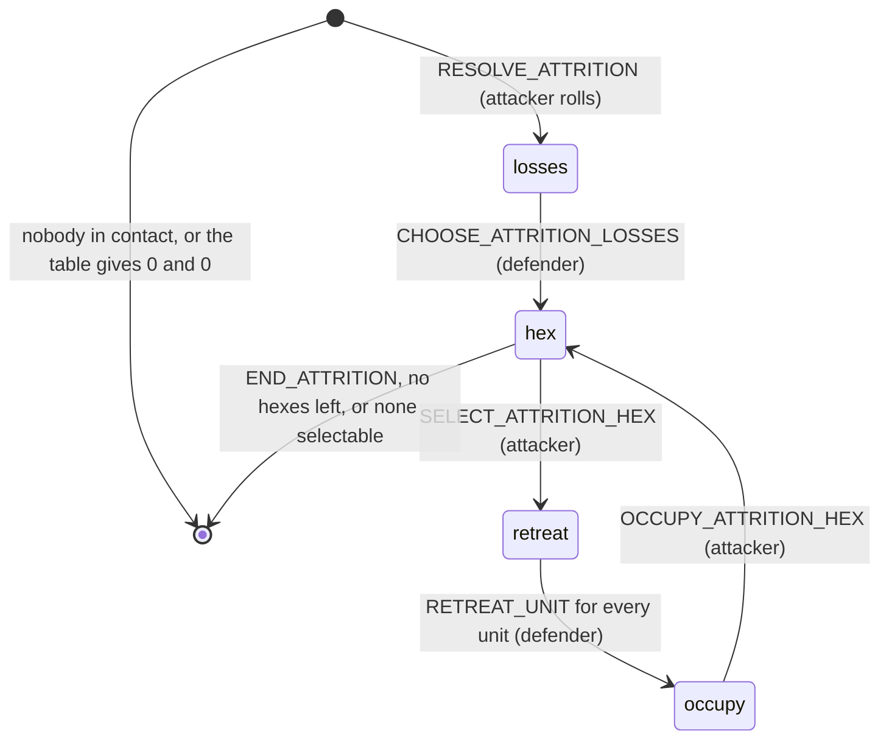
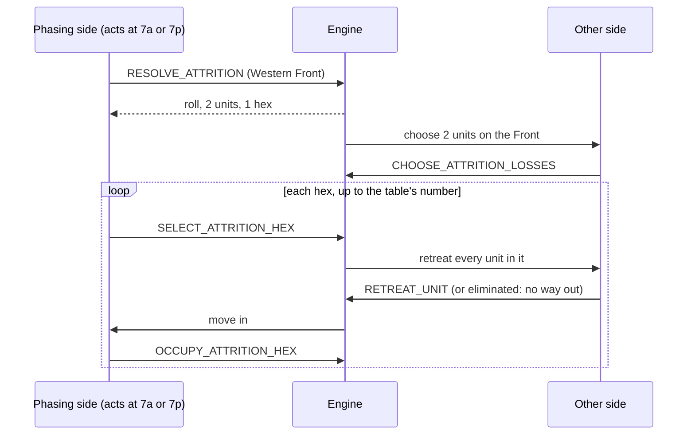
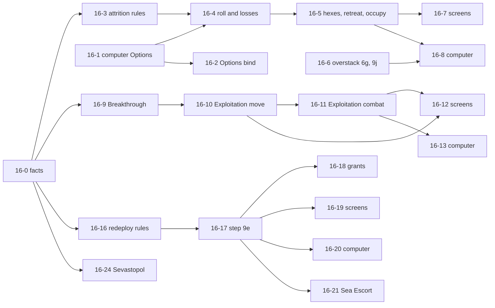

# 16. Attrition, Exploitation, Strategic Redeployment and the Fortress changes

Status: **Approved 2026-10-23 (owner: "Go, yes to all six", so Q1 to Q6 are yes); building. Written 2026-10-17. Part of the Beta milestone (docs/PLAN.md): 24 of its 28 tickets are Beta, 12 of those are Beta-critical (a 1939 game against the computer cannot run correctly without them); the other 4 tickets are Release 1.** Words and sketches only; the build plan is part G. Builds on spec 01 (turn steps), spec 02 (economy: the Front Options), spec 03 (movement, stacking, supply), spec 04 (ground combat), spec 05 (the computer), spec 09 (air: staging and the capture hook), spec 12 (fleets: ports, sea supply), spec 13 (zones of control) and on specs 14 (victory, conquest, the Russian winter) and 15 (minor countries), which own what is listed in part H. Written from the PC Reference Manual, the Operations Manual, the PC README errata and the text messages inside the game program (docs/GAME_DATA.md). Strategic Warfare is not here: the last section says whether Beta needs it and what a separate spec 17 would cover.

## Decisions needed

Six questions, each answerable with yes or no. My recommendation comes first; if you have no view, the recommendation stands (as for DF-1 to DF-3 in spec 12).

| # | Question (yes or no) | Recommended | What changes if you say no |
|---|---|---|---|
| Q1 | From now on, may a side **attack only on a Front where it chose the Offensive Option** (15 BRPs per Front per turn, as in the real game)? Today every Front allows attacks for nothing, and the computer never chooses an Option. | Yes | Attacks stay free everywhere. Attrition still works where it is chosen, but nothing pushes anyone to choose it, the Russian winter's ban on the Axis Offensive Option in the East (spec 14) does nothing, and the 15 BRP price of the Offensive Option is never paid. Ticket 16-2 moves to Release 1. |
| Q2 | Include **Exploitation** in the first playable version: armor that wins a battle brings other armor in for free, drives up to two hexes further and attacks again? | Yes | It is how the German armies break through in 1939 and 1940; without it Poland and France take many more turns and the German side feels slower than the real game. Tickets 16-9 to 16-13 move to Release 1 (3 M, 2 L). The game still runs to the end. |
| Q3 | In the first version, may **units cross the sea during Strategic Redeployment**, with a 9-factor fleet standing in a port as the escort (one unit per escort, ground units only, one sea crossing)? | Yes | Without it Britain is an island: British units can never reach France, and nothing reaches Egypt or Libya by sea. The Allied side is weak in France until ticket 16-21 comes in Release 1. |
| Q4 | When an enemy Attrition makes you choose losses and retreat hexes, or when units must be eliminated for overstacking, should there be a **"Choose for me"** button next to choosing by hand? | Yes | You always choose by hand (more taps on the iPad). The computer's own rule stays what it is. |
| Q5 | Draw a hex's **fortress outline only while the hex is a fortress**? The West Wall would appear only in 1944, the Maginot Line would disappear when France falls, and Sevastopol's outline would come and go. | Yes | The map keeps drawing all 11 printed fortresses all game, as today; the hex card and the odds preview still tell the truth. |
| Q6 | Agree that **Strategic Warfare** (U-boats, convoys, the Murmansk and American boxes) waits for Release 1 and its own spec? Reasons are in the last section. | Yes | It becomes a large Beta job (spec 18, size L or more) that must come after Strategic Redeployment and the fleets. |

Questions for Frank, who knows the DOS game, are in part J. None blocks anything; each has a reading chosen.

## Summary (read this first)

- **Today** a game has no Attrition, no Exploitation, no Strategic Redeployment and only half of the fortress rules. Steps 7a and 7p (Attrition), 7j and 7o (Exploitation) and 9e (redeployment) are in the sequence data and are passed with no rule behind them. The Attrition table and its die roll exist and are checked against the game's data, but nothing calls them. The three Front Options can be chosen at step 3 and are stored (the step 3 note prints them), but no rule reads them: every Front allows every attack, and the computer chooses no Option. The fortress status of the 11 printed fortresses is kept in the game state, quadruples the defence, stops armor ZOC and supplies the units inside; Sevastopol's two supply conditions, the news of a status change, and the map outline that follows the status are missing.
- **What this spec adds, in the order Frank would feel it:**
  1. **The Options start to matter** (Beta). The computer chooses an Option for each Front; an attack needs the Offensive Option (Q1).
  2. **Attrition** (Beta-critical). With the Attrition Option the side adds up the factors it has in contact with the enemy, rolls one die, and the enemy loses units and must give up hexes. The defender chooses the lost units; the attacker then picks the hexes **one at a time**; the defender retreats the units out of each; the attacker moves in. Capitals, Objectives, fortresses and bridgeheads cannot be taken this way. A new step for the non-active side: the defender acts during the attacker's turn. Overstacking from a retreat is settled at step 6g, which this spec wires.
  3. **Exploitation** (Beta if Q2 is yes). A won attack with armor in it opens a Breakthrough hex; other armor moves in free; at step 7j the armor drives up to two hexes further in a chain; at step 7o it attacks again, even a hex attacked before.
  4. **Strategic Redeployment** (Beta-critical on land; sea escort is Q3). At step 9e each Major Power may move a fixed number of units any distance over its own supplied land, never next to an enemy; Replacements, which cannot walk, move only this way. Grants count against the same allowance.
  5. **Fortresses.** Sevastopol follows its printed conditions and announces when it loses or regains the status; every status change is logged; the map draws only active fortresses (Q5); a companion rule keeps British units out of the Maginot Line, Paris, Marseilles and Vichy until the Allied turn after France falls or the start of 1942, whichever comes first (AER42).
- **Out of scope** (part H): Strategic Warfare and the American box (spec 18, last section); the conquest, Vichy and the Russian winter (spec 14); minor countries (spec 15); air missions and airdrops inside Exploitation (spec 09: the air steps 7k to 7m are a Release 1 ticket here, the drops are 09-11); fleet movement and interception (spec 12); lent Italian forces.
- **Size:** 28 tickets, numbered 16-0 to 16-27. **Beta: 24 (5 S, 13 M, 6 L), of which Beta-critical 12 (1 S, 8 M, 3 L). Release 1: 4 (3 M, 1 L).** The sizes are the spec's scale (a medium ticket is about a day of work). The smallest useful stop is after ticket 16-8: Attrition works end to end, for both sides, and the computer uses it.
- **Rules check:** 45 `TODO(verify)` rows (AER1 to AER45) are in docs/TODO-VERIFY.md and docs/RULES.md. The ones that change what Frank sees most: whether Attrition is added up per country or per side (AER1), what exactly counts as "adjacent to a unit that attacked" for the armor that moves into a Breakthrough (AER12), how long exploiting armor stays in supply (AER15), whether a unit may be redeployed after it has moved or attacked (AER22), and which Black Sea ports and which supply test Sevastopol needs (AER37).
- **Three readings changed while writing this.** (a) docs/PC-MANUAL-AUDIT.md says rule 22.0 (Replacements) has no body text in our copies; the corrected scan of page 35 has it, and it settles that Replacements are not counted for Attrition, cannot occupy an Attrition hex and move only by redeployment or when forced to retreat. (b) The Strategic Redeployment paragraph of spec 03 (cost in BRPs, distance, front limits) was written before the PC text was read; the PC manual limits the **number of units** per nation per turn, with no distance limit. This spec replaces that paragraph. (c) The Operations Manual's Attrition prompts read as if all hexes were chosen first; the Reference Manual and the PC README say they are chosen **one at a time**, and the program's own prompts do too. This spec builds one at a time.

## Words used here

| Word | Meaning |
|---|---|
| **Attrition** | The Option that grinds the enemy down with one die roll instead of battles (Ref 11.2, 12.4). |
| **Attritioned Front** | The Front the Attrition is resolved for. The Phasing side resolves each Front separately. |
| **In contact** | A ground unit is next to an enemy ground unit, across a hexside ground units can cross (a land hexside or a Crossing Arrow; not open water, not the Qattara Depression). |
| **Participating units** | The Phasing side's units that are in contact and count toward the total; shown with a red outline in the DOS game. |
| **#C and #H** | What the table gives: the number of units the defender loses (C) and the number of hexes the defender must give up (H). |
| **Retreat** | The defender moves every unit of one chosen hex into a neighbouring hex of his choice. |
| **Occupy** | The attacker moves at least one eligible unit into the hex just emptied. |
| **Breakthrough hex** | A hex a won attack with armor in it has been advanced into (Ref 12.31). |
| **Exploiting unit** | An armor unit that was moved into a Breakthrough hex for free; it may then move and attack again. |
| **Chain** | The line of exploiting armor, each unit at most two hexes from the one before it (Ref 12.31, Figure 3). |
| **SR** | Strategic Redeployment, step 9e: moving units far behind the lines, within a per-nation allowance (Ref 11.72). |
| **Sea Escort** | A 9-factor fleet that carries one unit or up to 20 BRPs across the sea during SR (Ref 21.6). |
| **Fortress** | A hex whose defender is multiplied by four (Ref 4.8). It is a fortress only while it has the status. |
| **Phasing side** | The side whose Player Turn it is. |
| **Pass Option** | The manual's third Front Option. The engine calls it "defensive". |

## Goal

Frank should be able to grind an enemy down with Attrition, break through with armor, and move reinforcements to the front, and see in plain words what each did, without knowing a rule number.

1. **Attrition** is a card, not a puzzle: it says how many factors take part and what each die result would cost the enemy; after the roll the defender is asked for losses and then for retreats, hex by hex; the attacker is asked which hexes to take.
2. **A breakthrough is visible and optional**: a won armor attack offers "Move in armor"; the armor then drives forward on a card that shows where it may go; it may stay.
3. **Redeployment shows its allowance**: "Germany: 6 of 9 left"; the units that cannot move say why (next to an enemy, cut off, none left).
4. **A fortress is what the map says it is**: Sevastopol tells you when it falls out of the fortress status and when it comes back; the West Wall appears in 1944.

Done means each of these works for both sides on the iPad, the computer never stalls at a new prompt, and every number on a card is the number the rules used.

## What exists today (facts from the repo, 2026-10-17)

| Fact | Where | Consequence |
|---|---|---|
| The Attrition table, the column from a total (1 to 10, 11 to 20, and so on up to 61 and over), and `resolveAttrition(factors, rngState)` (one die; units to lose, hexes to give up; none for 0 factors) exist and match the game's data cell by cell. Nothing in the engine calls them. | `combat.ts`, `tests/combat.test.ts`, docs/GAME_DATA.md | The numbers are done. The whole procedure around them is new. |
| `NO_ATTRITION_OCCUPATION` lists the features that cannot be taken by Attrition (capital, capital-port, objective). Only a test reads it. (Spec 14 R4 calls it "built"; it is a constant.) | `terrain.ts`, `tests/tables.test.ts` | Fortress, bridgehead, the Crossing Arrow case and the Luxembourg exception are not in it. |
| Front Options are chosen at step 3 (`SELECT_FRONT_OPTION`), kept in `GameState.frontOptions` until the next Player Turn begins; Offensive costs 15 (free for the 1939 German Eastern Front in Fall 1939), Attrition and Defensive cost nothing; a Front with no choice is "defensive". `frontAllowsAttack` returns true for every Front. | `frontoptions.ts`, `attack-rules.ts` | No rule reads the Option (`frontOptionOf` is called by nothing; only the step 3 note prints the choices). Specs 09 and 12 say "do not wire it here" and spec 14 notes the hook still returns true; nobody has taken it. This spec does (Q1, tickets 16-1 and 16-2). |
| The computer chooses no Option (`endTheStep` says so for step 3), resolves no Attrition, redeploys nothing and never retreats. It stalls in front of fortified hexes (spec 05). | `src/ai/choose.ts` | Tickets 16-1, 16-8, 16-13, 16-20. |
| Steps 7a, 7p, 6g, 7i to 7o and 9e to 9k are in the sequence and are passed. `IMPLEMENTED_STEPS` has II.B, 1, 3, 6f, 7b, 7h, 8b, 9a, 10b. | `sequence.ts`, `turn.ts` `settle` | Seven steps gain rules here: 6g, 7a, 7j, 7o, 7p, 9e, 9j. |
| Ground combat at 7h: `ATTACK`, `ALLOCATE_LOSSES`, `ADVANCE`. The record keeps the units that attacked (`attacked`), the hexes attacked (`targets`; `ONE_ATTACK_PER_HEX`), an Exchange waiting for its chooser (`pending`) and the hexes the defenders left (`advances`). The Offensive table has no retreat result. Ref 12.1 says a **unit** may not be attacked twice in a Player Turn, except by Exploitation combat; the engine caps the **hex**. | `attack.ts`, `attack-losses.ts`, `combat-record.ts`, `attack-rules.ts` | Exploitation must be able to attack a hex already attacked (audit item 15). |
| No Breakthrough, no Exploitation: nothing in `src/` beyond the step titles and two comments. | `grep` | All new. |
| `overstacks`, `eliminateOverstack` (the owner's choice, no more than needed) and `defaultElimination` exist and are tested, but nothing calls them; steps 6g and 9j are passed. `MOVE` refuses to end over the limit. The event `OVERSTACK_ELIMINATED` exists. | `stacking.ts`, `movement.ts`, `action-types.ts`, `tests/stacking.test.ts` | Retreat and Breakthrough are the only things that can create an overstack, so wiring 6g and 9j belongs here (16-6). The program itself refuses a move that would end overstacked (audit item 14: keep the refusal). |
| Movement helpers: `reachableHexes`, `movePathProblem`, `endProblem`, `entryProblem`, enemy-armor ZOC exit cost 2, neutral land closed, `ONE_MOVE_PER_TURN`. A Replacement has no movement factor, so `movableProblem` refuses it. | `movement.ts`, `zoc.ts`, `move-action.ts` | Exploitation movement reuses them; Replacements move only by SR. |
| Supply is a set of pure queries (`supplyNetwork`, `supplyStatus`, `isUnitSupplied`, `fortressSupplies`). The effects (cut-off units cannot move or advance, and are eliminated) are **switched off** (`SUPPLY_EFFECTS_ENABLED`; spec 12's gate 12-7 turns them on). `wasCutOff` reads the list taken when the Player Turn began. | `supply.ts`, `supply-effects.ts`, `supply-sources.ts` | Redeployment and Exploitation follow the same switch (R14, R20). |
| Strategic Redeployment: nothing. `grants.ts` says that 20 BRPs counting as one SR and a grant blocked by an enemy next to a capital are not built. | `grants.ts` | Tickets 16-16 to 16-18. |
| Fortress: `GameState.fortresses`; `refreshFortresses` runs when each Player Turn begins; `enterHexes` ends the status of a standard, Maginot or West Wall fortress when an enemy ground unit enters; the defence is multiplied by 4 first of all benefits; armor ZOC does not reach into a fortress; a fortress supplies the units in it (Malta only while the Allies hold Gibraltar, Alexandria and Suez; Sevastopol for Russian units). Sevastopol is a fortress while the U.S.S.R. holds the hex, and becomes one again if it retakes it. The Maginot Line is off in the 1942 and 1944 scenarios and when France is "vichy" or "out". The West Wall is decided once, in the first Player Turn of 1944. No event is emitted for any change. | `fortress.ts`, `control.ts`, `zoc.ts`, `terrain.ts`, `supply-sources.ts`, `tests/fortress.test.ts` | Sevastopol's two conditions, the news, and "began its turn there" are the remaining work. |
| The map draws the fortress outline on the 11 printed fortress hexes all game, from the map data. The hex card and the preview read the state (`state.fortresses`). | `ui/mapCities.ts`, `ui/hexCard.ts`, `ui/attackPreview.ts` | Q5, ticket 16-25. |
| There is no `sideToAct`. The one place a non-active side acts today is the Exchange loss choice (`PendingLosses.chooser`, read by `computerToMove`). Specs 09, 12, 14 and 15 each propose a shared `sideToAct`; none is on main. The shared capture hook `afterHexTaken` (specs 09 and 12) is not on main either; the sweep (`ALONE_NONGROUND_DESTROYED`) still destroys air and fleets left alone in a hex. | `combat-record.ts`, `ui/computerPlay.ts`, `attack-rules.ts` | Attrition adds a second non-active chooser (16-4) and a call to the capture hook (16-5). |
| Take back at 6f exists as a session convenience (the session replays the moves it kept). | `ui/moveUndo.ts` | Redeployment reuses the idea (no dice, so a replay is exact). |

## Sources, and how they were read

- **Primary:** the PC Reference Manual, 4.5 to 4.8 (terrain, cities, fortresses), 5.0 (stacking), 6.0 (hex control), 7.0 (ZOC), 8.0 (bridgeheads, boundary only), 11.2 to 11.8 (Options, movement, combat sequence, construction, redeployment), 12.1 to 12.4 (ground combat, Breakthrough and Exploitation, Attrition), 13.0 (the duty after a declaration), 19.1 to 19.4 (supply), 20.1 to 20.2 (airbases, staging), 21.1 to 21.7 (naval bases, Sea Escort), 22.0 (Replacements, from the corrected scan of page 35), 26.0 (Anglo-French cooperation), 29.0, 30.1, 31.0, 32.0, 34.0 (only what touches the three rules); the Operations Manual 5.42, 5.45f, 5.45g, 5.46a, 5.46h to 5.46p, 5.47b, 5.48a, 5.48e to 5.48k; Peele's errata (Operations page 12 on 5.46a; Reference page 18 on 12.4); the PC README (rules differences 14.23, 18.31, 18.33, 18.34, 31.1, 31.5); and the text messages inside `3R2.EXE` (facts only, nothing copied). Read from local copies kept outside the repo (docs/SOURCES.md). **Everything below is in our own words; no manual text is copied.**
- **The page numbers** of the Reference Manual (for finding things): Breakthrough and Exploitation pp. 16 to 17, Attrition p. 18, Redeployment pp. 13 to 14, fortresses p. 7, supply consequences p. 26, Sea Escort p. 34, Replacements p. 35.
- **Cross-check:** the Advanced Third Reich text in docs/RULES.md ("Web research") has the same wording for 4.8, 11.72 and 12.3 to 12.4 in the sentences compared.
- **What the program says** (text strings found in `3R2.EXE` on 2026-10-17, recorded with their file offsets, paraphrased, in docs/GAME_DATA.md, "Program messages (spec 16)"): it offers Attrition by group and Front; it prompts for hexes one at a time and for the defender's retreat; it allows retreat only into a friendly or enemy hex and lets Anglo-French cooperation forbid one; it refuses to end a move overstacked; it prompts for armor to move into the Breakthrough hex and for Exploitation movement and combat; it has messages on Replacements moving only in the SR phase, on SR between Fronts, on aborting an SR, and on Sevastopol losing and regaining its status. These are facts about what the game shows, found by searching the program for text; the rules are the manual's, and where the two differ the item is a `TODO(verify)`.
- **Where the sources differ or are silent** the rule is a `TODO(verify)` here and in part J. Nothing is invented: each number is cited, or is a named constant with a `TODO(verify)`.

## The turn, with the places this spec touches

```mermaid
flowchart LR
  S3["3 Front Options<br/>(computer chooses, 16-1;<br/>Offensive gates attacks, 16-2)"] --> S6f["6f Move"]
  S6f --> S6g["6g Overstack<br/>(the defender's retreat<br/>overstack ends here, 16-6)"]
  S6g --> S7a["7a Attrition now<br/>(16-4, 16-5)"]
  S7a --> S7h["7h Ground combat<br/>+ Breakthrough: move armor in (16-9)"]
  S7h --> S7j["7j Exploitation movement<br/>(16-10)"]
  S7j --> S7o["7o Exploitation combat<br/>(16-11)"]
  S7o --> S7p["7p Attrition later<br/>(16-4, 16-5)"]
  S7p --> S8["8 Build"]
  S8 --> S9e["9e Redeploy<br/>(16-17)"]
  S9e --> S9j["9j Overstack<br/>(Breakthrough hex, 16-6)"]
  S9j --> S10["10 End"]
```



Fortress status is refreshed when each Player Turn begins (it already is); the new news lines come from the same call (16-25).

## Part A. Rules in scope, rule by rule

Each rule says what the manual says (our words), what the engine does today, and the reading chosen. "Status" is **settled** (the text is clear), **TODO(verify)** (a check is needed; AER ids are in part J) or **PO** (a decision for the product owner).

### Attrition

#### R1. The Attrition Option (Ref 11.2, 11.21, 11.41, 11.52, 12.4; Ops 5.42) settled

- At step 3 each Front gets the Offensive, Attrition or Pass Option. Attrition costs no BRPs. Movement under Attrition is the same as under the Offensive Option. A side may choose it though none of its units will touch an enemy, and no fighting is required: it can simply walk through land nobody controls and take control of it. An ally must join an Offensive or Attrition Option on a Front or take the Pass Option; a nation may not take Attrition while an ally takes Offensive on the same Front.
- **Today:** the choice is stored and nothing reads it. The engine keeps one Option per Front for the whole side (audit item 12 stays open: ask Frank).
- **Reading:** Attrition is resolved on a Front only if the side's Option there is Attrition. An Offensive attack needs the Offensive Option (Q1, 16-2).

#### R2. Who takes part, and how many factors (Ref 11.52, 12.4, 19.4, 22.0, 31.0; Ops 5.46a with its erratum) settled except AER1 to AER3, AER8, AER45

- The Phasing side adds up the **printed combat factors** of its ground units (infantry, armor, airborne) that are **in contact** with an enemy ground unit on the Attritioned Front. Terrain multiplies nothing. A unit counts once.
- A unit standing on another Front counts if it is in contact with an enemy on this Front, provided it takes no part in combat on its own Front. A unit already used in an Offensive attack, or in an Attrition on another Front, in this Player Turn does not count again. The player may leave units out before the roll.
- **Unsupplied units count** (Ref 19.4), and so do German units that are unsupplied only because of the Libyan cap (Ref 31.0; the cap is not built, AER45); they cannot occupy a hex (R7). **Replacements do not count** (Ref 22.0). A bridgehead stack would count all five units (no bridgeheads before fleets Release IV).
- **Today:** nothing. The helpers exist (`neighborIds`, `crossable`, `isEnemy`, `defendersAt`, `attackerPool`).
- **AER1.** The program offers Attrition by group (Allied, Russian, Axis, Italian) on each Front, which suggests Italy's factors are totalled apart from Germany's and Russia's apart from the Western Allies'. The manual says the Phasing Player's factors in contact are totalled. Built per side and Front (it matches the one Option per Front the engine keeps); a per-nation total would give smaller totals and more rolls.
- **AER2.** Airborne units count as ground units here (no text says otherwise).
- **AER3.** The Front of a contact is the Front of the **enemy unit's hex**; the hexes chosen in R5 must lie on the Attritioned Front too.
- **AER8.** Taking part uses a unit up for the Player Turn: it cannot attack afterwards and cannot take part in a second Attrition (the manual says a unit at a Front boundary cannot do both; it does not say the same for units in the middle of a Front).

#### R3. The roll (Ref 12.4) settled; built

- The total gives a column (1 to 10, 11 to 20, and so on, 61 and over), one die gives a row, and the table gives #C and #H; zero factors give nothing, and some results are 0 and 0.
- **Today:** `resolveAttrition` is built and tested, cell by cell, against the game's data. The die comes from the game's seeded generator (`rollD6`), so a replay gives the same roll. The roll is made when the attacker presses the button, not earlier.

#### R4. The defender's losses (Ref 12.4; Peele on the board-game rule 18.31; Ops 5.46a) mostly settled

- The Non-Phasing side chooses which of its ground units are eliminated: any of its units **on the Attritioned Front** (not only those in contact) whose owner is at war with a participating nation. They go back to their pool (today an eliminated unit is simply removed, as for every loss; how pools refill is construction's work, spec 02). Replacements are the cheap choice; that is what they are for (Ref 22.0).
- **AER5.** If the defender has fewer eligible units than #C, all of them go; with none, nothing happens.
- **AER4.** Peele's note on rule 18.31 says losses may be taken from "friendly" Major Powers before Intervention. Our reading: any unit of the defending side on the Front whose owner is at war with a participant, an ally of the defender included. If the note means something narrower, only the candidate list changes.
- **Today:** nothing. The chooser is the Non-Phasing side (a person or the computer): the second non-active chooser after the Exchange one.

#### R5. The hexes, one at a time (Ref 12.4, 4.7, 4.8, 8.0; PC README 18.34; Ops 5.46a) settled except AER3, AER7, AER11

- After the losses the Phasing side may select **one hex** it wants the enemy to leave. The enemy retreats from it (R6), the Phasing side occupies it (R7), then the next hex is selected, up to #H. The side may stop earlier or take none.
- A hex may be selected only if: (1) it holds an enemy ground unit **now** (a hex the losses just emptied is out; so is a hex with only air units or ships); (2) it is on the Attritioned Front; (3) it is **not** a capital, capital-port or Objective, **not** a hex that has the fortress status at this moment, **not** a hex with a bridgehead (Luxembourg is the one named exception to the capital rule, unless a bridgehead is in it); (4) at least one eligible unit stands next to it over a hexside that is **not** a Crossing Arrow (a hex that could be entered only across a Crossing Arrow is out).
- **AER11.** The Operations Manual's prompts read as if all hexes were named before any retreat. The Reference Manual, the README (rule 18.34) and the program's own prompt say one at a time. Built one at a time; eligibility is checked again for each hex because the position has changed.
- **AER7.** Luxembourg's hex (O25) has no feature on our map, so nothing excludes it. If spec 15 reads that hex as Luxembourg's capital (its MC7), the Luxembourg exception must keep it selectable. Bridgeheads do not exist before fleets Release IV.
- **Today:** only `NO_ATTRITION_OCCUPATION` exists.

#### R6. The retreat (Ref 12.4 and the errata to 12.4 and rule 18.33; 5.0; 26.0; the program's messages) mostly settled

- The Non-Phasing side moves **every ground unit in the chosen hex** one hex, each to a neighbouring hex of his own choice. Allowed: a hexside ground units can cross; a hex controlled by either side; an enemy zone of control; a vacant enemy-controlled hex; a hex that would be overstacked. **Not allowed:** a hex holding an enemy ground, air, naval or airbase unit. There is **no duty to prefer a friendly or supplied hex** (the errata deleted it). A unit with no legal hex is **eliminated**.
- Air units and ships in the hex are not retreated by the player: they go to the nearest friendly base at once, by the capture rule of spec 09 R9 and spec 12 R9 (the shared call `afterHexTaken`; until it is built the existing sweep destroys them, as an advance does today: AER10).
- A unit that retreats into an enemy-controlled hex takes its control (Ref 6.0: the last nation with a ground unit there), and `enterHexes` decides a fortress status as it does for any entry.
- **Overstack after a retreat** is allowed until the end of the defender's next Movement Phase (step 6g, R15), then he eliminates what exceeds, his choice.
- While the ban of R32 holds, a British unit may not retreat into a hex it may not stop in (R32) and may not stack with French units; the program says so on a retreat.
- **AER6.** The program says retreat is only into a friendly or enemy hex, so land nobody controls is closed; a Crossing Arrow hexside is open; a vacant enemy fortress may be entered.
- **Today:** nothing. Helpers: `crossable`, the occupant test of `entryProblem`, `neutralLandProblem`, `enterHexes`, `stackingProblem`.

#### R7. The occupation (Ref 12.4, 19.4, 22.0; Ops 5.46a and its erratum) settled

- Once the hex is empty the Phasing side **must** move in at least one eligible unit; more may follow up to the stacking limit. Eligible: a participating ground unit next to the hex over a hexside that is not a Crossing Arrow; not a Replacement; not cut off when the Player Turn began (`wasCutOff`); not a unit of an attacked minor that may not leave its own country (spec 15). If no unit can move in, the hex could not have been selected.
- The hex changes hands (`enterHexes`). The occupation is **not** a Breakthrough. The units that moved in are used up for the turn (AER8). Air units and ships left in the emptied hex are displaced (R6).
- **Today:** nothing; `applyAdvance` is the nearest relative.

#### R8. When it is resolved (Ref 11.5, 11.52; Ops 5.46a, 5.46p) settled except AER9

- At step 7a the Phasing side with an Attrition Option on some Front is asked whether to resolve it now or later. Now: it picks the Front(s), may leave units out, and presses done. Later: at step 7p it resolves all it has not yet resolved. Each Front is resolved separately. Attrition is not compulsory.
- **AER9.** Each Front is resolved at most once per Player Turn; at 7p the side may decline; units that exploited (R12) may add their factors if they end next to an enemy on the Front, because they have not been used.
- **Today:** 7a and 7p are passed.

#### R9. Where Attrition meets other rules (AER43)

- **The duty after a declaration on a minor** (Ref 13.0, PC rule 21.4; spec 15 R4 and its MC3): an Attrition attack on the minor's forces meets the duty. The Attrition record keeps the owners of the units that were in contact, so spec 15's ticket 15-4 can read it.
- **Poland in 1939** (Ref 29.0; TODO(verify) AER43): Germany must keep attacking Polish forces, with Offensive or Attrition combats, until Poland is conquered. The rule is not built (spec 14 and 15 do not own it either); the record above is what it would read.
- **France while Paris is enemy-held** may not use an Attrition Option (Ref 18.3; spec 14 R5 and its ticket 14-9, whose milestone is spec 14's question Q4: see spec 14). The Option list hides it; nothing here.
- **Unsupplied units** count but cannot occupy (R2, R7). **Replacements** do not count and cannot occupy.
- **Fortresses** cannot be taken (R5), but their defenders can still be made to lose units, which is how the computer can act against the Maginot Line (spec 05's stall).
- **Minor-neutral units** cannot advance beyond their own borders, so they cannot make the enemy retreat (Ops 5.46a). In Beta an attacked minor only defends (spec 15 Q1), so this never arises.

### Exploitation

#### R10. The Breakthrough (Ref 12.31; Ops 5.46h) settled except AER12

- A **Breakthrough hex** arises when an Offensive-Option attack **included at least one armor unit** (it need not have survived) and at least one of the attacking units that survived **advanced** into the hex the defenders left. The advancing units are not exploiting units and neither move nor attack in Exploitation. (Reading, AER12: the armor among the attackers need not have survived.)
- An Attrition occupation, a retreat or an exploiter's advance is not a Breakthrough.
- **Today:** the advance exists (`AdvanceChance`, `ADVANCE`); the record does not remember that armor attacked, or from which hexes.

#### R11. Armor that moves in (Ref 12.31, 19.4, 5.0; Ops 5.46h) settled except AER12, AER13

- Right after the advance (before the next attack is chosen) the Phasing side may place into the Breakthrough hex any of its armor units that: are in supply; made no attack in this Combat Phase; and were adjacent to, or stacked with, a unit that attacked the hex. The placement is **free** (no movement points, no stacking limit) and optional for each unit. The placed units are the **exploiting units**.
- **AER12.** The test of being next to, or in the same hex as, an attacker is measured from where the attackers stood when they attacked. The text could also mean after the advance.
- **AER13.** A placed unit takes no further part in ordinary combat (at 7h) and counts as having moved.
- The offer stays open until step 7h is left; an unused Breakthrough lapses then.

#### R12. Exploitation movement, step 7j (Ref 12.31; Ops 5.46j) settled except AER14, AER16

- After all ordinary battles and advances (and the air attacks on ports, 7i) the exploiting units move, one at a time, each once, each move final.
- **Reach.** The first exploiter goes up to two hexes from the Breakthrough hex. Each later one goes up to two hexes from the Breakthrough hex, **or** follows exactly the path of an earlier exploiter (ending where that unit ended) and then goes up to two more hexes. No unit may spend more than its own movement factor counted from the Breakthrough hex, with the usual extra cost for leaving a hex in enemy armor ZOC. A unit may also stay.
- Ordinary movement rules otherwise apply: no entering an enemy-occupied hex, neutral land closed, stacking where the move ends, and the Option of the Front entered (a Pass-Option Front only over hexes friendly at the start of the turn and not next to an enemy: not built anywhere, shared TODO).
- Each Breakthrough hex has its own chain.
- **AER14.** What it costs to repeat an earlier exploiter's move exactly: the follower pays the other unit's path cost against its own movement factor, then up to two more hexes. "Two hexes" is counted in steps.
- **AER16.** Two inherited open points apply unchanged: the manual's Exploitation example prices leaving a ZOC at 3 against 2 in rule 7.0 (existing note in `zoc.ts`), and whether control changes on hexes only passed through (`CONTROL_ON_PASS_THROUGH`; Ref 6.0 says passing a ground unit through counts). Exploiting armor covers more hexes than anything else, so the second one is felt here first.
- **Today:** nothing.

#### R13. Exploitation combat, step 7o (Ref 12.31, 12.1, 12.21; Ops 5.46o) settled except AER17, AER18

- Only **exploiting armor** (and, with the airdrop ticket of spec 09, airborne units that dropped in Exploitation, with air support) attacks. Each attacks an adjacent enemy hex; the battle is resolved on the usual table like any other. More than two units may attack out of the Breakthrough hex if they stand in it (the overstack is allowed there). A hex attacked earlier this Player Turn may be attacked again (the exception in Ref 12.1).
- It needs the Offensive Option on the Front of the attacked hex.
- A survivor may advance into a hex the battle emptied **unless that advance would break the chain** (every exploiter within two hexes of the Breakthrough hex or of another exploiter). That advance is not a new Breakthrough. A unit cut off at the start of the turn cannot advance.
- **AER17.** The cap of one attack per hex (`ONE_ATTACK_PER_HEX`) is a hex-level reading of Ref 12.1, which speaks of a unit; Exploitation is the named exception, so the cap does not apply at 7o. **AER18.** The chain test uses the positions after the advance; two exploiters that end more than two hexes apart break it.
- **Today:** `attackNumbers`, `applyOutcome`, `applyAdvance` can do all of it; `attackerPool` and the `targets` cap need an Exploitation mode.

#### R14. Exploiters and supply (Ref 19.3 exceptions, 19.4, 31.0) TODO(verify) AER15, AER34

- Armor that Exploits counts as in supply for one turn afterwards; if it is moved by SR in the same Player Turn it loses that. An armor unit must be in supply to be placed and to move. The Libyan cap does not exempt a unit that has just exploited.
- **Reading chosen (AER15):** while the supply effects are on, placing and moving need current supply; after the exploitation the unit counts as supplied through the end of its owner's next Player Turn (the start-of-turn list and the end check both). While the effects are off (the shipped setting) nothing is checked, exactly as for movement and advance today. **AER34:** a redeployment in the same Player Turn removes the exemption.
- **Today:** nothing; `supplyStatus` has no exemption to read.

#### R15. Overstacking: the Breakthrough hex and a retreat (Ref 5.0, 11.77; Ops 5.45g, 5.48j) settled; wiring is new

- Two things leave a hex over its limit on purpose. The Breakthrough hex may hold any number of exploiters; it must be brought back within the limit by the end of the owner's SR phase, by redeploying the extras or by eliminating them, the owner's choice (step 9j). A defender who retreated into a hex may overstack it until the end of his own next Movement Phase (step 6g), then eliminates the excess, his choice. Airborne units never count.
- Everything else still refuses to end over the limit (the program too).
- **AER21.** At 9j the player may first redeploy (the Operations Manual says so) and only then eliminate; one step, one choice list.
- **Today:** `overstacks`, `eliminateOverstack` (no more than needed) and `defaultElimination` exist and are tested; nothing calls them.

#### R16. The vacant-hex attack (Ref 12.32) Release 1, TODO(verify) AER20

- During an Offensive Option a supplied armor unit that has not yet attacked and is not exploiting may "attack" an enemy-controlled hex that holds no enemy infantry, armor or airborne unit; other units that have not attacked and are adjacent may join. The armor advances in, creating a Breakthrough hex. Exploitation from it is not allowed if the hex is next to an enemy ground unit or no supply line can be traced to it at that moment.
- Not in Beta (Q2's note): the main Breakthrough comes from a won battle. Ticket 16-14.

#### R17. Air and airdrops in Exploitation (Ref 12.31; README 31.1; Ops 5.46k to 5.46n) boundary, AER19

- Steps 7k to 7n (ground support, defensive air, their interception, airdrops) belong to spec 09. They happen only if there are exploiting armor units; the README says otherwise there is no Exploitation phase. In Beta they stay passed. Ticket 16-15 (Release 1) gives 7k to 7m the air tools spec 09 builds; the drops are spec 09's 09-11.

### Strategic Redeployment, step 9e

#### R18. The allowance (Ref 11.72; Ops 5.48e) settled except AER26, AER31

- In its Phase each Major Power may redeploy a number of units: **U.S.A. 10, Germany 9, Britain 7, U.S.S.R. 6, Italy 5, France 5** per Player Turn. The allowance cannot be handed to another nation and cannot be saved. Every unit moved counts one, whatever its size; a unit that crosses two fleets' escorts still counts once. Grants of BRPs count too (R21). The sides' nations may redeploy in any order.
- A Minor-Ally's units are moved by its Major Power's redeployment and count against that power's allowance (Ref 17.1). **AER26.** Free French units are read as British for this, Polish units cannot be redeployed in Beta (spec 15, part H), and an Italian counter held by Germany counts for the nation named in its `nationality`. **AER31.** Spec 14's Occupation Force rule (SR only to correct a shortage) is a flag this spec reads if it is there.
- **Today:** nothing; step 9e is passed.

#### R19. Who may be redeployed (Ref 11.72, 19.4, 22.0) settled except AER22

- In Beta: **ground units and Replacements** of the Phasing side, standing on a map hex, **in supply** (while the supply effects are on, R20), **not next to an enemy ground unit**, not already redeployed this Player Turn. Not in Beta: air units and airbases (Release 1), fleets (Release 1), units in the American box (spec 17), units of a minor country (spec 15).
- A **Replacement** has no movement factor and moves only by redeployment (or when forced to retreat): this is how reinforcements reach the front. A unit built at step 8b the same turn may be redeployed in 9e.
- **AER22.** No text bars a unit that moved or attacked earlier in the turn from being redeployed; the manual excludes only cut-off units. Built so.
- **Today:** `movableProblem` already refuses a Replacement for step 6f; nothing else.

#### R20. The road (Ref 11.72, 4.5; Ops 5.48e) settled except AER23 to AER25, AER27, AER28, AER33, AER44

- Units redeployed by land use **hexes the side controls (an ally's included) that are supplied**, any distance. No redeployed unit may be on, or next to, an enemy unit at the start, at any hex on the way, or at the end. A hex across open water is not "next to" (a Crossing Arrow does not change that), and a future enemy not yet at war is not an enemy (AER44). Crossing the sea needs a Crossing Arrow or Sea Escort (R22). Redeployed units cannot be intercepted (AER44; nothing in the engine intercepts ground units).
- A unit can end in any hex of the connected region it starts in where it fits (stacking, Ref 5.0; the Anglo-French rule, R32). **AER27:** like a move, a redeployment may not end overstacked.
- **AER23.** The enemy unit of the adjacency test is read as an enemy ground unit (armor ZOC is the same adjacency). **AER24.** "Supplied" is read in the unit's own supply set: the Axis, the Western Allies or the Soviets (supply.ts), plus the special nets and fortresses. **AER33.** While the supply effects are off (the shipped setting) the supply test is skipped, as for every supply effect today; control and enemy adjacency are always tested. **AER25.** The program has a message refusing to redeploy "directly from one Front to another"; the manual restricts Fronts only for fleets (and for escort chains). Built: no Front restriction on land. The message is one line, with no rule number and no context, so it cannot be matched to a rule; the manual restricts Fronts only for fleets and for escort chains (which is what "directly", one escort across a Front boundary, may refer to); and a land restriction would forbid the German redeployment from the Western to the Eastern Front that the 1941 attack depends on. So the manual wins until Frank answers P5. **AER28.** A unit is redeployed once a Player Turn; "take back" before the step ends is a screen convenience (R25).
- **Today:** the pieces exist as queries: `supplyNetwork`, `controllingSide`, `crossable`, `isEnemy`, `stackingProblem`, `entryProblem`.

#### R21. BRP grants count as redeployments (Ref 11.72, 11.71) settled except AER30

- Each grant of 20 BRPs (or part) counts as one redeployment of the granting nation. BRPs travel capital to capital, so no grant may be made while an enemy unit stands next to either capital (the U.S.S.R. may receive as long as it has neither surrendered nor been conquered, whatever happens to Moscow). A grant across the sea needs a 9-factor fleet as Sea Escort (up to 20 BRPs each).
- **Reading (AER30):** in Beta the count and the capital block are built; a grant across the sea needs no escort (as today, the engine lets Britain grant to France or the U.S.S.R. directly). Escort for BRPs is Release 1 (16-23).
- **Today:** `grants.ts` records neither; its header names both as not built.

#### R22. Across the sea: Sea Escort (Ref 21.6, 11.72, 32.0; Q3) Beta slice, TODO(verify) AER29

- A 9-factor fleet may escort one unit of any size across the sea (or up to 20 BRPs). The unit must be able to reach the fleet's port over friendly-controlled land; the fleet's destination must be a friendly-controlled port; the unit may then continue overland. The fleet ends the phase in the port it started in, and may do nothing else that Game Turn (supply, interception, a second escort); a fleet that is itself redeployed cannot escort; a fleet escorting may not leave its Front. Chains through Gibraltar, Kiel and Istanbul carry a unit from one Front to another; Gibraltar may be used only by the side that holds it; the Turkish Straits need both sides of both Crossing Arrows; the Suez Canal and the way round Africa have their own rules.
- **The Beta slice (ticket 16-21):** one hop, ground units and Replacements, one escorted unit per fleet, on one Front, between two friendly ports; the fleet's record says it has escorted (`used` in spec 12's naval record, ticket 12-1). No chain, no BRPs, no airbases. The port facts and the shortest sea route come from spec 12 (12-0).
- **Today:** nothing. The state to hold it is spec 12's naval record (not on main).

#### R23. Air units, airbases and fleets (Ref 11.72, 20.1, 20.2, 21.7) Release 1

- An air unit crosses open water only by Sea Escort or by a chain of friendly bases at most eight hexes apart; over land it moves as any redeployed unit; it may cross a hex that is part ocean and part neutral land. An airbase moves only by redeployment and needs an escort over open water; extra air factors left over by a smaller airbase capacity are redeployed or eliminated. A fleet changes Front by redeployment, across at most one Front boundary. Tickets 16-22 and 16-23; the open points are AER32.

#### R24. What follows 9e (Ref 11.74 to 11.77; Ops 5.48f to 5.48k) boundary

- 9f, 9g: supply re-check, sea supply and the elimination of cut-off units: spec 12 R8 (the engine today eliminates at the end of the Player Turn, not at 9g). 9h: unsupplied airbases: spec 09. 9i: bridgeheads: fleets Release IV. **9j: overstack elimination: this spec (R15, 16-6).** 9k: Eastern-Front factor check: spec 14.

#### R25. The list, and taking back (Ops 5.48e; the program's SR list) screen convenience

- The DOS game keeps an SR list and lets the player abort a redeployment before the phase ends. Built the way take back at 6f is: the session keeps the position before the first redeployment and replays; there are no dice in 9e, so a replay is exact.

### The fortress changes

#### R26. The Maginot Line (Ref 4.8, 26.0) built; one hook to test, AER40

- Metz (P24), Strasbourg (Q24) and hex P25 are fortresses in the 1939 scenario and the Campaign. They are not in the 1942 and 1944 scenarios. They lose the status when France falls, and, like any fortress, for good when an enemy ground unit occupies them.
- **Today:** all built in `fortress.ts` (the fall is read from the nation's status "vichy" or "out"; spec 14's France ticket sets it). The status changes when the next Player Turn begins; between the fall (the end of the Allied Combat Phase) and then nothing is fought. A test with spec 14's fall closes it.

#### R27. The West Wall (Ref 4.8) built; AER39

- Essen (M27), Bonn (N26), Frankfurt (O26) and Stuttgart (P26) become fortresses at the start of 1944 and only if the Axis controls them then; the map shows no symbol before. A hex that is not Axis-held at that moment never becomes one.
- **Today:** built. `refreshFortresses` decides once, in the first Player Turn that begins in 1944, and never again. **AER39:** "the start of 1944" is read as that first Player Turn's beginning; a hex nobody controls counts as not Axis-held.

#### R28. Sevastopol (Ref 4.8, 19.2) hex condition built; the rest new, TODO(verify) AER35 to AER37

- Sevastopol (V38) is a fortress only while the U.S.S.R. controls **another Black Sea port that is itself in supply**, and/or can **trace a line of supply from Sevastopol to the east edge of the map** (across the Crimea-Kerch Strait, hexside U40-U41, if need be), at the start of its Player Turn. The program announces when it has lost the status and when it has regained it.
- **Reading chosen:** it is a fortress when the U.S.S.R. controls the hex **and** (the port condition **or** the supply-line condition) held at the start of the latest Allied Player Turn. It is evaluated at the start of each Allied Player Turn and kept through the Axis turn that follows; it comes and goes in both directions with a news line each way (the program's wording suggests it can regain, so the "lost for good" rule of the other fortresses is not applied to it: AER35). Until the U.S.S.R. is at war there is no Soviet turn to start, so only the hex condition applies (AER36).
- **Black Sea ports (AER37):** the data has six ports on that sea (the same six spec 12 counts): Odessa (T37), Sevastopol (V38) itself, Constanta (W35), Batum (X43), Istanbul (Z33) and Izmit (AA33). The other five count; in practice Odessa and Batum for the U.S.S.R., and Constanta, Istanbul and Izmit only if it ever holds them. The list comes from spec 12's port facts (12-0, which Fronts and waters each port opens on) when that is built, from a constant until then. "In supply" is the Soviet supply set reaching the port. The supply-line test is the Soviet east-edge net of `supply-sources.ts` reaching V38.
- **Today:** only the hex condition (`controllerOf === "ussr"`), re-read at every Player Turn.

#### R29. What a fortress does, and when it is lost (Ref 4.8, 4.51, 7.0, 12.4) built except Attrition

- The defender is multiplied by four from any direction, whatever the hexsides show; the benefits do not add up. Armor ZOC does not reach into a fortress but does reach out of it. Attrition cannot take a fortress (R5). It supplies the units inside (R30). Malta and Gibraltar are always fortresses; the others lose the status for good when an enemy occupies them; Leningrad (D44) is a standard fortress printed on the map (the 4.8 text we read does not name it; the 11 fortress codes of the game's own map agree with ours). The loss of Gibraltar costs Britain 25 BRPs: spec 14, Release 1.
- **AER41.** The terrain chart says a fortress cannot be taken by Attrition or by something it calls Isolation; no PC rule we have defines an Isolation attack. Nothing built for it.
- **Today:** built: `defenseBasis`, `zocOfUnit`, `enterHexes`, `fortressSupplies`.

#### R30. Fortress supply (Ref 19.2, 4.8, 33.0) built except AER38

- A fortress is a limited supply source for **the units that began their turn in it** and no others; units outside may never trace to it. Malta supplies Allied units only while the Allies hold Gibraltar, Alexandria and Suez city; Sevastopol supplies Russian units under R28's conditions.
- **AER38.** `fortressSupplies` supplies any unit standing in the hex now, including one that moved in this turn. Built fix: a unit that moved, advanced, was redeployed or exploited into the fortress this Player Turn does not count.

#### R31. News and what the map shows (Ref 4.8; the program's Sevastopol messages) new

- Every change of fortress status becomes an event (`FORTRESS_CHANGED`: hex, new status, why) and a line in the log: an enemy entered, Sevastopol lost or regained it, France fell, the West Wall became fortresses. The map outline follows the status (Q5); the hex card already says "fortress" from the state.

#### R32. The Anglo-French stop ban (Ref 26.0, 4.8) new; a companion to the Maginot Line; TODO(verify) AER42

- Before the Allied Player Turn that follows the fall of France, or before 1942, whichever is first, no British unit may **stop** in a Maginot Line hex (Metz, Strasbourg, P25), Paris, Marseilles or the city of Vichy; it may pass through. A British unit forced to retreat there is eliminated (the program refuses the retreat). Once the Axis occupies a Maginot hex, British units may enter it. Before 1942 British and French units may not share a hex (built). **AER42:** the end date (the first of the two events) and the list of four places are read from the manual's wording; the program's own list and date are not known.
- **Today:** only the sharing ban is built (`stackingProblem`). Ticket 16-26 adds the stop ban to movement, advance, redeployment and retreat from one function.

## Part B. Rules not decided by the text

The full list is part J (rows AER1 to AER45). The five that would change a game most:

1. **AER1:** whether Attrition is totalled per nation (the program's menu suggests it) or per side.
2. **AER12 and AER14:** exactly who may move into a Breakthrough, and how far the chain reaches.
3. **AER15:** how long exploiting armor counts as supplied.
4. **AER22 and AER25:** whether a unit that has fought may be redeployed, and whether land redeployment may cross a Front boundary.
5. **AER37:** which ports and which supply test make Sevastopol a fortress.

## Part C. Engine design

### C1. State (additive; an old saved game without any of it reads as "nothing has happened")

```
GameState (all four fields optional)
  attrition?: AttritionRecord     // attrition-record.ts. Like CombatRecord it is replaced by a fresh one when another Player Turn asks for it.
  exploit?:   ExploitRecord       // exploit-record.ts
  sr?:        SrRecord            // sr-record.ts
  exploited?: Record<unitId, number>   // the Game Turn index through which an exploiting unit counts as supplied (R14)

AttritionRecord { turn, done: Front[], run: AttritionRun | null }
AttritionRun    { front, factors, column, roll, mustLose, hexesLeft,
                  participants: unitId[], against: ForceOwner[],          // the owners in contact: spec 15 reads this for its duty (R9)
                  stage: "losses" | "hex" | "retreat" | "occupy", chooser: Side,
                  target?: HexId, retreating?: unitId[], occupiers?: unitId[], taken: HexId[] }

ExploitRecord   { turn, groups: BreakthroughGroup[] }
BreakthroughGroup { hex, from: HexId[],             // the hexes the attackers stood in when they attacked (AER12)
                  placeable: unitId[], placed: unitId[],
                  moved: Record<unitId, HexId[]>,   // the hexes each exploiter entered, starting at `hex`
                  attacked: unitId[] }

SrRecord        { turn, used: Partial<Record<PowerId, number>>, moved: unitId[], escorted: Record<unitId, fleetId> }

Existing records:
  CombatRecord.attacked   also receives the units that took part in an Attrition (AER8)
  AdvanceChance           gains optional armor (the attack had an armor unit), from (the attackers' hexes) and exploit (the group hex)
```

The records hold ids and hexes, never copies of units, so they stay small and serializable. `GameState.fortresses` is unchanged.

### C2. Pure queries (no state change; each tested alone)

- `attrition.ts`: `attritionFronts` (Fronts with the Attrition Option, a participant and no resolution yet), `attritionParticipants(front)`, `attritionColumnOf` (the existing table), `lossCandidates(run)`, `selectableHexes(run)` with the reason for every neighbouring enemy hex that is not selectable, `retreatOptions(unit)`, `occupiersOf(hex)`.
- `breakthrough.ts`: `breakthroughAfter(advance)`, `placeableArmor(group)`, `exploitReach(unit, group)` (hexes and paths, chain rule inside), `chainBroken(positions)`, `exploiters(state)`.
- `sr-rules.ts`: `SR_ALLOWANCE` (the six numbers), `srLeft(state, power)`, `srRegion(unit)` (the connected region it can reach), `srProblem(units, to, escort?)`, `srCost` (one a unit, one per 20 BRPs).
- `fortress-rules.ts`: `SEVASTOPOL_PORTS` (until spec 12's port facts exist), `sevastopolConditions`, `fortressChanges(before, after)` (the diff the events come from).
- `overstack-rules.ts`: a thin wrapper over `overstacks` for "the active side's overstacks that must now be settled".

### C3. Actions (every one carries the acting `side`; new `type`s, so old recordings replay unchanged)

| Action | Step | Who acts | Fields | Legal when |
|---|---|---|---|---|
| `RESOLVE_ATTRITION` | 7a, 7p | Phasing side | `front`, optional `units` (a subset of the participants) | the side's Option on `front` is Attrition; at least one participant; the Front is not done; no run is in progress |
| `CHOOSE_ATTRITION_LOSSES` | 7a, 7p | the other side | `units` | stage "losses"; exactly `min(mustLose, candidates)` distinct candidates |
| `SELECT_ATTRITION_HEX` | 7a, 7p | Phasing side | `hex` | stage "hex"; `hexesLeft > 0`; the hex is selectable (R5) |
| `END_ATTRITION` | 7a, 7p | Phasing side | none | stage "hex": no more hexes |
| `RETREAT_UNIT` | 7a, 7p | the other side | `unit`, `to` | stage "retreat"; the unit is in the target hex; `to` is a legal retreat (R6). Units with no legal hex are eliminated by the engine at once. |
| `OCCUPY_ATTRITION_HEX` | 7a, 7p | Phasing side | `units` | stage "occupy"; distinct eligible occupiers (R7), at least one |
| `PLACE_EXPLOITERS` | 7h | Phasing side | `hex`, `units` | a Breakthrough group with placeable armor; "not now" is the existing `END_STEP` |
| `EXPLOIT_MOVE` | 7j | Phasing side | `unit`, `path` | an exploiter that has not moved; the path obeys the reach (R12) |
| `ATTACK`, `ALLOCATE_LOSSES`, `ADVANCE` | 7o | as at 7h | unchanged shapes | the exploiting pool (R13); same routing as 7h, with the Exploitation mode |
| `SR_UNITS` | 9e | Phasing side | `units`, `to`, optional `escort` | R18 to R22 |
| `ELIMINATE_OVERSTACK` | 6g, 9j | the owner | `choices: Record<hex, unitId[]>` | an overstack of this side exists; `eliminationProblem` finds nothing |

`END_STEP` is refused while an Attrition run is in progress, as it is at 7h while an Exchange waits. `legalActions` lists: `RESOLVE_ATTRITION` once per Front with all participants (a subset is accepted and validated; the screen builds it from the query); for the losses, the default set (Replacements first, then the weakest) and no more (any valid set is accepted, as `lossSetError` accepts any valid Exchange loss); one `SELECT_ATTRITION_HEX` per selectable hex; one `RETREAT_UNIT` per unit and legal hex; for the occupation, each single eligible unit and the whole set. `SR_UNITS` is listed for each single unit and each stack and every destination in its region, built from one flood fill per supply set and cached like `legalMoves`; if ticket 16-17 measures that list too large for an iPad (over about 40 ms or 20,000 actions in a 1944 position), the list is cut to the spec 10 pattern: the engine lists the stack-level actions and a query answers the subsets.

### C4. Events (for the log, the cards and the self-play report)

`ATTRITION_RESOLVED` (front, side, factors, column, roll, units to lose, hexes allowed, against), `ATTRITION_LOSSES_CHOSEN` (units), `ATTRITION_HEX_SELECTED`, `UNIT_RETREATED` (unit, from, to) and `UNIT_ELIMINATED` (no way out), `ATTRITION_HEX_OCCUPIED` (hex, units), `BREAKTHROUGH` (hex), `EXPLOITERS_PLACED`, `EXPLOIT_MOVED`, `UNITS_REDEPLOYED` (units, from, to, nation, left, escort?), `FORTRESS_CHANGED` (hex, status, why), and the existing `OVERSTACK_ELIMINATED`, `HEX_CONTROL_CHANGED`, `UNIT_ELIMINATED`, `COMBAT_RESOLVED` (an Exploitation battle carries `exploitation: true`).

### C5. Which steps wait, and for whom

| Step | Waits when | Actions | Ticket |
|---|---|---|---|
| 3 | unchanged (the computer now answers) | `SELECT_FRONT_OPTION` | 16-1 |
| 6g | the active side has an overstacked hex | `ELIMINATE_OVERSTACK` | 16-6 |
| 7a, 7p | a Front has the Attrition Option and a participant and is not done, or a run is in progress | the six Attrition actions | 16-4, 16-5 |
| 7h | as today, and while a Breakthrough has armor to place | `PLACE_EXPLOITERS` | 16-9 |
| 7j | an exploiter has not moved | `EXPLOIT_MOVE` | 16-10 |
| 7k to 7n | stay passed in Beta (they would wait only if exploiters exist) | | 16-15 (Release 1) |
| 7o | an exploiter can attack (next to an enemy ground unit, the Option allows it), or a battle is pending | `ATTACK`, `ALLOCATE_LOSSES`, `ADVANCE` | 16-11 |
| 9e | a unit can be redeployed and its nation has an allowance left | `SR_UNITS` | 16-17 |
| 9j | the active side has an overstacked hex | `ELIMINATE_OVERSTACK` | 16-6 |

`IMPLEMENTED_STEPS` gains `6g 7a 7j 7o 7p 9e 9j`, each with a `hasWork` case in `turn.ts`; a step with nothing to do is passed, as spec 01 says. Leaving 7h lapses the unplaced Breakthroughs (as it already lapses unused ground support); leaving 7o ends the Exploitation attacks; leaving 7p ends Attrition.

### C6. Who is asked

The shared `sideToAct(state)` of specs 09, 12, 14 and 15 (the pending chooser, else the active side) gains the Attrition run's `chooser`: the other side at "losses" and "retreat", the Phasing side at "hex" and "occupy". `computerToMove` in the browser and `chooseAction` in the computer both use it, so there is no special case. Whoever builds first creates `sideToAct`; B2 in part J.

### C7. Modules (proposed names; each under 300 lines)

`attrition.ts`, `attrition-record.ts`, `attrition-action.ts`, `retreat.ts`, `breakthrough.ts`, `exploit-record.ts`, `exploit-move.ts`, `exploit-action.ts`, `sr-rules.ts`, `sr-record.ts`, `sr-action.ts`, `overstack-action.ts`, `fortress-rules.ts`, `anglo-french.ts`; in `src/ai/`: `options.ts`, `attrition.ts`, `exploit.ts`, `redeploy.ts`.

### C8. How an Attrition run goes





Each stage re-reads the position: a hex the losses emptied is not selectable, and the second hex is judged after the first has been taken.

### C9. Where it plugs in (each by the smallest edit)

`types.ts` (four optional fields), `action-types.ts` (actions and events), `actions.ts` (routing; `sideToAct`; `legalActions` for the new steps; `ATTACK`, `ALLOCATE_LOSSES` and `ADVANCE` also routed at 7o), `sequence.ts` (`IMPLEMENTED_STEPS`), `turn.ts` (`hasWork` cases; leaving 7h; the fortress diff after `beginPlayerTurn`), `attack.ts` and `attack-losses.ts` (the advance chance carries armor and origin; the Breakthrough after an advance; the Exploitation attacker pool and the `targets` bypass), `attack-rules.ts` (`frontAllowsAttack` reads the Option, 16-2), `combat-record.ts`, `movement.ts` (the end-of-move stacking test skipped for the Breakthrough hex in Exploitation, one parameter), `supply.ts` (the exploiters' exemption; an `id` on `SupplyReach` for the east-edge net), `supply-sources.ts` (`fortressSupplies` and "began its turn there"), `fortress.ts` (Sevastopol, the diff), `grants.ts` (the count and the capital block), `placement.ts` (the stop ban from `anglo-french.ts`), `frontoptions.ts` (a helper only), `ui/*`, `ai/*`, `scripts/selfplay/*`. `control.ts` is read, not changed: retreats and occupations call `enterHexes`.

## Part D. The screens

English for now (the French interface comes after Release 1). Every card names places and counters, never ids (`names.ts`).

### D1. Step 3: the Options (ticket 16-1 and 16-2)

The existing fold-out stays. Each button gets one line under it: **Offensive**: "15 BRPs. You may attack with battles; armor that wins may break through." **Attrition**: "Free. Wear the enemy down with one die roll; you may take hexes." **Defensive (Pass)**: "Free. No attacks on this Front." A line under the turn shows the chosen Options ("Western: Offensive. Eastern: Attrition."). With Q1 on, tapping a red hex on a Front without the Offensive Option says why in words: "You did not choose the Offensive Option on the Western Front. It can be chosen only at step 3."

### D2. Attrition (ticket 16-7)

- **Step 7a card** (the Phasing side): "Attrition on the Western Front. 7 of your units are next to the enemy here: 23 factors." Under it the six possible results for that column, built from the table ("Roll 1: they lose 3 units and give up 2 hexes ... Roll 6: they lose 1 unit"). The participating units carry a red ring on the map and are listed as chips ("Counts" / "Left out"). Buttons: **Resolve Attrition now**, **After the battles** (the existing "Done with step 7a"), and a chip row to leave units out. At 7p the card reads "Attrition (you did not resolve it earlier)" with **Resolve** and **Skip**.
- **Result line and card** (both sides): "Die: 4. The Allies lose 2 units and must give up 1 hex."
- **Losses** (the other side): the same chip card as "Choose your losses" at step 7h: "Choose 2 units to lose. Replacements are cheapest." Chips show name, place and factors; **Choose for me** (Q4: weakest first, Replacements first); one confirm button.
- **Hexes** (the Phasing side): "Take a hex (1 left)". Selectable enemy hexes get a red target ring; tapping one opens the hex card with "Take Lodz (N33)? The 2 defenders there must retreat. Your units next to it: 3-4 German infantry from Lublin." Buttons **Take this hex** and **No more hexes**. A tapped enemy hex that is not selectable says why: "A capital cannot be taken by Attrition", "A fortress cannot be taken by Attrition", "None of your units next to it can move in", "It is not on this Front".
- **Retreat** (the other side): "Retreat from Lodz". One chip per unit; tapping a chip lights the hexes it may go to (yellow); tap one. A unit with no legal hex is marked "eliminated: nowhere to go" before you confirm. **Choose for me** (toward your capital, away from enemy units). Overstacking from the retreat shows the badge "3 units, 2 allowed: fix before the end of your Movement Phase".
- **Move in** (the Phasing side): chips of the eligible units, the strongest chosen; one confirm. The log gets one line per stage in plain words.
- When the computer is the other side, the same cards appear read-only ("The computer is choosing its losses...").

### D3. Exploitation (ticket 16-12)

- After a won attack with armor, the advance card is followed by **"Breakthrough at Lodz (N33). These armor units can move in free."** with chips and **Move in (2)** / **Not now**.
- Step 7j: a banner "Exploitation movement. Each armor unit may go up to two hexes beyond the last one." Tapping an exploiter lights its reach (the Move card of spec 10 with a different caption); the hexes beyond the chain are not lit. **Done with exploitation movement**.
- Step 7o: the usual attack card, listing only exploiters; the header says "Exploitation attack".
- The Breakthrough hex shows the overstack badge until it is settled at 9j.

### D4. Redeployment (ticket 16-19)

- Step 9e shows a panel **Redeploy** with the allowance per nation of the side ("Germany 6 of 9 left. Italy 5 of 5."), the units that can move grouped by hex, and a note for each one that cannot ("next to an enemy unit", "cut off from supply", "Germany has no redeployments left", "needs a Sea Escort and none is free").
- Tap a unit (or tick several in one hex): the region it can reach is shaded; tap a hex; a confirm card reads "Redeploy 2 German infantry from Berlin to Lodz? Germany will have 4 left." There is a **Send toward the front** button (the computer's own choice for that unit, Part E), **Take back last redeployment**, and **Done with redeployment**. With Q3, a unit whose region does not reach the sea lists the **Escort** choices ("9-factor fleet at Dover").
- Replacements appear in the list with the note "Replacements move only by redeployment".

### D5. Fortresses (tickets 16-24 and 16-25)

The outline is drawn only for hexes that are fortresses now (Q5). The hex card says "Fortress: defence x4" and, for Sevastopol when it is not one, the reason ("No other Black Sea port of yours is in supply and there is no supply line to the east edge"). Each change is one log line, also in a short toast: "Sevastopol is no longer a fortress." "From 1944 Essen, Bonn, Frankfurt and Stuttgart are fortresses." "France has fallen: the Maginot Line is no longer fortified."

### D6. Messages, touch and access

Every refusal names the rule in words. Chips are buttons with `aria-pressed`; every new button is at least 44 px; no hover; the fold-outs keep a list of every action for a keyboard; reduced motion and focus handling follow the cards of spec 07 (focus goes to the new card's heading). A tap on a hex that cannot be chosen explains itself rather than doing nothing.

## Part E. The computer opponent: minimum viable

The computer plays by `legalActions` and the pure queries (spec 05). Every number below is a named constant with a `TODO(verify)`, a policy and not a rule, to be tuned by play-testing.

- **Options (16-1).** For each Front, at step 3: **Offensive** if it can pay (after `plannedReserve`) and has at least `OFFENSIVE_MIN_FACTORS` ground factors within `OPTION_REACH` hexes of an enemy ground unit on that Front; else **Attrition** if it has any ground unit within `OPTION_REACH` of one; else Defensive. It pays for at most `OFFENSIVE_MAX_FRONTS` Offensive Options a turn. Without this, wiring the Offensive Option (16-2) would stop it attacking.
- **Attrition (16-8).** It resolves at 7p with every participant. As the other side it gives up Replacements first, then the weakest units, then those farthest from its capital; it retreats each unit to the legal hex that is supplied, next to the fewest enemy factors and nearest its capital. When it chooses hexes it takes each selectable hex whose occupier would end next to at most `MOVE_MAX_ENEMY_RATIO` times its own factors, objectives' neighbours first, and moves in with the strongest eligible unit. For overstacks it uses `defaultElimination`.
- **Exploitation (16-13).** It places every eligible armor unit, moves each along the reach to the hex nearest its enemy objective (the target in its memory) that is not next to more than `EXPLOIT_MAX_ENEMY_RATIO` times its factors, then attacks with the exploiters through the same chooser as at 7h (same odds floor, same Exchange limit) and advances with the largest set the engine lists.
- **Redeployment (16-20).** In turn order for each nation: Replacements first, then units not next to an enemy and at least `SR_MIN_GAIN` hexes farther from their target than the best reachable hex, to that hex; never the capital's garrison; at most the allowance. With Q3 built it uses an escort only when no land destination gets closer.
- **Fortress and Sevastopol (16-24).** Nothing to decide: the engine does it. The computer already reads the state.
- **Self-play** (`npm run selfplay`) gets: Options chosen per Front, Attrition runs, units lost and hexes taken; Breakthroughs, exploiters placed and exploiter battles; redeployments per nation; overstack eliminations; fortress changes. Anomalies: "a redeployment ending next to an enemy", "an overstack left after 6g or 9j", "an Attrition run left open", "a unit without a side after a retreat", "a Front attacked without the Offensive Option" (after 16-2).

## Part F. Tests and verification

### F1. What already exists, what is new

| Table or fact | Status |
|---|---|
| The Attrition table, the columns, `resolveAttrition` | Verified against the game's data (`tests/combat.test.ts`, docs/GAME_DATA.md). Reused as is. |
| `overstacks`, `eliminateOverstack`, `defaultElimination` | `tests/stacking.test.ts`. Reused; wired by 16-6. |
| Fortress statuses (the West Wall in 1944, the Maginot Line, Sevastopol's hex condition, the loss on entry, the defence x4) | `tests/fortress.test.ts`. Extended. |
| The six redeployment allowances (10, 9, 7, 6, 5, 5), the 20-BRP unit of a grant | New (16-0), tests cite Ref 11.72. |
| Breakthrough geometry (two hexes, the chain) | New (16-9, 16-10), hand-built positions on the real map. |

### F2. Checking against the original game

Ticket 16-27's list for the owner or Frank (DOSBox or the real game, nothing committed): (1) one Attrition by the Axis on the Western Front with a known total: the column, the six results, the order of the prompts, whether the hexes are chosen one at a time, and what the retreat menu offers; (2) the same by Italy and Germany together: are the totals added or separate (AER1)? (3) one Breakthrough with three armor units: who may move in, how far each may go, and when the units are supplied again (AER12, AER14, AER15); (4) one redeployment of a Replacement and one across the Front line (AER25); (5) Sevastopol: when the "lost" and "regained" messages appear (AER35).

### F3. Unit tests (Vitest; each cites its rule and gets a mutation check: break the rule, see a test fail, restore)

- **R2:** the total counts units next to an enemy over a land hexside or a Crossing Arrow and not over open water or Qattara; a Replacement and a unit used earlier do not count; an unsupplied unit does; a unit on another Front counts only if it touches an enemy on this one; a left-out unit does not count.
- **R3:** the same seed gives the same roll; zero factors give no roll.
- **R4:** the candidates are exactly the defending side's ground units on the Front whose owner is at war with a participant; fewer than #C: all go; a wrong count or a non-candidate is refused.
- **R5:** each exclusion alone: capital, Objective, a fortress hex (Metz), a hex only across a Crossing Arrow, a hex the losses emptied, a hex with air units only, a hex on another Front; Luxembourg is selectable; at most #H hexes; stopping early is legal; eligibility is read again after the first hex is taken.
- **R6:** a retreat into a friendly hex, a vacant enemy hex and an enemy ZOC is legal; into a hex with an enemy air unit, fleet or airbase, or into land nobody controls, is not; overstacking is legal; a unit with no hex is eliminated; the retreat changes control; a British unit may not retreat into Paris while the ban holds.
- **R7:** a unit cut off at the start, a Replacement, and a unit across a Crossing Arrow cannot occupy; at least one must; the occupation changes control and is not a Breakthrough.
- **R8:** "later" at 7a leaves the Front for 7p; a Front is resolved once; declining at 7p ends it; units used by an Attrition cannot attack at 7h.
- **R10, R11:** a Breakthrough needs armor among the attackers (even if it was eliminated) and an advance; armor that attacked, armor that is cut off, armor not next to an attacker cannot be placed; placement ignores stacking and movement; a placed unit cannot attack at 7h.
- **R12:** the first exploiter reaches two hexes and no more; a follower reaches two beyond an earlier exploiter's end; the movement factor and the ZOC cost cap it; an enemy-occupied hex and neutral land stop it; the Breakthrough hex may be overstacked and no other hex.
- **R13:** only exploiters attack at 7o; a hex attacked at 7h can be attacked again; a survivor advances unless it breaks the chain; the advance is not a Breakthrough.
- **R14:** with the effects on, an unsupplied armor unit cannot be placed or move; a unit that exploited is supplied through its owner's next Player Turn; a redeployment the same turn removes that.
- **R15:** a retreat overstack is eliminated at the defender's 6g and not before, his choice, no more than needed; a Breakthrough overstack at 9j; airborne never count.
- **R18 to R21:** the six allowances; a nation's allowance is not another's; it resets next Player Turn; a unit next to an enemy cannot move; a destination next to an enemy, over open water or overstacked is refused; a Replacement moves; an ally's hex is passable; grants cost one redeployment per 20 BRPs and are refused when an enemy is next to a capital (the U.S.S.R. receiving excepted).
- **R22:** one escort hop: the fleet must be a free 9-factor fleet in a port reachable by land; the destination a friendly port on the same Front; the fleet is marked used; a second escort by the same fleet is refused.
- **R26 to R32:** the West Wall turns on in a played game from 1942 to 1944 only where the Axis holds the hex; the Maginot Line goes when France falls (with spec 14's fall); Sevastopol both ways on each of its two conditions, with a news line each way; a unit that moved into Malta this turn is not supplied by it; the stop ban for British units, with the pass-through and the Axis-occupied exception.
- **Properties:** (1) no redeployment ends next to an enemy or overstacked; (2) after 6g and 9j the side that just moved has no overstack; (3) an Attrition run never creates a unit and the units gone equal the units lost plus the units with no way out; (4) random legal action sequences at 7a, 7p, 7j, 7o and 9e replay to the same state and the same events.
- **Mutation checks:** change one nation's allowance, the capital exclusion, the Crossing Arrow exclusion, "an enemy air unit blocks a retreat", the one-at-a-time loop, "armor among the attackers", two hexes to three, the chain test, the 20 in "per 20 BRPs", the "next to an enemy" refusal, the West Wall year, Sevastopol's port condition; each must make a test fail.

### F4. UI and end-to-end (Playwright, mouse and touch)

A scripted Western Front position: the Axis side takes the Attrition Option, resolves it at 7a, the human Allied player gets the losses card, the retreat card and the news; a Breakthrough with the "Move in" card, a move and an Exploitation attack; a redeployment with its allowance line and a take back; Sevastopol's lost-and-regained lines; Q5's outline. Every new button is at least 44 px. The browser tests use the existing seeded positions; nothing depends on a random roll.

## Part G. Build plan

Difficulty: easy, medium, hard. Size: S (under half a day), M (about a day), L (more). **Beta-critical**: a 1939 game against the computer cannot run correctly without it. **Beta**: belongs to the milestone but the game still runs without it (the owner can move these to Release 1, which is what Q1 to Q3 ask). **Release 1**: after Beta. One branch and one pull request each, a reviewer from a stronger level than the author (CLAUDE.md), at most 3 workers at once (the cap of four subagents includes the reviewers). Changes to `types.ts` and `actions.ts` are announced first. Eight tickets edit the shared engine files `actions.ts`, `action-types.ts`, `sequence.ts`, `turn.ts` or `types.ts` (16-4, 16-5, 16-6, 16-9, 16-10, 16-11, 16-17, 16-25): they run one after another, never in the same wave.

| # | Ticket | Difficulty | Size | Needs | Milestone | Files |
|---|---|---|---|---|---|---|
| 16-0 | **Facts and constants.** The six redeployment allowances, the 20 BRPs per redeployment, Exploitation's two hexes, the Black Sea port list and the fortress dates, each cited; tests pin them. | easy | S | none | **Beta-critical** | `sr-rules.ts`, `fortress-rules.ts`, `attrition.ts`, tests |
| 16-1 | **The computer chooses Front Options (Part E).** Offensive, Attrition or Defensive per Front by the named constants; self-play lines. Options are still not enforced, so its play does not change. | medium | M | none | **Beta-critical** | `src/ai/options.ts`, `src/ai/choose.ts`, tests |
| 16-2 | **The Options bind attacks (Q1).** `frontAllowsAttack` reads the Option; a refused attack says why; tests that attack on a default board get a helper that sets the Option. Shared with specs 09, 12 and 14: whichever hooks read `frontAllowsAttack` follow automatically. | medium | M | 16-1 | Beta | `attack-rules.ts`, `frontoptions.ts`, `ui/attackText.ts`, tests |
| 16-3 | **Attrition rules (pure).** Participants and factors, loss candidates, selectable hexes with reasons, retreat options, occupiers (R2 to R7). | medium | M | 16-0 | **Beta-critical** | `attrition.ts`, `retreat.ts`, tests |
| 16-4 | **Attrition, part 1: the roll and the losses.** `AttritionRecord`, `RESOLVE_ATTRITION`, `CHOOSE_ATTRITION_LOSSES`, steps 7a and 7p wait, `sideToAct`, units used, events, replay. | hard | M | 16-3, 16-1 | **Beta-critical** | `attrition-record.ts`, `attrition-action.ts`, `actions.ts`, `action-types.ts`, `sequence.ts`, `turn.ts`, `combat-record.ts`, `types.ts`, tests |
| 16-5 | **Attrition, part 2: hexes, retreat, occupation.** `SELECT_ATTRITION_HEX`, `END_ATTRITION`, `RETREAT_UNIT`, `OCCUPY_ATTRITION_HEX`; control through `enterHexes`; air and ships by `afterHexTaken` (the sweep until 09-5 and 12-4 are built); a retreat may overstack. | hard | L | 16-4 | **Beta-critical** | `attrition-action.ts`, `retreat.ts`, `actions.ts`, `action-types.ts`, `control.ts` (read), tests |
| 16-6 | **Overstack elimination at 6g and 9j (R15).** `ELIMINATE_OVERSTACK`, both steps wait, `defaultElimination` is the computer's choice and "Choose for me". | medium | M | none (the retreat test waits for 16-5) | **Beta-critical** | `overstack-action.ts`, `actions.ts`, `sequence.ts`, `turn.ts`, tests |
| 16-7 | **Attrition screens (D2).** The 7a card with the six results, the result line, the losses chips, the hex tap with reasons, the retreat chips, the move-in chips, "Choose for me" (Q4), the map rings. | medium | L | 16-4, 16-5 | **Beta-critical** | `src/ui/attrition*.ts`, `src/ui/statusView.ts`, `src/ui/hexCard.ts`, `src/ui/mapLayers.ts`, `src/style.css`, tests |
| 16-8 | **Computer: Attrition and overstack (Part E).** Resolves at 7p, chooses losses, retreats, hexes and occupiers; handles 6g and 9j; `computerToMove` and `chooseAction` use `sideToAct`. | medium | M | 16-5, 16-6, 16-1 | **Beta-critical** | `src/ai/attrition.ts`, `src/ai/choose.ts`, `src/ui/computerPlay.ts`, tests |
| 16-9 | **Breakthrough and armor that moves in (R10, R11).** `ExploitRecord`, the advance chance carries armor and origin, `PLACE_EXPLOITERS`, leaving 7h lapses unplaced ones. | hard | M | 16-0 | Beta (Q2) | `breakthrough.ts`, `exploit-record.ts`, `attack.ts`, `attack-losses.ts`, `actions.ts`, `action-types.ts`, `turn.ts`, `types.ts`, tests |
| 16-10 | **Exploitation movement at 7j (R12, R14).** `EXPLOIT_MOVE`, reach and chain, the Breakthrough hex may overstack, the exemption from supply, 7j waits. | hard | L | 16-9 | Beta (Q2) | `exploit-move.ts`, `exploit-action.ts`, `movement.ts`, `supply.ts`, `actions.ts`, `action-types.ts`, `sequence.ts`, `turn.ts`, tests |
| 16-11 | **Exploitation combat at 7o (R13).** The exploiters' attacker pool, the attacked-hex cap bypassed, the chain-breaking advance, 7o waits. | hard | M | 16-10 | Beta (Q2) | `attack.ts`, `attack-rules.ts`, `exploit-action.ts`, `actions.ts`, `sequence.ts`, `turn.ts`, tests |
| 16-12 | **Exploitation screens (D3).** The "Move in armor" card, the reach on the Move card, the 7o header, the overstack badge. | medium | L | 16-10, 16-11 | Beta (Q2) | `src/ui/exploit*.ts`, `src/ui/moveView.ts`, `src/ui/statusView.ts`, `src/style.css`, tests |
| 16-13 | **Computer: Exploitation (Part E).** Places, moves, attacks, advances. | medium | M | 16-11 | Beta (Q2) | `src/ai/exploit.ts`, `src/ai/choose.ts`, tests |
| 16-14 | **The vacant-hex attack (R16).** `VACANT_HEX_ATTACK`, the Breakthrough from an empty enemy hex, the no-Exploitation cases. | medium | M | 16-9 | Release 1 | `breakthrough.ts`, `attack.ts`, tests |
| 16-15 | **Air in Exploitation (R17).** Steps 7k to 7m use the ground-support, defensive-air and interception tools; 7n is spec 09's drop ticket. | medium | M | 16-11, 09-8, 09-10 | Release 1 | `exploit-action.ts`, `air-missions.ts`, tests |
| 16-16 | **Redeployment rules (pure).** The region a unit can reach (control, supply, never next to an enemy), the allowance, the destination test, the cost of a unit and of a grant (R18 to R20). | hard | L | 16-0 | **Beta-critical** | `sr-rules.ts`, `supply.ts` (read), tests |
| 16-17 | **Step 9e.** `SrRecord`, `SR_UNITS`, 9e waits, the allowance per nation, Replacements move, events, the list size check (C3). | medium | M | 16-16 | **Beta-critical** | `sr-record.ts`, `sr-action.ts`, `actions.ts`, `action-types.ts`, `sequence.ts`, `turn.ts`, `types.ts`, tests |
| 16-18 | **Grants as redeployments (R21).** 20 BRPs per redeployment; refused when an enemy is next to either capital. | easy | S | 16-17 | Beta | `grants.ts`, tests |
| 16-19 | **Redeployment screens (D4).** The panel with the allowances, the shaded region, the confirm card, "Send toward the front", take back, the reasons. | medium | M | 16-17 | **Beta-critical** | `src/ui/redeploy*.ts`, `src/ui/moveView.ts`, `src/ui/statusView.ts`, `src/style.css`, tests |
| 16-20 | **Computer: redeployment (Part E).** | medium | M | 16-17 | Beta | `src/ai/redeploy.ts`, `src/ai/choose.ts`, tests |
| 16-21 | **Sea Escort for ground units (R22, Q3).** One hop, one unit a fleet, one Front; the fleet is marked used. | hard | L | 16-17, 12-0, 12-1 | Beta (Q3) | `sr-rules.ts`, `sr-action.ts`, naval record (spec 12), `src/ui/redeploy*.ts`, tests |
| 16-22 | **Air units and airbases by redeployment (R23).** The 8-hex chain over water, extra factors, airbase capacity. | medium | M | 16-17, 09-2, 09-3 | Release 1 | `sr-rules.ts`, `air-range.ts` (read), tests |
| 16-23 | **Fleets by redeployment, escort chains, BRPs by sea, Suez and the way round Africa (R23).** | hard | L | 16-21, 12-11 | Release 1 | `sr-rules.ts`, `grants.ts`, tests |
| 16-24 | **Sevastopol's two conditions (R28).** The port and supply-line tests at the start of each Allied Player Turn; news both ways. | medium | S | 16-0 (12-0 for the ports when built) | Beta | `fortress.ts`, `fortress-rules.ts`, `supply.ts`, tests |
| 16-25 | **Fortress news, outlines, supply detail (R26, R27, R30, R31).** `FORTRESS_CHANGED` and the log lines; the map follows the status (Q5); a unit that moved in is not supplied by a fortress; the Maginot test with the fall of France. | easy | S | none (the France test waits for 14-7) | Beta | `fortress.ts`, `turn.ts`, `supply-sources.ts`, `ui/mapCities.ts`, `ui/mapLayers.ts`, tests |
| 16-26 | **The Anglo-French stop ban (R32).** One function used by movement, advance, redeployment and retreat. | medium | S | none | Beta | `anglo-french.ts`, `placement.ts`, `movement.ts`, `attack.ts`, tests |
| 16-27 | **Gate and docs.** 30 seeds in each scenario with everything on: no illegal action, no stall at a new prompt, anomalies zero; "As built" here; the open questions to RULES and TODO-VERIFY; PLAN, PROGRESS and the audit file; the F2 list handed to the owner. | medium | M | all of a release | **Beta-critical** | docs, `scripts/selfplay/*` |

**Totals: Beta 24 tickets (5 S, 13 M, 6 L), of which Beta-critical 12 (1 S, 8 M, 3 L); Release 1: 4 (3 M, 1 L).** If Q2 is no, 16-9 to 16-13 (3 M, 2 L) move to Release 1; if Q3 is no, 16-21 (L); if Q1 is no, 16-2 (M). PLAN section D counts these instead of its guesses.



**First visible changes.** After 16-1 the status line shows the computer's Options. After 16-4 an Attrition roll and the defender's losses work in a test position. After 16-8 a full Attrition, for both sides, in a played game. After 16-12 a blitz breaks through. After 16-19 reinforcements reach the front. After 16-25 the map shows only the fortresses that are fortresses.

**What each ticket asks of other specs.** 16-4, 16-9 and 16-17 share `sideToAct` with specs 09, 12, 14 and 15 (B2). 16-5 calls the capture hook of 09-5 and 12-4 (B2). 16-21 needs spec 12's port facts (12-0) and naval record (12-1). 16-24 reads spec 12's port facts when they exist. 16-25's France test needs spec 14's France ticket (14-7). 16-2 changes what 09-8, 09-9 and spec 12's missions see through `frontAllowsAttack`; that is the intent. 16-27's gate runs with spec 12's supply switch (12-7) either way and reports both.

### Waves

No two tickets in a wave share a file, every ticket's "Needs" is met by an earlier wave, and a wave has at most three workers. The eight tickets that edit the shared engine files are in different waves.

- **Wave 1 (3):** 16-0, 16-1, 16-26.
- **Wave 2 (3):** 16-3, 16-16, 16-25 (16-25 is the wave's one shared-file ticket).
- **Wave 3 (3):** 16-4 (shared files), 16-2, 16-24.
- **Wave 4 (1):** 16-5 (shared files).
- **Wave 5 (2):** 16-6 (shared files), 16-7.
- **Wave 6 (2):** 16-9 (shared files), 16-8.
- **Wave 7 (1):** 16-10 (shared files).
- **Wave 8 (1):** 16-11 (shared files).
- **Wave 9 (3):** 16-17 (shared files), 16-12, 16-13.
- **Wave 10 (3):** 16-19, 16-18, 16-20.
- **Wave 11 (1):** 16-21, once spec 12's 12-0 and 12-1 are merged.
- **Last:** 16-27; the Release 1 tickets when the owner says.

## Part H. Out of scope

| Item | Why not here | Room left |
|---|---|---|
| Strategic Warfare, convoys, Lend-Lease, the Murmansk and American boxes, Initial Deployments from the American box | Spec 18 (last section). | A unit in the box is not on a hex, so redeployment refuses it. A grant to the U.S.S.R. stays direct. |
| Conquest of every country, Vichy, Moscow and Leningrad, the Russian winter, the Occupation Force, the limits on French attacks, the 25-BRP losses at Gibraltar and Suez | Spec 14. | The Maginot hook reads the nation's status; the Occupation Force is a flag R18 reads. |
| Minor countries: their units' redeployment, their own turn, the duty, Intervention | Spec 15. | The `against` list of an Attrition run (R9); the border limit on a minor's occupation (R7). |
| Air missions and airdrops inside Exploitation | Spec 09 (09-8, 09-10, 09-11). | 16-15 gives 7k to 7m the tools; the drops stay spec 09's. |
| Fleet movement, interception, Sea Transport, shore bombardment, seaborne invasion, bridgeheads | Spec 12. | R5 and R7 already name the bridgehead cases. |
| Lent Italian forces (Ref 30.1): each lend and each reclaim costs one redeployment | Unowned and not built. | `srCost` is where it would count. |
| Gibraltar's redeployment rule (Ref 32.0), the Suez Canal (34.0), the way round Africa at double cost | With fleets Release II. | 16-23. |
| The Pass Option's movement limits (Ref 11.42) | Unowned; nothing models the Pass Option beyond the name. | Exploitation and redeployment will obey them when they exist. |
| Rebuilding eliminated units (Ref 11.6: they go back to their pool) | Construction (spec 02). Every loss is a plain removal today. | Attrition losses are events like any other. |
| The Counterattack result and Replacements that counterattack | Spec 04 and the combat table work. | R2 and R7 only say what Replacements do not do. |

## Part I. Rules references

Ref 4.5 to 4.8 (terrain, cities, fortresses), 5.0, 6.0, 7.0, 8.0, 11.2, 11.21, 11.3, 11.41, 11.42, 11.51, 11.52, 11.6, 11.62, 11.7 to 11.77, 12.1, 12.2, 12.21, 12.3 to 12.32, 12.4, 13.0, 17.1, 18.3, 19.1 to 19.4, 20.1, 20.2, 21.1, 21.6, 21.7, 22.0, 26.0, 29.0, 30.1, 31.0, 32.0, 33.0, 34.0; Ops 5.42, 5.45f, 5.45g, 5.46a, 5.46h to 5.46p, 5.47b, 5.48a, 5.48e to 5.48k; Peele's errata (Operations page 12 on 5.46a, Reference page 18 on 12.4, the Reference corrected page 35) and the PC README rules differences 14.23, 18.31, 18.33, 18.34, 31.1, 31.5. Existing code and docs: `combat.ts`, `terrain.ts`, `frontoptions.ts`, `attack.ts`, `attack-losses.ts`, `attack-rules.ts`, `combat-record.ts`, `movement.ts`, `move-action.ts`, `zoc.ts`, `stacking.ts`, `placement.ts`, `control.ts`, `supply.ts`, `supply-effects.ts`, `supply-sources.ts`, `fortress.ts`, `grants.ts`, `sequence.ts`, `turn.ts`, `actions.ts`, docs/GAME_DATA.md, docs/PC-MANUAL-AUDIT.md, specs 01, 02, 03, 04, 05, 09, 12, 13, 14, 15.

## Part J. Open questions

**For the product owner:** the six decisions at the top (Q1 to Q6).

**For Frank (how the DOS game behaves; all optional for Beta, each has a reading chosen):**
- **P1.** When the Axis takes the Attrition Option, does the game add Germany's and Italy's factors together or separately? (Its menu has separate entries for each.)
- **P2.** After the die roll, do you choose all the hexes first, or one at a time with the retreat in between? What does the retreat menu allow?
- **P3.** After a won attack with armor, which other armor units may move in for free, and does the game say why a unit may not?
- **P4.** How far can the armor go afterwards, and how does the game show where? Is it in supply at the end of the turn and during the next one?
- **P5.** Can a unit that attacked or moved this turn still be redeployed? Can a unit be redeployed by land from the Western to the Eastern Front? (The game has a message about redeploying "directly" between Fronts.)
- **P6.** When Sevastopol stops being a fortress, what does the game say and when? Does it say "regained" after the Germans have taken and lost it?
- **P7.** Can British units stand in Paris or the Maginot Line in the 1939 game, and what happens when one has to retreat there?
- **P8.** Do Replacements really move only in the redeployment phase, and may they be chosen as Attrition losses?

**Rules to check against the PC manual or the program (all `TODO(verify)`; also added to docs/RULES.md ("Attrition, exploitation, redeployment and fortress open items") and to docs/TODO-VERIFY.md as rows AER1 to AER45):**

1. **AER1.** R2: Attrition totalled per nation (the program's menu) or per side (built).
2. **AER2.** R2: airborne units count as ground units for the total and may occupy.
3. **AER3.** R2, R5: a contact belongs to the Front of the enemy unit's hex; the hex taken must be on the Attritioned Front.
4. **AER4.** R4: the note on rule 18.31 ("friendly Major Powers before Intervention"); built as any unit of the defending side whose owner is at war with a participant.
5. **AER5.** R4: fewer eligible units than the table asks: all go.
6. **AER6.** R6: retreat only into land controlled by either side, over Crossing Arrow hexsides too, into a vacant enemy fortress; the retreat takes control of an enemy hex.
7. **AER7.** R5: the Luxembourg exception on a map that gives its hex no feature; bridgeheads.
8. **AER8.** R2, R7: taking part in an Attrition, or occupying, uses a unit up for the Player Turn.
9. **AER9.** R8: once a Front a Player Turn; 7p may be declined; exploiters that end in contact may add their factors.
10. **AER10.** R6, R7: air units and ships in a vacated hex: the sweep until the capture call exists, then displacement.
11. **AER11.** R5: the Operations Manual's prompts read all-hexes-first; built one at a time (Reference Manual 12.4, README 18.34, the program's prompt).
12. **AER12.** R10, R11: "includes at least one armor unit" read as armor among the attackers (it need not survive); "adjacent to or stacked with an attacker" measured when the attackers attacked.
13. **AER13.** R11: a placed armor unit cannot also attack at 7h; it counts as having moved.
14. **AER14.** R12: the cost of following another exploiter's exact path; two hexes counted in steps.
15. **AER15.** R14: exploiting armor counts as supplied through its owner's next Player Turn.
16. **AER16.** R12: the Exploitation example's ZOC cost of 3 against 2 in rule 7.0, and control on hexes passed through (Ref 6.0 against `CONTROL_ON_PASS_THROUGH`); both inherited from movement.
17. **AER17.** R13: Exploitation may attack a hex already attacked (Ref 12.1: a unit is attacked once, except by Exploitation); `ONE_ATTACK_PER_HEX` is a hex-level reading.
18. **AER18.** R13: the chain test after an advance uses the positions after it.
19. **AER19.** R17: Exploitation steps 7k to 7n exist only if there are exploiters (README 31.1).
20. **AER20.** R16 (Release 1): what "vacant" means (Replacements, air and ships alone), adjacency, the supply-line test.
21. **AER21.** R15: at 9j the player may redeploy before eliminating; the Breakthrough overstack is judged at 9j only.
22. **AER22.** R19: a unit that moved or attacked, or was built this turn, may be redeployed.
23. **AER23.** R20: "enemy unit" next to a redeployed unit means an enemy ground unit.
24. **AER24.** R20: "supplied hex" read in the unit's own supply set.
25. **AER25.** R20: no Front restriction on land redeployment; the program has one unexplained message about redeploying directly between Fronts, read as the Sea Escort case because the manual restricts Fronts only for fleets and escort chains and a land restriction would block Germany's move east (P5).
26. **AER26.** R18: whose allowance a Minor-Ally, a Free French unit, a Polish unit or an Italian counter held by Germany uses.
27. **AER27.** R20: a redeployment may not end overstacked (as a move may not).
28. **AER28.** R20, R25: a unit is redeployed once a Player Turn; taking back before the step ends.
29. **AER29.** R22: the Beta slice of Sea Escort (one hop, one Front, ground units, land path to the fleet's port).
30. **AER30.** R21: the capital-adjacent test for grants; escort for BRPs left to Release 1.
31. **AER31.** R18: the Occupation Force flag of spec 14.
32. **AER32.** R23 (Release 1): air redeployment over land and the 8-hex chain; airbase capacity.
33. **AER33.** R20: with the supply effects off the supply test is skipped; control and enemy adjacency are always tested.
34. **AER34.** R14: armor that exploited and is redeployed the same Player Turn loses the exemption.
35. **AER35.** R28: Sevastopol evaluated at the start of each Allied Player Turn, comes and goes both ways, no "lost for good".
36. **AER36.** R28: before the U.S.S.R. is at war only the hex condition applies.
37. **AER37.** R28: the six Black Sea ports of the map data (Odessa, Sevastopol, Constanta, Batum, Istanbul, Izmit), the other five counting; what "itself in supply" means; the east-edge net as the supply-line test.
38. **AER38.** R30: a fortress supplies only units that began their turn there.
39. **AER39.** R27: "the start of 1944" is the first Player Turn that begins in 1944; a hex nobody controls is not Axis-held.
40. **AER40.** R26: the Maginot Line changes when the next Player Turn begins after France falls; British units may enter a Maginot hex once the Axis occupies it.
41. **AER41.** R29: "Isolation" on the terrain chart is not a PC rule we have.
42. **AER42.** R32: the Anglo-French stop ban ends at the first of the Allied turn after France falls and the start of 1942, and covers the Maginot hexes, Paris, Marseilles and Vichy.
43. **AER43.** R9: Germany's 1939 duty to keep attacking Polish forces with Offensive or Attrition combats until Poland is conquered (Ref 29.0): not built by any spec; the Attrition record would be what it reads.
44. **AER44.** R20: a future enemy not yet at war is not an "enemy unit" for the redeployment adjacency test, and redeployed units cannot be intercepted (Ref 4.5, 11.72); built so, nothing in the engine intercepts ground units.
45. **AER45.** R2: German units unsupplied only because of the Libyan cap (Ref 31.0) count in Attrition totals; the cap itself is not built, so this applies when it is.

**For the builders**
- B1. Each new record in its own module (like `CombatRecord`), not in `types.ts`.
- B2. `sideToAct` and `afterHexTaken` are shared with specs 09, 12, 14 and 15: whoever builds first creates them; the others plug in.
- B3. The `AdvanceChance` change touches `legalAdvances` and `applyAdvance`; an old state without the new fields must still read as it does today.
- B4. 16-2 changes many existing tests on purpose (they attack on a default board): add one helper that sets the Option, change no test body otherwise.
- B5. The size of the redeployment list (C3): measure before choosing the pattern.
- B6. `fortressSupplies` (called from `supplyStatus`) needs the "moved this turn" record; keep its signature cheap, it runs on every supply search.

## As built

Nothing built yet. Each ticket adds its own section here, as in spec 09 ("As built (ticket 16-N: ...)": files, the rule as built, differences from this text, what is not in the ticket, tests and mutation checks, the `TODO(verify)` items left).

### As built (ticket 16-16: redeployment rules, pure)

- **Files.** `src/engine/sr-rules.ts` (the facts of 16-0 plus the counting rules), `src/engine/sr-region.ts` (new: who may be redeployed, the region, the destination test), `tests/sr-rules.test.ts`, `tests/sr-region.test.ts`. `supply.ts`, `supply-effects.ts`, `supply-sources.ts`, `control.ts`, `movement.ts` and `zoc.ts` are read, not changed. Nothing calls the new code yet: the step, the record and the action are 16-17.
- **The rule as built.**
  - R18: `srNationOf` (whose allowance a unit uses: its nationality first, a Major Power its own, Free French Britain's, a Minor-Ally its Major Power's by `GameState.minorAllies`, Polish and Vichy none), `srLeft(used, power)`, `srUnitCost` (one a unit per nation), `srAllowanceProblem`.
  - R21: `srGrantCost(brps)`, one per 20 BRPs or part. The capital block and the charge to the allowance are 16-18 (`grants.ts`).
  - R19: `srUnitProblem`: a ground unit (infantry, armor, airborne) or Replacement (`SR_UNIT_TYPES`) of the side to move, on a map hex, of a nation with an allowance, not already redeployed this Player Turn, whose own hex passes the hex test (with the screen's reasons "next to an enemy unit", "cut off from supply").
  - R20: `srView` (built once per position: the hexes on or next to an enemy, and the supply network while the effects are on), `srHexProblem` (land the side controls, no enemy on it or next to it across a land hexside, supplied in the unit's own set), `srRegion` (flood fill from the unit's hex through hexes that pass, across land hexsides and Crossing Arrows; cached in the view per supply key, so the units of one region share one search), `srProblem(units, to, {used, redeployed})` (each unit eligible, `to` another hex of its region, the allowances, stacking at the end by `endProblem`, which since 16-26 also applies the Anglo-French stop ban of R32), `srDestinations`.
- **Differences from the text.** C2's `srLeft(state, power)` takes the used counts (`SrUsed`) instead of the state, since the record holding them (`SrRecord`, 16-17) is not in `GameState` yet; 16-17 passes `state.sr?.used`. `srProblem` has no `escort` argument (16-21 adds it). Units of one redeployment may start in different hexes; each must reach `to`. A unit's own hex is in its region but is not a destination.
- **Readings (each a `TODO(verify)` row that already exists).** AER23: the adjacency test counts enemy infantry, armor, airborne and Replacements (`SR_ENEMY_GROUND_TYPES`); an enemy air unit, fleet or airbase blocks only its own hex; an all-Qattara hexside is not "next to" (it is not a land hexside). AER44: an enemy is a counter of the other side, or one that takes no side and is at war with a Major Power of this side. AER24: a hex is supplied for a unit when one of the land reaches of `supplyNetwork` that serves its owner reaches it, a sea designation that names the unit reaches it, or a Fortress would supply it there. AER33: with the supply effects off, no supply test. AER22: no test of moved or attacked. AER26, AER27, AER28 as written. AER25: no Front test.
- **Not in the ticket.** Step 9e, `SrRecord`, `SR_UNITS`, events (16-17); grants (16-18); Sea Escort (16-21); air, airbases, fleets (16-22, 16-23); the Anglo-French stop ban's own rule (R32, 16-26: it reaches redeployment through `endProblem`, and a test here pins that); the Occupation Force flag (AER31: spec 14 has not built it, so there is nothing to read).
- **Tests.** 12 in `sr-rules.test.ts` (allowances, whose allowance, what is left, the cost of units and grants), 27 in `sr-region.test.ts` (who may be redeployed; next to an enemy across land, not across water or a Crossing Arrow; air units block only their hex; a neutral Soviet unit is not an enemy; the region is connected and stays on the side's land; an ally's land; Messina's arrow; open water; overstack; the stop ban at Paris; the allowance; the nationality charge; supply on and off; the unit's own supply set at Konigsberg; property 1 of F3 on a crowded border).
- **Mutation checks (14, each made a test fail, then restored).** Germany's allowance 9 to 10; `srLeft` without its floor at 0; the grant cost rounded down; the nationality ignored; Replacements left out; a Crossing Arrow counted as "next to"; the next-to-enemy refusal removed; a future enemy treated as an enemy; the control test removed; the supply test removed; Crossing Arrows not usable; the end stacking test dropped; the once-a-turn test dropped; the unit's own supply set ignored.
- **`TODO(verify)` left.** AER22 to AER28, AER30, AER31, AER33, AER44 (no new id).

## Done when

1. In a played 1939 game the computer chooses an Option for each Front (16-1) and, with Q1 yes, an attack on a Front without the Offensive Option is refused with the reason (16-2).
2. A side with the Attrition Option adds up its factors, rolls one die, and the other side chooses the lost units; the Phasing side picks hexes one at a time; the other side retreats each unit or loses it; the Phasing side moves in; capitals, Objectives, fortresses and bridgeheads are never taken; Replacements neither count nor occupy; air units and ships are displaced (16-3 to 16-8). A retreat overstack is settled at 6g.
3. With Q2 yes, a won attack with armor lets other armor move in free, drive up to two hexes in a chain, and attack again, including a hex attacked before; the Breakthrough overstack is settled at 9j (16-9 to 16-13).
4. At step 9e each nation moves up to its allowance of supplied units any distance over its own land, never next to an enemy; Replacements move this way; the allowance and the reasons are on the screen; grants use the allowance; with Q3 yes, a ground unit crosses one sea by a 9-factor escort (16-16 to 16-21).
5. Sevastopol is a fortress under its printed conditions and says when it changes; the West Wall appears in 1944 where the Axis holds it; the Maginot Line goes when France falls; the map draws only fortresses that are fortresses (Q5); a unit that moved into Malta this turn is not supplied by it; British units cannot stop in the Maginot Line, Paris, Marseilles or Vichy until the Allied turn after France falls or the start of 1942, whichever comes first (16-24 to 16-26).
6. The computer plays Attrition, Exploitation and redeployment for both sides and a full 1939 self-play game ends with no anomaly in these lines (16-27).
7. Every constant is named with its rule and every unclear rule is a `TODO(verify)` in docs/RULES.md and docs/TODO-VERIFY.md.
8. No existing test body changed except the ones 16-2 changes on purpose (B4); lint, typecheck, unit tests, build and the Playwright tests (mouse and touch) pass; every new button is at least 44 px.
9. Mutation checks (F3) each make a test fail.

## Is Strategic Warfare needed for Beta? (for a later spec 18)

**Recommendation: no. Strategic Warfare (roadmap 6.6) is not Beta-critical for a 1939 game, start to finish, against the computer. Put it in Release 1 (Q6).** Why:

- **It changes money, not the board.** A 1939 game has only three Year Start Sequences (1940, 1941 and 1942, the first with no growth) and ends in Summer 1942. Submarine and anti-submarine factors are built out of a share of each nation's BRPs at those sequences and then cancel one another; whatever submarines are left take three BRPs each from Britain and the U.S.A., and surviving bomber factors take two from Germany (Ref 9.1). The game can reach its last turn without any of that. The engine already holds the factor counts per nation and the two Year Start parts as empty slots, so nothing blocks the Beta game.
- **The Russian economy is not starved without it.** The convoys and Lend-Lease are the only ways the Western Allies can feed Russia in the real game; today a grant to the U.S.S.R. is direct (`grants.ts`), with the caps. Without the convoy routes the engine is more generous to Russia than the game, which helps the Allies a little and does not stop the game.
- **The American box matters late in a 1939 game.** The U.S.A. enters automatically in Spring 1942; its units leave the box by Initial Deployment (a limit per turn). In a 1939 game that is two Game Turns; in the 1942 and 1944 scenarios it is the whole game, and those are Release 1.
- **It is large and needs other things first.** Convoys, escorts and the Lend-Lease pipeline need fleets that move and fight (spec 12, Releases II and III) and the redeployment step of this spec (Initial Deployment and Sea Escort are redeployments).

What Frank would notice in the first version: no U-boat war (Britain never runs short of money), American units that stay in their box, no convoys to Russia.

**What spec 18 would have to cover** (listed, not designed): Year Start Sequence part A (the one-for-one cancelling, the 1943 and 1944 exchange rates, fractions in the Axis's favour, the German 5-4 air unit swap) and part C (building the factors within the 10 percent limit, who may build what); the 1945 and 1946 repeats (Ref 9.11); step 9b to 9d (Lend-Lease grants, Murmansk Convoy grants and their escort fleets and ASW, moving ASW out in Spring); Lend-Lease itself (the 25-BRP opening, 20 BRPs a turn, the two-turn pipeline and the box that holds up to 20, the routes Axis capture cuts, the Turkish route; the Persian hook is spec 15's `openPersia`); the Murmansk Convoy Box (German air, fleet and submarine assignment, Bergen, the fleet-against-fleet combat, the route closed by Leningrad and Vologda); the American box (Initial Deployment limits of 6, or 4 if Britain falls, where each deploying unit must end, fleets that go in and out, the interception distance); the computer's use of all this, the screens, and the self-play checks. It reads this spec's redeployment (a record per nation) and spec 12's fleets, spec 14's fall of Leningrad and Britain, and spec 15's Persia hook.
