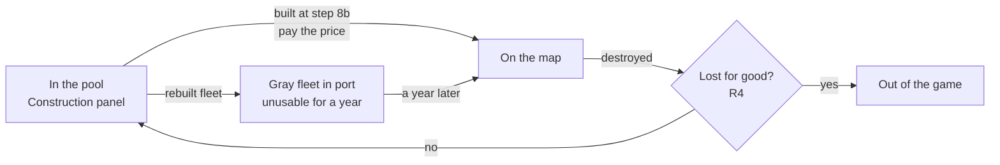
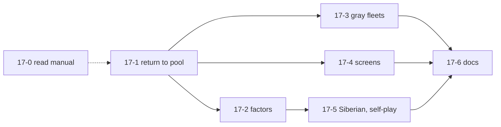

# 17. Lost units come back: eliminated units return to the Force Pool and can be rebuilt

Status: **approved by the owner on 2026-10-23 (Q1 to Q4 answered yes). Beta milestone, built after group 1 (spec 14). Tickets 17-1 to 17-6 are built (2026-10-23, see the "As built" sections at the end); 17-0 waits for network access to the manuals or for Frank.** Words only; the build plan is part G. Builds on spec 02 (construction), and touches spec 09 (airborne units that dropped), spec 12 (rebuilt "gray" fleets), spec 14 (conquered Powers, the Free Siberian Transfer) and spec 15 (Minor-Allies). The spec that spec 16 calls "a separate spec 17" (Strategic Warfare) will take the next free number.

## Decisions needed

**Answered by the owner on 2026-10-23: yes to Q1, Q2, Q3 and Q4.**

Four questions, each answerable with yes or no. My recommendation comes first; if you have no view, the recommendation stands.

| # | Question (yes or no) | Recommended | What changes if you say no |
|---|---|---|---|
| Q1 | From now on, does a **unit that is destroyed go back to its nation's pool, so it can be bought again** at the normal price? | Yes (it is the rule; you decided it for Beta) | Every loss stays for good, as today. Nations run out of units in long games, and the Free Siberian Transfer gives the Allies nothing in a 1939 game against the computer (V58). |
| Q2 | Should a lost unit simply **reappear in the Construction panel**, marked "rebuild", available at once (no "in or after" date), with the other builds? | Yes | The Construction panel gets a separate "Lost units" list. Same rules, more taps, one more thing for Frank to learn. |
| Q3 | Build the **"gray" fleet rule in Beta**: a fleet bought back after being sunk stays in port, unusable, for a year? | Yes | Rebuilt fleets are not offered at all until Release 1 (a sunk fleet stays lost until then). Offering them without the wait would break the rule in the buyer's favour. |
| Q4 | May the builders **start the main ticket (17-1) before anyone has re-read the manual's construction pages**, using the readings below and fixing them later if the text disagrees? | Yes | Nothing starts until ticket 17-0 has read the text. 17-0 needs the cloud environment to reach www.geocities.ws (see "Sources"), or Frank to check in the DOS game. |

## Summary (read this first)

- **Today** a destroyed unit is simply deleted. The Construction panel offers only what the scenario lists as "Allowable Builds", and once those are bought nothing is left (`src/engine/stacking.ts` says so in a comment; `construction.ts` uses each build up for good).
- **The rule** (Ref 11.6, 11.63; Ops 5.47b, as recorded by earlier sessions): a destroyed unit goes back to its nation's **Force Pool**, the stock of counters the nation may build from. It can be built again at the printed price, inside the spending limit, placed like any new unit.
- **Some losses are for good** (part A, R4): units of a conquered Major Power; units of a minor country that is not an active Minor-Ally; an airborne unit destroyed soon after it dropped; partial fleets; the fleets of Turkey, Spain, Vichy France, Sweden and the Free French; Italian naval factors Germany keeps after an Italian surrender; the French units eliminated when France falls.
- **One delay:** a rebuilt fleet is "gray", unusable for a year (Ref 11.62).
- **What Frank will see:** lost units show up again in the Construction panel with a "rebuild" mark; a gray fleet says until when it is out of action; the log says "returned to the pool" or "lost for good".
- **Knock-on effects:** the computer will spend money rebuilding (so less money is left unspent, which slows its growth at the Year Start); the Free Siberian Transfer now finds Russian units in a 1939 game; every fixed-seed game of the computer changes from the first loss on, on purpose.
- **Size:** 7 tickets, all Beta: 4 S, 3 M (part G). The smallest useful stop is after 17-1: units come back and can be rebuilt.
- **Rules check:** 14 new `TODO(verify)` rows, **RB1 to RB14**, in docs/TODO-VERIFY.md and docs/RULES.md. The ones that change most: which kinds of loss send a unit back (RB1), whether it can be bought back in the same turn (RB2), what happens to the factors an air unit or a fleet loses without being destroyed (RB4, RB5), and how long "a year" is for a gray fleet (RB6).

## Sources, and how they were read

- **The manuals could not be read for this spec.** The session that wrote it could not download the PC Reference Manual, the Operations Manual or the errata page: the cloud environment's network policy refused www.geocities.ws (and the board-game rulebook hosts). To change that, add www.geocities.ws under Allowed domains in the project's cloud environment settings (Project settings, Cloud environment, Add cloud environment, Network access).
- **What this spec relies on instead:** facts earlier sessions recorded in this repo after reading the PC Reference Manual, each with its Ref: spec 02 (construction, 11.6, 11.62, 11.64), spec 09 R6 and R13 (partial air units 11.61, 20.6; airdrops 23.1), spec 12 R1 and R5 (partial and gray fleets 11.62, 21.3), spec 14 R4 to R6 and R11 (conquest 16.0, 18.x, 35.0; the Siberian Transfer 11.63, Ops 5.47b; rows V10, V16, V58), spec 15 R8 (minor units 14.0, Minor-Allies 17.1, 17.3; row MC18), spec 16 R4 (Attrition losses go back to the pool, Ref 11.6) and docs/RULES.md (the printed 11.62 fleet list).
- Every detail those sessions did not record is a reading marked `TODO(verify)` (RB1 to RB14). **Ticket 17-0 reads Ref 11.5 to 11.64, 20.6, 21.3, 23.1, Ops 5.47 and the errata page** and settles or corrects them before the rules tickets close. The board-game rulebook is only a fallback, and would be said so.

## What exists today (facts from the repo, 2026-10-23)

| What | Where | Today |
|---|---|---|
| A nation's pools | `GameState.pools[owner]`: `forcePool` (counters set up at the start, all on the map after setup) and `allowableBuilds` (counters that may still be built, some with an "in or after" date) | The engine's `allowableBuilds` is what the manual calls the Force Pool (V58). |
| Building | `construction.ts`: `availableBuilds`, `legalBuilds`, `applyBuild` (step 8b) | Pays the chart price, uses the entry up, places the unit. A built fleet or air unit is "new" and does nothing in that Game Turn (Ref 20.3, 21.3). |
| Losses | combat (`attack-losses.ts`), air combat (`air-missions.ts`), overstack (`stacking.ts`), unsupplied units (`supply-effects.ts`, switched off for now), the sweep of air and fleets left alone (`conquest-stages.ts`), the fall of France (`conquest-france.ts`) | Every one deletes the unit. A conquest removes the Power's units and pools for good (`conquest-forces.ts`, V10). |
| Siberian Transfer | `siberian.ts` | Takes Russian infantry and armor from the Allowable Builds. Finds none in 1939 games of the computer (V58). |
| The computer | `src/ai/build.ts` | Builds whatever is on offer, in a fixed priority order. |

## The life of a counter

## Part A. The rules, one by one

### R1. A destroyed unit goes back to its pool (Ref 11.6, 11.63; Ops 5.47b) settled; RB1, RB3

- When a unit is destroyed it goes back to the Force Pool of **its own nation** (the nationality printed on the counter, not the Power that happens to control it), unless R4 says it is lost for good.
- It goes back **as it was when destroyed**: same type, same factors, same movement. It never creates a counter the nation did not have (RB13).
- It has **no "in or after" date**: its date has passed already (RB3).
- **Which losses count:** a battle, an Attrition loss (spec 16 R4 already says so, Ref 11.6), air combat, ground support lost because the hex was not attacked, the sweep of air units and fleets left alone in a hex, being unsupplied (Ref 11.74, 11.75), overstacking (Ref 5.0) and British units caught in Vichy territory. **Reading (RB1):** all of these alike; only R4 makes a loss permanent.

### R2. Buying it back (Ref 11.6, 11.61, 11.64; spec 02) settled; RB2, RB13

- A unit in the pool is bought exactly like a new one: the chart price per factor (a 9-factor fleet is 27 BRPs), inside the Player Turn's spending limit, at step 8b, placed in the nation's home territory by the placement rules already built (the U.S. in the U.S. Box, Ref 11.64).
- **Reading (RB2):** it can be bought at the next construction step after it was lost, even in the same Player Turn.
- **Reading (RB13):** no other limit: no cap per year on rebuilds, none beyond the money and the counters that exist.

### R3. Units that lose factors without being destroyed (Ref 11.61, 11.62, 20.6, 21.7) RB4, RB5

- **Air (RB4).** An air unit that loses factors breaks down to a smaller counter (spec 09 R6). A nation may never have more air factors than its Force Pool allows (Ref 20.6), and partial air units can be built (Ref 11.61). **Reading:** the lost factors go back to the pool as buildable air factors, offered in the counter sizes of spec 09 (`AIR_COUNTER_SIZES`).
- **Fleets (RB5).** Fleets are built only as whole 9-factor fleets, and partial fleets cannot be rebuilt (Ref 11.62; spec 12 R1). **Reading:** only a whole 9-factor fleet that is sunk goes back to the pool; a partial fleet that is sunk, and the factors a fleet loses when it breaks down, are lost for good.

### R4. Losses that are for good settled per the specs named; RB9 to RB11, RB14

| Who | Why | Source |
|---|---|---|
| Units of a conquered Major Power and of its active Minor-Allies | The Power leaves the game; its pools go too | Ref 16.0, 18.x; spec 14 R4, V10 (built) |
| Units of a minor country that is not an active Minor-Ally (Poland included) | Never come back | Ref 14.0; spec 15 R8 |
| An airborne unit destroyed before the end of the Game Turn after the one it dropped in | Gone for good | Ref 23.1; spec 09 R13 (drops are ticket 09-11, not built) |
| Partial fleets; fleets of Turkey, Spain, Vichy France, Sweden and the Free French | Never rebuilt, even as active Minor-Allies | Ref 11.62; spec 12 R1, docs/RULES.md |
| Italian naval factors Germany keeps after an Italian surrender | Never rebuilt | Ref 18.2; spec 14 R6, V16 |
| The French units eliminated when France falls (the half that does not become Vichy) | Eliminated for good | Ref 35.0; spec 14 R5, V13 (built) |
| A unit whose nation is out of the game or has no pool when it is destroyed | Nowhere to go back to | Reading, RB14 |

- **Active Minor-Allies (RB9; answers MC18).** Their losses go back to the minor's own pool and wait there; ticket 15-19 (Release 1) lets the Major Power rebuild them at its own cost, at home (Ref 17.1, 17.3). A loss while the minor is not active is for good.
- **Free French (RB10).** Their losses may be rebuilt in Britain (Ref 35.0; spec 14 R5). **Reading:** Britain pays and builds them as its own builds, in Britain; never their fleets (R4).
- **Vichy France (RB11).** An inactive German Minor-Ally. **Reading:** its ground and air losses go back to the Vichy pool and follow RB9; never its fleets.

### R5. The gray fleet (Ref 11.62, 21.3) RB6 to RB8

- A fleet **bought back from the pool** is "gray": it stands in its port and cannot be used for a year. **Reading (RB8):** a fleet built new from the scenario's Allowable Builds is not gray; it only waits out the Game Turn it is built in (Ref 21.3, already built).
- **Reading (RB6):** "a year" is four Game Turns: a fleet rebuilt in Fall 1940 can first act in Fall 1941.
- **Reading (RB7):** while gray it does nothing a fleet can do (supply, intercept, missions, escort, change base) but is on the map: it counts for the port's capacity and can be attacked and captured like any fleet.

### R6. The Free Siberian Transfer takes from the same pool (Ref 11.63; Ops 5.47a, 5.47b) settled; RB12

- The Transfer takes Russian infantry and armor from the Russian Force Pool (spec 14 R11). **Reading (RB12):** returned Russian infantry and armor count, like any other entry; nothing else in R11 changes. V58 is then answered as the manual has it: the pool takes back eliminated units.
- Effect: a 1939 game in which Russia has lost units by Winter 1941 and not yet rebuilt them now offers the Allies free units, and the first one taken switches the victory tables (spec 14 R2).

### R7. Saved games and recordings

- A game saved or recorded before this change still loads and replays: a pool with no returned units reads as "nothing was destroyed yet". New action types are not needed if returned units are offered through `BUILD` (decision Q2).

## Part B. What changes in the engine (behaviour only)

1. **Every loss is routed through one place** that decides, by R1 and R4, "back to the pool" or "lost for good", adds the counter to the right pool, and logs one event saying which (with the reason when it is for good).
2. **The pool** holds returned counters with no date and a mark that says they were returned, so the Construction panel can label them and R5 can tell a rebuilt fleet from a new one.
3. **Construction** offers returned counters like the others; buying a returned fleet makes it gray until the date of R5.
4. **Air factors** lost by a unit that survives go back to the pool as factors (RB4); fleets do not (RB5).
5. **The Siberian Transfer** reads the same pool as construction (no change to its code beyond what the pool returns).
6. **Conquest** keeps removing units and pools for good (V10); the routing of point 1 must not put a conquered Power's units back.

## Part C. Screens

- **Construction panel:** a returned counter shows a small "rebuild" mark on its chip; nothing else is new (Q2).
- **Hex card of a gray fleet:** "Rebuilt: cannot act until Fall 1941."
- **Log:** "German 4-6 armor destroyed at L33, back in the pool." / "Polish 1-2 infantry destroyed at J30, lost for good (minor country)."
- No new step and no new prompt.

## Part D. The computer opponent

- No new policy: it already builds whatever the Construction panel offers, in its priority order (`BUILD_PRIORITY`), so it rebuilds as soon as units come back. That spends BRPs it used to leave unspent, which lowers its Year Start growth; ticket 17-5 measures it.
- A gray fleet is never chosen for a fleet task while gray (the engine refuses it anyway).
- The computer's Siberian Transfer policy (take everything, ticket 14-19) is unchanged.

## Part E. Tests and verification

- **Unit tests** (each cites its rule; each gets a mutation check: break the rule, see a test fail, restore): a destroyed unit is offered again at the next step 8b with its own factors and no date, by every kind of loss of R1; every row of R4 is lost for good; R2's price and spending limit; R3's air factors and the fleet that breaks down; R5's gray fleet before and after the year, and a new fleet that is not gray; R6's Transfer taking a returned unit; R7 an old recording replays unchanged up to its end.
- **Fixed-seed hashes (`tests/ai-stability.test.ts`):** they **will change, on purpose and unavoidably**: the 1939 seeds 1, 2 and 5 over four Game Turns, very likely the 1942 seed 1 hash and the 7h list hash. The pull request lists each one and checks, as tickets 14-6 and 14-7 did, by comparing whole recorded games on the old and new engine, that the first action to differ is a `BUILD` of a returned counter (or comes right after one) and nothing before it differs. The supply snapshots (`tests/supply-snapshot.test.ts`) may change for the same reason and are checked the same way.
- **Self-play (ticket 17-5):** 10 games of the 1939 scenario and 4 of each other scenario run to the end without an anomaly; the report gives, per nation, units returned, rebuilt and lost for good, BRPs spent on rebuilds, and the Siberian units taken. No nation may end with more counters of a kind than its scenario lists (RB13).
- **Browser:** the "rebuild" mark is covered by the existing construction spec, run once by the 17-4 builder.

## Part F. Effect on other specs

- Spec 09 R13: the "dropped" record becomes used when 09-11 is built (R4 row 3).
- Spec 12: the gray fleet (out of scope there) is built here (R5).
- Spec 14: V58 is answered (R6); V10 unchanged.
- Spec 15: MC18 is answered (RB9); ticket 15-19 builds on this spec's pools.
- Spec 16: Attrition losses go back to the pool through this spec's routing.

## Part G. Build plan

All Beta. Difficulty easy, medium or hard; size S (under half a day), M (about a day), L (more); "Builder" is the tier of agent best suited, as CLAUDE.md assigns them: grunt (the cheap agent for work with no decision), standard (medium tickets) or senior (hard design).

| Ticket | What | Difficulty | Size | Builder | Needs |
|---|---|---|---|---|---|
| 17-0 | Read the manual pages of "Sources" and the errata; settle or correct RB1 to RB14 in this spec and the two lists (docs only) | medium | S | standard | Network access to www.geocities.ws, or Frank |
| 17-1 | The return to the pool: one routing for every loss (R1, R4), returned counters offered at step 8b (R2), log events, old recordings replay; the fixed-seed hashes and the check of Part E | hard | M | senior | Q1, Q2 (and Q4, or 17-0) |
| 17-2 | Air factors lost by a surviving unit go back to the pool; partial fleets and broken-down fleet factors do not (R3) | medium | S | standard | 17-1 |
| 17-3 | The gray fleet (R5): the mark, the year, the refusals; the hex card line | medium | M | standard | 17-1, Q3 |
| 17-4 | Screens: the "rebuild" mark on the Construction panel chip, the log lines | easy | S | standard | 17-1 |
| 17-5 | Siberian Transfer test with returned units (R6), self-play report lines and the run of Part E; the computer's growth checked | medium | M | standard | 17-1, 17-2 |
| 17-6 | Docs: "As built", RULES.md, TODO-VERIFY.md, PLAN.md rows | easy | S | grunt | last |

17-1 changes a shared engine type (the pools) and the fixed-seed hashes, so its review is the stronger one CLAUDE.md asks for large or engine-wide changes.

## Part H. Out of scope

- Building an active Minor-Ally's losses (ticket 15-19, Release 1); this spec only puts them in the pool.
- Lending Italian units to Germany and their return (V32, not built anywhere).
- The airdrop itself (ticket 09-11); this spec only says what a dropped unit's loss means.
- Any change to the price chart, the spending limit or the placement rules (spec 02; O6 stays open).
- Strategic Warfare (the spec spec 16 called "17", now the next free number).

## Part I. Rules references

Ref 5.0 (stacking), 11.6, 11.61, 11.62, 11.63, 11.64 (construction, air, fleets, the Siberian Transfer, placement), 11.74, 11.75 (unsupplied units), 14.0 (minor countries), 16.0 and 18.x (conquest of Major Powers), 17.1, 17.3 (Minor-Allies), 18.2 (Italy's surrender), 20.3, 20.6 (new and partial air units), 21.3, 21.7 (new fleets, partial fleets), 23.1 (airdrops), 35.0 (France, Vichy, Free French); Ops 5.47a, 5.47b. All as recorded in the specs named in "Sources", paraphrased, to be re-read by ticket 17-0.

## Part J. Open questions (also in docs/TODO-VERIFY.md and docs/RULES.md)

1. **RB1.** Every kind of loss in R1 sends a unit back alike; only R4 makes a loss permanent.
2. **RB2.** A lost unit can be bought back at the next step 8b, even in the Player Turn it was lost.
3. **RB3.** It goes back as it was, to its own nation's pool, with no "in or after" date.
4. **RB4.** Air factors lost by a unit that survives go back to the pool as factors, built in the sizes of spec 09.
5. **RB5.** Only a whole 9-factor fleet goes back; partial fleets and factors lost in a break-down are lost for good.
6. **RB6.** A gray fleet's "year" is four Game Turns.
7. **RB7.** A gray fleet does nothing but stands in port, counts for capacity and can be attacked or captured.
8. **RB8.** Only fleets bought back from the pool are gray; fleets from the scenario's Allowable Builds are not.
9. **RB9.** An active Minor-Ally's losses wait in its own pool (MC18); a loss while it is not active is for good.
10. **RB10.** Free French losses are rebuilt by Britain, at its cost, in Britain; never their fleets.
11. **RB11.** Vichy's ground and air losses go to the Vichy pool and follow RB9; never its fleets.
12. **RB12.** The Siberian Transfer takes returned Russian infantry and armor like any other entry.
13. **RB13.** No limit on rebuilding beyond money and the counters that exist; a nation never has more counters than its scenario lists.
14. **RB14.** A unit whose nation is out of the game, or has no pool, is lost for good.
15. **RB15** (added by ticket 17-1). Airbases and bridgeheads are counters no pool holds: one destroyed goes back to no pool.
16. **RB16** (added by ticket 17-1). A Free French counter Britain rebuilds stays Free French and is placed where Britain places its own builds.

For Frank, who knows the DOS game: after a battle, do your lost units show up again in the build screen that same turn? Does a rebuilt fleet look different, and for how long?

## Done when

1. A unit destroyed in any way of R1 is offered again in the Construction panel, with a "rebuild" mark, and can be bought at the chart price.
2. Every loss of R4 is gone for good, and the log says why.
3. A rebuilt fleet cannot act for a year and its hex card says until when.
4. The Siberian Transfer can take returned Russian units.
5. Old recordings replay; the changed fixed-seed hashes are listed and checked as in Part E; self-play shows no anomaly.
6. RB1 to RB14 are settled by ticket 17-0 or stay listed as open.

## As built (ticket 17-1: the return to the pool)

- **Files.** New engine modules: `src/engine/losses.ts` (`lossFate`, `routeLosses`, `eliminateUnits`, `WHOLE_FLEET_FACTORS`, `FLEETS_NEVER_REBUILT`) and `src/engine/old-records.ts` (`replayRecord`, `waitsOnlyForReturned`, for R7). Shared types: `ForceEntry.returned` (`types.ts`); the `BUILD` action gains `unit.returned` and `pool`, `UNIT_BUILT` gains `returned` and `pool`, and two events are new, `UNIT_RETURNED_TO_POOL` and `UNIT_LOST_FOR_GOOD` with a `LostReason` (`action-types.ts`). `construction.ts` gains `buildSources`. The loss sites call the routing: `attack-losses.ts` (battle, Exchange, the sweep of counters left alone), `air-missions.ts` (ground support not used), `supply-effects.ts` (unsupplied), `stacking.ts` (overstack), `naval-displace.ts` (a fleet with no port), `conquest-forces.ts` (`sweepPassed`: the sweep of the land a conquest passed, at the fall and when a kept hex passes on later, ticket 14-25) and `conquest-france.ts` (British units in Vichy territory). The screens only carry the new marks through (`ui/buildView.ts`, `sessionActions.ts`, `mapSync.ts`, `session.ts`, `logSide.ts`, `e2eLoad.ts`); the "rebuild" mark and the log lines are ticket 17-4. Tests: `tests/losses.test.ts` (29).
- **One routing (part B 1).** Each loss is routed when the unit leaves the map, so a unit lost when step 7h ends is offered at the 8b the same action reaches (RB2). Its routing event comes right after its own UNIT_ELIMINATED (or OVERSTACK_ELIMINATED, or FLEET_DISPLACED to nowhere). The units of a conquered country are not routed: `removeUnits` (conquest-forces.ts) still takes them and their pools away for good (V10, part B 6), so a counter that came back to a Power's pool before it falls goes with the pool.
- **R4 as built** (`lossFate`, in this order): the counter's nation (its nationality, else its owner) is out of the game ("out-of-game", RB14; this covers a conquered Power's counters held by an ally, and the Italian naval factors Germany holds once Italy is out, V16); a minor owner that is not an active Minor-Ally, Vichy France or the Free French ("minor-country", RB9: Poland); an airbase or bridgehead ("not-in-pool", RB15); a fleet of Turkey, Spain, Vichy France, Sweden or the Free French ("fleet-never-rebuilt", Ref 11.62); a fleet under 9 factors ("partial-fleet", RB5); no pool left ("out-of-game", RB14). Otherwise the counter goes back to the pool of its nationality as an Allowable Builds entry marked `returned`, with its type, factors and movement and no date (RB3); counters of one kind add to one entry. The airborne row of R4 waits for ticket 09-11, which records drops.
- **R2 as built.** `legalBuilds` offers a returned counter as its own `BUILD` (`unit.returned: true`), apart from the scenario's counter of the same kind, in the same places, at the chart price and inside the spending limit; a `BUILD` without the mark never takes a returned counter and one with it never takes a scenario counter (this keeps old records legal and gives ticket 17-3 the fleet to make gray). Active Minor-Allies' and Vichy losses wait in their own pools (no Major Power builds them until ticket 15-19). Britain builds the returned Free French counters (`pool: "free-france"`, RB10): Britain pays, the counter stays Free French and stands where Britain places its builds (RB16). The computer is unchanged (part D): returned infantry come before the armor of the scenario in its priority list, so a German returned 3-3 infantry is often its first rebuild.
- **R6.** `siberianPool` reads the same pool, so returned Russian infantry and armor are taken; where a returned and a scenario counter of one kind are both there the scenario's (first) entry is taken.
- **R7: old records.** A record made before this ticket replays with `replayRecord`: its actions stay legal, but the game can now wait at 8a or 8b for returned counters alone where the old engine passed the step; that step is ended for the record (END_STEP) and nothing else changes. The browser tests' fixtures load through it (`ui/e2eLoad.ts`), and `tests/losses.test.ts` replays all seven of them to their end (surrender-build needs it). A game saved before this ticket has no `returned` entries and loads as "nothing was destroyed yet".
- **What it does to the computer's games** (Part E check: `npm run compare-games` from PR #128, run on this branch against main 3803bd1, and again after merging main 2329ec6 with the same first differences, results and totals). All 22 standard games differ and no game has a new anomaly; in every one the first action to differ is a `BUILD` of a returned counter (a French 1-factor replacement in 1939 seed 1, a German 3-3 infantry in most 1939 games, German or Russian builds in 1942 and 1944), and nothing before it differs. In those 22 games 1,807 lost units went back to a pool, 120 were lost for good (Polish units, partial fleets) and 1,464 were rebuilt. Every 1939 and Campaign game now uses the Free Siberian Transfer (V58 answered as RB12 reads it) and so the Transfer victory tables; the winner or the level of victory changes in 8 of the 22 games (7 of the ten 1939 games, 1942 seed 2). **No computer game now reaches Russia's offer to surrender** (1939 seeds 1 to 70, Campaign 1 to 12, 1942 1 to 12; before, 4 of the 22): the computer's Russia rebuilds its losses at once and never falls under the offer's threshold. The whole-game tests of the offer (`tests/surrender-play.test.ts`, the surrender row of `tests/prompts-play.test.ts`) now play with a computer that never builds nor takes a Russian loss again (`withoutRussianRebuilds`, legal choices), which reaches the offer in 1939 seeds 1, 3, 5, 7, 8 and 12. Ticket 17-5 measures the effect on growth and balance.
- **Fixed-seed hashes and snapshots** (`tests/ai-stability.test.ts`, `tests/supply-snapshot.test.ts`): all changed on purpose; each is listed with its old value and the check in the test file. Other whole-game tests that pinned a game's course were moved to the game that still shows what they test: the winter question with the Allies waiting is 1939 seed 2 (seed 1 now has 18 Axis units in Russia), the idle-Axis test reads whether France fell before the Axis Player Turn of Fall 1940 (seed 5 now loses France in that Game Turn's first, Allied, Player Turn), and the Siberian whole games expect the returned units they now take.
- **Seams left.** 17-2: the factors an air unit loses without being destroyed are not returned (no air combat losses are applied to the map yet); 17-3: a `BUILD` with `unit.returned` of a fleet is where the gray mark goes; 17-4: the two new events carry what the log lines need (unit, place, pool or reason) and the `BUILD` mark is what the chip needs; 15-19: `buildSources` is where a Major Power gets its active Minor-Allies' pools.

## As built (ticket 17-2: air factors)

- **Files.** `src/engine/losses.ts` (`airCounterParts`, `routeLostAirFactors`), `src/engine/air-breakdown.ts` (`applyAirBreakDown`), `tests/air-breakdown.test.ts`. A surviving air unit that loses factors gives them back to its nation's pool as counters of the spec 09 sizes, largest first (4 factors become a 3 and a 1). The constant is `AIR_COMBAT_RULES.counterSizes` in `air-combat.ts`, not `AIR_COUNTER_SIZES` as R3 names it. A loss under an R4 case is lost for good, with one event for all the factors (RB4, RB17). Fleets never come here: a fleet's factors lost in a break-down stay lost (RB5). **Not wired yet:** `applyAirBreakDown` has no caller; nothing applies a partial air loss in play until the air combat tickets (spec 09) call it, so no recorded game changes.

## As built (ticket 17-3: gray fleets)

- **Files.** `src/engine/naval-record.ts` (`markGray`, `grayUntil`, `fleetMayAct`, `grayProblem`), `src/engine/construction.ts` (`applyBuild` marks a fleet gray only when its entry is `returned`), `src/engine/types.ts` (`GameState.grayFleets`, absent in an older save), `src/engine/naval-supply.ts` and `naval-supply-options.ts` (sea supply is refused for a gray fleet), `src/ui/hexCard.ts` (the line "Rebuilt: cannot act until Fall 1941."), `tests/gray-fleet.test.ts`. A gray fleet is out of action until four Game Turns after its build (RB6); it stays on the map (RB7); a fleet from the scenario's Allowable Builds is not gray (RB8). **Not wired yet:** `fleetMayAct` has no caller. The fleet missions, intercept, escort and change of base (tickets 12-5, 12-6 and 12-8) must check `grayUntil` or `fleetMayAct`, or a gray fleet could act in them.

## As built (ticket 17-4: screens)

- **Files.** `src/ui/buildView.ts` (the "rebuild" mark on the Construction chip's caption), `src/ui/lossText.ts` (`lossLine` for a counter back in the pool or lost for good, `builtLine` for a build or a rebuild), `src/ui/session.ts` (`describeEvent` logs them; a loss already logged by its own elimination line is not logged twice), `tests/loss-text.test.ts`. The engine is unchanged and no prompt is new (Part C). The hex card line for a gray fleet is ticket 17-3's.

## As built (ticket 17-5: Siberian test and self-play report; PR #161)

- **Files.** `tests/siberian-returned.test.ts` (the Free Siberian Transfer takes returned Russian units, R6, RB12), `scripts/selfplay/rebuild.ts` (the per-nation counts of units returned, rebuilt, lost for good by reason, BRPs spent on rebuilds and Siberian units taken, and the BRPs unspent at each Year Start; `auditCounters`, the RB13 check that reports a `counter-excess` anomaly when a nation holds more counters of a kind than its scenario lists, counted from the position play began), `scripts/selfplay/report.ts` (the "Lost units and rebuilds" section), `scripts/selfplay/runner.ts` and `types.ts`, `tests/selfplay-rebuild.test.ts`, and `scripts/make-e2e-fixture.ts` (the fixture script, fixed for spec 17).
